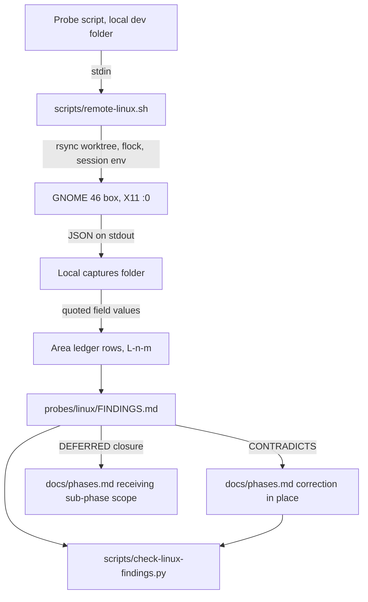

# Linux Platform Exploration and Findings Ledger (Sub-phase 3.0) - Plan

## Goal Capsule

- **Objective:** every later Linux sub-phase plans against measured AT-SPI2, D-Bus, X11 and Wayland behaviour on a real GNOME desktop, and `docs/phases.md` no longer states anything about Linux that the measurements disprove.
- **Means:** raw Python probes run on the GNOME dev box through `scripts/remote-linux.sh`, kept outside the repository; the repository receives only the conclusions as a findings ledger plus in-place corrections to `docs/phases.md` (KTD1, KTD2).
- **Authority:** `docs/phases.md` §3.0 is the product contract, amended by R1–R4 below where the owner changed it on 2026-10-18. The ledger cites what was measured; `docs/phases.md` states what is true.
- **Stop conditions:** stop and report if the box cannot host a graphical AT-SPI session, or if a probe would need root, a reboot, or a change to the shared user session that cannot be undone.
- **Execution profile:** probe authoring runs in parallel by area; probe execution is serialized by the box lock in `scripts/remote-linux.sh`.
- **Finishes and ships:** the orchestrating session assembles the ledger, applies the `docs/phases.md` corrections, and opens the PR into `feat/linux-adapter`.

---

## Product Contract

### Summary

Build the Linux evidence base that sub-phases 3.1–3.15 implement against. Probe scripts exercise trees, interfaces, interactions, input, hit-testing, events, identity, capture, clipboard, lifecycle, shell surfaces and sandboxing on Ubuntu 24.04 GNOME 46. A committed ledger records each observation with a verdict against `docs/phases.md`, and every contradiction is corrected in that document in the same PR.

### Problem Frame

`docs/phases.md` §Phase 3 was written from documentation in one pass. Windows showed that platform reality overturns a large share of such claims: the Windows 2.0 corpus amended the roadmap in many places before any adapter code existed. Linux adds fragmentation that Windows does not have, namely X11 against Wayland, GTK3 against GTK4 against Electron, and per-desktop shell services. A sub-phase that plans on an unmeasured claim builds the wrong thing.

### Requirements

**Evidence and its location**

- R1. Probe scripts and raw captures live in a local development folder outside the repository and are never committed. Nothing under `crates/`, `src/` or `tests/` reads probe or capture data.
- R2. The repository receives `probes/linux/FINDINGS.md`: one row per observation, conclusions only, no raw dumps, and no identity of the box (user name, home path, host name, Tailscale address, machine id).
- R3. Every ledger row uses an `L<n>-<m>` id, the eight-column shape of `probes/windows/FINDINGS.md`, and one verdict from CONFIRMS, CONTRADICTS, NEW-EDGE or DEFERRED.
- R4. A DEFERRED row names why it was not measured (`needs: <prerequisite>`) and the sub-phase that closes it (`closure: 3.<n>`). No row is left without a verdict.

**Coverage** (each area named by §3.0 gets at least one row)

- R5. Tree: full dumps of GNOME Files, Terminal, Text Editor, Calculator, Settings, one Electron app (VS Code) and one Chromium browser, with node counts, depth, cycle behaviour and read cost.
- R6. Interfaces: a census per role of Action, Text, EditableText, Value, Selection, Component, Table and Hyperlink support, plus StateSet and attribute keys.
- R7. Identity: `accessible-id` coverage across GTK3, GTK4, Electron, Firefox and Qt, and whether a value survives an app restart.
- R8. Interactions: DoAction by index and by name, text read, caret, selection and insert, value set, child selection and focus, each checked for whether it needs focus, steals focus or moves the pointer.
- R9. Input: xdotool on X11, AT-SPI device event generation, ydotool, and the Wayland input path that exists without root.
- R10. Hit-testing: `Component.GetAccessibleAtPoint`, `Contains` and extents in screen and window coordinates, including an occluded and a zero-size target.
- R11. Events: which `org.a11y.atspi.Event.*` signals fire for focus, value, children, state and window changes, in what order and how fast, and what registration they need.
- R12. Windows, apps and displays: app and window enumeration, the focused window, pid and window identity, stacking order, and display geometry and scale.
- R13. Capture and clipboard: portal screenshot consent, X11 capture without the portal, and clipboard ownership on X11 and Wayland.
- R14. Lifecycle: launch and attach behaviour for single-instance GApplications, close and termination verification, and window operations on X11 and Wayland.
- R15. Shell surfaces: notification listing, dismissal and actions, the tray (StatusNotifierWatcher), and the GNOME Shell panel and dock as AT-SPI trees.
- R16. Sandbox and bus bootstrap: a sandboxed app's tree with and without bus access, and AT-SPI behaviour when the a11y bus is cold or absent.

**Feedback into the roadmap**

- R17. Every CONTRADICTS row has a matching in-place correction in `docs/phases.md` in the same PR, written as the true statement and citing the row id.
- R18. `docs/phases.md` §3.0, the Phase 3 sub-phase DoD evidence line and §3.12 are rewritten to match R1, R2 and KD2.
- R19. Every DEFERRED row's closure is written into the receiving sub-phase's scope in `docs/phases.md`.

### Key Decisions

- KD1. **Probes and captures stay outside the repository; only the ledger is committed.** (session-settled: user-directed — chosen over committing the probe corpus as Windows did, and over committing nothing at all: probes and fixtures are development aids that must not pollute the project or feed tests.) Governs R1, R2, R18.
- KD2. **The live e2e gate drives real GNOME apps; no fixture app is built.** (session-settled: user-directed — chosen over the §3.12 GTK4 fixture app and over a minimal fixture for edge cases: real apps are the verification target.) Governs R18. The 3.0 probes record which edge cases (delayed enable, zero bounds, duplicate titles, occlusion, disclosure) real GNOME apps present, so §3.12 can name its real targets.
- KD3. **Every command on the box runs through `scripts/remote-linux.sh`.** (session-settled: user-directed — chosen over raw ssh: the box is shared, and the user asked for one secure, audited path.)
- KD4. **The PR targets `feat/linux-adapter`, stacked with `gh stack`.** (session-settled: user-directed — chosen over a PR against `main`: the integration-branch rule and the user's instruction.)

### Scope Boundaries

- No Rust and no change under `crates/` or `src/`.
- No change to the shared box beyond `~/ad-wt/`, `~/ad-target/` and `~/.local/ad-tools/`. No root, no reboot, no `gsettings` change that outlives the probe that made it.
- Not built: a CI workflow that runs probes. KD1 keeps the probes out of the repository, so there is nothing for a workflow to run. Whether `ubuntu-latest` can host AT-SPI under `xvfb-run` and `dbus-run-session` is a CI-lane question that 3.1 measures when it builds the Linux test lane; U15 writes that item into §3.1.
- Not built: tests for the ledger gate beyond one invert check during this PR. The gate is a short shape-and-citation check; a corrupted ledger fails it visibly in the next sub-phase that cites a row.

---

## Planning Contract

### Key Technical Decisions

- KTD1. **Probes read the bus two ways and say which.** The product stack is `atspi` + `zbus`, which speaks raw D-Bus with no client cache. Probes therefore use Gio D-Bus calls (`Gio.DBusConnection.call_sync` against the a11y bus address) for every timing row and every row a Rust implementation depends on, and may use `gi.repository.Atspi` for convenience reads. libatspi caches and batches, so a GI timing says nothing about zbus cost. The ledger's `stack` column records `dbus`, `gi-atspi` or `tool`; on disagreement the `dbus` row wins. This replaces §3.0's python-dbus and pyatspi2 wording, which is a correction under R17.
- KTD2. **Captures come back over stdout.** A probe is a single Python file run as `scripts/remote-linux.sh python3 - <args> < probe.py`, which prints JSON that the caller redirects into the local captures folder. Nothing is written on the box, so the next sync cannot delete it, and nothing reaches the repository.
- KTD3. **Measurement discipline follows `docs/solutions/`.** Timings report the minimum of seven runs after a discarded warm-up, with median and max (one-measurement-is-not-a-measurement). Waits use an event or a polled state with a deadline, never a fixed sleep (a-fixed-sleep-is-not-a-synchronization-primitive). Every probe records the absolute path and version of each tool it measures (a-path-resolved-tool-is-not-the-tool-you-measured). Empty-but-successful answers (a child count of 0, an empty name, extents of 0 or -1, a pid of 0) are reported apart from errors (a-zero-success-value-is-not-the-answer-you-asked-for). A behavioural claim is measured in its failing and its passing direction.
- KTD4. **Probes act only on what they launched.** A probe launches its own target app, records its pid, acts on that process only, and closes it in a `finally` block. It never kills by name, never types into a window it has not verified is its own target, and releases every held key and button on exit. The user's own running apps, including Google Chrome and AnyDesk, are read-only.
- KTD5. **Wayland evidence comes from a nested or headless `gnome-shell --wayland` when it runs without root.** The box login is X11 by design (`docs/solutions/best-practices/remote-dev-boxes-over-tailscale.md`). If neither mode starts, every Wayland row is DEFERRED with `needs: Wayland login session` and closes in the sub-phase that owns the capability (3.8 input, 3.10 capture and clipboard).
- KTD6. **Missing tools come from user-space package extraction.** xdotool, xclip, wl-clipboard, wmctrl and pyatspi are unpacked with `apt-get download` and `dpkg -x` into `~/.local/ad-tools`, sourced through its `env.sh`. ydotool needs `/dev/uinput`, and flatpak needs a system install; both are root-only on this box, so their rows are DEFERRED with that cause. The snap-confined Firefox is measured as the available sandboxed app.
- KTD7. **The ledger gate is one stdlib Python script.** `scripts/check-linux-findings.py` checks the eight-cell shape, unique ids, the verdict and stack vocabularies, the `needs:` and `closure:` fields on DEFERRED rows, that every `L<n>-<m>` cited in `docs/phases.md` exists in the ledger, and that the ledger carries no box identity. Identity is checked two ways so the gate never embeds what it guards: in CI by patterns (`/home/<name>` paths, the Tailscale range 100.64.0.0/10, `*.ts.net` names, 32-hex machine ids), and locally also against literal tokens read from the untracked `AGENT_DESKTOP_BOX_IDENTITY` variable. With `--sub-phase 3.<n>` it lists the rows whose action names that sub-phase, which each later sub-phase uses at close (the cross-cutting DoD's ledger-disposal rule). The `L` prefix keeps these ids out of the Windows `A<n>-<m>` citation gate.
- KTD8. **The dogfood gate does not apply to 3.0.** The cross-cutting DoD's dogfood drives a shipped surface with the shipped skill; 3.0 ships neither a binary change nor a skill. The probes themselves are the confrontation with real software.

### High-Level Technical Design

### Assumptions

- The local development folder is `agent-desktop-probes/linux/` beside the repository checkout, with `captures/` inside it; it is a local git repository for history and has no remote.
- Area numbers are fixed in the Unit Index below so parallel authors cannot collide on row ids.
- The box-preparation task already running supplies `~/.local/ad-tools/env.sh`, a VS Code install and the Wayland feasibility answer before U5, U6 and U13 execute.

### Sequencing

U1 runs first. U2 and U4–U13 are authored in parallel; U3 and U14 start once U2's walker exists; U9, U11 and U5 run their Wayland halves after U13 proves a session. Each runs on the box when it takes the lock. U15 starts when every area has returned its rows.

---

## Implementation Units

| U-ID | Title | Primary files | Depends on |
|---|---|---|---|
| U1 | Environment, tools and bus bootstrap | local `00-environment.py`, `01-bus-bootstrap.py` | — |
| U2 | Tree dumps and read cost | local `02-tree.py` | U1 |
| U3 | Interface, state and identity census | local `03-census.py` | U2 |
| U4 | Raw interactions | local `04-interactions.py` | U1 |
| U5 | Input synthesis | local `05-input.py` | U1, U13 (Wayland half) |
| U6 | Hit-testing, extents and occlusion | local `06-hittest.py` | U1 |
| U7 | Event signals | local `07-events.py` | U1 |
| U8 | Windows, apps and displays | local `08-windows.py` | U1 |
| U9 | Capture and clipboard | local `09-capture-clipboard.py` | U1, U13 (Wayland half) |
| U10 | Shell surfaces, notifications and tray | local `10-shell.py` | U1 |
| U11 | Process and window lifecycle | local `11-lifecycle.py` | U1, U13 (Wayland half) |
| U12 | Sandboxed app access | local `12-sandbox.py` | U1 |
| U13 | Wayland session evidence | local `13-wayland.py` | U1 |
| U14 | Edge-case targets in real apps | local `14-edge-targets.py` | U2 |
| U15 | Ledger, gate and roadmap corrections | `probes/linux/FINDINGS.md`, `scripts/check-linux-findings.py`, `docs/phases.md` | U2–U14 |

"local" means the development folder from the Assumptions, never the repository (R1).

### U1. Environment, tools and bus bootstrap

- **Goal:** record the measured environment every other row depends on, and how AT-SPI behaves when its bus is cold or missing.
- **Requirements:** R16, R4.
- **Dependencies:** none.
- **Files:** local `00-environment.py`, `01-bus-bootstrap.py`, `captures/00-environment.json`, `captures/01-bus-bootstrap.json`.
- **Approach:**
  1. Record OS, kernel, GNOME Shell, AT-SPI core and GTK versions, session type, the a11y bus address from `org.a11y.Bus.GetAddress`, the `IsEnabled` and `ScreenReaderEnabled` properties, `toolkit-accessibility`, and the path and version of every tool in KTD6.
  2. In a private `dbus-run-session` (never the shared session bus), measure: a fresh session with no a11y bus, whether `org.a11y.Bus` activates on first call, the latency to a usable registry, and what a GTK4 app exposes when it starts before and after the bus exists.
- **Patterns to follow:** `probes/windows/00-environment.ps1` for the environment record.
- **Test expectation:** none -- probe output is evidence, judged in U15.
- **Verification:** the captures name every tool by absolute path and version, and the cold-bus capture shows the failing case and the passing case.

### U2. Tree dumps and read cost

- **Goal:** know what real Linux trees look like and what reading them costs over raw D-Bus.
- **Requirements:** R5.
- **Dependencies:** U1.
- **Files:** local `02-tree.py`, `captures/02-tree-<app>.json`.
- **Approach:**
  1. Dump GNOME Files, Terminal, Text Editor, Calculator, Settings, VS Code and the user's running Google Chrome (read-only) with role, role name, name, description, states, interfaces, attributes, `AccessibleId`, child count, extents and relations per node.
  2. Track an ancestor-path set to detect cycles, and record depth, node count and any node whose child count disagrees with `GetChildren`.
  3. Time a full walk three ways over Gio D-Bus: sequential property gets, concurrent property gets (async `Gio.DBusConnection.call` under one main loop, which is what concurrent zbus calls do; `call_sync` cannot measure concurrency), and `org.a11y.atspi.Cache.GetItems` where the app exposes it. §3.2 assumes AT-SPI has no batch read; this measurement decides that claim.
  4. Record the Chromium and Electron tree before and after accessibility activation, and whether `ACCESSIBILITY_ENABLED=1` or the a11y bus alone activates it.
- **Test expectation:** none -- evidence.
- **Verification:** each app has a capture with timing per KTD3 and a cycle verdict.

### U3. Interface, state and identity census

- **Goal:** know which roles carry which interfaces, states and stable identifiers.
- **Requirements:** R6, R7.
- **Dependencies:** U2 (reuses its walker).
- **Files:** local `03-census.py`, `captures/03-census.json`.
- **Approach:**
  1. Over the U2 apps plus Firefox and one Qt app (PyQt6 in a venv under `~/.local/ad-tools`, launched with `QT_ACCESSIBILITY=1`; if it cannot be installed, a DEFERRED row with `needs: Qt toolkit install`), count per role the interfaces present, the states seen, the action names, and the attribute keys.
  2. Report `AccessibleId` and toolkit id attributes (`id`, `gtk-id`, Qt `objectName` equivalents) as tri-state: present, absent-answered, read-failed.
  3. Restart two apps and compare identifiers to measure stability.
- **Test expectation:** none -- evidence.
- **Verification:** the capture has a role-by-interface matrix and an identity coverage table per toolkit.

### U4. Raw interactions

- **Goal:** know which semantic actions work headless and what side effects they have.
- **Requirements:** R8.
- **Dependencies:** U1.
- **Files:** local `04-interactions.py`, `captures/04-interactions.json`.
- **Approach:**
  1. On probe-launched Text Editor, Calculator, Settings and Files: DoAction by index and by name for every advertised action, text read, caret set, selection add and remove, `EditableText.InsertText` and `SetTextContents`, `Value.CurrentValue` set, `Selection.SelectChild`, and `Component.GrabFocus`.
  2. For each, record the return value, the observed effect read back independently, whether the target window gained focus, whether the active window changed, and whether the pointer moved.
- **Test expectation:** none -- evidence.
- **Verification:** each action has a returned-versus-observed pair, so a call that answers success with no effect is visible.

### U5. Input synthesis

- **Goal:** know which input paths reach which apps on X11 and on Wayland without root.
- **Requirements:** R9.
- **Dependencies:** U1; U13 for the Wayland half.
- **Files:** local `05-input.py`, `captures/05-input.json`.
- **Approach:**
  1. Into a probe-launched Text Editor whose window is verified active: xdotool key, chord, type (including non-ASCII and long strings), mouse move, click, wheel and drag; then the same through `Atspi.generate_keyboard_event` and `generate_mouse_event`. Read every effect back through AT-SPI.
  2. Record whether each path needs the target focused, whether it can address a background window, and the pointer position before and after.
  3. ydotool is DEFERRED per KTD6 unless `/dev/uinput` becomes accessible; on Wayland, measure what reaches a nested-session app and whether the RemoteDesktop portal or libei is reachable.
- **Execution note:** release every key and button in `finally`; confirm the active window is the probe's own before any keystroke (KTD4).
- **Test expectation:** none -- evidence.
- **Verification:** each path has a measured effect, and a path that cannot run has a DEFERRED cause.

### U6. Hit-testing, extents and occlusion

- **Goal:** know whether AT-SPI can answer "what is under this point" honestly, including when a window covers the target.
- **Requirements:** R10.
- **Dependencies:** U1.
- **Files:** local `06-hittest.py`, `captures/06-hittest.json`.
- **Approach:**
  1. Compare `GetExtents` in screen and window coordinates against the X11 window geometry.
  2. Call `GetAccessibleAtPoint` and `Contains` on visible targets, on a target covered by a second probe-launched window, and on zero-size and offscreen nodes.
  3. Read X11 stacking order (`_NET_CLIENT_LIST_STACKING`) as the occlusion source AT-SPI may lack.
- **Test expectation:** none -- evidence.
- **Verification:** the occluded case and the visible case both have captures.

### U7. Event signals

- **Goal:** know which AT-SPI events fire, when, and what a listener must register.
- **Requirements:** R11.
- **Dependencies:** U1.
- **Files:** local `07-events.py`, `captures/07-events.json`.
- **Approach:**
  1. Listen on the a11y bus with match rules, with and without `org.a11y.atspi.Registry.RegisterEvent`, for focus, `StateChanged`, `PropertyChange`, `ChildrenChanged`, `TextChanged` and `Window:Create`, `Destroy` and `Activate`.
  2. Cause each change with a probe-launched app and record arrival, order and latency (min of seven per KTD3).
- **Test expectation:** none -- evidence.
- **Verification:** each event kind is listed as fired or not, with the registration it needed.

### U8. Windows, apps and displays

- **Goal:** know how to enumerate apps and windows, find focus, and map windows to processes and displays.
- **Requirements:** R12.
- **Dependencies:** U1.
- **Files:** local `08-windows.py`, `captures/08-windows.json`.
- **Approach:**
  1. Enumerate registry apps and their frame and dialog children, `Application` interface ids, and pids from `GetConnectionUnixProcessID`.
  2. Find the focused window through the `active` state and compare it with X11 `_NET_ACTIVE_WINDOW`.
  3. Measure whether any AT-SPI field carries an X11 window id or a stable window identity, and how two windows with the same title differ.
  4. Read display geometry and scale from `xrandr` and from Mutter's `org.gnome.Mutter.DisplayConfig`.
- **Test expectation:** none -- evidence.
- **Verification:** the capture maps each probe-launched window to a pid and an X11 window.

### U9. Capture and clipboard

- **Goal:** know the lowest-permission capture path and how clipboard ownership behaves.
- **Requirements:** R13.
- **Dependencies:** U1.
- **Dependencies note:** the wl-clipboard step runs in the U13 session.
- **Files:** local `09-capture-clipboard.py`, `captures/09-capture-clipboard.json`.
- **Approach:**
  1. Call `org.freedesktop.portal.Screenshot` non-interactive and interactive, and record whether GNOME 46 shows a dialog, remembers a grant, or refuses. Record whether `org.gnome.Shell.Screenshot` is callable from an unlisted client.
  2. Capture the root window and one app window on X11 without the portal, and record whether a covered window captures its own content.
  3. Set and read text, image and file-URI clipboard content with xclip and wl-clipboard, and measure whether the content survives the setting process exiting.
- **Test expectation:** none -- evidence.
- **Verification:** each path records a success or refusal, and a consent dialog is observed through AT-SPI rather than assumed.

### U10. Shell surfaces, notifications and tray

- **Goal:** know what GNOME exposes for notifications, the tray, the top panel and the dock.
- **Requirements:** R15.
- **Dependencies:** U1.
- **Files:** local `10-shell.py`, `captures/10-shell.json`.
- **Approach:**
  1. Call `org.freedesktop.Notifications.GetServerInformation`, post a probe notification with an action, and measure whether any D-Bus method lists notifications; §3.14 claims `org.gnome.Shell.Notifications.GetNotifications()`, which this measurement decides.
  2. Find the posted notification in the gnome-shell AT-SPI tree, then dismiss it and invoke its action through AT-SPI and through `CloseNotification`.
  3. Read `org.kde.StatusNotifierWatcher` registered items and the Ubuntu AppIndicator extension state, and dump the gnome-shell panel and dock subtrees.
- **Test expectation:** none -- evidence.
- **Verification:** every probe notification is closed at the end, and each claim in §3.14 has a row.

### U11. Process and window lifecycle

- **Goal:** know how launch, attach, close and window operations behave on GNOME.
- **Requirements:** R14.
- **Dependencies:** U1.
- **Dependencies note:** the Wayland window-operation step runs in the U13 session.
- **Files:** local `11-lifecycle.py`, `captures/11-lifecycle.json`.
- **Approach:**
  1. Launch by desktop id (`gio launch`, `gtk-launch`) and by command, and measure whether a single-instance GApplication hands the launch to an existing process so the spawned pid exits.
  2. Close by `SIGTERM`, by a window close action, and by `SIGKILL`, and verify termination by a follow-up liveness probe.
  3. Exercise move, resize, minimize, maximize and restore on X11 through xdotool and wmctrl, and record what Wayland allows.
  4. Read `/proc/<pid>/stat` for a stopped (`SIGSTOP`) probe-launched app to test the hung-detection claim.
- **Test expectation:** none -- evidence.
- **Verification:** every launch and close outcome is read back, not assumed from an exit code.

### U12. Sandboxed app access

- **Goal:** know what a confined app exposes and what an agent sees when bus access is missing.
- **Requirements:** R16.
- **Dependencies:** U1.
- **Files:** local `12-sandbox.py`, `captures/12-sandbox.json`.
- **Approach:**
  1. Dump the snap-confined Firefox tree and record its `a11y` plug state.
  2. Measure the without-access case without root: inside a private `dbus-run-session`, launch a probe-owned GTK4 app with `AT_SPI_BUS_ADDRESS` pointing at a socket that does not exist, and with no a11y bus at all, then record what the app logs, whether it blocks, and what the registry shows.
  3. Disconnecting the snap `a11y` plug needs root, so that row is DEFERRED with `needs: root to run snap disconnect`. Flatpak rows are DEFERRED per KTD6 with `needs: flatpak system install`.
- **Test expectation:** none -- evidence.
- **Verification:** both halves of R16, with and without bus access, have a measured row or a DEFERRED row with its cause.

### U13. Wayland session evidence

- **Goal:** know which tree, extents, input and capture behaviour changes under Wayland.
- **Requirements:** R5, R9, R10, R13, R14 (their Wayland halves).
- **Dependencies:** U1 and the box-preparation result.
- **Files:** local `13-wayland.py`, `captures/13-wayland.json`.
- **Approach:** in the nested or headless `gnome-shell --wayland` the box-preparation task proved, launch Text Editor with `GDK_BACKEND=wayland`, then repeat the tree, extents, `GetAccessibleAtPoint`, clipboard and portal reads. If no mode starts, write DEFERRED rows per KTD5.
- **Test expectation:** none -- evidence.
- **Verification:** each Wayland row is measured or DEFERRED with its cause.

### U14. Edge-case targets in real apps

- **Goal:** find real GNOME controls that present the edge cases the e2e gate must cover (KD2).
- **Requirements:** R18.
- **Dependencies:** U2.
- **Files:** local `14-edge-targets.py`, `captures/14-edge-targets.json`.
- **Approach:** search the U2 apps for a control that becomes enabled after an input, a zero-size node, two siblings with the same name and role, a disclosure or expander, a scrollable list with offscreen items, and a dialog that can cover its parent. Record the app, the path and how to reach each.
- **Test expectation:** none -- evidence.
- **Verification:** each edge case has a named real target or a row that says no real app shows it.

### U15. Ledger, gate and roadmap corrections

- **Goal:** turn the captures into the committed ledger and a `docs/phases.md` that matches them.
- **Requirements:** R2, R3, R4, R17, R18, R19.
- **Dependencies:** U2–U14.
- **Files:** `probes/linux/FINDINGS.md`, `scripts/check-linux-findings.py`, `docs/phases.md`, `.github/workflows/ci.yml` (one step in the `fmt` job).
- **Approach:**
  1. Assemble area tables in Unit Index order. Each row quotes the capture field it rests on, written with the capture open.
  2. Write a CONTRADICTS index mapping each row to its `docs/phases.md` hunk, then make each correction in place.
  3. Rewrite §3.0, the Phase 3 DoD evidence line and §3.12 per R18, and write each DEFERRED closure into its receiving sub-phase per R19.
  4. Add the gate (KTD7) as a `python3 scripts/check-linux-findings.py` step in the existing `fmt` job of `.github/workflows/ci.yml`, which already runs on `ubuntu-latest` with Python.
- **Patterns to follow:** `probes/windows/FINDINGS.md` (row shape, verdicts, closure field).
- **Test scenarios:**
  - The gate passes on the finished ledger and `docs/phases.md`.
  - Invert check, run once and recorded in the PR: a row with seven cells, a duplicate id, a DEFERRED row with no `closure:`, an `L` id cited in `docs/phases.md` but absent from the ledger, and the box user name pasted into a row (with `AGENT_DESKTOP_BOX_IDENTITY` set) each make the gate fail.
  - `--sub-phase 3.4` lists exactly the rows whose action names 3.4.
- **Verification:** the gate passes in CI, and a reader of `docs/phases.md` §3.x finds no statement a ledger row contradicts.

---

## Verification Contract

| Check | Command or method | Proves |
|---|---|---|
| Ledger gate | `python3 scripts/check-linux-findings.py` | R2, R3, R4, R17 citation integrity |
| Ledger disposal list | `python3 scripts/check-linux-findings.py --sub-phase 3.<n>` | rows each later sub-phase must close |
| Gate invert check | the U15 scenarios, run once | the gate can fail |
| No repository pollution | `git diff --stat feat/linux-adapter` shows no file outside `probes/linux/FINDINGS.md`, `scripts/`, `docs/`, `.github/workflows/ci.yml` | R1 |
| Core isolation | `cargo tree -p agent-desktop-core` | unchanged; no crate code touched |
| Existing gates | the `.githooks/pre-commit` checks and the full CI run on the PR | nothing regressed |

## Definition of Done

- Every area in the Unit Index has at least one ledger row, and no row lacks a verdict.
- Every CONTRADICTS row has its in-place correction in `docs/phases.md`, and every DEFERRED row has its closure written into the receiving sub-phase.
- `docs/phases.md` §3.0, the Phase 3 DoD evidence line and §3.12 match KD1 and KD2.
- The ledger carries no box identity, and no probe script or capture is in the repository.
- Every probe-launched process is closed and every probe notification dismissed; the box is left as it was found.
- Abandoned probe attempts are deleted from the development folder rather than left beside the final scripts.
- CI is green on the PR into `feat/linux-adapter`.

## Risks & Dependencies

| Risk | Mitigation |
|---|---|
| A probe types or clicks into the user's own session apps | KTD4: verify the active window is the probe's own before input, act only on recorded pids |
| Nested Wayland does not run in the VMware guest | KTD5: DEFERRED rows with the cause, closed by the owning sub-phase |
| Box lock contention slows the run | authoring stays parallel; only execution waits |
| A GI read hides zbus cost | KTD1: timing rows use the `dbus` stack only |

## Sources & Research

- `probes/windows/FINDINGS.md` — row shape, verdict vocabulary, DEFERRED closure field.
- `docs/plans/2026-07-25-001-feat-windows-platform-exploration-probes-plan.md` — the Windows 2.0 plan this mirrors.
- `scripts/check-phases-ledger-citations.ps1` — matches only `A<n>-<m>`, so Linux uses `L<n>-<m>` (KTD7).
- `docs/solutions/best-practices/remote-dev-boxes-over-tailscale.md` — why the box login is X11 (KTD5).
- `docs/solutions/` measurement learnings cited in KTD3.
