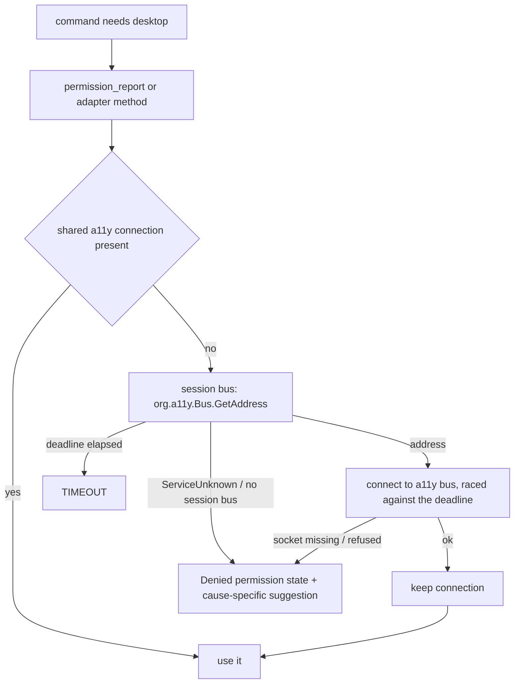

# Linux Toolchain, CI and Bus Bootstrap (Sub-phase 3.1) - Plan

## Goal Capsule

- **Objective:** an agent that runs agent-desktop on a Linux desktop gets a truthful answer about whether accessibility works there, with instructions it can act on when it does not, and every Linux change from here on is held to the same CI gates as macOS and Windows.
- **Means:** a synchronous D-Bus connection through `zbus::blocking` that detects the AT-SPI bus on first use and is shared for the process, a Linux permission report built on it, and a Linux CI lane with lint, full tests, isolation, size and a real AT-SPI smoke (KTD1–KTD5).
- **Authority:** `docs/phases.md` §3.1 is the contract, corrected in this PR where 3.0 evidence and the dependency research disproved it (R9). The probe rows `L1-5`, `L1-9`, `L12-2`–`L12-7` settle bus behaviour.
- **Stop conditions:** stop if `zbus` 5.19 cannot build at the 1.89 toolchain on Linux, or if `cargo deny` rejects the graph for a reason other than the three documented unmaintained advisories.
- **Execution profile:** U1 first; U2 and U4 in parallel after it; U3 after U2; U5 last.
- **Finishes and ships:** the orchestrating session runs the box verification, commits, and opens the PR stacked on `feat/linux-3.0-probes`.

---

## Product Contract

### Summary

Add the D-Bus dependency, detect the AT-SPI bus correctly, report Linux permissions from that detection, give the adapter a session that owns its connection, and turn the Linux CI job into a real gate. Every command that Linux does not implement yet keeps returning `PLATFORM_NOT_SUPPORTED`.

### Problem Frame

Today the Linux adapter is an empty stub: it reports accessibility as `Unknown`, the Linux CI job runs only library tests, and nothing checks lint, the binary crate, core isolation or binary size on Linux. 3.0 measured that the documented detection method (check that `org.a11y.Bus` has an owner) reports a healthy cold session as missing, and that a missing service answers `ServiceUnknown`. Every later sub-phase reads the tree over this connection, so it has to be right first.

### Requirements

**Dependency and isolation**

- R1. `crates/linux` depends on `zbus` at an exact version; no `tokio`, `async-std` or `smol` enters the workspace, and zbus's default `async-io` backend is accepted (KTD1).
- R2. `agent-desktop-core` gains no dependency, no Linux name and no `#[cfg]` branch; `cargo tree -p agent-desktop-core` lists no platform crate and no D-Bus crate.
- R3. `cargo deny` passes; the three zbus 5 unmaintained advisories are ignored by id with a written reason and the condition that removes the ignore.

**Bus detection**

- R4. The adapter finds the AT-SPI bus by calling `org.a11y.Bus.GetAddress` on the session bus, which activates the service when it is cold, then connects to the returned address.
- R5. A missing session bus, a missing or unstartable `org.a11y.Bus` service, and an unreachable a11y socket each produce a bus error with a `platform_detail` naming the D-Bus error and a suggestion chosen from the classified fault (L12-2, L12-3): no session bus means run inside a desktop session; `ServiceUnknown`/`NameHasNoOwner` means install `at-spi2-core` (with the Flatpak `--talk-name=org.a11y.Bus` override and the snap `desktop-legacy`/`unity7` interfaces); `Spawn.*` means the launcher is installed but cannot start; a missing or refusing a11y socket means restart `at-spi-dbus-bus.service` or log out and back in. The GNOME `toolkit-accessibility` setting is not offered for any of them: with it false detection still succeeds (L1-16).
- R6. A bus call that outlives the command deadline returns `TIMEOUT`, not a hang.
- R7. Detection succeeds at most once per process and runs only for commands that need it; a failed detection is retried by the next call (KTD3). Commands that never touch the desktop (for example `version`) open no D-Bus connection.

**Reporting and session**

- R8. `permission_report` returns `accessibility: Granted` when the a11y bus answers, `screen_recording: Unknown` until capture lands, and `automation: NotRequired`; when the bus is missing it returns a successful report with `accessibility: Denied` carrying the R5 suggestion for the detected fault. Timeouts and unexpected bus errors remain errors.
- R9. `docs/phases.md` states what 3.0 and the dependency research measured: no `tokio` in Phase 3 (zbus blocking API), detection by `GetAddress` on first use, the snap guidance, and verification by real runs. `tokio` is introduced by Phase 4 instead.
- R10. `open_session` returns a Linux session that holds the shared a11y connection and releases it on `close`; it holds no element handles.

**CI**

- R11. The Linux CI lane runs clippy with `-D warnings`, the full test suites of core, linux, the binary crate and the FFI crate, the core isolation check, and the 15 MiB release size check.
- R12. A Linux CI job runs the built binary inside a real D-Bus + Xvfb + AT-SPI session and fails unless `status` reports accessibility granted; the same job runs it with no session bus and fails unless `status` and `permissions` succeed reporting accessibility `denied` with the session-bus suggestion, and a ref command answers `PERM_DENIED` carrying that suggestion.

### Key Decisions

- KD1. **Core stays platform-neutral.** (session-settled: user-directed — chosen over adding Linux helpers or `#[cfg]` branches to core: core is the shared surface for every platform.) Governs R2.
- KD2. **Verification is by real runs, not mocks; only tests that can fail for a real reason.** (session-settled: user-directed — chosen over broad unit suites and mocked D-Bus responses: the owner wants real-world verification and no low-value tests.) Governs R12, R9. The §3.1 exit criterion "unit-tested against mocked D-Bus responses" is rewritten to the real-run checks (R9).
- KD3. **All box access goes through `scripts/remote-linux.sh`.** (session-settled: user-directed — chosen over raw ssh: shared box, one audited path.)
- KD4. **The PR stacks on `feat/linux-3.0-probes`; nothing merges to `main`.** (session-settled: user-directed — chosen over a PR against `main`: integration-branch rule.)

### Scope Boundaries

- No tree reading, no AT-SPI proxies and no `atspi` crate; 3.2 decides typed proxies when it reads trees.
- No change to what any command does on macOS or Windows.
- Not built: caching a failed detection. A cold bus activates on the first call and succeeds on the next, so a failure is retried on the next command rather than remembered.
- Not built: a mock D-Bus server for tests (KD2).
- Not built: reading `org.a11y.Status.IsEnabled` to tailor the suggestion. The suggestion is chosen from the classified D-Bus fault (KTD6); `IsEnabled` adds a call and a failure mode and does not change detection (L1-16).

---

## Planning Contract

### Key Technical Decisions

- KTD1. **`zbus =5.19.0`, default features, `zbus::blocking` only; no `tokio`, no `atspi`.** zbus 5's default `async-io` backend runs the blocking API with no runtime thread pool; the `tokio` feature would start a hidden multi-thread runtime inside zbus (`.claude` dependency research, scratch crates a–f). zbus 6.0.0 has no blocking API and `atspi` 0.30 requires zbus ^5.5. All transitive licences are on the `deny.toml` allow-list. Exact pin per the supply-chain policy.
- KTD2. **The dependency is unconditional in `crates/linux`.** zbus compiles on macOS, so macOS hosts keep checking and linting the real Linux code, which the pre-commit hook already includes in the macOS package set. Only the binary and FFI crates gate the Linux crate by target, as today. No non-Linux stubs are written.
- KTD3. **Detect on first use and share one connection per process.** The adapter holds a lazily filled slot for the a11y connection behind a mutex; the first method that needs the bus connects, a success is kept, a failure is returned and not kept (Scope Boundaries). This replaces §3.1's "detection at adapter construction", which would make every command, including `version`, pay a D-Bus round trip.
- KTD4. **Deadline-bounded calls.** Every bus wait (session connect, `GetAddress`, the a11y handshake, the registry read) is raced against the caller's remaining deadline by `within`, so a wait never outlives the caller's deadline and an elapsed deadline maps to `TIMEOUT`. The kept a11y connection is built with the standard operation timeout (`DEFAULT_OPERATION_TIMEOUT_MS`) only as the per-call ceiling for later callers of the shared connection. The shared slot is not locked across a connect, so a short-deadline caller never waits behind another caller's connect; a failure is not stored and a connection-level failure on a call drops the cached connection so the next call reconnects.
- KTD5. **Error classification is one pure function over `zbus::Error`.** `Error::MethodError` whose name is `org.freedesktop.DBus.Error.ServiceUnknown` or `NameHasNoOwner` maps to `PLATFORM_NOT_SUPPORTED` with the install-`at-spi2-core` suggestion, and a `Spawn.*` name to the cannot-start suggestion. `Error::InputOutput` of kind `NotFound` or `ConnectionRefused`, and `Error::Address`, map to `PLATFORM_NOT_SUPPORTED` with the session-bus suggestion when raised while resolving the session bus and with the restart-the-bus-daemon suggestion when raised on the a11y address; zbus falls back to `$XDG_RUNTIME_DIR/bus` when `DBUS_SESSION_BUS_ADDRESS` is unset, so a missing session bus surfaces as this socket error, not as a missing variable. `TimedOut` and an elapsed deadline map to `TIMEOUT`. Anything else maps to `INTERNAL` with the error text in `platform_detail`. This function is the one place with branching logic, so it carries the one unit test.
- KTD6. **The suggestion is chosen from the classified fault, and the fault is reported as a permission state.** Four faults exist (`crates/linux/src/system/bus_fault.rs`): no session bus (run inside a desktop session), service absent (install `at-spi2-core`; Flatpak `--talk-name=org.a11y.Bus`; snap `desktop-legacy`/`unity7`), launcher cannot start (read `systemctl --user status at-spi-dbus-bus.service`), and a11y socket gone (`systemctl --user restart at-spi-dbus-bus.service` or log out and back in). The bus error carries explicit non-retryable evidence (`retryable: false`). `permission_report` converts any of these into `PermissionState::Denied` carrying the same suggestion, so `status` and `permissions` succeed and report the condition, and every command that needs accessibility fails with `PERM_DENIED` and that suggestion, exactly as on macOS. A timeout or an unexpected bus error stays an error. `acquire_interaction_lease` uses core's shared Unix lease, as macOS does, so `permissions --request` returns the current report: Linux has no permission prompt.
- KTD7. **The CI smoke uses the runner's own packages.** The smoke job installs `at-spi2-core`, `dbus-x11` and `xvfb` with apt on `ubuntu-latest`, starts `dbus-run-session -- xvfb-run -a`, and runs the release binary. Its no-bus run sets `DBUS_SESSION_BUS_ADDRESS=unix:path=/nonexistent` and points `XDG_RUNTIME_DIR` at an empty directory, because zbus otherwise falls back to `$XDG_RUNTIME_DIR/bus`. If the runner cannot host the a11y bus, that is measured in the job log and the job's assertion is reduced to the no-bus case with the reason written into §3.1 (R9).
- KTD8. **Layout follows the shared platform layout.** `system/bus.rs` (connection and detection), `system/permissions.rs`, `system/session.rs`, and `system/adapter.rs` for the `SystemOps` impl, mirroring `crates/windows/src/system/`.

### High-Level Technical Design

### Assumptions

- `zbus::blocking::connection::Builder` exposes `session`, `address` and `method_timeout` at 5.19.0, and D-Bus error names surface as `zbus::Error::MethodError(name, ..)` (confirmed against the 5.19.0 source by document review).
- The binary-crate and FFI test suites compile on Linux; tests that need an `ok` permission report pass once they run inside the real session of U4 step 1. Any test that assumes macOS behaviour is fixed in place or gated by platform where it tests platform-only behaviour.

### Sequencing

U1 → (U2, U4 in parallel) → U3 → U5.

---

## Implementation Units

### U1. D-Bus dependency and supply chain

- **Goal:** the Linux crate can use zbus and the supply-chain gates still pass.
- **Requirements:** R1, R2, R3.
- **Dependencies:** none.
- **Files:** `crates/linux/Cargo.toml`, `Cargo.lock`, `deny.toml`.
- **Approach:** add `zbus = "=5.19.0"` to `crates/linux` dependencies (KTD1, KTD2). Add `[advisories] ignore` entries for RUSTSEC-2026-0370, RUSTSEC-2026-0371 and RUSTSEC-2026-0372, each with a reason naming zbus 5.19 as the only version `atspi` and the blocking API allow and the condition that removes the entry (moving to zbus 6).
- **Test expectation:** none -- dependency change; proved by `cargo deny` and the isolation check.
- **Verification:** `cargo tree -p agent-desktop-core` is unchanged; `cargo deny check` passes; `cargo +1.89.0 check -p agent-desktop-linux` passes on the box.

### U2. Bus connection and detection

- **Goal:** the adapter connects to the AT-SPI bus correctly or says exactly why it cannot.
- **Requirements:** R4, R5, R6, R7.
- **Dependencies:** U1.
- **Files:** `crates/linux/src/system/bus.rs`, `crates/linux/src/system/bus_tests.rs`, `crates/linux/src/system/mod.rs`, `crates/linux/src/adapter.rs`.
- **Approach:**
  1. Build the session-bus connection with `zbus::blocking::connection::Builder::session()` and `within` the caller's deadline, call `GetAddress` under the same `within`, then build the a11y connection with `Builder::address(..)` and the standard timeout as its per-call ceiling (KTD4).
  2. Classify failures with one pure function (KTD5) and the per-fault suggestion (KTD6).
  3. Store the connection in a lazily filled, mutex-guarded slot on `LinuxAdapter` (KTD3).
- **Patterns to follow:** `crates/windows/src/system/permissions.rs` (`ensure_budget`, error shape with suggestion and `platform_detail`); `crates/windows/src/system/hresult.rs` for detail formatting.
- **Test scenarios:**
  - A timeout (`InputOutput` `TimedOut`, and an elapsed deadline) maps to `TIMEOUT`.
  - An unrecognised `MethodError` maps to `INTERNAL` with its name in `platform_detail`.
  - The `ServiceUnknown` and missing-session-bus mappings are proved by the real runs in U4 and U5, not by this test.
- **Verification:** the classification test passes; the box runs in U5 show each real condition.

### U3. Permission report and session

- **Goal:** `status` and `permissions` report Linux truthfully, and callers can hold the connection across commands.
- **Requirements:** R8, R10.
- **Dependencies:** U2.
- **Files:** `crates/linux/src/system/permissions.rs`, `crates/linux/src/system/session.rs`, `crates/linux/src/system/adapter.rs`, `crates/linux/src/adapter.rs`.
- **Approach:** move the `SystemOps` impl into `system/adapter.rs` (KTD8); `permission_report` uses the U2 connection; `open_session` returns a session holding a clone of the shared connection handle. Keep the existing `snapshot_surfaces_fail_closed_until_linux_implements_them` test as it is: surfaces stay unimplemented.
- **Patterns to follow:** `crates/windows/src/system/session.rs`, `crates/windows/src/system/adapter.rs`.
- **Test expectation:** none -- thin wiring over U2; proved by U5's real runs of `status` and by the U4 smoke job.
- **Verification:** `agent-desktop status` on the box reports `accessibility: granted`.

### U4. Linux CI lane

- **Goal:** Linux changes face the same gates as macOS and Windows, including one real AT-SPI session.
- **Requirements:** R11, R12.
- **Dependencies:** U1.
- **Files:** `.github/workflows/ci.yml`.
- **Approach:**
  1. Extend `test-linux`: install `at-spi2-core`, `dbus-x11` and `xvfb`; clippy `-D warnings` over core, linux, agent-desktop and ffi; full `cargo test` over the same set through `scripts/cargo-test-isolated-home.sh`, run inside `dbus-run-session -- xvfb-run -a` so tests that spawn the binary (for example `status_reports_state_root_env_value_verbatim` in `src/tests/cli_process.rs`) get a granted report from a real bus — no test assertion is weakened or branched by platform; the core isolation check (pattern adds `zbus`, `zvariant`, `async-io`, `tokio`); release build with the 15 MiB check.
  2. Add a Linux AT-SPI smoke job per KTD7 that asserts the R12 pass and fail directions on the binary's JSON.
- **Patterns to follow:** the `test-windows` job's isolation and size steps; the macOS job's clippy and isolation steps.
- **Test expectation:** none -- CI configuration; proved by the PR's own CI run, including a deliberate local check that the smoke assertion fails when accessibility is not granted.
- **Verification:** every new step is green on the PR; the smoke job log shows the granted and the missing-bus answers.

### U5. Roadmap corrections and box verification

- **Goal:** `docs/phases.md` says what is true, and the real box confirms the behaviour.
- **Requirements:** R9, and the real-run proof of R4–R8.
- **Dependencies:** U2, U3, U4.
- **Files:** `docs/phases.md`.
- **Approach:**
  1. Rewrite §3.1 (scope bullets on dependencies, `tokio`, detection timing, the exit criterion's test method), the AT-SPI2 Bus Detection list (GetAddress, snap guidance), the Phase 3 New Dependencies table and text, the Phase 4 New Dependencies note that `tokio` enters "no later than Phase 3", and the Dependency Introduction Schedule row for `tokio`.
  2. On the box through `scripts/remote-linux.sh`, run the release binary's `status` in four conditions and record the JSON in the PR: the live GNOME session (granted); a private `dbus-run-session` whose config has no service directories (no a11y service → accessibility `denied`); no session bus (`DBUS_SESSION_BUS_ADDRESS=unix:path=/nonexistent` and `XDG_RUNTIME_DIR` set to an empty temp dir → accessibility `denied`); and a private session whose own `at-spi-bus-launcher` is stopped with `SIGSTOP` (→ `TIMEOUT` within the deadline, R6). Every private session uses its own `XDG_RUNTIME_DIR`.
  3. Close ledger row `L1-16`: in a private session with `GSETTINGS_BACKEND=memory` and `toolkit-accessibility` set to false there, launch a probe-owned GTK4 app and record whether it registers on the a11y bus and what `status` answers, so the claim that the GNOME setting is not the fix for a missing bus (KTD6) is measured in both directions; correct §3.1's GNOME hint to the result.
- **Test expectation:** none -- documentation and manual real-run verification.
- **Verification:** the three answers match R8 and R5; the 3.0 ledger gate passes on the corrected `docs/phases.md`.

---

## Verification Contract

| Check | Command or method | Proves |
|---|---|---|
| Lint | `cargo clippy -p agent-desktop-core -p agent-desktop-linux -p agent-desktop -p agent-desktop-ffi --all-targets -- -D warnings` on the box and in CI | code quality gate |
| Tests | `scripts/cargo-test-isolated-home.sh test --locked -p agent-desktop-core -p agent-desktop-linux -p agent-desktop -p agent-desktop-ffi` on the box and in CI | U2 classification test, no regression |
| MSRV | `cargo +1.89.0 check --locked -p agent-desktop-core -p agent-desktop-linux -p agent-desktop --all-targets` (existing job) | R1 at the pinned toolchain |
| Isolation | `cargo tree -p agent-desktop-core` with the extended pattern | R2 |
| Supply chain | `cargo deny check` (existing workflow) | R3 |
| Size | release `agent-desktop` ≤ 15 MiB on Linux | R11 |
| Real AT-SPI | CI smoke job + the three box runs in U5 | R4–R8, R12 |
| Ledger | `python3 scripts/check-linux-findings.py` and `--sub-phase 3.1` | R9 citations stay valid; rows assigned to 3.1 are disposed |
| Rust source rules | `scripts/check-rust-file-size.sh`, `scripts/check-no-phase-references.sh` | 400-line cap, no plan ids in source |

## Definition of Done

- Every row of the Verification Contract passes, in CI and on the box where named.
- `status` on the GNOME box answers granted; the failure conditions answer `status` and `permissions` ok with accessibility `denied` and a cause-specific suggestion, and a ref command answers `PERM_DENIED` with that suggestion.
- `crates/core` diff is empty.
- `docs/phases.md` contains no claim that `tokio` is required in Phase 3, and §3.1 describes detection as implemented.
- `python3 scripts/check-linux-findings.py --sub-phase 3.1` lists no row this sub-phase leaves undisposed.
- No experimental or abandoned code remains in the diff.
- The stranger dogfood report `docs/dogfood-reports/2026-10-18-001-feat-linux-3-1-toolchain-bus-dogfood.md` is committed with a disposition for every finding.

## Risks & Dependencies

| Risk | Mitigation |
|---|---|
| `ubuntu-latest` cannot host the a11y bus | KTD7: measured in the job; reduce to the no-bus assertion with the reason in §3.1 |
| Binary or FFI tests assume macOS | U4 measures; fix in place or gate the platform-only test |
| zbus 5 advisories become errors elsewhere | R3: documented ignores with the removal condition |
| zero MSRV headroom: `uuid` in the zbus graph already needs 1.89 | the existing MSRV job catches a lockfile bump that raises it; pin back or raise the toolchain then |

## Sources & Research

- `.claude` dependency dossier for 3.1 (zbus/atspi/tokio versions, features, licences, sizes, advisories) — evidence summarised in KTD1.
- `probes/linux/FINDINGS.md` rows `L1-5` (owner check fails cold), `L1-9` (empty registry is success), `L1-10` (`IsEnabled`), `L12-2`–`L12-3` (snap interfaces), `L12-4`–`L12-7` (dead and missing buses).
- `crates/windows/src/system/permissions.rs`, `session.rs`, `adapter.rs` — patterns.
- `src/main.rs` `execute_with_adapter` — a `permission_report` error becomes the pre-dispatch envelope with its suggestion; a `Denied` report instead reaches `command_policy::preflight`, which validates arguments first and then refuses accessibility-gated commands with `PERM_DENIED`.
