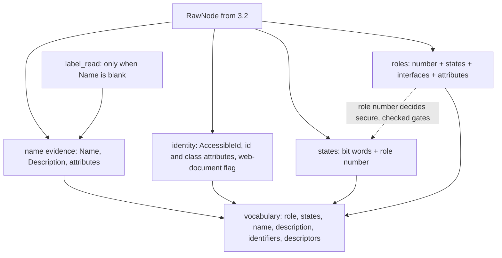

# Linux Vocabulary - Role, State, Identity, Name Evidence (Sub-phase 3.3) - Plan

## Goal Capsule

- **Objective:** what the Linux adapter will report about any element of a real GNOME or Electron app means the same thing an agent already reads on macOS and Windows: a control is the role it is, is disabled only when it is, and carries the best name and developer id the toolkit offers.
- **Means:** pure mapping functions over the raw node 3.2 reads (role number, state bit words, interface and attribute strings), producing core's own role, state, name-evidence and identifier types, with every unknown read kept unknown (KTD1–KTD8).
- **Authority:** `docs/phases.md` §3.3 as corrected by 3.0 and 3.1 (rows `L1-12`, `L2-16`, `L3-1`–`L3-15`, `L3-17`), and further corrected here where the ledger disproves it (R14).
- **Stop conditions:** stop if a ledger-backed mapping cannot be expressed in core's existing `Role`, state vocabulary, `NameEvidence` or `IdentifierKind` without changing `crates/core`.
- **Execution profile:** U1 first (it settles three branches); U2, U3, U4, U5 in any order after it; U6 after U2–U5; U7 after U6; U8 after U1 and U6.
- **Finishes and ships:** the orchestrating session runs the box measurements and live verification, commits, and opens the PR stacked on `feat/linux-3.2-tree-walk`.

---

## Product Contract

### Summary

Add the vocabulary layer of the Linux adapter: one function turns a raw node into the canonical role, state tokens, name and description, placeholder, developer id, DOM id and classes, and descriptors. Nothing user-visible changes yet; observation wiring is 3.4.

### Problem Frame

3.2 reads each node's role number, state bits, name, description, attributes and interfaces, but nothing says what they mean. 3.0 measured the traps. GTK4 never sets the `ENABLED` state, so reading it alone disables every GTK4 control (`L3-6`). `GetRoleName` is a toolkit-local vocabulary where GTK4 answers `generic`, `switch` and `search` (`L3-2`). `AccessibleId` is empty on GTK3, GTK4, Chromium and Gecko and carries the objectName chain only on Qt (`L2-16`, `L3-8`, `L3-9`). GTK `Description` is a tooltip and Qt's is a placeholder (`L3-12`). The 130-value role enum is mostly unseen on this box (`L3-1`). A mapping that copies the macOS or Windows habit without these facts mislabels most of the Linux tree.

### Requirements

**Role**

- R1. Every AT-SPI role number from 0 to 129 maps to a canonical role and any larger number maps to unknown; the map is keyed on the number, never on `GetRoleName` (`L3-1`, `L3-2`).
- R2. A role that depends on another field (state set, interface list, attributes) falls back to the unrefined role when that field's read failed, and never claims the refinement.
- R3. A node whose role read failed has an unknown role field, distinct from the canonical `unknown` role.

**State**

- R4. State tokens come from the state bit words by positive claims only; `disabled` is claimed only on a successful state read with neither `ENABLED` nor `SENSITIVE` set (`L3-6`), and a failed read yields an unknown state field, not an empty list.
- R5. `checked`, `indeterminate` and `pressed` are emitted only for roles that can carry them, `secure` from the password role, and `invalid` from `INVALID_ENTRY`, not from the object-invalid bit.
- R6. `offscreen` is emitted from the state set only if U1's measurement shows it never marks an on-screen node on any measured toolkit; otherwise it is unproduced and §3.6 owns it. `hidden` is unproduced.

**Name, identity, descriptors**

- R7. Name evidence fills `native_title` from `Name`, `labelled_by_text` from the `LabelledBy` target only when `Name` is blank, `description` from `Description` where it is a description, and `placeholder` from its per-toolkit source; the other slots are suppressed; a failed read makes its slot uncertain, so the resolved name is unknown rather than absent (`L3-12`, `L3-14`, `L3-15`).
- R8. `native_id` is `AccessibleId` where non-blank (Qt in practice), keeping the full dotted value, and treating a value whose last segment looks like a Qt class name as non-identifying (`L3-9`); the DOM `id` and `class` attributes feed the DOM id and `dom_classes` only for nodes inside a web document (`L3-11`).
- R9. A node with no identifier is answered-absent; a node whose identifier read failed is unknown.
- R10. `subrole` comes from the first `xml-roles` token on web content and, on GTK, only from the one matched pair in KTD8; `role_description` comes from the `roledescription` attribute, and from `GetLocalizedRoleName` only if U1 shows it differs from `GetRoleName` under a non-English locale (`L3-4`, `L3-26`).

**Verification and roadmap**

- R11. The mapping modules take plain numbers, bit words and strings, so their tests run on every host and CI lane.
- R12. A live test on the GNOME box resolves the vocabulary of Files, Terminal, Calculator, Qt and VS Code with zero failed reads (VS Code within the walk deadline once its tree has settled) and checks the facts the ledger established (GTK4 controls are enabled, the GTK4 window is a window, Qt ids and placeholders resolve).
- R13. Every ledger row naming 3.3 is disposed of, and the two `DEFERRED` rows (`L3-25`, `L3-26`) are closed by real-app measurement or recorded as accepted with the reason.
- R14. `docs/phases.md` states what was built and no longer states what the ledger disproved.
- R15. `crates/core` is unchanged.

### Key Decisions

- KD1. **Core stays platform-neutral.** (session-settled: user-directed — chosen over Linux helpers, variants or `#[cfg]` in core: core is the shared surface.) Governs R15: core's `Role`, `STATE_VOCABULARY`, `NameEvidence` and `IdentifierKind` are used as they are.
- KD2. **Tests fail for a real reason, and real runs outrank suites.** (session-settled: user-directed — chosen over fixture-driven or broad unit suites: probe scripts and captures are never read by tests and never committed.) Governs R11, R12.
- KD3. **All box access goes through `scripts/remote-linux.sh`, never `sudo`, and any second session uses a private `XDG_RUNTIME_DIR`.** (session-settled: user-directed — chosen over raw ssh.)
- KD4. **The PR stacks on `feat/linux-3.2-tree-walk`; nothing merges to `main`.** (session-settled: user-directed — chosen over a PR against `main`.)
- KD5. **Role is keyed on the numeric AT-SPI role; `enabled` is `ENABLED` or `SENSITIVE`; only positive state claims; a failed read is unknown.** (session-settled: user-directed — chosen over keying on `GetRoleName`, which GTK4 fills with ARIA strings: `L3-2`, `L3-6`.) Governs R1–R5.
- KD6. **A `docs/phases.md` statement the ledger disproves is corrected in place in this PR, as its own unit, citing the row id.** (session-settled: user-directed — chosen over leaving it for the next sub-phase's planner.) Governs R14.

### Scope Boundaries

- No `observe_tree` wiring, no snapshot, no value or text content reads, no live state reads for the actionability gate (3.4, 3.5, 3.6).
- No change to `RawNode` (it already holds the seven-field maximum); a new per-node read lands in `NodeTraits` or a new sub-struct.
- Considered and not built:
  - `AtspiObjectPath` as identifier evidence. The handle already carries bus name and path, the path is a runtime id and not a stable selector, and Windows emits no runtime id either; evidence that would change the call is a 3.4 resolver that needs a within-session fast path.
  - `hidden`. No clean source: `VISIBLE` absent over-counts and Chromium's `hidden` is an attribute (`L3-13`); Windows produces none.
  - Name-slot sources `explicit_label`, `static_value`, `child_label`. `Name` is already the toolkit's computed name, and a child-label read would need child reads outside the raw node; evidence that would change the call is a toolkit whose `Name` is empty where a child names the control.
  - Application-level `ToolkitName` for toolkit detection. Per-node attributes already separate GTK (`toolkit` key), web (`tag`, `xml-roles`) and Qt (none) (`L3-13`).
  - A GTK4 fixture app. Real apps are the only measurement targets (KD2).

---

## Planning Contract

### Key Technical Decisions

- KTD1. **Layout and data flow.** New files in `crates/linux/src/tree/`: `state_bits.rs`, `states.rs`, `roles.rs`, `name_evidence.rs`, `label_read.rs`, `identity.rs`, `descriptor.rs`, `vocabulary.rs`. Each function takes plain data (role number, `&[u32]` bit words, interface and attribute strings, a small context of `in_web_document`) and returns core's `LocatorField`, `NameEvidence`, `NameSlotStatus`, `IdentifierEvidence` or `NodeDescriptor`, the way `crates/windows/src/tree/roles.rs` and `states.rs` do. `vocabulary.rs` assembles a resolved vocabulary from a `RawNode`, mirroring Windows' `ResolvedVocabulary`. Governs R11.
- KTD2. **Role table is total by construction.** A fixed 130-entry table indexed by role number plus a fallthrough above 129, so a missing arm cannot compile. The grouping (canonical role: AT-SPI numbers) is: window: 23, 69, 89; dialog: 16, 19, 22, 36; alert: 2, 101; application: 75; group: 5, 9, 14, 17, 20, 21, 24, 25, 28, 30, 39, 46, 53, 68, 71, 72, 77, 78, 85, 99, 104–107, 128; statictext: 1, 29, 81, 116, 119, 120, 125–127; image: 3, 26, 27, 80, 100; button: 43; menubutton: 129; switch: 62; checkbox: 7; menuitem: 8, 35, 45, 59; combobox: 11, 76; datefield: 12; slider: 15, 51; incrementor: 52; dockitem: 13; column: 10, 57; cell: 47, 56, 58; row: 90; table: 55; outline: 65, 66; treeitem: 91; list: 31, 121; listbox: 98; option: 32; menu: 33, 34, 41; tab: 37; tablist: 38; textfield: 40, 79; textfield or document by KTD3: 60, 61; document: 82, 92–94, 96; webarea: 95; page: 84; paragraph: 73; heading: 83; link: 88; form: 87; region: 110; separator: 50; scrollbar: 48; scrollarea: 49; toolbar: 63; tooltip: 64; status: 54, 102; progressbar: 42; levelindicator: 103, 114; ruler: 74; article: 109; definition: 108, 123; term: 122; note: 97, 124; log: 111; marquee: 112; math: 113, 117, 118; timer: 115; radiobutton: 44; unknown: 0, 4, 6, 18, 67, 70, 86 and above 129. `colorwell` has no AT-SPI source and stays unproduced; every other interactive role in core is produced. Governs R1.
- KTD3. **Contested mappings, each with its deciding evidence.**
  - 62 toggle button → `switch`, not `button` plus `pressed`. macOS maps `AXToggle` and Windows maps a button with the toggle pattern to `switch`, and core's toggle gating keys on `checked`. Which bit GTK4 sets (`CHECKED` or `PRESSED`) is what U1 measures; for role 62, `checked` is emitted from either, and `pressed` is emitted only for push buttons (43, 129).
  - 61 text and 60 terminal → `textfield` only when `EDITABLE` is set, otherwise `document`; a failed state read gives `document`, the non-interactive side (`L3-17`; Windows' document-versus-textfield rule).
  - 43 push button with `HAS_POPUP` → `menubutton`.
  - 31 list whose interface list includes `Selection` → `listbox`, else `list`; a failed interface read gives `list`.
  - 110 landmark → `region`, refined by the first `xml-roles` token when it is one of banner, main, navigation, complementary, contentinfo, search, form.
  - 101 notification → `alert`; Chromium reports 49 of them in VS Code and U1 reads their `xml-roles` and `live` attributes to confirm the source role, and the map changes if they show another role.
  - 7 check box on GTK4 stays `checkbox` whatever `GetRoleName` says; the switch distinction is carried by `subrole` (KTD8).
  - 40 password text → `textfield` with `secure`.
  Governs R1, R2.
- KTD4. **State derivation.** Bit n of the state set is `word[n / 32]` bit `n % 32`, low word first; U1 confirms the word order against a known bit before any mapping is trusted. Mapping: `focused`←12, `selected`←23, `expanded`←10, `required`←33, `readonly`←43, `modal`←16, `busy`←3, `multiselectable`←18, `haspopup`←42, `invalid`←36, `secure`←role 40. `checked`←4, `indeterminate`←32 and `pressed`←20 are gated by role number: check box 7, radio button 44, check and radio menu items 8 and 45, toggle button 62 for `checked` and `indeterminate`; push buttons 43 and 129 for `pressed`. `disabled` when neither 8 nor 24 is set. A state field is unknown when the state read or the role read failed (the role decides `secure`, and a password field must not be reported as plain). Applies the positive-claim rule of `docs/solutions/logic-errors/emit-state-on-a-positive-claim-never-on-a-default.md` and the failed-read rule of `docs/solutions/logic-errors/tri-state-evidence-collapses-under-negation.md`. Governs R4, R5.
- KTD5. **`offscreen` is decided by measurement, not by assumption.** `SHOWING` absent is a clean off-screen signal on GTK3 (`L6-9`) but GTK4 keeps `SHOWING` 5,500 px outside the viewport and Firefox sets `SHOWING` on 42 of 247 nodes against `VISIBLE` on 218 (`L3-7`). Rule: U1 compares `VISIBLE` without `SHOWING` against the node's extents on every measured toolkit. If no such node has on-screen extents anywhere, `offscreen` is `VISIBLE` without `SHOWING`; otherwise `offscreen` is unproduced in 3.3, the `showing` accessor stays available, and §3.6 gains the derivation (extents against the scroll container) in U8. Governs R6.
- KTD6. **Name evidence slots.**
  - `native_title`←`Name`; `description`←`Description`, suppressed on the application role (Qt returns the interpreter path, `L3-15`) and suppressed where it is the placeholder.
  - `labelled_by_text`←the first `LabelledBy` target's `Name`, suppressed when `Name` is non-blank (`L3-14`: one node on the whole box needs it), read lazily only for blank-name nodes, and a failed read marks the slot uncertain.
  - `placeholder`←the `placeholder` attribute (Chromium), `placeholder-text` (Gecko), and `Description` on text-input roles when the node's attributes were read successfully and show neither the GTK `toolkit` key nor any web key (Qt; `L3-12`, `L3-13`). GTK `Description` stays a description, and when the attribute read failed the placeholder slot is uncertain and `Description` is not reclassified.
  - `explicit_label`, `static_value`, `child_label` are suppressed. A failed `Name` or `Description` read marks its slot uncertain.
  The lazy label read lives in `label_read.rs` and runs the same async call pattern as `node_read.rs`, which is at 390 of 400 lines. Governs R7.
- KTD7. **Identifier kinds.** Qt `AccessibleId` is the accessibility identifier kind (`AxIdentifier`) and the DOM `id` the DOM kind (`AxDomIdentifier`), preferred when both exist, as on macOS; core's own ref helper already uses `AxIdentifier` for a generic native id. Kinds only separate equal strings from different sources, so no core change is needed. A last dotted segment that looks like a Qt class name (`Q` followed by an upper-case letter) makes the whole value non-identifying (`L3-9`). `id` and `class` attributes count only when the caller says the node is inside a web document, because browser chrome carries view ids and view class names under the same keys (`L3-11`); 3.4 supplies that flag from the walk's ancestor path. Governs R8, R9.
- KTD8. **Descriptors.** `subrole`: the first `xml-roles` token on web content; on GTK, only the pair (role 7, role name `switch`) on a node whose `toolkit` attribute is `GTK`, giving `switch`. No other toolkit string is matched, so `generic`, `grid` and `search` carry no meaning here (`L3-2`). `role_description`: the `roledescription` attribute; and `GetLocalizedRoleName` only if U1 finds it differs from `GetRoleName` under a non-English locale, in which case it is read with the node's other traits and reported only when it differs. `dom_classes`: the `class` attribute split on whitespace, under the same web-document condition as KTD7. `placeholder`: the descriptor field takes the same value as the name-evidence placeholder slot, from one shared function so the two cannot diverge. Governs R7, R10.

### High-Level Technical Design

### Assumptions

- The box can run Files, Calculator, Text Editor, Terminal, a Qt window and VS Code as in 3.2, and has a Spanish locale with the GNOME language pack (`es_ES.utf8`, `language-pack-gnome-es`), so U1 can measure off-English role names without root.
- `Action.DoAction` on the GTK4 toggle and menu controls works while box keyboard and pointer input is blocked, since it needs no input device.
- Core exports `LocatorField`, `NameEvidence`, `NameSlotStatus`, `resolve_name`, `resolve_description`, `IdentifierEvidence`, `NodeDescriptor` and `Role` as the Windows crate uses them.
- The choice of `AxIdentifier` for Qt's developer id (KTD7) is an inference; the alternative, `AutomationId`, would carry a Windows name for a Linux value.

### Sequencing

U1 → U2, U3, U4, U5 → U6 → U7; U8 after U1 and U6.

---

## Implementation Units

### U1. Close the measurement rows on the box

- **Goal:** replace the three guesses (offscreen rule, toggle state bit, off-English role names) and the two unverified mappings (101, 60/61) with real-app observations, and rewrite the ledger rows they close.
- **Requirements:** R6, R10, R13.
- **Dependencies:** none.
- **Files:** `probes/linux/FINDINGS.md`. Probe scripts and captures stay outside the repository and no test reads them.
- **Approach:**
  - Confirm the bit-word order of `GetState` against a bit known to be set (`SHOWING` on a visible window) before any state is trusted.
  - Offscreen: for Files, Calculator, Terminal, Firefox, VS Code and the Qt window, list nodes with `VISIBLE` and not `SHOWING` and compare their extents with the window frame; record per toolkit, then apply KTD5.
  - `L3-25`: launch Files, Text Editor and Calculator, change a toggle button, a check item in a menu popover and a menu button's open state with `Action.DoAction`, read the state set before and after, and record whether GTK4 sets `CHECKED`, `PRESSED` or `EXPANDED`. Read the search entry and any entry for `placeholder`, `placeholder-text` and `Description`. Pick harmless controls (the Files search toggle, the Text Editor wrap-text item), never a system setting.
  - `L3-26`: launch Calculator and Files under `LANG=es_ES.UTF-8`, read `GetRoleName` against `GetLocalizedRoleName` for every role present; the outcome settles `role_description` (KTD8).
  - Read VS Code notification nodes' `xml-roles` and `live` attributes and the GTK3 Terminal and a GTK4 text box's `EDITABLE` state for KTD3.
  - Rewrite `L3-25` and `L3-26` with the new verdict and observation (no `DEFERRED` left), add new rows for the offscreen, notification and terminal findings, and cite them from the plan's later units. A measurement that cannot be made on this box is recorded as accepted with the reason and the receiving sub-phase named in `docs/phases.md`.
- **Test expectation:** none -- measurements; the ledger checker is the gate.
- **Verification:** `python3 scripts/check-linux-findings.py` exits 0 and the `--sub-phase 3.3` listing shows no `DEFERRED` row.

### U2. State bits and state tokens

- **Goal:** the canonical state list for a node from its state bit words and role number, or unknown.
- **Requirements:** R4, R5, R6, R11.
- **Dependencies:** U1.
- **Files:** `crates/linux/src/tree/state_bits.rs`, `crates/linux/src/tree/states.rs`, `crates/linux/src/tree/states_tests.rs`, `crates/linux/src/tree/mod.rs`.
- **Approach:** KTD4, KTD5. A small bit-set type built from the word slice with named constants for the AT-SPI state numbers; `states.rs` takes the bit set and role number and returns the token list inside a `LocatorField`.
- **Patterns to follow:** `crates/windows/src/tree/states.rs`.
- **Test scenarios:**
  - Bit 33 (`REQUIRED`) set only in the second word yields `required`; the same bit set in the first word yields nothing (word order).
  - `SENSITIVE` without `ENABLED` yields no `disabled` (the GTK4 case, `L3-6`); neither bit set yields `disabled`.
  - A failed state read yields the unknown field, not an empty list; a successful read with no relevant bit yields an empty known list.
  - `CHECKED` on a push button yields no `checked`; on a check box, a check menu item and a toggle button it yields `checked`; `PRESSED` on a toggle button yields `checked` and on a push button yields `pressed`.
  - `INVALID_ENTRY` yields `invalid`; bit 0 (object invalid) yields nothing.
  - A password-text role yields `secure`; a failed role read with a good state read yields unknown.
  - Every single state bit 0–43 set alone, on several roles, yields only tokens that pass the core vocabulary assertion.
- **Verification:** the scenarios pass; each fails when its rule is broken (invert-verified, DoD).

### U3. Role map

- **Goal:** the canonical role for any role number, with the refinements of KTD3.
- **Requirements:** R1, R2, R3, R11.
- **Dependencies:** U1.
- **Files:** `crates/linux/src/tree/roles.rs`, `crates/linux/src/tree/roles_tests.rs`, `crates/linux/src/tree/mod.rs`.
- **Approach:** KTD2, KTD3. The map returns a role; the resolver returns a `LocatorField` of the role token and is unknown when the role read failed. Refinements read the state bits, interface list and attributes only through their `Field` outcome, falling back on failure (R2).
- **Patterns to follow:** `crates/windows/src/tree/roles.rs`.
- **Execution note:** write the exhaustiveness test first; it is the guard that the table has no gap.
- **Test scenarios:**
  - Every number 0–129 yields a role whose token is in core's canonical set, every number above 129 (130 and the maximum) yields unknown, and every core interactive role is either produced by some number or listed as unproduced (`colorwell` only).
  - Number 23 yields `window` (the GTK4 window, `L1-12`, `L3-2`) and number 39 yields `group`.
  - A list with `Selection` in its interfaces yields `listbox`; without it, `list`; with the interface read failed, `list`.
  - Role 61 yields `textfield` with `EDITABLE`, `document` without it, and `document` when the state read failed.
  - A push button with `HAS_POPUP` yields `menubutton`; with the state read failed, `button`.
  - A landmark with `xml-roles` `navigation` yields `navigation`; with an unlisted token or no attribute, `region`.
- **Verification:** the scenarios pass and the exhaustiveness test fails when a table entry is removed.

### U4. Name evidence and the lazy label read

- **Goal:** `NameEvidence` and its slot statuses for a node, so core's `accname` resolves the name and description, and the one extra read for a blank-name node.
- **Requirements:** R7, R11.
- **Dependencies:** U1.
- **Files:** `crates/linux/src/tree/name_evidence.rs`, `crates/linux/src/tree/label_read.rs`, `crates/linux/src/tree/name_evidence_tests.rs`, `crates/linux/src/tree/mod.rs`.
- **Approach:** KTD6. A label outcome type (unlabelled, text, failed) is the input to the pure function, as in Windows; `label_read.rs` produces it by reading the relation set and the target's `Name`.
- **Patterns to follow:** `crates/windows/src/tree/name_evidence.rs`.
- **Test scenarios:**
  - A non-blank `Name` with a `LabelledBy` target resolves to the `Name`; the label slot is suppressed (`L3-14`).
  - A blank `Name` with label text resolves to the label text.
  - A blank `Name` with a failed label read resolves unknown, not absent.
  - A failed `Name` read resolves unknown.
  - The application role's `Description` is not exposed as a description or name.
  - A text input on a node with no attributes puts `Description` in the placeholder and not in the name; the same `Description` on a GTK node (with the `toolkit` attribute) stays a description.
  - `placeholder` and `placeholder-text` attributes fill the placeholder on web nodes.
- **Verification:** the scenarios pass; the live label read is proved in U7 where a real blank-name labelled node exists.

### U5. Identity and descriptors

- **Goal:** `native_id`, DOM id, `dom_classes`, `subrole`, `role_description` and `placeholder` from a node's identifier and attribute reads.
- **Requirements:** R8, R9, R10, R11.
- **Dependencies:** U1.
- **Files:** `crates/linux/src/tree/identity.rs`, `crates/linux/src/tree/descriptor.rs`, `crates/linux/src/tree/identity_tests.rs`, `crates/linux/src/tree/mod.rs`, and, only if U1 finds the localized role name differs, `crates/linux/src/tree/node_traits.rs` and `crates/linux/src/tree/trait_reads.rs`.
- **Approach:** KTD7, KTD8. The web-document flag is a plain boolean argument; the identifier evidence uses core's typed constructor so blanks are dropped and a read failure is reported as unknown. If U1 says the localized role name is worth reading, U5 adds it to `NodeTraits` with its read in a new file (`node_read.rs` has no room); the VS Code walk time is compared with 3.2's and the field is kept in the batch only if the walk grows by under 10%, else it becomes an on-demand read.
- **Patterns to follow:** `crates/windows/src/tree/element_properties.rs` (`identifier_evidence`) and `descriptor.rs`.
- **Test scenarios:**
  - A dotted Qt `AccessibleId` is kept whole as the native id; one ending in `QPushButton` yields no identifier.
  - A DOM `id` yields an identifier only with the web-document flag; without it, none.
  - Both an `AccessibleId` and a DOM id present: the DOM id is preferred and the other is kept.
  - An answered-blank id yields answered-absent; a failed id read yields unknown.
  - `class` `"btn  primary"` yields two classes under the flag and none without it.
  - `subrole` is the first `xml-roles` token on web content; the GTK pair (role 7, name `switch`, `toolkit` `GTK`) yields `switch` and any other pair yields nothing.
  - `role_description` is the `roledescription` attribute when present.
  - The descriptor placeholder equals the name-evidence placeholder for the Chromium attribute, the Gecko attribute and the Qt text-input `Description` cases.
- **Verification:** the scenarios pass.

### U6. Assemble the resolved vocabulary

- **Goal:** one call turns a `RawNode`, a label outcome and the web-document flag into the full vocabulary 3.4 will project into the snapshot.
- **Requirements:** R1–R10.
- **Dependencies:** U2, U3, U4, U5.
- **Files:** `crates/linux/src/tree/vocabulary.rs`, `crates/linux/src/tree/mod.rs`.
- **Approach:** call the four resolvers and collect role, states, name, description, identifiers and descriptor; no logic of its own beyond passing the role number to the state mapping and the attribute dialect to the name and descriptor mappings.
- **Patterns to follow:** `crates/windows/src/tree/element_properties.rs` (`ResolvedVocabulary`).
- **Test expectation:** none -- composition only; every branch is covered by U2–U5 and the live run in U7.
- **Verification:** U7.

### U7. Live verification on real apps

- **Goal:** prove the vocabulary against the apps whose facts the ledger recorded.
- **Requirements:** R12.
- **Dependencies:** U6.
- **Files:** `crates/linux/src/tree/vocabulary_live_tests.rs`.
- **Approach:** an `#[ignore]` test in the style of the 3.2 live walk: it launches its own Files, Terminal, Calculator, the Qt window and VS Code, walks each, resolves every node, and prints a role and state histogram, the nodes that resolved unknown, and the minimum of seven timings of the vocabulary pass over the VS Code tree. It stops every process it launched.
- **Test scenarios:**
  - Every node of Files, Terminal, Calculator, the Qt window and (after its tree has settled) VS Code resolves a role, states, name and identifier evidence with no failed read.
  - No button in Calculator or Files resolves `disabled`, and every state token is in the core vocabulary.
  - The Files and Calculator top-level frames resolve `window`.
  - The Qt window's named button resolves a native id ending in its object name with the accessibility identifier kind, and its line edit resolves the placeholder `Type name` in both the name evidence and the descriptor, with no description. The output also lists every node that resolved `disabled` in the GTK4 apps and VS Code, so an over-claim on a non-sensitive root is seen.
  - In Calculator, a node with a non-blank `Name` and a `LabelledBy` target resolves its own `Name` and performs no label read. The lazy label read is proved on the blank-name, labelled node `L3-14` found in Firefox; if no such node exists in the run, the read is recorded as unproved on a real app, with the reason, in the PR description.
  - In VS Code, `id` and `class` become DOM id and classes only under a web document, and none appears on browser-chrome nodes outside it.
  - A VS Code notification node's resolved role agrees with U1's reading of its `xml-roles`.
- **Verification:** the run passes on the box; its output (counts, unknowns, timing) goes in the PR description and any surprise becomes a ledger row with a disposition.

### U8. Roadmap and ledger corrections

- **Goal:** `docs/phases.md` states what 3.3 built and what the next sub-phases now own; the ledger rows naming 3.3 are disposed of.
- **Requirements:** R13, R14.
- **Dependencies:** U1, U6.
- **Files:** `docs/phases.md`, `probes/linux/FINDINGS.md`.
- **Approach:** rewrite in place, citing row ids, against the text as it stands after 3.1 and 3.2 land:
  - §3.3 scope: replace "same conformance tests U1/U2 already run, parameterized over `LinuxAdapter`" (no such per-adapter suite exists in core) with the totality and refinement behavior built; replace the GTK4-window sentence with the numeric result (role 23 is a window, `L1-12`, `L3-2`); replace "Qt `objectName` coverage is measured here" with `L3-9`.
  - §3.3 exit criteria: enumerate role map, state map with the enabled rule, name evidence, placeholder, `native_id`, DOM id and classes, descriptors, and the live run; drop "accname tests pass on Linux" (core's tests already run on that lane).
  - Capability map rows for `subrole` and `role_description`: state the matched pair and the U1 outcome for the localized name.
  - P3-O8 and the capability-map rows for `native_id`, `dom_id`/`dom_classes` and `placeholder`: state Qt `AccessibleId` (`L3-9`), the DOM `id`/`class` on Chromium and Gecko (`L3-11`), the per-toolkit placeholder source (`L3-12`) and drop "Qt `objectName` coverage is measured in 3.3"; afterwards `docs/phases.md` is searched for `objectName` and `gtk-id` and none remain that the ledger disproves.
  - §3.5 resolution evidence: replace "`accessible-id`-first" with Qt `AccessibleId` and web DOM id where present, role, name and path elsewhere (`L3-8`, `L3-10`), and state that a Qt id shared by list and combo rows is non-unique and resolved by the resolver with sibling context (`L3-9`).
  - §3.12: the fixture "`accessible-id`/`gtk-id` on every interactive target" cannot be observed through AT-SPI (`L3-8`); state that fixture targets are told apart by name and position.
  - §3.4 scope: the walk supplies the web-document flag from its ancestor path (a `document web` or document-frame ancestor), and observation re-reads the vocabulary through `snapshot` as a stranger on Files, Calculator, Qt and VS Code, since no user-visible surface exists before it.
  - §3.6 scope: the `offscreen` derivation if KTD5's rule fails.
  - Dispose of each ledger row naming 3.3 (below) in the PR description.
- **Test expectation:** none -- documentation; the ledger checker and the citation check are the gate.
- **Verification:** `python3 scripts/check-linux-findings.py` exits 0 and the `--sub-phase 3.3` listing shows no `DEFERRED` row.

---

## Verification Contract

| Check | Command or method | Proves |
|---|---|---|
| Lint | `cargo clippy --locked -p agent-desktop-core -p agent-desktop-linux -p agent-desktop -p agent-desktop-ffi --all-targets -- -D warnings` on the box | quality gate |
| Unit | `scripts/cargo-test-isolated-home.sh test --locked -p agent-desktop-linux` | U2–U5 behaviors, on every host |
| Live | `cargo test --locked -p agent-desktop-linux -- --ignored vocabulary_live` through `scripts/remote-linux.sh` | R12 on real apps |
| Invert | break each named rule (the `ENABLED`-or-`SENSITIVE` rule, the second state word, the table entry for 23, the blank-name label suppression, the web-document flag), watch its test fail, restore | the tests guard what they name |
| MSRV | `cargo +1.89.0 check --locked -p agent-desktop-linux --all-targets` | toolchain floor |
| Isolation | `cargo tree -p agent-desktop-core` and an empty `git diff -- crates/core` | KD1, R15 |
| Source rules | `scripts/check-rust-file-size.sh`, `scripts/check-no-phase-references.sh` | 400-line cap, no plan ids in source |
| Ledger | `python3 scripts/check-linux-findings.py` (must exit 0), then read the `--sub-phase 3.3` listing and confirm no row shows `DEFERRED` | citations valid, no `DEFERRED` row left for 3.3 |
| Perf | the vocabulary pass timing (min of seven, with median and max) over the VS Code tree, and 3.2's walk time re-measured only if U4 added a read | no unexplained latency |

Requirement-to-check map: R1–R3 → U3 scenarios and the exhaustiveness test; R4–R5 → U2; R6 → U1 outcome and U2; R7 → U4 and U7; R8–R9 → U5 and U7; R10 → U5 and U1; R11 → the unit lane; R12 → U7; R13–R14 → ledger and citation checks; R15 → isolation.

## Definition of Done

- Every Verification Contract row passes and the invert check has been run for each rule it names.
- Every ledger row naming 3.3 is disposed of in the PR description. The disposition is implemented, owned elsewhere with the receiving sub-phase's scope updated in `docs/phases.md`, or accepted with the reason:
  - `L1-12`, `L3-1`, `L3-2`, `L3-6`, `L3-8`, `L3-12`, `L3-14`, `L3-15`, `L2-16`: implemented.
  - `L3-9`: the class-name tail is implemented; row-level duplicate ids (list and combo rows sharing their list's id) need sibling context a single node lacks, so §3.5's resolver and §3.4's walk own them, written into those scopes in U8.
  - `L3-4`, `L3-5`, `L3-10`, `L3-13`, `L3-17`: implemented for the 3.3 half; the 3.4 or 3.7 half is stated in those sub-phases.
  - `L3-7`, `L3-11`: 3.3 implements the state accessor and the web-document scoping; 3.4 and 3.6 own the wiring.
  - `L1-18`: the Qt identity half is answered by `L3-9` and `L3-10` and the row is rewritten; the sandbox half stays with its other closure.
  - `L3-25`, `L3-26`: closed by U1.
- The live run's output is in the PR description. No dogfood-as-a-stranger report exists because no user-visible surface exists before 3.4; §3.4 owns it (U8).
- `crates/core` diff is empty; no probe script, capture or box identity is committed.
- No abandoned experiment code remains.

## Risks & Dependencies

| Risk | Mitigation |
|---|---|
| A role in the 86 unseen numbers is mapped wrongly and no app here can show it | the table's structural defaults (container → group, text → statictext, otherwise unknown) and the totality test; unseen roles are marked unseen in the PR description |
| `Description`-as-placeholder misfires on a toolkit with no attributes that is not Qt | limited to text-input roles and the lowest-precedence name source; a wrong placeholder never replaces a real name |
| GTK4 sets neither `CHECKED` nor `PRESSED` on toggles | U1 measures it before U2 fixes the gate; the finding becomes a ledger row |
| Off-English role names unmeasurable | the box has the Spanish pack; if the catalog does not translate role names, the row is recorded accepted and no read is added |
| Rebase moves `docs/phases.md` under U8 | U8 edits the text as it stands after the rebase, not the 3.2 copy |

## Open Questions

### Deferred to implementation

- Whether `GetLocalizedRoleName` joins the per-node batch or stays on-demand (U1, U5).
- Whether `offscreen` is produced in 3.3 or handed to §3.6 (U1, KTD5).
- Whether role 101 stays `alert` (U1).

### For the owner

- `docs/phases.md` §3.12 still specifies a GTK4 fixture app; the project rule for end-to-end work is real GNOME apps only. 3.3 corrects the fixture's unobservable `gtk-id` clause and leaves the fixture itself for the owner.

## Sources & Research

- `probes/linux/FINDINGS.md` rows `L1-12`, `L1-18`, `L2-16`, `L3-1`–`L3-15`, `L3-17`, `L3-25`, `L3-26`, `L6-9`, `L6-10`, `L14-12`.
- `crates/linux/src/tree/` (`raw_node.rs`, `node_traits.rs`, `node_properties.rs`, `node_read.rs`, `field.rs`) for what 3.2 already reads.
- `crates/core/src/role.rs`, `roles.rs`, `state.rs`, `name_evidence.rs`, `name_slot_status.rs`, `accname.rs`, `identifier_kind.rs`, `node_descriptor.rs`, `live_locator/identifier_evidence.rs`.
- `crates/windows/src/tree/roles.rs`, `states.rs`, `name_evidence.rs`, `element_properties.rs`, `descriptor.rs` and `crates/macos/src/tree/roles.rs` — patterns, including toggle-to-switch.
- `docs/solutions/logic-errors/emit-state-on-a-positive-claim-never-on-a-default.md`, `docs/solutions/logic-errors/tri-state-evidence-collapses-under-negation.md`, `docs/solutions/best-practices/a-test-that-cannot-fail-is-not-coverage.md`, `docs/solutions/best-practices/real-app-tests-are-the-platform-adapter-gate.md`.
