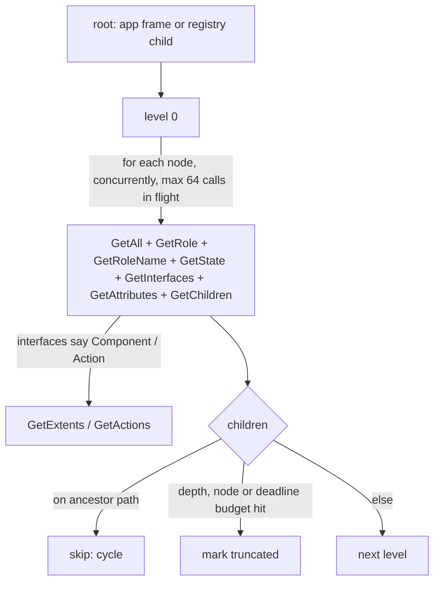

# Linux Accessible Wrapper and Tree Walk (Sub-phase 3.2) - Plan

## Goal Capsule

- **Objective:** the Linux adapter can read the complete accessibility tree of a real GNOME or Electron app quickly and without hanging or looping, so the vocabulary and observation sub-phases build on correct raw evidence.
- **Means:** an AT-SPI element handle of bus name and object path, a per-node read set built on `Properties.GetAll`, and a breadth-first walk that issues each level's reads concurrently on zbus's own executor, bounded by depth, node and deadline budgets and guarded by an ancestor-path set (KTD1–KTD5).
- **Authority:** `docs/phases.md` §3.2 as corrected by 3.0 (rows `L2-1`–`L2-8`, `L2-15`, `L2-18`), and further corrected here where this plan settles the batching design (R8).
- **Stop conditions:** stop if a concurrent level cannot be issued on the shared connection without a runtime crate beyond the current lockfile, or if a real GNOME app's tree cannot be read without errors.
- **Execution profile:** U1 → U2 → U3 → U4; U5 after U3.
- **Finishes and ships:** the orchestrating session runs the live verification on the box, commits, and opens the PR stacked on `feat/linux-3.1-toolchain-bus`.

---

## Product Contract

### Summary

Add the internal reading layer of the Linux adapter: an element handle, the raw evidence read for one node, and a bounded, concurrent, cycle-safe tree walk. Nothing user-visible changes yet; `snapshot` stays `PLATFORM_NOT_SUPPORTED` until 3.4 wires observation.

### Problem Frame

Every later Linux sub-phase reads the tree. 3.0 measured that the read is fully reliable on GNOME 46 apps (`L2-1`), that one `GetAll` replaces five property gets (`L2-6`), that concurrency gives a 2.5–3.5x speedup (`L2-5`), that a sequential 2,000-node walk would take about 4 s (`L2-4`), and that Electron trees fill in seconds after launch (`L2-15`). A walker that ignores these is either slow enough to time out on Electron or wrong on GTK4.

### Requirements

**Handle and read set**

- R1. A Linux element is identified by its D-Bus bus name and object path, plus the owning process id; it travels inside core's `NativeHandle` and a wrong or empty handle returns the same `INVALID_ARGS` shape as macOS and Windows.
- R2. One node read returns name, description, child count, accessible id, role number and role name, state set, interface list, object attributes, and, when the node advertises them, extents and action names; each field is present, absent-answered, or read-failed, never guessed (`L2-18`: zero and `-1` extents are values, not errors).
- R3. A failed read of one node is recorded on that node and does not abort the walk; a bus error that means the app left the bus stops that app's walk with a classified error.

**Walk**

- R4. The walk visits children in `GetChildren` order, guards cycles with the ancestor path rather than a global visited set, and never uses the `Parent` property to place a node (`L2-2`).
- R5. The walk honours a maximum depth, a maximum node count and the caller's deadline, and reports whether the result is complete; a truncated subtree is marked, not silently dropped.
- R6. Each tree level's reads are issued concurrently with a bounded number in flight, and the whole walk uses the process's shared a11y connection from 3.1.

**Verification and roadmap**

- R7. A live test, run on the GNOME box, walks GNOME Files, Terminal and Calculator to completion with zero read errors, and walks VS Code within the deadline.
- R8. `docs/phases.md` §3.2 states the batching design this plan builds, the live-test exit criterion, and that `Cache.GetItems` is not used (KTD3).

### Key Decisions

- KD1. **Core stays platform-neutral.** (session-settled: user-directed — chosen over Linux helpers or `#[cfg]` in core: core is the shared surface.) Governs R1–R6: all new code is in `crates/linux`.
- KD2. **Real runs over mocks; only tests that can fail for a real reason; no probe or fixture data in the repository.** (session-settled: user-directed — chosen over unit suites, fixtures and a committed dump binary.) Governs R7: the exit evidence is a live test against real apps, plus unit tests for the cycle guard and budget logic (the three U3 scenarios), whose failing directions no real app shows (`L2-2`).
- KD3. **All box access goes through `scripts/remote-linux.sh`.** (session-settled: user-directed — chosen over raw ssh.)
- KD4. **The PR stacks on `feat/linux-3.1-toolchain-bus`; nothing merges to `main`.** (session-settled: user-directed — chosen over a PR against `main`.)

### Scope Boundaries

- No role or state mapping (3.3), no `observe_tree` wiring or snapshot (3.4), no text or value content reads (3.3/3.4 decide which roles need them).
- Not built: the `Cache.GetItems` fast path (KTD3).
- Not built: a committed tree-dump binary. The live test is the dump (KD2), and its output prints the tree on failure.

---

## Planning Contract

### Key Technical Decisions

- KTD1. **Handle = `{bus_name, path, pid}` in `NativeHandle`.** Bus name and path are owned strings; the pid comes from `GetConnectionUnixProcessID` once per app. A downcast helper returns the `INVALID_ARGS` error with `{kind: "invalid_native_handle", platform: "linux", empty}` details, matching `crates/windows/src/tree/element.rs`.
- KTD2. **Read set per node:** `Properties.GetAll("org.a11y.atspi.Accessible")` for name, description, child count and accessible id; `GetRole`, `GetRoleName`, `GetState`, `GetInterfaces`, `GetAttributes` on `org.a11y.atspi.Accessible`; then, only when the interface list names them, `Component.GetExtents` (screen coordinates) and `Action.GetActions`. `GetChildren` supplies the next level. This is 7–9 calls per node, each answered independently (R2).
- KTD3. **No `Cache.GetItems` path.** It answers only on GTK4 (`UnknownMethod` on GTK3 and Chromium, `L2-7`), returns items a children walk cannot reach that must not become refs (`L2-8`), and carries no extents, attributes or actions, so the walk would still need most per-node calls. The concurrent `GetAll` walk already reads a 201-node GTK4 app in about 120 ms (`L2-5`). Revisit if a measured snapshot budget is missed on GTK4.
- KTD4. **Concurrency on zbus's executor, no new runtime.** The walk takes the async `zbus::Connection` behind the shared blocking connection, runs each level's reads as futures with a bounded `buffered` stream and drives them with `zbus::block_on`. The bound is on in-flight D-Bus calls, at most 64 (eight nodes at a time, four action-name reads per node, and 64 bus-name lookups, which run when no node reads do): a batch joins about 8 nodes of 7–9 calls each, inside the 16–128 calls `L2-5` measured with no errors. `futures-util` 0.3.33 is in the lockfile only through a wasm-only dependency, so it is not compiled on Linux today and becomes a new, exactly pinned direct dependency with default features off and `alloc` on; the MSRV job verifies it.
- KTD5. **Budgets and completeness.** The walk stops descending at the depth or node budget. Each level is raced against the caller's actual deadline; a timeout after the first level returns the tree read so far marked incomplete, and a timeout before any node was read returns `TIMEOUT`; every node whose children were not read is marked truncated, and the result carries a `complete` flag, mirroring core's `subtree_truncated` and `complete` contract so 3.4 can map it directly.
- KTD6. **Error classification reuses 3.1's `classify`.** `org.freedesktop.DBus.Error.UnknownObject`, `UnknownMethod` on a required call, and `ServiceUnknown` for the app's bus name mean the node or app is gone; other errors are per-field read failures (R3).
- KTD7. **Layout:** `tree/element.rs` (handle), `tree/node_read.rs` (one-node read), `tree/walker.rs` (walk), `tree/raw_node.rs` (the raw node type), following the shared platform layout.

### High-Level Technical Design

### Assumptions

- `zbus::blocking::Connection::inner()` exposes the async connection used by the blocking one, at 5.19.0.
- `futures-util` 0.3.33 compiles at the 1.89 toolchain with default features off and `alloc` on; it is a new compiled crate on Linux.

### Sequencing

U1 → U2 → U3 → U4; U5 after U3.

---

## Implementation Units

### U1. Element handle

- **Goal:** a Linux element can travel through core as a `NativeHandle`.
- **Requirements:** R1.
- **Dependencies:** none.
- **Files:** `crates/linux/src/tree/element.rs`, `crates/linux/src/tree/mod.rs`.
- **Approach:** KTD1.
- **Patterns to follow:** `crates/windows/src/tree/element.rs`.
- **Test expectation:** none -- data carrier; the wrong-handle and round-trip paths are U4 scenarios.
- **Verification:** U4's handle scenarios pass.

### U2. One-node read

- **Goal:** read one node's raw evidence with every field's outcome kept honest.
- **Requirements:** R2, R3.
- **Dependencies:** U1.
- **Files:** `crates/linux/src/tree/raw_node.rs`, `crates/linux/src/tree/node_read.rs`.
- **Approach:** KTD2, KTD6. Each field stores present, absent-answered, or read-failed. `Action.GetActions` has no 3.0 ledger row, so its reply shape is unverified until U4 exercises it.
- **Test expectation:** none -- every branch is driven by real bus replies; proven by the live test's zero-error walks and its read of a node from an app that has just exited.
- **Verification:** U4.

### U3. Bounded concurrent walk with cycle guard

- **Goal:** walk a whole app tree fast, completely, and safely.
- **Requirements:** R4, R5, R6.
- **Dependencies:** U2.
- **Files:** `crates/linux/src/tree/walker.rs`, `crates/linux/src/tree/walker_tests.rs`, `crates/linux/Cargo.toml`, `Cargo.lock`.
- **Approach:** KTD4, KTD5. The cycle check and budget logic live in one pure function over node keys and child lists, so the unit test can feed it a graph no real app produces.
- **Test scenarios:**
  - A child list that points back to an ancestor is skipped and the walk completes.
  - The same node reached through two different parents is visited both times (siblings share, ancestors do not: the macOS rule).
  - A node budget smaller than the tree marks the cut nodes truncated and the result incomplete.
- **Verification:** the unit test passes and fails when the ancestor check is removed; U4 shows full walks.

### U4. Live verification on real apps

- **Goal:** prove the walk on the apps §3.2 names.
- **Requirements:** R7.
- **Dependencies:** U3.
- **Files:** `crates/linux/src/tree/walker_live_tests.rs`.
- **Approach:** an `#[ignore]` test that launches its own GNOME Files, Terminal and Calculator and VS Code from the box's user-space tools (the run fails if VS Code is absent, since R7 requires it), finds their frames on the registry by process, walks each, asserts completion and zero read errors, prints node count, depth and wall time, prints the walked tree when any assertion fails, and stops every process it launched by pid. It runs only through `scripts/remote-linux.sh` on the box; CI does not run ignored tests.
- **Execution note:** a test that acts on the desktop must only touch processes it launched.
- **Test scenarios:**
  - Files, Terminal and Calculator walk complete with 0 read errors.
  - At least one Calculator button reports a non-empty action list, which exercises the `GetActions` reply shape.
  - The downcast helper given a null handle returns `INVALID_ARGS` with the `invalid_native_handle` detail, and a handle taken from a live walk round-trips through the downcast.
  - VS Code walks within the default deadline after its tree has settled.
  - A handle to an app that has exited classifies as gone, not as a field failure.
- **Verification:** the box run passes; its timing beats the sequential baselines of `L2-4` by at least 2x.

### U5. Roadmap correction

- **Goal:** §3.2 states what was built.
- **Requirements:** R8.
- **Dependencies:** U3.
- **Files:** `docs/phases.md`.
- **Approach:** rewrite the §3.2 batching bullet to the KTD2–KTD4 design, the exit criterion to the live test, delete the "Committed probe examples" bullet (KD2: probe data stays out of the repository), and replace "async tree-dump binary" and "`atspi` crate" with what shipped; cite `L2-5`, `L2-7`, `L2-8`.
- **Test expectation:** none -- documentation.
- **Verification:** `python3 scripts/check-linux-findings.py` passes.

---

## Verification Contract

| Check | Command or method | Proves |
|---|---|---|
| Lint | `cargo clippy --locked -p agent-desktop-core -p agent-desktop-linux -p agent-desktop -p agent-desktop-ffi --all-targets -- -D warnings` on the box | quality gate |
| Unit | `scripts/cargo-test-isolated-home.sh test --locked -p agent-desktop-linux` | U3 cycle and budget logic |
| Live | `cargo test --locked -p agent-desktop-linux -- --ignored walker_live` on the box through `scripts/remote-linux.sh` | R7 on real apps |
| MSRV | `cargo +1.89.0 check --locked -p agent-desktop-linux --all-targets` | the new pin builds |
| Isolation | `cargo tree -p agent-desktop-core` | KD1 |
| Source rules | `scripts/check-rust-file-size.sh`, `scripts/check-no-phase-references.sh` | 400-line cap, no plan ids |
| Ledger | `python3 scripts/check-linux-findings.py` and `--sub-phase 3.2` | citations valid; 3.2 rows disposed |

## Definition of Done

- Every Verification Contract row passes.
- The live walk output (counts, depth, time) for each app is in the PR description.
- `crates/core` diff is empty.
- Every ledger row naming 3.2 is disposed of in the PR description.
- No abandoned experiment code remains.
- The judged live report stays outside version control; its findings and dispositions go in the PR description.

## Risks & Dependencies

| Risk | Mitigation |
|---|---|
| Many in-flight calls overrun the bus or the app | at most 64 calls in flight (`L2-5` saw no `LimitsExceeded` up to 128 calls) |
| `zbus::block_on` from inside another executor | the walk is called only from synchronous adapter methods |
| A slow app stalls one level | each level is raced against the caller's deadline; a mid-walk timeout returns a partial tree marked incomplete and a timeout before any node returns `TIMEOUT` (KTD5) |

## Sources & Research

- `probes/linux/FINDINGS.md` rows `L2-1`–`L2-8`, `L2-15`, `L2-18`.
- `.claude` adapter surface map (NativeHandle, ObservedSubtree contract).
- `crates/windows/src/tree/element.rs`, `walker.rs`, `walker_enumerate.rs` — patterns.
