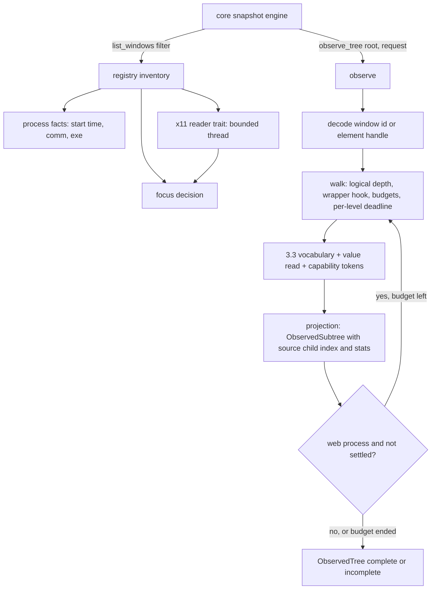
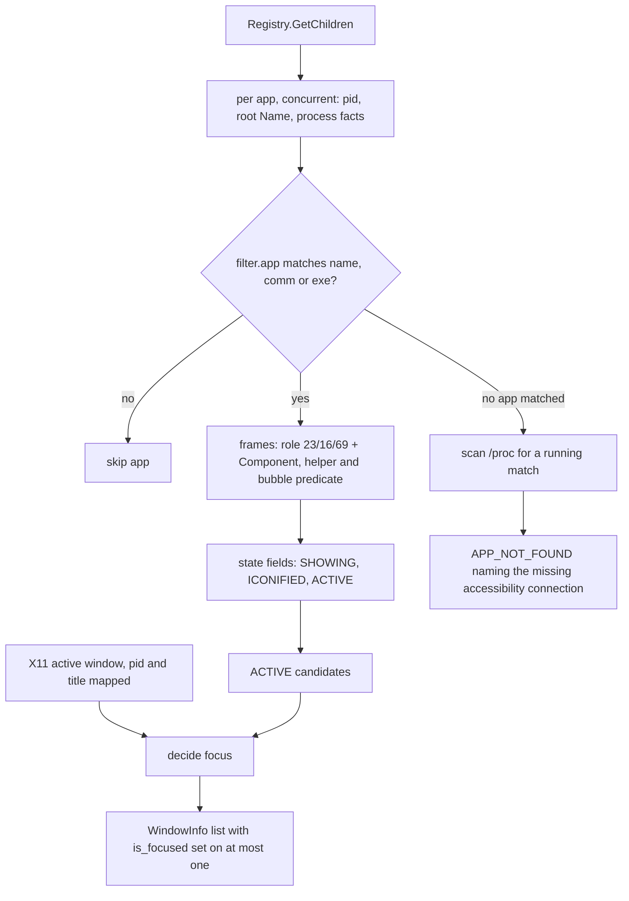

# Linux Observation - Snapshot, Windows, Apps, Displays (Sub-phase 3.4) - Plan

## Goal Capsule

- **Objective:** an agent on a GNOME desktop can list the running apps, windows and displays and take a `snapshot` of a real app (GNOME Files, Terminal, Settings, an Electron app) that comes back as the same reffed, honest tree it already gets on macOS and Windows, including when a fact cannot be known.
- **Means:** the shared snapshot engine drives a Linux `observe_tree` built on the 3.2 walk and the 3.3 vocabulary; the AT-SPI registry supplies apps and windows, with optional X11 reads (`x11rb`) corroborating focus and RandR supplying displays (KTD2, KTD9, KTD12, KTD14).
- **Authority:** `docs/phases.md` §3.4 as corrected by 3.0 and 3.1 (rows `L8-2`, `L8-6`, `L8-11`, `L13-5`), and further corrected here where the ledger or the code disproves it (R18).
- **Stop conditions:** stop if a requirement needs a change under `crates/core`; if 3.3's resolved-vocabulary call lands with a shape this plan cannot consume without reading raw bits again; or if no real GNOME app can be walked in a private session.
- **Execution profile:** U1 first (it settles the app-name rule, the Chrome-bubble predicate, the settle parameters and the focus corroboration); U2, U3 and U9 in any order after it; U4 after U3; U5 after U3, U4; U6 after U2, U5; U7 after U1, U2, U5; U8 after U7; U9 beside U2-U8; U10 after U8, U9; U11 after U9; U12 after U5, U7; U14 after U12; U15 after U14; U13 last.
- **Finishes and ships:** the orchestrating session runs the box measurements and live verification, commits, and opens the PR stacked on `feat/linux-3.3-vocabulary`; nothing merges to `main`.

---

## Product Contract

### Summary

Wire the Linux adapter into the shared observation path. After this sub-phase `list-apps`, `list-windows`, `list-displays` and `snapshot` work on a GNOME session with real apps, `get_tree` serves the FFI, and everything the Linux stack cannot know (focus on Wayland, global position of GTK4 windows, an app that has no accessibility connection) is reported as unknown or absent rather than guessed. It is the first sub-phase with a user-visible Linux surface, so it carries the first stranger dogfood.

### Problem Frame

3.2 reads raw nodes and 3.3 gives them meaning, but nothing yet answers "which apps and windows exist", "which one is focused", "what is this window's tree" or "what displays are there". The ledger measured the traps. GTK3 names windows `frame`, GTK4 names the same numeric role `application`, and neither has a `Window` interface (`L8-2`, `L13-5`). Two accessibles report `ACTIVE` at once, one under the `mutter-x11-frames` helper app (`L8-3`). No AT-SPI field carries the X11 window id, and a fresh process per window gets the same id every time (`L8-4`, `L8-7`). GTK4 reports no global position on X11 or Wayland (`L13-6`). Chromium and Gecko trees are 18-66 nodes right after launch and take 3-4 s to fill (`L2-15`, `L3-23`), while the default snapshot budget is 3 s and the default depth is 10, against GTK4 trees 17-18 deep (`L13-4`). GTK4 `generic` is numeric role 39 and is 52-62% of nodes (`L3-3`). An app with no bus access is simply absent from the registry (`L12-5`). The box's windows cannot be enumerated by any portal (`L8-11`).

### Requirements

**Snapshot and tree**

- R1. `snapshot --app` returns a reffed tree through core's engine for GNOME Files, Terminal, Settings, Calculator, Text Editor and a Qt window, and `get_tree` returns the same tree for the FFI.
- R2. Depth follows core's contract: wrapper nodes do not consume logical depth, a node cut at the requested depth carries `children_count` and is not an error, raw depth reaches 50, and core's node, edge, child and field limits bound the walk and are counted when hit.
- R3. A wrapper is a node whose role number is panel (39), section (85) or filler (20), with a blank resolved name, no value, no description, no identifier and no primary action; the decision is global, not limited to web content (KTD4).
- R4. Every node carries 3.3's vocabulary plus `value`, bounds as read (zero and `-1` stay distinct from a failed read, `L2-18`) and capability tokens in core's vocabulary; a read that failed is unknown, never absent.
- R5. A web process (Chromium or Gecko family, or a tree with a `document web` node) is observed with a stable-count wait bounded by the request deadline; when the budget ends first the tree read so far is returned as incomplete, not as an error (KTD7).
- R6. A VS Code snapshot at the default depth finds 50 or more refs with no activation flag, under core's real ref rule.
- R7. `snapshot --surface sheet` roots a modal dialog window; an Electron file picker is detected as a sheet or the plan records, with the measurement, why it cannot be (KTD15).

**Apps, windows, focus, identity**

- R8. `list-apps` lists every registered app with a name, pid, process instance and presentation; an app that cannot be read is reported as skipped, not dropped.
- R9. `list-windows` lists top-level frames by numeric role 23, 16 or 69 with the Component interface, excludes helper and bubble frames by a predicate decided from measurement, and sets `visible`, `minimized`, `accessible` and `is_focused` truthfully.
- R10. Focus is claimed only when the available sources agree; on Wayland and on an X11 session with no window manager it comes from AT-SPI `ACTIVE` alone, and when that is absent `focused_window` answers `None` (KD6).
- R11. Naming a running app that is not on the accessibility bus gives an `APP_NOT_FOUND` that names the missing accessibility connection, never `PLATFORM_NOT_SUPPORTED` (`L12-5`).
- R12. A window id is computable without X11, unique across same-title windows, stable across calls, and verified by `resolve_window_strict` together with pid, title and process instance; every window and app carries a non-empty process instance.
- R13. X11 reads are optional corroboration: they never fail a listing, they honor the caller's deadline, and a missing window manager or a hung server yields "unknown".
- R14. `list-displays` returns every monitor on X11 through RandR and, where GNOME is present, the Mutter scale; a Wayland session without a measured source answers `PLATFORM_NOT_SUPPORTED`.

**Process and proof**

- R15. `crates/core` is unchanged and no shipped source names a plan, phase or decision id.
- R16. Pure tests run on every host; every other requirement is proved by a real run on the GNOME box, first in a private session and again on the live session when the owner restores its bus.
- R17. Every ledger row naming 3.4 is disposed of; `L2-14` and `L2-17` are closed by measurement.
- R18. `docs/phases.md` states what was built and no longer states what the ledger or the code disproved.
- R19. A stranger dogfood is run and its report committed, with at least one finding, each disposed of.
- R20. Latency is measured min-of-seven with the warm-up discarded, and the release binary stays under 15 MiB with `x11rb` added.

### Key Decisions

- KD1. **Core stays platform-neutral.** (session-settled: user-directed — chosen over adding fields or variants to core: core is the shared surface.) Governs R15. Consequence: the display work area is not built; it is written into `docs/phases.md` for the owner (U13).
- KD2. **Tests fail for a real reason, and real runs outrank suites.** (session-settled: user-directed — chosen over fixture-driven or broad unit suites: probe scripts and captures are never read by tests and never committed.) Governs R16. Mapping logic takes plain values so tests run on Linux CI.
- KD3. **All box access goes through `scripts/remote-linux.sh`, never `sudo`; live verification runs in a private session now.** (session-settled: user-directed — chosen over using the live bus: it is broken and the owner restarts it.) Governs R16.
- KD4. **The PR stacks on `feat/linux-3.3-vocabulary`; nothing merges to `main`.** (session-settled: user-directed — chosen over a PR against `main`.)
- KD5. **X11 properties and RandR come from `x11rb`, pure Rust, pinned exactly.** (session-settled: user-directed — chosen over spawning `xprop`/`wmctrl`/`xrandr` (not guaranteed installed, `L8-6`), a hand-rolled X11 client (more code to own) and the `xcb` crate (a C dependency).) Governs R13, R14, R20.
- KD6. **Where focus or geometry cannot be derived, report it unknown or absent.** (session-settled: user-directed — chosen over guessing, such as the last-active app or translating window-relative extents.) Governs R4, R10, R14.
- KD7. **A `docs/phases.md` statement the ledger or the code disproves is corrected in place in this PR, as its own unit, citing the row id or the source.** (session-settled: user-directed — chosen over leaving it for the next planner.) Governs R18.
- KD8. **The stranger dogfood is a gate.** (session-settled: user-directed — chosen over an author-run check: the operator gets only the shipped skill and the built binary.) Governs R19.

### Scope Boundaries

- No element resolution, live reads, hit testing, actionability or actions (3.5-3.7), no input (3.8), no window operations, launch or close (3.9), no screenshot (3.10), no shell surfaces or notifications (3.14).
- No Linux platform skill: `docs/phases.md` gives it to 3.13 (`skills/agent-desktop-linux/`, registered in core's skills command, a core change). The stranger therefore holds `skills/agent-desktop/` only.
- Considered and not built:
  - A display work area. `DisplayInfo` has no such field and adding one is a core change (KD1); evidence that would change the call is the owner adding an additive field (`L8-10` measured `[66,32,1214,768]`).
  - Core's renderer-activation loop for the settle wait. Linux has nothing to activate and the loop decides from a single walk (KTD7).
  - `Focused` and `Menu` surfaces. No measured need for the first; GTK popovers are unreadable (`L14-14`).
  - Reading `Cache.GetItems` as the hierarchy source. The walk stays on `GetChildren` (3.2 KTD3); `L13-26` shows the cost is node count, not call latency.
  - A root re-verification after a complete walk. Evidence that would change the call is the dogfood finding a window closed mid-walk that returns a tree that looks whole.
  - An X11 connection cached across calls. A cached connection to a hung server is the failure the deadline pattern exists to avoid (KTD12).
  - A fixture app. Real apps are the only measurement targets (KD2).
- Deferred to follow-up work: using the X11 mapping to find a window's XID for close, move and capture belongs to 3.9 and 3.10; this sub-phase ships the mapping and nothing consumes the XID.

---

## Planning Contract

### Key Technical Decisions

- KTD1. **Layout.** New files by the shared platform layout. `crates/linux/src/tree/`: `action_names.rs`, `value_read.rs`, `wrapper.rs`, `walk_context.rs`, `projection.rs`, `observe.rs`, `settle.rs`, `surfaces.rs`. `crates/linux/src/system/`: `process_facts.rs`, `registry.rs`, `app_ops.rs`, `window_ops.rs`, `window_filter.rs`, `window_id.rs`, `window_resolve.rs`, `focus.rs`, `x11/` (`reader.rs`, `snapshot.rs`, `map.rs`, `bounded.rs`), `display.rs`, `display_mutter.rs`. `adapter.rs` and `system/adapter.rs` only wire. Governs R1-R14.
- KTD2. **`observe_tree` is the entry point; `get_tree` is its wrapper.** `observe_tree` validates the request, resolves the root (a decoded window id, or the handle of an element root), walks, and returns `ObservedTree::from_roots` with exactly one root. `get_tree` is `observe_tree(...).into_accessibility_tree()` because the FFI entry point `ad_get_tree_exact` calls it (`crates/ffi/src/tree/get.rs`) and core's snapshot never does. An incomplete observation is a success carrying `structurally_complete=false`, which core's snapshot reads through `into_accessibility_tree_partial`. Governs R1.
- KTD3. **Walk upgrades keep 3.2's pure generic walk.** `walk_levels` gains: a logical depth per slot, a per-node classification hook (wrapper or not, enters a `document web` or not) that sees the node's payload after its level is read and before its children are admitted, and each slot's original index in its parent's child list. Boundary rules are copied from the Windows walker's `visit_entered`: a node whose children would exceed the logical depth keeps no children, gets `children_count` and stays complete; a node at the raw-depth limit, or cut by the deadline or a cap, is incomplete and carries `children_count` whenever its child list was read (AT-SPI returns the whole list in one call, so the logical-depth, raw-depth and child-cap cuts always know it); a node whose child read timed out at the deadline has no count and is incomplete. A child admitted to the walk keeps its original index through `with_source_child_index`, because core derives the ref path from it and rejects out-of-order siblings. Core's budget maps to the walk's limits (50,000 nodes, 100,000 edges, 4,096 children per node, 64 KiB per field), and each hit increments the matching `LocatorLimitStats` counter. Each level's reads run inside `within(deadline, ...)`; a level that times out ends the walk with the parents of the unread level marked truncated, instead of blocking past the deadline (3.2 checked the deadline once per level, so one slow level overran it). Governs R2.
- KTD4. **The wrapper skip is global, with strict criteria (the predicate is R3's).** "No primary action" means the capability list from KTD6 holds nothing but the ubiquitous tokens, so a clickable `div` is not a wrapper and Chromium's `showContextMenu` on every node, which maps to `RightClick`, does not stop the skip. A failed or unknown read never makes a node a wrapper. Skipped nodes stay in the tree; only depth accounting changes, and `web_wrapper_nodes` counts them. Chosen over the Windows model (limit the skip to Chromium) because the default depth is 10 and GTK4 trees are 17-18 deep (`L13-4`), so a web-only skip would leave GTK4 controls below the cut and miss the exit criterion; macOS skips globally by the same shape of rule. The 3.3 web-document flag is still computed from the ancestor path for identity (3.3 KTD7) and for the settle decision. Evidence for the GTK side is `L3-3` (role 39 is 121 of 201 nodes in Files) and `L2-12` (a GTK3 Terminal goes from 28 to 89 nodes inside depth 3); the cost is that `--max-depth` counts meaningful levels, which is what core's skeleton mode wants. U1 measures reachable ref counts at depth 10 with and without the skip so the decision is shown, not assumed. Governs R2, R3, R6.
- KTD5. **`value` is read for the roles that carry one.** `NodeTraits` has no value, and core's snapshot requirement marks `value` required, so leaving it unread would report unknown on every node. The `Value` interface's `CurrentValue` is read for slider, incrementor, progress bar, scroll bar and level indicator; the `Text` interface's contents (up to the field budget, at a character boundary) for text field and combo box. It is read only for nodes whose interface list names the interface, which `L3-17` shows is rare (`Value` on sliders and scroll bars, one GTK4 panel). Every other role's value is answered-absent. A text field's value is a mutable control value and is never part of identity, as core already requires. Not named in `docs/phases.md` §3.4 (3.3's plan assigns value reads to 3.4-3.6); built here because the snapshot contract needs it, and recorded in U13. Governs R4.
- KTD6. **Capability tokens come from the advertised action names.** Core's ref rule reads capability tokens (`Click`, `Toggle`, `RightClick`, `SetFocus`, ...), not AT-SPI names. A pure table maps the names `L3-19` recorded, case-insensitively: `click`, `press`, `activate`, `doDefault`, `open`, `jump` to `Click`; `check`, `uncheck`, `toggle`, `switch` to `Toggle`; `showContextMenu`, `menu`, `ShowMenu`, `menu.popup` to `RightClick`; Qt `SetFocus` to `SetFocus`. `clickAncestor` and the GAction names (`clipboard.copy`, `window.close`) map to nothing: they delegate or are not an affordance of the node. `SetValue` is added from the `editable` state on a text role. On GTK the "advertises an action" test is `NActions > 0`, not the interface (`L3-18`). The table is the one place 3.7 reads for dispatch, so ref-ability and dispatch cannot drift; names not in the table are listed in the live run output. Expand and collapse tokens are 3.7's (there is no such action name, `L3-19`). Governs R3, R4.
- KTD7. **Settle wait is internal, parameterized by measurement.** Chosen over core's renderer-activation loop because Linux has nothing to activate (`IsEnabled` is the user's setting and changing it mutates shared desktop state, `L2-14`), the loop takes an interaction lease for a no-op, and it decides from one walk, so it cannot see "still growing" (VS Code sits at 18 nodes for over a second, then jumps to 370, `L2-15`). The wait applies when the process is web-family by `/proc/<pid>/comm` and exe (`L2-13`) or the walk met a `document web` node. It re-walks until the node count is unchanged across N consecutive polls and above a shell ceiling, or the process is older than the warm age U1 measures and two polls agree. It uses at most the share of the remaining deadline U1 sets and returns the last tree as incomplete when the budget ends. Starting values are N=3 polls 200 ms apart, ceiling 32 nodes, wait share 70%; U1 replaces them with measured ones. The default budget is 3 s (`DEFAULT_SNAPSHOT_TIMEOUT_MS`) and Gecko settles in about 4.1 s (`L3-23`), so a cold Firefox or VS Code at default timeout returns `complete: false` with the tree seen, and the dogfood runs at the default timeout to show that. Governs R5, R6.
- KTD8. **Chromium detection feeds the wait and the diagnostic, not the skip.** Process facts (comm, exe basename) classify Chromium and Gecko families. `ACCESSIBILITY_ENABLED=1` and `--force-renderer-accessibility` are guidance text only: `L2-14` showed neither needed while the bus has `IsEnabled` true, and U1 measures the false direction on a private session. If the false direction yields no registration, the guidance joins the no-connection diagnostic (KTD16); if it yields a thin tree, it joins the incomplete result's details. `force_renderer_accessibility` in the request is accepted and changes nothing, since the adapter never generates guidance for the caller to suppress. Governs R5.
- KTD9. **Apps and windows come from one registry pass.** `Registry.GetChildren` gives (bus, root); per app, the bus daemon's `GetConnectionUnixProcessID`, the root `Name` and the process facts are read concurrently (the 19-app sequential baseline is 37 ms, `L8-1`); frames are read only for apps that pass the `filter.app` match. A frame is a window when its numeric role is 23, 16 or 69, it has the Component interface and the app is not the `mutter-x11-frames` helper (excluded by process name, so the unmeasured role number is not load-bearing); the Chrome bubble predicate (`RootView` frames against `BrowserRootView`) is a pure function over role, states, extents, name and app, decided from U1's dump. Fields: `title` is the frame name; `visible` is `SHOWING` (`L3-7`); `minimized` is `ICONIFIED`; `accessible` is true when the frame read; bounds are the frame extents as read, which on GTK4 are window-relative `[0,0,w,h]` on X11 and Wayland alike (`L13-6`) and are reported as read, not translated. The app name is the registry root `Name` when non-blank, otherwise `comm`; U1 records the measured names for the GNOME apps, and the exit criteria in `docs/phases.md` are rewritten to those names. `--app` also matches `comm` and the exe basename, through `list_apps_scoped`, so an agent can type `nautilus`. `bundle_id` stays `None`: no measured source (recorded, not faked). `presentation` is `Foreground` for an app with at least one listed window, otherwise `Background`. An app whose root cannot be read in time, or whose process facts are gone, is reported in the inventory's `skipped`. Governs R8, R9.
- KTD10. **Window identity is the AT-SPI address plus the process token; the XID is never in the id.** The id encodes the app's bus unique name and the frame's object path in a reversible, shell-safe form (the exact encoding is an implementation choice, constrained to be stateless, distinct per window and stable across calls). Unique bus names are never reused within one bus lifetime and a frame path is stable for the object's lifetime, which U1 confirms across repeated reads. This is computable on Wayland, separates same-title windows without X11, and does not depend on a heuristic mapping (`L8-4`, `L8-5`, `L13-6`). The XID is not recoverable from AT-SPI, so storing it would store a guess. `process_instance` is `<boot-id prefix>:<starttime>` from `/proc/<pid>/stat` field 22 (parsed after the last `)`, because `comm` may contain spaces and parentheses) with the boot id making it unique across reboots; both `AppInfo` and `WindowInfo` use one function so core's same-pid comparison holds. `resolve_window_strict` re-lists, finds the id, and requires pid, process instance and, when the stored title is non-empty, a title match; it tolerates title drift for a stored identity (Electron retitles) and fails closed with `WINDOW_NOT_FOUND`. It ships here with the id it verifies, because 3.9 depends on 3.4's window identity and the verifier is the other half of that contract. Governs R12.
- KTD11. **Focus is a decision over sources, with a stated tie-break.** Candidates are the frames carrying `ACTIVE` after the window filter. If an X11 active window is known and maps to a frame (pid, then title), the answer is that frame when it is a candidate, and none when it names a different frame; if the X11 active window is ambiguous or maps to no listed frame, the answer is none (claiming the one candidate would guess); if X11 is unavailable, the answer is the one candidate, and none when there are zero or several. `focused_window` is the first focused window of `list_windows` or `None`. A pure function takes the candidate set and the X11 outcome so the table is tested directly. On Wayland, and on an X11 session where `_NET_SUPPORTING_WM_CHECK` is absent, X11 contributes nothing. `snapshot` with no `--app` then ends in core's `WINDOW_NOT_FOUND "No focused window found"`; that is the correct answer and a Linux-specific hint would be a core change, recorded for the owner in U13. Governs R10.
- KTD12. **The X11 layer is a trait with a bounded real implementation.** `x11rb =0.14.0` (MIT OR Apache-2.0; `x11rb-protocol` the same; its `gethostname` 1.1.0 is Apache-2.0; all within `deny.toml`'s allowed list), `default-features = false`, feature `randr` only, `RustConnection` over the display socket. A trait returns plain records (window list, active window, per-window pid, title, frame extents, geometry; the monitor list), so mapping and focus tests use a fake, as the Windows walker does with its `TreeSource`. The real reader runs on a short-lived thread and the caller waits with `recv_timeout` on the remaining deadline, because a blocking X round trip ignores a `Deadline` (`docs/solutions/logic-errors/a-deadline-cannot-interrupt-a-blocking-os-call.md`); a hung server leaves one parked thread and the answer is "unknown". No connection is kept between calls. The display server is chosen by `WAYLAND_DISPLAY` then `DISPLAY` (`L8-12`); `XDG_SESSION_TYPE` is `tty` over ssh and is not read. Governs R13.
- KTD13. **Window to X11 mapping is pid and title first, extents second.** For a frame with pid P and title T the candidates are the X11 clients with `_NET_WM_PID` P and equal title. One candidate is the match. Several are separated by extents only when the toolkit reports global position (GTK3, Qt, Chromium) by comparing AT-SPI extents with the client rectangle expanded by `_NET_FRAME_EXTENTS` (AT-SPI y is X y minus the top extent, height plus it, `L8-5`); GTK4 reports window-relative extents, so a GTK4 tie stays ambiguous. Child order is used only if U1 measures it agreeing with the client list across windows. Ambiguous means "no corroboration", never a pick. Governs R10, R13.
- KTD14. **Displays: RandR for the list, Mutter for the scale.** On X11 the monitor list is RandR 1.5 `GetMonitors` (name, geometry, primary); on GNOME the scale and logical geometry come from `org.gnome.Mutter.DisplayConfig.GetCurrentState` on the session bus (`L8-10`: scale 1.0, primary, layout mode 2). Without Mutter on X11 the scale is 1.0, which is the true device-pixel factor of X11 coordinates; on a Wayland session (`WAYLAND_DISPLAY` set, even when `DISPLAY` is also set for Xwayland) the list and scale come from Mutter alone, and without Mutter the answer is `PLATFORM_NOT_SUPPORTED`, because no other source is measured. Ids are the source's monitor names. Multi-monitor and mixed-scale are unmeasured on real hardware and are stated so in the output docs, as Windows did; the RandR path is exercised with virtual monitors in the private X server. Governs R14.
- KTD15. **Sheet and `list_surfaces`.** Advertised surfaces are Window and Sheet. A window is a sheet when its role is dialog (16) with the `MODAL` state (a pure predicate over role and state bits); an Electron dialog that reports as the active window itself, or through `embeds`/`embedded-by` (`L3-16`), is added to the predicate only as far as U1's probe of a real VS Code open-file dialog shows. `observe_tree` on a non-sheet window under `--surface sheet` answers `ELEMENT_NOT_FOUND`, which makes core try the next candidate window (`observe_first_owner`). `list_surfaces` returns a `window` entry per frame and a `sheet` entry per modal frame, carrying the same ids as `list_windows`. Governs R7.
- KTD16. **An app without a bus connection gets a named diagnostic through `list_apps_scoped`.** Core resolves `--app` by calling `list_apps_scoped` when no window matched, and propagates its error. The override filters the registry apps as the default does; when none match, it scans `/proc` for a running process whose `comm` or exe basename equals the name (case-insensitive) and, if found, returns `APP_NOT_FOUND` saying the process is running but not on the accessibility bus, with `details` (pid, the matched process) and the sandbox and toolkit-accessibility suggestion text already used for the unreachable-bus error, plus a note that the registry was read once and a just-launched app may need a retry (`L12-5` waited 6 s and did not prove "forever"). Absence with no matching process is the ordinary not-found. Governs R11.
- KTD17. **Capabilities are advertised only where proved.** `supported_surfaces` lists Window and Sheet, the lib test that pinned it empty is replaced by one that pins this list and the fail-closed answer for any other surface, and every trait method this sub-phase does not implement keeps its `not_supported` default. Governs R7.

### High-Level Technical Design

### Assumptions

- 3.3 lands first with its resolved-vocabulary call (role, state tokens, name and description evidence, identifiers, descriptors) taking a raw node, a label outcome and the web-document flag; the label outcome is read only for a blank-name node whose canonical role is ref-able, so the 121 blank GTK4 containers in Files cost no relation reads. If it lands differently, this plan stops.
- The private-session method of 3.1 works for 3.4: `dbus-run-session` under a private `XDG_RUNTIME_DIR`, a file-backed settings store so `IsEnabled` can be false (`L1-16`), `xvfb-run`, and real GNOME apps with `XDG_CURRENT_DESKTOP=GNOME` (`L4-25`). VS Code is at `~/.local/ad-tools/vscode/app/code` and runs with `--disable-gpu`; `/usr/bin/google-chrome` exists; Firefox is the snap build.
- The box has no window manager installed except `gnome-shell`, and `openbox`, `metacity`, `icewm` and `twm` are apt candidates only; whether `gnome-shell` can run as an X11 window manager under Xvfb is unmeasured (U1 tries it, and may extract an apt-downloaded WM into a private directory without root). Without a window manager the private X server has no `_NET_CLIENT_LIST`, `_NET_ACTIVE_WINDOW` or `_NET_FRAME_EXTENTS`: that is exactly the AT-SPI-only path and the focus-unknown path, so enumeration, `snapshot --app` and the unknown-focus behavior get real verification there; the positive X11 corroboration is verified against a real window manager if U1 finds one, and otherwise on the live session (`L8-3` and `L8-5` were measured on its mutter with `xprop`).
- `xdotool` is not on the box today (the 3.0 dossier said it was); nothing in this sub-phase uses it.
- Xvfb exposes RandR, and `xrandr --setmonitor` can create virtual monitors for the harness; the adapter itself never runs `xrandr`.
- The live AT-SPI bus is broken until the owner restarts it, so the live-session re-run is a separate, later step.

### Sequencing

U1 → (U2, U3, U9); U3 → U4; (U3, U4) → U5 → U6; U7 after U1, U2, U5 → U8 → U10 (with U9); U11 after U9; U12 after U5, U7; U14 after U6, U8, U10, U11, U12 → U15 → U13.

Size: `docs/phases.md` estimates about 2k LOC; this plan is roughly 3.3-4k lines of code plus tests. It ships as one PR above the cap, as the sub-phase rule allows when the plan states the reason: the units share one observation path (walk, identity, X11 corroboration, surfaces), so a split would review half of that path without the other half, and Windows sub-phase 2.3 shipped 3,580 product lines the same way.

---

## Implementation Units

### U1. Measurements before code

- **Goal:** replace the plan's assumptions with observations on the box, rewrite the two `DEFERRED` rows, and fix the parameters later units read.
- **Requirements:** R5, R9, R10, R12, R17.
- **Dependencies:** none.
- **Files:** `probes/linux/FINDINGS.md`. Probe scripts and captures stay outside the repository and no test reads them.
- **Approach:** in a private session (KD3), measure each of the following, repeating each at least three times (`docs/solutions/best-practices/one-measurement-is-not-a-measurement.md`), and record rows:
  1. App-root `Name`, `ToolkitName`, `comm` and exe for Files, Terminal (`gnome-terminal-server`), Settings, Calculator, Text Editor, VS Code, Chrome and Firefox, and the `.desktop` name each shows; this fixes the app-name rule and the exit-criteria names (KTD9).
  2. The numeric role and states of the `mutter-x11-frames` child and of the gnome-shell child, and the registry frames of Chrome (the bubble predicate), if a window manager is obtainable; otherwise recorded as unmeasured here and measured on the live session.
  3. Frame object-path and bus-name stability across repeated `GetChildren` reads and across a window's lifetime, and the unique-name behavior across an app restart (KTD10).
  4. `/proc/<pid>/stat` start time stability across reads and distinctness across two processes, and the boot id.
  5. Window manager availability under the private Xvfb: try `gnome-shell` as an X11 window manager; failing that, apt-download one candidate into a private directory with no root; record which `_NET_*` properties appear.
  6. `L2-14`: with `IsEnabled` false on the private bus, launch VS Code with no flag, with `ACCESSIBILITY_ENABLED=1` and with `--force-renderer-accessibility`; record registration and node counts. `L2-17`: launch an own Chrome instance (fresh profile directory) on the private bus and record frames and nodes, replacing the `DEFERRED` rows.
  7. Settle curves for a cold and a warm VS Code, Chrome and Firefox (nodes against elapsed time, process age), to set the shell ceiling, N, the poll spacing and the warm age (KTD7).
  8. Reachable ref-able node counts at depth 10 for Files, Settings, Calculator, Text Editor, Terminal and the Qt window, with and without the wrapper skip (KTD4).
  9. The Electron file-picker probe: open VS Code's open-file dialog and record whether it is a separate frame, whether it carries `MODAL`, and its `embeds` relations (KTD15).
  10. Action-name histogram across the apps, to confirm the KTD6 table covers what is advertised.
  11. Whether AT-SPI child order agrees with `_NET_CLIENT_LIST` order, only if a window manager is available (KTD13).
  12. Whether a WebKitGTK app (Epiphany or Yelp) is installed and exposes `document web`; if none is installed, recorded as unmeasured and left out of the exit criteria with that stated.
- **Test expectation:** none -- measurements; the ledger checker is the gate.
- **Verification:** `python3 scripts/check-linux-findings.py` exits 0 and the `--sub-phase 3.4` listing shows no `DEFERRED` row.

### U2. Process facts and the process-instance token

- **Goal:** one function turns a pid into its start-time token, `comm`, exe basename and web family, for apps and windows alike.
- **Requirements:** R5, R8, R12.
- **Dependencies:** none.
- **Files:** `crates/linux/src/system/process_facts.rs`, `crates/linux/src/system/process_facts_tests.rs`, `crates/linux/src/system/mod.rs`.
- **Approach:** KTD10, KTD8. A pure parser takes the text of `/proc/<pid>/stat` and returns the start time, parsing after the last `)`; a thin reader supplies the text, the boot id and `comm`, and the exe link. Web family is a pure function of comm, exe basename and a name-independent signal (a Chromium payload beside the exe, such as `resources/app.asar` or `libffmpeg.so`), so an Electron app with its own binary name is still classified. A pid that has gone returns no facts, and its app is skipped, never given a made-up token.
- **Patterns to follow:** `crates/windows/src/system/process_identity.rs`.
- **Test scenarios:**
  - A stat line whose `comm` is `(a b) c` still yields the correct field 22; a line with an unbalanced `comm` is rejected, not misparsed.
  - Two different start times yield different tokens; the same start time with a different boot id yields a different token.
  - `code`, `chrome`, `chromium`, `electron` and `firefox` classify to their families, an unlisted binary with `resources/app.asar` beside it classifies as Chromium, and `nautilus` classifies to none; the classification is case-insensitive on the exe basename.
  - A missing `/proc/<pid>` yields no facts.
- **Verification:** the scenarios pass; each fails when the parse is changed to take the first `)` (invert-verified).

### U3. Capability tokens and value reads

- **Goal:** the capability list a node advertises and the value it carries, both from the raw read, in core's vocabulary.
- **Requirements:** R3, R4.
- **Dependencies:** U1.
- **Files:** `crates/linux/src/tree/action_names.rs`, `crates/linux/src/tree/value_read.rs`, `crates/linux/src/tree/action_names_tests.rs`, `crates/linux/src/tree/value_read_tests.rs`, `crates/linux/src/tree/mod.rs`.
- **Approach:** KTD5, KTD6. `action_names.rs` is a pure table from advertised names to core capability constants plus the `SetValue` rule; it returns a known list or unknown when the action read failed. `value_read.rs` is the async read for nodes whose interface list names `Value` or `Text` and whose canonical role carries a value, with the character-boundary truncation as a pure function; it is not added to `node_read.rs`, which has no room.
- **Patterns to follow:** `crates/windows/src/tree/element_properties.rs` (capability fields) and 3.2's `node_read.rs` call pattern.
- **Test scenarios:**
  - Every name `L3-19` recorded maps as KTD6 states: `click` to `Click`; `Toggle` and `check` to `Toggle`; `showContextMenu` to `RightClick`; `clickAncestor`, `clipboard.copy` and `window.close` to nothing.
  - Names match case-insensitively (`Activate`, `activate`).
  - A failed action read yields unknown, not an empty list; a confirmed empty list yields known-empty.
  - `SetValue` appears for an editable text role and not for a read-only one.
  - A text value longer than the field budget is cut on a character boundary and never panics on multi-byte text.
  - A role that carries no value yields absent without any read.
- **Verification:** the scenarios pass; inverting the case-insensitive match or the `clickAncestor` exclusion fails its test.

### U4. Walk: logical depth, wrapper skip, budgets and deadline

- **Goal:** the walk honors core's depth and budget contract and the wrapper rule, and stays inside the caller's deadline.
- **Requirements:** R2, R3, R6.
- **Dependencies:** U3.
- **Files:** `crates/linux/src/tree/wrapper.rs`, `crates/linux/src/tree/walk_context.rs`, `crates/linux/src/tree/walker.rs`, `crates/linux/src/tree/walker_expand.rs`, `crates/linux/src/tree/walk_limits.rs`, `crates/linux/src/tree/walker_tests.rs`, `crates/linux/src/tree/wrapper_tests.rs`, `crates/linux/src/tree/mod.rs`; remove the `#[allow(dead_code, unused_imports)]` on the `tree` module in `crates/linux/src/lib.rs` once the walk has a caller.
- **Approach:** KTD3, KTD4. `wrapper.rs` holds the pure predicate over plain values (role number, resolved name state, value, description, identifier presence, capability list, interface list). `walk_levels` carries the logical depth and the original child index in each slot, calls the classification hook after each level and before admitting children, and applies the boundary rules. `expand_level` wraps its async block in `within(deadline, ...)`; a timed-out level is a truncation, except at the root, where it is the deadline's timeout error. The walk's counters feed `LocatorStats` fields the projection reads.
- **Execution note:** write the depth-accounting and boundary tests against the pure `walk_levels` first; they use core's real `ObservedTree::from_roots` through a small projection so the sibling-order rule is exercised on any host.
- **Patterns to follow:** `crates/windows/src/tree/walker_enumerate.rs` (`visit_entered`) and `walker.rs` (a walk generic over its source, driven by fakes).
- **Test scenarios:**
  - A wrapper chain of 12 panels above a button keeps the button inside `max_logical_depth` 10, while the same chain with named containers cuts it: the GTK4-shaped case `docs/phases.md` requires, built from the role numbers and blank names `L3-3` recorded.
  - A node with role 39 and a name, or with a DOM-id-style identifier, or with a `Click` capability, is not a wrapper; a node whose name read failed is not a wrapper.
  - A node at the logical limit has no children, keeps `children_count` equal to its child count and is complete; a node at the raw limit is incomplete.
  - A node with 4,200 children keeps the first 4,096, is incomplete and counts one child-limit hit; an exhausted node budget counts a node-limit hit and marks the cut parents.
  - A child skipped as a cycle keeps its siblings' original indices in order and the tree builds; if indices were renumbered the projection would fail with the document-order error, so the test builds a tree through `ObservedTree::from_roots`.
  - A fake level that returns the deadline's timeout error mid-walk yields a partial walk with the parents of the unread level truncated and `complete` false; at the root it returns the error.
  - A parent whose child read timed out at the deadline is incomplete and carries no `children_count`.
  - Covers R2: the same fake tree walked at depth 3 and depth 10 yields different node counts and a boundary count on every cut container.
- **Verification:** the scenarios pass; inverting the wrapper depth increment, the boundary count or the original-index carry each fails a named test.

### U5. Projection, `observe_tree` and `get_tree`

- **Goal:** a window or element root becomes a core `ObservedTree` with complete evidence per node.
- **Requirements:** R1, R2, R4, R6.
- **Dependencies:** U3, U4 and 3.3's vocabulary.
- **Files:** `crates/linux/src/tree/projection.rs`, `crates/linux/src/tree/observe.rs`, `crates/linux/src/tree/projection_tests.rs`, `crates/linux/src/system/window_id.rs`, `crates/linux/src/system/window_id_tests.rs`, `crates/linux/src/adapter.rs`, `crates/linux/src/tree/mod.rs`.
- **Approach:** KTD2. `projection.rs` turns each walked node, with the 3.3 vocabulary, the value read and the capability list, into `LocatorEvidence` (every field known, absent or unknown as read; failed reads feed `native_read_failures`) and an `ObservedSubtree` with `children_count`, completeness and `with_source_child_index`; it fills `LocatorStats` (nodes visited, raw and logical depth reached, wrapper nodes, limit hits, child reads, failures). `observe.rs` validates the request, decodes the root (a window id through the id codec this unit adds, which U7 and U8 reuse, or an element root's handle through `atspi_element`, whose end-to-end drill-down proof belongs to 3.5 with `resolve_element_strict`), runs the walk, and wraps the result. `get_tree` calls it. A registered app that vanished mid-read maps to `APP_NOT_FOUND` as 3.2 already classifies. `adapter.rs` replaces its empty `ObservationOps` impl.
- **Patterns to follow:** `crates/windows/src/tree/observe.rs`, `walker_source.rs`.
- **Test scenarios:**
  - A walked fake tree projects to a tree whose roles, states, names, values and capability tokens equal the inputs and whose unknown fields stay unknown (a failed state read is not an empty list).
  - A zero-size and a `-1` extent project as known bounds, and a failed extents read projects as unknown.
  - A cut container reports `children_count` and `subtree_truncated` through core's projection.
  - A 400-node fake tree with a wrapper skip produces a ref count under core's real `allocate_refs` equal to its interactive-role and primary-action nodes (the pure arm of R6).
  - `get_tree` equals `observe_tree(...).into_accessibility_tree()` and returns the incomplete-observation error when the walk was incomplete.
- **Verification:** the scenarios pass; the live proof is U14.

### U6. Settle wait

- **Goal:** a web process's tree is read after it has filled, within the caller's budget.
- **Requirements:** R5, R6.
- **Dependencies:** U1, U2, U5.
- **Files:** `crates/linux/src/tree/settle.rs`, `crates/linux/src/tree/settle_tests.rs`, `crates/linux/src/tree/observe.rs`.
- **Approach:** KTD7, KTD8. `settle.rs` is a pure tracker fed (node count, elapsed, process age, web family, budget left) per walk and returning settled, wait for a delay, or give up; `observe.rs` loops walk and tracker. The parameters are U1's. On give-up the last tree is returned with `structurally_complete=false` and the node count in the stats. The no-connection guidance of KTD8 attaches here only if U1's false-direction measurement calls for it.
- **Execution note:** replay U1's measured curves as plain sequences in the tracker tests, so the rule is checked against the shapes that motivated it.
- **Test scenarios:**
  - A curve of 18, 18, 18, 18, 370, 380, 386, 386, 386 does not settle at the first plateau (below the ceiling) and settles after the last three equal counts.
  - A curve of 66, 120, 226, 247, 247, 247 settles at 247.
  - A native GTK app (not web family, no `document web`) never waits: one walk, settled.
  - A warm web process with two equal counts above the ceiling settles without a third poll.
  - A budget smaller than one poll gives up at once with the incomplete flag.
  - The wait never consumes more than its share of the remaining budget.
- **Verification:** the scenarios pass; inverting the ceiling check or the share cap fails its test; the live run in U14 shows the VS Code and Firefox tree before and after.

### U7. Registry inventory: apps, windows, the no-connection diagnostic

- **Goal:** `list_apps`, `list_windows` and the scoped lookup answer from the registry.
- **Requirements:** R8, R9, R11.
- **Dependencies:** U1, U2, U5.
- **Files:** `crates/linux/src/system/registry.rs`, `crates/linux/src/system/app_ops.rs`, `crates/linux/src/system/window_ops.rs`, `crates/linux/src/system/window_filter.rs`, `crates/linux/src/system/app_ops_tests.rs`, `crates/linux/src/system/window_filter_tests.rs`, `crates/linux/src/system/bus.rs` (expose the registry constants), `crates/linux/src/adapter.rs`.
- **Approach:** KTD9, KTD16. `registry.rs` does the concurrent per-app reads inside `within(deadline, ...)`. `window_filter.rs` holds the pure predicates: window role set, Component presence, the helper app exclusion, the bubble predicate, state-field derivation from state bits. `app_ops.rs` builds `AppInfo` and the `list_apps_scoped` override (name, comm and exe match, then the `/proc` scan and the diagnostic); `list_apps_inventory` is overridden to carry `skipped`. `window_ops.rs` builds `WindowInfo` (id from U5's codec, process instance from U2, state, bounds as read), applies `filter.app` and `focused_only`.
- **Patterns to follow:** `crates/windows/src/system/window_ops.rs`, `app_ops.rs`.
- **Test scenarios:**
  - Role 23 with `GetRoleName` `application` (the GTK4 window, `L13-5`), role 16 and role 69 with Component are windows; role 75 and a role-23 node without Component are not.
  - The `mutter-x11-frames` app's frames are excluded by process name whatever their role.
  - The bubble predicate keeps the two `BrowserRootView` frames and drops the four `RootView` bubbles of the recorded Chrome case, using the inline role, state, extents and name values the row records.
  - `SHOWING` absent gives `visible` false, `ICONIFIED` gives `minimized` true, an unreadable state set gives `visible` and `minimized` unknown (`None`).
  - An app with no listed frame is `Background`; with one it is `Foreground`; an app whose process facts are gone appears in `skipped`, not in `apps`.
  - `--app nautilus`, the registry name and the exe basename each match the same app; a substring does not.
  - A name that matches no registry app but matches a running process's `comm` returns `APP_NOT_FOUND` whose message names the missing accessibility connection and carries the pid; a name matching nothing returns the ordinary not-found.
  - Every returned app and window has a non-empty process instance and the same instance for the same pid.
- **Verification:** the scenarios pass; inverting the helper exclusion, the Component requirement or the `/proc` scan fails its test; live proof is U14.

### U8. Window identity, focus and strict resolution

- **Goal:** a stable, stateless window id; one focused window or none; a verifier for stored identities.
- **Requirements:** R10, R12.
- **Dependencies:** U7.
- **Files:** `crates/linux/src/system/focus.rs`, `crates/linux/src/system/window_resolve.rs`, `crates/linux/src/system/focus_tests.rs`, `crates/linux/src/system/adapter.rs`.
- **Approach:** KTD10, KTD11. The id codec (U5) is used here and rejects anything but its own format with `INVALID_ARGS`; its round-trip scenarios live in U5's tests. `focus.rs` is the pure decision over the candidate set and an X11 outcome (known frame, none, ambiguous, unavailable). `window_resolve.rs` implements `resolve_window_strict`; `focused_window` takes the first focused window. `system/adapter.rs` wires both.
- **Patterns to follow:** `crates/windows/src/system/window_identity.rs`, `window_resolve.rs`.
- **Test scenarios:**
  - (In U5's tests) Encode then decode returns the same bus name and path for GTK, Qt and Chromium path shapes, including a path outside the usual prefix; a malformed id is `INVALID_ARGS`.
  - Two frames of one app with the same title get different ids.
  - Focus table: one `ACTIVE` candidate with X11 unavailable focuses it; two candidates with X11 unavailable focuses none; two candidates with X11 naming one focuses that one; one candidate with X11 naming a different frame, an ambiguous window or an unmapped window focuses none; zero candidates focuses none whatever X11 says.
  - Strict resolution: a window whose pid or process instance differs from the stored one is `WINDOW_NOT_FOUND`; a changed title is tolerated for a stored identity and refused for a freshly listed one; a vanished window is `WINDOW_NOT_FOUND`.
- **Verification:** the scenarios pass; inverting the process-instance check or the two-candidate rule fails its test. Live: every listed window re-resolves, and a forged process instance does not.

### U9. X11 reader, dependency and bounded access

- **Goal:** read the window manager's properties without any external tool and without ever outliving the deadline.
- **Requirements:** R13, R20.
- **Dependencies:** U1.
- **Files:** `crates/linux/Cargo.toml`, `Cargo.lock`, `crates/linux/src/system/x11/mod.rs`, `crates/linux/src/system/x11/reader.rs`, `crates/linux/src/system/x11/snapshot.rs`, `crates/linux/src/system/x11/bounded.rs`, `crates/linux/src/system/x11/snapshot_tests.rs`, `crates/linux/src/system/x11/bounded_tests.rs`.
- **Approach:** KTD12. Add `x11rb` pinned `=0.14.0`, no default features, feature `randr`. `reader.rs` implements the trait over `RustConnection`: root `_NET_SUPPORTING_WM_CHECK`, `_NET_ACTIVE_WINDOW`, `_NET_CLIENT_LIST`, and per client `_NET_WM_PID`, `_NET_WM_NAME` (falling back to `WM_NAME`), `_NET_FRAME_EXTENTS` and geometry translated to the root; requests are pipelined. `snapshot.rs` decodes raw property values into plain records (pure). `bounded.rs` runs a reader on a thread and waits on the deadline. Review `Cargo.lock` for exactly the new crates and run the license, advisory and source checks.
- **Execution note:** this unit itself runs `cargo deny check` and a release-size measurement with `x11rb` added, against 15 MiB, before U10 and U11 start (U14 repeats and reports the final figure); supply-chain scanning of the added crates happens at install time as for any new dependency.
- **Test scenarios:**
  - A raw `_NET_CLIENT_LIST` value of three 32-bit window ids decodes to three ids; a truncated value is rejected, not read short.
  - A UTF-8 title and a Latin-1 `WM_NAME` fallback decode to the same text; an invalid UTF-8 title is lossy-decoded, never an error.
  - `_NET_FRAME_EXTENTS` of `0, 0, 37, 0` decodes to left 0, right 0, top 37, bottom 0 (the order the property defines).
  - A reader that blocks forever returns "unavailable" within the deadline and does not fail the caller; a reader that errors returns "unavailable".
  - No window manager (`_NET_SUPPORTING_WM_CHECK` absent) returns "no window manager", which downstream treats as no X11 evidence.
- **Verification:** the scenarios pass; the real reader is exercised against the private X server in U14.

### U10. X11 corroboration of windows

- **Goal:** map an AT-SPI frame to its X11 client and feed focus.
- **Requirements:** R10, R13.
- **Dependencies:** U8, U9.
- **Files:** `crates/linux/src/system/x11/map.rs`, `crates/linux/src/system/x11/map_tests.rs`, `crates/linux/src/system/window_ops.rs`.
- **Approach:** KTD13. A pure function takes a frame (pid, title, extents, whether the toolkit reports global position) and the X11 records and returns match, none or ambiguous; `window_ops.rs` calls it only on a session where `WAYLAND_DISPLAY` is unset and the reader reports a window manager, and passes the X11 active window's mapping to U8's decision. The mapping is internal, kept for 3.9 and 3.10 to find a window's XID.
- **Test scenarios:**
  - One X11 client with the frame's pid and title is the match with no extents needed.
  - Three clients sharing a title across two pids leave two candidates for one pid (`L8-5`); extents `[100,120,320,237]` against the client `{100,157,320,200}` with top extent 37 select exactly one.
  - The same tie for a GTK4 frame (window-relative extents) stays ambiguous.
  - A frame with no X11 client with its pid maps to none.
  - Child order is used only when the setting derived from U1 allows it, and its absence leaves a tie ambiguous.
- **Verification:** the scenarios pass; inverting the top-extent arithmetic fails the extents test.

### U11. Displays

- **Goal:** `list_displays` from RandR, with the Mutter scale where GNOME is present.
- **Requirements:** R14, R20.
- **Dependencies:** U9.
- **Files:** `crates/linux/src/system/display.rs`, `crates/linux/src/system/display_mutter.rs`, `crates/linux/src/system/display_tests.rs`, `crates/linux/src/system/adapter.rs`.
- **Approach:** KTD14. `display.rs` assembles `DisplayInfo` from RandR monitor records (bounds, primary, name) and, when available, Mutter's logical monitors matched by connector (scale; on Wayland also the logical geometry). `display_mutter.rs` makes the session-bus call inside `within(deadline, ...)`. Primary monitors sort first. Wayland with no Mutter answers `PLATFORM_NOT_SUPPORTED` with a suggestion.
- **Patterns to follow:** `crates/windows/src/system/display.rs` (primary first, multi-monitor stated as unverified).
- **Test scenarios:**
  - Two RandR monitors, one primary, return the primary first with each id, bounds and `is_primary` as given.
  - A Mutter monitor with scale 2.0 matched by connector sets that display's scale; a monitor Mutter does not list keeps scale 1.0 on X11.
  - The single measured case (`Virtual1 1280x800`, scale 1.0, primary) reproduces from its values.
  - A Wayland session without Mutter returns `PLATFORM_NOT_SUPPORTED` whether or not `DISPLAY` is set; a Wayland session with Mutter lists its monitors from Mutter alone.
- **Verification:** the scenarios pass; live: the private Xvfb with virtual monitors defined through `xrandr --setmonitor` lists them all, and the live GNOME session shows the Mutter scale.

### U12. Surfaces

- **Goal:** `--surface sheet` and `list_surfaces` work, and the advertised list is true.
- **Requirements:** R7.
- **Dependencies:** U5, U7.
- **Files:** `crates/linux/src/tree/surfaces.rs`, `crates/linux/src/tree/surfaces_tests.rs`, `crates/linux/src/system/adapter.rs`, `crates/linux/src/adapter.rs`.
- **Approach:** KTD15, KTD17. A pure predicate over role number, state bits and (from U1's probe) relation facts classifies a sheet; `observe.rs` applies it for `--surface sheet`; `list_surfaces` builds its entries from the same window inventory. Replace the lib test that pins an empty advertised list with one that pins Window and Sheet and the fail-closed answer for a menu surface.
- **Patterns to follow:** `crates/windows/src/tree/surface_inventory.rs`, `surfaces.rs`.
- **Test scenarios:**
  - A dialog role with `MODAL` is a sheet; a frame role with `MODAL`, a dialog without it and an unreadable state set are not.
  - `--surface sheet` on a non-modal window is `ELEMENT_NOT_FOUND`; on a modal dialog it observes that dialog.
  - The surface ids equal the window ids.
  - Requesting `menu` fails at validation with the supported list `[window, sheet]`.
- **Verification:** the scenarios pass; live: a GTK dialog in Files or Text Editor is listed as a sheet and snapshots; the VS Code open-file dialog result is recorded per U1.

### U13. Roadmap and ledger corrections

- **Goal:** `docs/phases.md` states what 3.4 built and what the receiving sub-phases now own; every ledger row naming 3.4 is disposed of.
- **Requirements:** R17, R18.
- **Dependencies:** U1, and U15 for the dogfood dispositions.
- **Files:** `docs/phases.md`, `probes/linux/FINDINGS.md`.
- **Approach:** rewrite in place against the text as it stands after 3.3 lands, citing the row id or the source file, with no "previously" notes:
  - §3.4 scope and Goal: `get_tree`/`get_subtree` become `observe_tree` over `ObservationRoot` with `get_tree` as the FFI wrapper (`crates/core/src/adapter/observation.rs`); "via portals/randr" becomes the AT-SPI registry, optional X11 properties, RandR and Mutter `DisplayConfig` (`L8-11`: no portal names windows); the Wayland "portal's equivalent query" is removed (unmeasured) and Wayland displays are `PLATFORM_NOT_SUPPORTED` without Mutter.
  - §3.4 file names: `tree/builder.rs::is_web_wrapper` and `tree/surfaces.rs` become the files built; `tree/resolve.rs` and the resolver-depth bullet move to §3.5 with the statement that the walk already honors raw depth 50.
  - §3.4 window identity, and the Phase 3 introduction's sentence that identity pairs the XID with the pid and start time: identity is the registry address plus pid and the process token; the XID is not recoverable from AT-SPI and is read only for corroboration (`L8-4`, `L8-7`); 3.9 and 3.10 take the XID from the mapping 3.4 ships.
  - §3.4 wrapper bullets: state the global decision and its criteria (KTD4), citing `L3-3`, `L2-12` and the default depth; the web-document flag sentence 3.3 adds; Chromium detection as measured (comm and exe, `L2-13`) with the `L2-14` and `L2-17` results; the settle wait's measured parameters and the 3 s default; `value` reads added to scope; the capability-token table owned here and consumed by 3.7; the `mutter-x11-frames` result.
  - §3.4 exit criteria: enumerate `list_windows`, `list_apps`, `focused_window` (including `None`), `list_displays`, `list_surfaces`, wrapper skip, Chromium detection, settle wait, value reads, capability tokens, the no-connection diagnostic, `get_tree`, `resolve_window_strict`, and the measured app names in place of "GNOME Files" and "GNOME Terminal" if they differ; the VS Code 50-ref and Electron sheet criteria as proved or re-assigned with the measurement. `Est. PR size` is restated.
  - Owner items, each with the evidence: the display work area needs an additive core field (`L8-10`); `snapshot` without `--app` on Wayland ends in a generic message and a Linux hint would be a core change; the Linux platform skill is §3.13, which gains the dogfood's skill findings.
  - §3.7: the capability table and the missing expand/collapse tokens. §3.9 and §3.10: how they obtain an XID. §3.12: the `L14-9`-`L14-14` target notes.
  - `probes/linux/FINDINGS.md`: rewrite `L2-14` and `L2-17`, add the U1 rows, and dispose of each row in the Definition of Done.
- **Test expectation:** none -- documentation; the ledger checker and the citation check are the gate.
- **Verification:** `python3 scripts/check-linux-findings.py` exits 0 with no `DEFERRED` row under `--sub-phase 3.4`, and `docs/phases.md` no longer contains `get_subtree`, `tree/builder.rs`, `tree/resolve.rs` under §3.4 or the XID-pairing sentence.

### U14. Live verification, performance and size

- **Goal:** prove the requirements on real apps in a private session now, re-run them on the live session later, and measure cost.
- **Requirements:** R1-R14, R16, R20.
- **Dependencies:** U6, U8, U10, U11, U12.
- **Files:** `crates/linux/src/tree/observe_live_tests.rs`, `crates/linux/src/system/inventory_live_tests.rs`, `crates/linux/src/system/x11/reader_live_tests.rs` (all `#[ignore]`, in the style of 3.2's live walk and reusing its launch helpers).
- **Approach:** the tests launch their own Files, Terminal, Settings, Calculator, Text Editor, the Qt window, VS Code, Chrome (fresh profile) and the snap Firefox, drive core's snapshot and list commands through the real adapter, and stop everything they launched. No capture or probe output is committed or read by a test.
- **Test scenarios:**
  - Files, Terminal, Settings, Calculator and Text Editor each return a reffed tree, with zero failed reads, whose window id equals the one `list_windows` reports and whose app name equals the one `list_apps` reports (`docs/solutions/best-practices/real-app-tests-are-the-platform-adapter-gate.md`).
  - Files and Calculator at the default depth: the ref count with the wrapper skip against without it is printed, and the controls U1 named are reached.
  - VS Code at the default depth, after settling: 50 or more refs, no flag; the same launch with `IsEnabled` false follows U1's recorded branch.
  - Firefox and a cold VS Code at the default timeout return `complete: false` with the tree seen, and the same at a raised timeout returns the settled tree.
  - A Calculator `value` and a Text Editor text box value are read; a slider value on Settings is read; a password field's value is absent.
  - Two windows of one app with the same title list with distinct ids and each snapshot returns its own tree; every listed window passes `resolve_window_strict`, and a forged process instance does not.
  - In the no-window-manager private X server, `focused_window` is the `ACTIVE` frame or `None`, never a guess, and `snapshot` without `--app` returns the generic focus error when none; with a window manager (if U1 found one) the corroborated focus agrees with `ACTIVE`.
  - A launched app started with no bus access (`NO_AT_BRIDGE=1`) and named by `--app` returns the diagnostic naming the missing connection.
  - `list_displays` on the private X server with three virtual monitors returns three with the primary first; on the live session it returns the Mutter scale.
  - A GTK modal dialog is a sheet; the VS Code open-file dialog result matches U1's row.
  - A window closed between listing and snapshot returns `WINDOW_NOT_FOUND`, not a tree.
- **Verification:** the run passes in the private session; the output (counts, timings, unknowns, unmapped action names) goes in the PR description and any surprise becomes a ledger row with a disposition. Performance: min of seven with the warm-up discarded, with median and max beside it, for `list_windows` against the 37 ms sequential baseline of `L8-1`, `list_apps`, and `snapshot` of Files, Calculator and VS Code (settled) against 3.2's raw walk; `scripts/perf-baseline-compare.sh` is macOS-bound and is not the vehicle. Size: release build before and after adding `x11rb`, reported against 15 MiB. The live-session re-run executes the same tests plus the mutter-only checks (U1 items 2 and 11, window-manager focus, the Mutter scale) once the owner restores the bus, and is listed as outstanding until then.

### U15. Stranger dogfood

- **Goal:** find what a new agent hits using only the shipped skill and the built binary.
- **Requirements:** R19.
- **Dependencies:** U14.
- **Files:** `docs/dogfood-reports/<date>-feat-linux-3-4-observation-dogfood.md` (no captures directory: Phase 3 keeps raw dumps out of the repository).
- **Approach:** KD8. The operator is a subagent briefed that it holds the built release binary and `skills/agent-desktop/` (read through `agent-desktop skills get core`) and nothing else, with the repository withheld; it works in a private session with the apps U14 uses. It executes every example the skill contains verbatim, reads every step's `ok`, uses the tool's own `wait` primitives instead of sleeps, runs `snapshot --app` at the default timeout, and treats any flag, variable or ordering the skill does not document as a finding. Behavioral claims are measured in both directions before they are written down, and a failure is a finding only after a second independent observation. Commands this sub-phase does not implement must fail with `PLATFORM_NOT_SUPPORTED`, which the run checks is honest and not a stub success. The report is judged: at least one finding, else the targets are made harder (VS Code cold, the snap Firefox, two same-title windows, a no-bus app, an app that closes mid-snapshot). The core skill says Linux has no platform skill yet and `skills get platform` will therefore fail: that finding is expected and owned by 3.13, which gains its content in U13.
- **Test expectation:** none -- a run and a report; each finding disposed as fixed with a named test that fails when the fix is broken, owned elsewhere with the receiving scope written in `docs/phases.md`, or accepted with the reason.
- **Verification:** the report is committed, every finding has one of the three dispositions, and every "fixed" finding's test has been seen to fail with the fix removed.

---

## Verification Contract

| Check | Command or method | Proves |
|---|---|---|
| Lint | `cargo clippy --locked -p agent-desktop-core -p agent-desktop-linux -p agent-desktop -p agent-desktop-ffi --all-targets -- -D warnings` on the box | quality gate |
| Unit | `scripts/cargo-test-isolated-home.sh test --locked -p agent-desktop-linux` | U2-U5, U7-U12 pure behaviors, on every host |
| Live, private session | through `scripts/remote-linux.sh`: `R=$(mktemp -d $HOME/ad-wt/rt.XXXXXX); chmod 700 $R; XDG_RUNTIME_DIR=$R dbus-run-session -- xvfb-run -a cargo test --locked -p agent-desktop-linux -- --ignored observe_live inventory_live reader_live`, apps launched inside it | R1-R14 on real apps without the broken live bus |
| Live, live session | the same ignored tests on the live session once the owner restores its bus, plus the mutter-only checks | the window-manager and Mutter legs the private session cannot show |
| Invert | break each named rule (the wrapper depth increment, the original-index carry, the boundary count, the process-instance check, the two-candidate focus rule, the helper-app exclusion, the top-extent arithmetic, the `clickAncestor` exclusion, the settle ceiling), watch its test fail, restore | the tests guard what they name |
| MSRV | `cargo +1.89.0 check --locked -p agent-desktop-linux --all-targets` | toolchain floor |
| Isolation | `cargo tree -p agent-desktop-core` shows no platform crate and `git diff -- crates/core` is empty | KD1, R15 |
| Dependency | `cargo deny check` (licenses, advisories, bans, sources) and a review of the `Cargo.lock` diff | the three new crates are allowed and exact-pinned |
| Size | release binary size before and after `x11rb`, against 15 MiB | R20 |
| Source rules | `scripts/check-rust-file-size.sh`, `scripts/check-no-phase-references.sh`, `cargo fmt --all -- --check` | 400-line cap, no plan ids in source |
| Ledger | `python3 scripts/check-linux-findings.py` exits 0, then the `--sub-phase 3.4` listing shows no `DEFERRED` row | citations valid, `L2-14` and `L2-17` closed |
| Perf | min-of-seven with warm-up discarded, min with median and max, for `list_windows`, `list_apps` and `snapshot` | no unexplained latency |
| Dogfood | the committed report with every finding disposed | R19 |

Requirement-to-check map: R1 → U5 scenarios and U14 apps; R2-R3 → U4 scenarios and U14 ref counts; R4 → U3 and U5 scenarios and U14 values; R5 → U6 scenarios and U14 settle runs; R6 → U5 pure arm and U14 VS Code; R7 → U12 and U14 dialog; R8-R9 → U7 scenarios and U14 lists; R10 → U8, U10 scenarios and U14 focus; R11 → U7 and U14 no-bus app; R12 → U8 scenarios and U14 re-resolve; R13 → U9, U10 scenarios; R14 → U11 and U14 virtual monitors; R15 → isolation and source rules; R16 → the live rows; R17-R18 → ledger and citation checks (U13); R19 → U15; R20 → Perf and Size.

## Definition of Done

- Every Verification Contract row passes in the private session, the invert check has been run for each rule it names, and the live-session re-run is either done or listed in the PR description as outstanding with what it covers.
- Every ledger row naming 3.4 is disposed of in the PR description, with the disposition implemented, owned elsewhere with the receiving sub-phase's scope updated in `docs/phases.md`, or accepted with the reason:
  - `L2-1`, `L2-18`, `L3-18`: implemented (U4, U5, U3).
  - `L2-9`, `L2-10`, `L2-11`, `L2-12`, `L3-3`: implemented, with the global decision and its GTK4 test (U4).
  - `L2-13`, `L2-15`, `L3-22`, `L3-23`: implemented (U2, U6); `L3-24`: accepted, the snapshot is valid within a process and the skill (3.13) says so.
  - `L2-14`, `L2-17`: closed by measurement (U1), `DEFERRED` removed.
  - `L2-19`: owned elsewhere for launch attach semantics (3.9); `--app` matching on the registry is built (U7).
  - `L2-20`, `L8-6`: implemented, `x11rb` and no `wmctrl` (U9).
  - `L3-11`, `L3-13`: implemented for the 3.4 half, the web-document flag and the `toolkit` probe (U4, U5).
  - `L3-16`: implemented as far as U1's probe supports (U12), otherwise re-assigned with the measurement.
  - `L4-25`: implemented in the harness (U14).
  - `L8-1`, `L8-2`, `L8-11`, `L12-4`, `L12-5`: implemented (U7).
  - `L8-3`, `L8-4`, `L8-5`: implemented (U8, U10, U13); `L8-8`: partial, window operations stay with 3.9.
  - `L8-10`: implemented for monitors and scale (U11), the work area owned elsewhere (owner, U13).
  - `L12-1`: confirmed by the snap Firefox run (U14).
  - `L13-4`, `L13-5`, `L13-6`, `L13-26`: implemented as honest Wayland behavior (U7, U8).
  - `L14-9`-`L14-12`, `L14-14`: accepted as test-target notes; 3.12 owns the targets (U13).
- The dogfood report is committed with every finding disposed of and every fixed finding's test invert-verified.
- `crates/core` diff is empty, no shipped source names a plan, phase or decision id, and no probe script, capture or box identity is committed.
- `docs/phases.md` states what was built and no longer states what the ledger or the code disproved.
- No abandoned experiment code remains.

## Risks & Dependencies

| Risk | Mitigation |
|---|---|
| 3.3's vocabulary call lands in a different shape | the Goal Capsule stops on it; U5 is the only consumer |
| No window manager can run under the private X server, so X11 corroboration is verified only on the live session | the AT-SPI-only and focus-unknown paths are verified for real now; the mapping and the focus table are pure and tested; the live-session re-run is a Definition of Done line |
| The global wrapper skip changes depth meaning on native GTK trees | strict criteria, skipped nodes stay in the tree, U1 and U14 show the ref counts with and without it, and the decision is recorded for the owner |
| The settle wait spends the default 3 s budget on a cold web app | it returns an incomplete tree rather than an error, and the dogfood runs at the default timeout; the skill gap (3.13) is a stated finding source |
| `x11rb` adds a dependency tree and size | exact pin, no default features, one feature, measured size against 15 MiB, and `cargo deny` |
| A hung X server parks a thread | one thread per failed attempt, no cached connection, the answer is "unknown" |
| The live AT-SPI bus is broken | all verification runs in a private session; the live-session re-run waits for the owner |
| `/proc/<pid>/stat` start time is a within-boot token | the boot id joins the token; documented |
| PR size exceeds the ~2k estimate | one PR above the cap, with the reason stated under Size |
| App names differ from the "GNOME Files" and "GNOME Terminal" the exit criteria use | U1 measures them and U13 rewrites the criteria |

## Open Questions

### Deferred to implementation

- The exact id encoding (KTD10), within the constraints stated.
- The settle parameters, the warm age and the bubble predicate, set from U1's rows.
- The numeric role of the `mutter-x11-frames` child; the exclusion by process name does not depend on it, and the number goes into the `docs/phases.md` sentence that says it was not recorded.
- Whether child order may break an extents tie (U1 item 11).
- Whether a WebKitGTK app is available to measure (U1 item 12).

### For the owner

- A display work area needs an additive field on `DisplayInfo` in core (`L8-10`); this sub-phase does not build it.
- Whether the generic "No focused window found" on Wayland deserves a Linux hint, which would be a core change.
- The live session's AT-SPI bus must be restarted before the live-session re-run.

## Sources & Research

- `probes/linux/FINDINGS.md` rows `L2-1`, `L2-9`-`L2-15`, `L2-17`-`L2-20`, `L3-3`, `L3-11`, `L3-13`, `L3-16`-`L3-19`, `L3-22`-`L3-24`, `L4-25`, `L8-1`-`L8-6`, `L8-8`, `L8-10`-`L8-12`, `L12-1`, `L12-4`, `L12-5`, `L13-4`-`L13-6`, `L13-26`, `L14-9`-`L14-14`.
- `crates/core/src/adapter/observation.rs`, `adapter/system.rs`, `live_locator/` (`observed_tree.rs`, `observed_subtree.rs`, `observation_request.rs`, `observation_budget.rs`, `locator_evidence.rs`), `snapshot.rs`, `app_lookup.rs`, `window_lookup.rs`, `ref_alloc.rs`, `capability.rs`, `renderer_accessibility.rs`, `window_info.rs`, `app_info.rs`, `display_info.rs` for the contract 3.4 implements.
- `crates/linux/src/tree/` (`walker.rs`, `walker_expand.rs`, `raw_node.rs`, `node_read.rs`, `element.rs`) and `system/` (`bus.rs`, `bus_deadline.rs`) for what 3.2 and 3.1 provide.
- `crates/windows/src/tree/` (`observe.rs`, `walker_enumerate.rs`, `walker_source.rs`, `wrapper.rs`, `chromium.rs`, `surface_inventory.rs`, `surfaces.rs`) and `system/` (`window_ops.rs`, `app_ops.rs`, `window_identity.rs`, `process_identity.rs`, `display.rs`) as the patterns; `crates/macos/src/tree/query/node_evidence.rs` for the global skip.
- `crates/ffi/src/tree/get.rs` (the `get_tree` caller), `src/cli_args/snapshot_tree.rs` (default depth 10), `crates/core/src/snapshot.rs` (`DEFAULT_SNAPSHOT_TIMEOUT_MS` 3,000).
- `docs/plans/2026-10-18-0909-feat-linux-vocabulary-plan.md` (the vocabulary this plan consumes) and `docs/plans/2026-10-18-0915-feat-linux-accessible-tree-walk-plan.md`.
- `docs/solutions/logic-errors/a-deadline-cannot-interrupt-a-blocking-os-call.md`, `emit-state-on-a-positive-claim-never-on-a-default.md`, `tri-state-evidence-collapses-under-negation.md`; `docs/solutions/best-practices/real-app-tests-are-the-platform-adapter-gate.md`, `never-ship-platform-code-that-ci-cannot-execute.md`, `a-test-that-cannot-fail-is-not-coverage.md`, `one-measurement-is-not-a-measurement.md`, `a-fixed-sleep-is-not-a-synchronization-primitive.md`, `a-shared-live-desktop-is-shared-state.md`.
- External: `x11rb` 0.14.0 and `x11rb-protocol` 0.14.0 (MIT OR Apache-2.0), `gethostname` 1.1.0 (Apache-2.0), read with `cargo info` on 2026-10-18; `deny.toml` for the allowed licenses.
