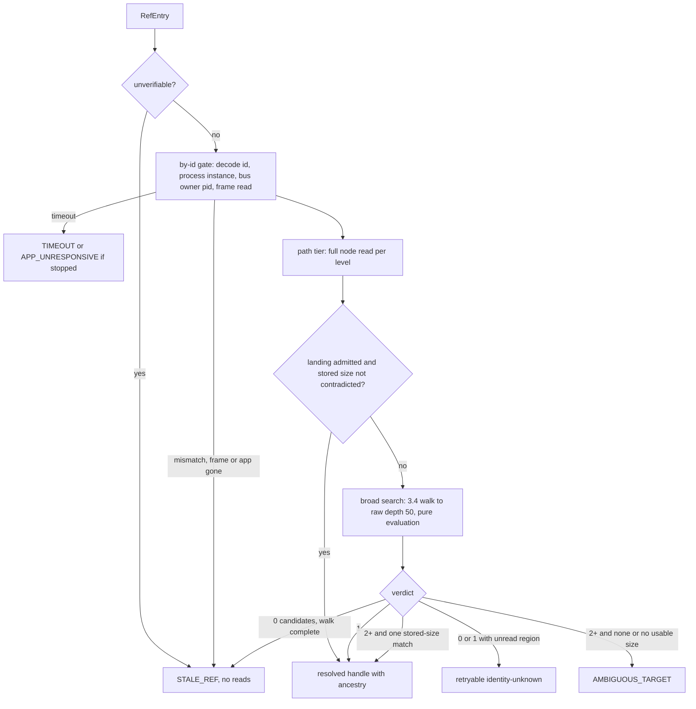
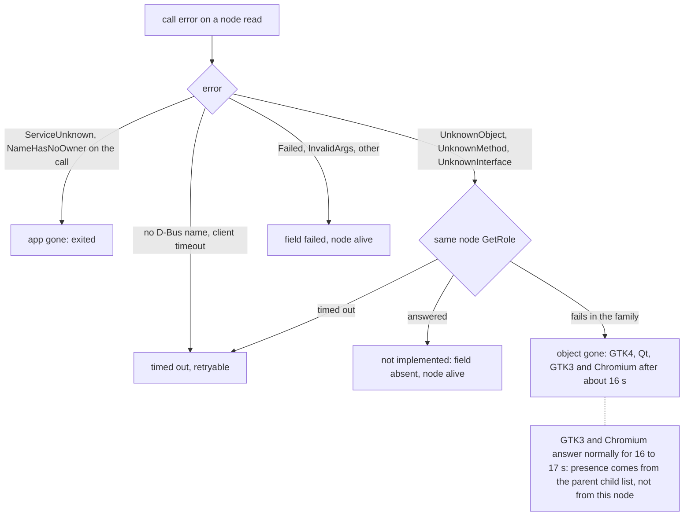

# Linux Resolution and Live Locator (Sub-phase 3.5) - Plan

## Goal Capsule

- **Objective:** an agent on a GNOME desktop that took a `snapshot` can read and target the same elements by ref later and ask `find`, `get` and `is` about the live UI, and a ref whose element changed or left is refused as `STALE_REF`, two equally plausible elements as `AMBIGUOUS_TARGET`, never answered with a different element.
- **Means:** the Linux adapter implements the strict resolver, the path-only anchor and the live reads on top of 3.4's walk and 3.3's vocabulary, with the "object gone" classification decided from the measured error table (`L17-1` to `L17-12`, KD5, KTD9).
- **Authority:** `docs/phases.md` §3.5 as corrected by 3.0-3.4, and further corrected here (U2) where the ledger or the code disproves it (R13).
- **Stop conditions:** stop if a requirement needs a change under `crates/core`; if 3.4's handle stops carrying the frame, scroll-container and web-document ancestry that Element-root `observe_tree` seeds from, or loses the window-id codec, `process_facts` or the per-node `Projector`; or if a requirement can only be met by trusting one D-Bus error name as proof of absence (`L17-2`).
- **Execution profile:** U1 is complete. U2 (roadmap corrections and L17 ingestion), U3 (absence) and U4 (candidate rule) start from it in any order; U5 after U3; U6 after U4 and U5; U7 (`resolve_locator_anchor` and `find` end to end) after U6; U8 (live reads) after U3 and U5; U9 after U6, U7 and U8; U10 after U9; U11 last, because it records the dispositions U9 and U10 produce.
- **Finishes and ships:** the implementer runs the box measurements and live verification, commits, and opens the PR stacked on `feat/linux-3.4-observation`; nothing merges to `main`.

---

## Product Contract

### Summary

Make refs and the live locator work on Linux. After this sub-phase `resolve_element_strict` and `resolve_locator_anchor` re-identify an element from its stored `RefEntry`, `get_live_value`, `get_live_state`, `get_live_actions`, `get_live_element` and `get_element_bounds` read it live, and core's `find`, `get`, `is` and `snapshot --root @ref` run end to end on GNOME apps. `find` returns matches and refs only once `resolve_locator_anchor` exists: through 3.4 it answers counts and empty results and fails every returned match with `PLATFORM_NOT_SUPPORTED` (`L20-3`). Everything the bus cannot tell us stays unknown, and "the object is gone" is told apart from "the toolkit does not implement this" by a table measured on destroyed objects (`L17-1` to `L17-12`), not assumed.

### Problem Frame

3.4 produces refs; nothing yet takes one back to a live element. The ledger measured the traps. GTK has no identifier at all (`L3-8`), so GTK identity is role, name and path (`L3-10`), while Qt's `AccessibleId` is shared by list rows (`L3-9`) and Electron trees differ per launch (`L3-24`). Files' toolbar holds two sibling `View Options` nodes that differ only by width, action count and a toggle child (`L14-5`); 3.3's vocabulary reads them as `button` and `menubutton`, so the role gate already separates them, and the same-role case needs a constructed pair. Zero and `-1` extents are real values and GTK4 containers often report a zero axis (`L2-18`). `showing` is a strict subset of `visible` (`L3-7`). A call to a stopped app returns no D-Bus error, only a client timeout, while the registry still lists the app (`L17-10`, `L11-15`). Window ids are reused across processes (`L8-7`). A Qt process can register two bus connections under one pid (`L20-1`).

U1 measured the central classification the roadmap relied on, and the roadmap was wrong. No single D-Bus error name means "gone":

- An exited application answers `ServiceUnknown` on the call and `NameHasNoOwner` on a bus-daemon query, never `UnknownObject` (`L17-9`).
- A destroyed GTK3 or Chromium object keeps answering every read normally for 16 to 17 s, with `DEFUNCT` never set, and only then answers `UnknownObject` (`L17-6`, `L17-7`, `L17-8`).
- A destroyed GTK4 object answers `UnknownMethod` on everything (`L17-4`); a destroyed Qt object answers `UnknownObject` on methods and `UnknownInterface` on property reads (`L17-1`).
- Live objects return the same names for interfaces they do not implement (`L17-2`), so a name alone proves nothing.
- `Accessible.GetRole` succeeded on every live node of all four toolkits (`L17-11`); the parent's child list never contained a destroyed object, including during the 16 s window in which the object itself still answers (`L17-12`).
- A stopped app produces no error name at all (`L17-10`).

The roadmap also conflates two macOS ideas: `is_definitive_absence` there means "this element does not implement the attribute or action", not "the object is gone". Two further roadmap statements are wrong as written: `resolve_query` is core's evaluator, not adapter code, and the Files twins resolve to one button, not to `AMBIGUOUS_TARGET`, whenever the ref still carries its path or its stored size.

### Requirements

**Resolution**

- R1. A ref taken from a `snapshot` of GNOME Files, Calculator, Settings, Text Editor, Terminal, a Qt window and VS Code resolves to the element it was taken from, checked by an independent observation of that element and not by the command's own `ok`.
- R2. Strict resolution answers `STALE_REF` for zero matches, `AMBIGUOUS_TARGET` for two or more it cannot separate, and a retryable incomplete answer when any candidate could not be read; an unreadable candidate is never a non-match.
- R3. A ref never resolves to an element whose identity or stored size it contradicts (a size is stored only when the ref carries a rect, see KTD3); the one accepted bound is an identity-equal twin at the stored path when the ref carries no usable size (KTD3). A different process, a reused window id, a restarted app, a moved path and a shared native identifier each end in a refusal or a verified match. (Corrected by `L17-19`: this line said "known bounds hash". The hash covers x, y, width and height; GTK3 and Qt positions change on every window move and GTK4 x and y are always 0, so a hash refutation would kill every GTK3 and Qt ref after a plain window move and could never confirm anything on GTK4. Positions are not identity evidence on Linux; size is.)
- R4. Twins that share role and name are proved in both directions: with an intact path, or a stored rect whose size separates them, a ref resolves to exactly the element it came from, including after the window has been moved; without a landing path and without a separating stored size (a default-mode snapshot ref of a named element stores no rect, KTD3), or after a layout change that leaves both sizes unmatched, resolution answers `AMBIGUOUS_TARGET` with two candidates. GNOME Files' `View Options` pair is not such a pair under 3.3's vocabulary: the nodes read as `button` (34 wide) and `menubutton` (23 wide), plus a `switch` child of the same name (24 wide), so the role gate separates them and the Files proof is that each resolves to its own node. The ambiguous direction is proved on a Qt window with two buttons of one name and different widths, whose live test is in the tree (`resolve_live_tests.rs`).
- R5. Qt list rows that share their list's `AccessibleId` resolve by stable text and then stored size, and stay ambiguous when nothing separates them.
- R6. A ref with no id, no stable text and no positive-area bounds is refused as `STALE_REF` before any search, and the live proof shows that the refusal is the documented one.
- R7. `resolve_locator_anchor` returns the element at the stored path or `STALE_REF`, without a broad search, and `find` returns matches with usable refs on real apps because of it.

**Live reads and the locator**

- R8. The five live reads are projections of one node read. A failed read is unknown and never absent, zero and `-1` extents stay values, the `INT32_MIN` sentinel is unknown bounds, a secure field's value is withheld, and `hidden` is added only when both `VISIBLE` and `SHOWING` are absent (`L2-18`, `L3-7`, `L3-27`).
- R9. `find`, `get` and `is` work live, and `snapshot --root @ref` observes the drilled element end to end.

**Absence, liveness and deadlines**

- R10. "Object gone", "app left the bus", "not implemented by this element" and "timed out" are classified from the measured table with one mapping at the resolver boundary. An exited app and a target absent from its parent's child list are a settled `STALE_REF` in one pass. A destroyed object is recognised by its own reads only where the toolkit stops answering (GTK4, Qt, and GTK3 and Chromium after about 16 s); within that window presence is decided by the descent from the verified frame, never by a successful read of a stored path (`L17-6`).
- R11. Every call races the caller's deadline: a stopped app yields a retryable `TIMEOUT`, or `APP_UNRESPONSIVE` where `/proc` shows it stopped (3.4's convention for the same state), and a search that an app stopping mid-way left incomplete is `APP_UNRESPONSIVE` naming the app by the same check, within the command budget, and is never reported as `STALE_REF` (`L17-10`, `L19-1`).

**Process and proof**

- R12. `crates/core` is unchanged, no shipped source names a plan, phase or decision id, pure tests run on every host, and every other requirement is proved by a real run on the GNOME box, in a private session now and on the live session once the owner restores its bus.
- R13. `docs/phases.md` states what was built and no longer states what the evidence disproved (U2); every ledger row naming 3.5 is disposed of, and so are the rows the roadmap text cites under other sub-phases.
- R14. A stranger dogfood of the release binary and an insider end-to-end verification against real GNOME apps with independent oracles are run, and their findings are each disposed of in the pull request description (fixed with an invert-verified test, owned elsewhere in `docs/phases.md`, or accepted with the reason). No report file is committed.
- R15. Latency is measured min-of-seven with the warm-up discarded, and the release binary stays under 15 MiB.

### Key Decisions

- KD1. **Core stays platform-neutral and Phase 3 is trait implementation only.** (session-settled: user-directed — chosen over building an evaluator or adding fields in core: core is the shared surface.) Governs R9, R12. `resolve_query` is core's (`crates/core/src/live_locator/resolve.rs`); this sub-phase supplies the adapter methods it calls, `observe_tree` on an Element root (3.4, already present) and `resolve_locator_anchor`. Anything that would need a core change is written into `docs/phases.md` for the owner and not built.
- KD2. **Tests fail for a real reason, and real runs outrank suites.** (session-settled: user-directed — chosen over broad fixture-driven suites: probe scripts and captures are never read by tests and never committed.) Governs R12. Mapping and classification logic takes plain values so it runs on Linux CI, and every new test is invert-verified.
- KD3. **Box access goes only through `scripts/remote-linux.sh`, never `sudo`, and live verification runs in a private session.** (session-settled: user-directed — chosen over using the live bus, which is broken until the owner restarts it.) Governs R12. Live tests launch real apps inside the session, never kill by name, and never waive an error wholesale. D-Bus-activated apps (Terminal) need `DISPLAY` pushed into the activation environment, as `scripts/private-session.sh` does (`L17-26`).
- KD4. **The PR stacks on `feat/linux-3.4-observation`; nothing merges to `main`.** (session-settled: user-directed — chosen over a PR against `main`.)
- KD5. **Measure before trusting "object gone".** (session-settled: user-directed — chosen over porting the roadmap's `UnknownObject` rule on its word.) Governs R10. Done in U1: the table is `L17-1` to `L17-12` and the result is that no error name alone is evidence (KTD9).
- KD6. **Definitive absence follows the macOS meaning.** (session-settled: user-directed — chosen over the roadmap's conflation: "the element does not implement this" is a complete answer, "the object is gone" is a different one.) Governs R8, R10.
- KD7. **The twin exit criterion is proved in both directions.** (session-settled: user-directed — chosen over a one-direction demonstration.) Governs R4. The proof includes a window move (`L17-19`), and the size-separated direction uses refs that carry a rect (`find`, or a snapshot taken with `--include-bounds`). The `View Options` pair resolves by role (U6 live run); the same-role pair is the Qt twin window.
- KD8. **A `docs/phases.md` statement the evidence disproves is corrected in place, as its own unit, citing rows; ledger rows the roadmap cites under other sub-phases are disposed of or re-tagged.** (session-settled: user-directed — chosen over leaving it for the next planner.) Governs R13. U2 carries the two corrections `L17` proved false, and ingests the L17 rows into the ledger.
- KD9. **The stranger dogfood is a gate.** (session-settled: user-directed — chosen over an author-run check: the operator gets only the shipped skill copy and the box binary.) Governs R14. `skills get platform` failing until 3.13 is a known finding owned by 3.13.
- KD10. **Latency is measured with the probe-corpus cost method.** (session-settled: user-directed — chosen over the macOS-bound comparison script, which cannot run here.) Governs R15.

### Scope Boundaries

- No actionability, hit testing or occlusion (3.6), no actions (3.7), no input (3.8), no launch, close or process state beyond the stopped-app mapping at the resolver boundary (3.9), no screenshot (3.10), no waits on events (3.11).
- No Linux platform skill: it belongs to 3.13. The stranger holds `skills/agent-desktop/` only.
- Considered and not built:
  - An internal retry loop in the resolver. Core already polls a retryable failure every 100 ms inside the caller's deadline and caps one attempt at 4 s (`crates/core/src/ref_resolve_deadline.rs`); Windows keeps its own loop for per-attempt liveness that D-Bus addressing already gives (KTD11). Evidence that would change the call: a dogfood run where core's loop burns the budget on a failure the resolver could have settled.
  - A D-Bus object-path tier beside the child-index path. Decided by U1 and not built: its precondition failed, because Qt object paths do not survive a re-sort (11 of 39 unchanged) or the first expand (37 of 39), while the other three toolkits keep them (`L17-13`). The second fact held on all four, no destroyed path was ever given to a different object (`L17-15`), so the tier is not unsafe, only unavailable on Qt; a Qt-only gap would need a second mechanism anyway. The child-index path fails exactly for the siblings behind an insertion, removal or re-sort (`L17-14`), so those refs take the bounded search, which costs about one snapshot (`L17-23`).
  - A pre- and post-read process-token check on live reads (Windows `with_verified_process`). A call is addressed to a unique bus name that was never observed to answer for another process: the old name is `ServiceUnknown` after exit and `NameHasNoOwner` on the daemon, and a replacement process gets a new name, 0 of 6 old names answering for another process (`L17-18`, one restart per toolkit observed). The pid and process instance are verified once, by the gate (KTD11).
  - A walked-parent address on the handle (an `Ancestry` field). A held GTK3 or Chromium handle answers with stale values for 16 to 17 s after its object is destroyed (`L17-6`, `L17-8`) and a live read cannot tell, because `Parent` is never trusted (`L2-2`) and the handle holds only the frame and scroll-container addresses. Accepted: core resolves by descent immediately before it reads, so the window only matters to code that reuses one handle across UI changes; U11 writes into 3.11's scope that a wait polling an element must re-resolve and not reuse a handle. Evidence that would change the call: a dogfood finding where one command reads a handle after destroying its object.
  - A Chromium leading-chrome path repair (Windows `resolve_chrome_repair`). The path was stable within one document across settle, removal, insertion and body replacement, and one `document web` at one path throughout (`L17-16`); the late second document was not reproducible and is attempted again in U9 (open a file in VS Code). The repair is added only if U9 measures a shift.
  - Stopping the broad search early on a second match. The walk is bounded and the verdict needs the whole picture; the search costs about one snapshot (`L2-5`, `L17-23`: about 0.1 s serial for 200 nodes).
  - Position as evidence. Bounds position is never used to confirm or refute an element (R3).
  - `ElementState.offscreen`. GTK3 offscreen is the `INT32_MIN` sentinel, which is unknown bounds here, and GTK4 offscreen needs a scroll-container comparison that belongs to 3.6.
- Deferred to follow-up work: promoting `hidden` from the live projection into the shared state vocabulary so snapshots carry it too is 3.6's call, because 3.6 owns visibility evidence; the receiving scope is written in U11.

---

## Planning Contract

### Key Technical Decisions

- KTD1. **Layout.** New files by the shared platform layout, one concern each, under the 400-line cap. `crates/linux/src/tree/`: `absence.rs`, `resolve_errors.rs`, `resolve_match.rs`, `resolve_verdict.rs`, `path_descent.rs`, `node_evidence.rs`, `resolve_gate.rs`, `resolve_search.rs`, `resolve.rs`, `resolve_anchor.rs`, `live_read.rs`, `live_project.rs`. `node_read.rs` is at 390 lines and loses `gone` and `field` to `absence.rs`. `projection.rs` (129 lines) gains a per-node entry point (KTD10). `walker_expand.rs` makes `read_observed` visible to the new files. `adapter.rs` only wires. Governs R1-R11.
- KTD2. **One attempt per call; core owns retry.** The resolver makes one attempt and returns errors whose retry stamp is the truth: core's `identity_unknown_error` for an unreadable candidate (a `TIMEOUT` carrying `retryable: true` and a `not_delivered` disposition, which the resolver upgrades to `APP_UNRESPONSIVE` only where `/proc` shows the process stopped), a retryable `TIMEOUT` stamped by core, and settled non-retryable errors for refusals. Chosen over Windows' internal retry loop for the reason in Scope Boundaries. Governs R2, R10, R11.
- KTD3. **Four tiers in Windows' order, with the positional claim stated and size, not position, as geometry evidence.** Unverifiable-entry refusal, window gate, stored-path tier, bounded broad search, then the 0/1/N verdict. The path tier's claim is positional: the element at the stored path still answers to the stored identity and its live width and height do not contradict a known stored size. It is not a uniqueness claim, so a ref whose path still lands resolves even when a twin exists and no usable size is stored. `AMBIGUOUS_TARGET` therefore needs the path tier to decline (index moved, landing refuted, relative drill-down path) and the search to find two candidates the stored size cannot separate. This is Windows' `accept_path_landing` with the geometry key changed: the stored `RefEntry.geometry.bounds` carries the full rectangle when the ref has one, and the Linux resolver compares width and height only, never the hash or the position (`L17-19`). Core stores the rectangle for `find`-materialised refs, for `snapshot --include-bounds`, and for entries with no meaningful identity; allocation drops it from a named or id-bearing entry of a default-mode snapshot (`crates/core/src/ref_alloc.rs`, `if !include_bounds && has_meaningful_identity`), keeping only the hash. Such a ref has no size evidence: it resolves through the path tier and, once the path declines, two identity-equal candidates are `AMBIGUOUS_TARGET`. Persisting the width and height regardless is core's call and is an owner item. A resize or an expand changes a size and sends the ref to the search, where a unique identity match still resolves. Governs R2, R3, R4.
- KTD4. **The path index space is the one the walk stores.** `read_children` drops null and empty child entries before anyone indexes, and 3.4's `source_index` is the position in that filtered list (`admission.indices` over `child_elements`). The descent reads each level with the same `read_node` the walk uses, so both index the same list by construction. A test builds a child list with a null entry from the walker's own output and fails if the descent counts the raw list. A null entry that appears or vanishes between snapshot and resolve shifts later siblings; the landing then fails the identity check and the search takes over, the same shape as the measured insert, remove and re-sort failures (`L17-14`). Governs R1, R3.
- KTD5. **The descent reads the full node at each level, and an empty child list on a web frame is unread.** Cold Chromium returns no children until a read other than `GetChildren` happens (`GetAttributes` woke it, `L17-17`, `L20-6`), so the descent calls `read_node` per level (about 3 ms, `L17-23`) and never `list_children` alone. A level whose child list is empty on a node of a web-family process (`process_facts::read(pid).web_family`) is an unread region, not "lands nowhere", and the answer is the retryable incomplete one that core re-polls. Identity evidence depends on whether a node sits under a `document web` ancestor (3.3: the DOM `id` counts only there), and 3.4's handle already carries that: each level builds the child with `ancestry::child(parent, role)` exactly as `child_elements` does, so the frame, nearest scroll container and web flag ride on every handle the descent, search and anchor return, and 3.4's Element-root observation already seeds `root_in_web` from `element.in_web_document()`. The flag is never defaulted; a handle built without ancestry is rejected as invalid rather than read with a guessed flag, because `identity.rs` reports a DOM identifier as known absent when the flag is false (A1). A child on a different bus name gets its owner pid from the bus daemon as the walk does (`process_id`), and a failed lookup leaves that child unreadable, not absent. Governs R1, R3, R9.
- KTD18. **The handle's frame and the target's bus owner are separate facts and already are.** A node under a cross-bus child has its own bus-owner pid (`pid()`), while the ref's `expected_process` is the containing window's pid (core stamps `entry.process.pid` from the window, `live_locator/materialize.rs`, and derives `expected_process` in `ref_action.rs`). 3.4's `AtspiElement` carries `frame()` with the owning window root's address and pid, `scroll_container()` and `in_web_document()`. The resolver sets the frame from the verified gate (`ancestry::of_root`) and preserves it across every descent, search and anchor result, including a cross-bus hop; 3.7 validates `expected_process` against `frame().pid()` and the target's `pid()` separately (A2). A process may hold two bus connections (`L20-1`): nothing in resolution looks an app up by pid, the window id is the exact bus name and path, and the gate checks that the bus name's owner pid equals the stored pid (KTD7). Governs R3.
- KTD6. **Candidate rule and verdict are Windows' rule over plain values, with size as the geometry key.** Role gate (an unreadable role is unread, a different role is rejected); core `identity_match`; when the ref carries a `native_id` and stable text and the id matched, the stable-text verdict decides (the Explorer id-reuse shape, `A7-3`, and the Qt shared-row-id shape, `L3-9`); geometry promotion only from a positive-area stored rect (`L2-18`, `A17-7`); `size_contradicts` refutes a path landing when both the stored and the live width and height are known and differ; `select_by_stored_size` breaks a tie only when exactly one candidate has the stored width and height and every candidate's extents were read (an unreadable extent could be the element, so it is incomplete, never a size-based win); two or more candidates with no usable stored size are ambiguous even if a region is unread, except that a window-rooted ref whose search read everything first narrows several candidates to those whose depth below the frame equals the stored path length and resolves when exactly one remains (nested twins such as a Files row's cell holding a same-named cell, `L26-1`; it only picks and never refutes); otherwise an unread region withholds the verdict. The functions are pure over `RefEntry` and `LocatorEvidence`, which are core types, so they run on any host. Governs R2, R4, R5, R6.
- KTD7. **The window gate is by id, built on 3.4's pieces.** `window_resolve::resolve_window_strict` is not used: it lists the whole registry (a 300 ms slice for every unresponsive app) and a stopped target is simply absent from the unscoped listing, which would read as a closed window. The gate instead decodes `source_window_id` with `window_id::decode`, requires a stored non-empty process instance (refused as core's action path refuses it, the rule `window_resolve::verify` applies), looks the pid up with `process_facts::lookup` and compares its `instance` (a read that failed because the pid has no `/proc` entry is an exited application; a read that failed any other way is an unidentified process and is retried, never declared exited), reads the frame once with `read_node` (an application that left the bus answers `ServiceUnknown`, which the absence classifier maps to app gone), and last asks the bus daemon for the owner pid of the decoded bus name and compares it to the stored pid. The daemon query goes through a raw-error sibling of `process_id` in `bus_process.rs`: `process_id` maps its failure through `classify`, which turns `NameHasNoOwner` into `PLATFORM_NOT_SUPPORTED`, and an owner lookup that fails after the frame answered is an unidentified owner (retryable), never an exit. A mismatch, a vanished frame (classified by KTD9), or an app that left the bus is a settled `STALE_REF`, so a reused id or a restarted app can never be searched (`L8-7`, `L17-18`). The title is not compared (applications retitle; `verify` does not either). Chosen over the registry listing for cost and for the stopped-app case; U9 times the by-id gate against `resolve_window_strict` once so the choice stands on a number. Governs R3, R11.
- KTD8. **The broad search is 3.4's walk, then a pure evaluation.** It calls `walk_tree` from the verified frame with `WalkLimits::default()` (raw depth 50, 10,000 nodes, 100,000 edges; a resolve has no `ObservationRequest`) and the walk's in-flight cap, projects each node through the per-node projection, and evaluates every node with the KTD6 rule. An incomplete walk (deadline, cap, an unreadable child list, a timed-out level, a childless web frame) marks an unread region and withholds a negative verdict. Re-identification descends from the frame only and never climbs by `Parent` (`L2-2`). The search does not run the settle wait; a cold web tree is the retryable answer. A ref with an empty stored path is the window frame itself: the gate proved the process and the window and one node sits at depth zero, so the frame resolves whenever it answers to the stored evidence, whatever else the search left unread (a background tab's document lists no children). A name that matches several applications while one is stopped is `APP_UNRESPONSIVE` naming it, from the adapter's scoped application lookup, as the scoped window listing answers. Governs R2, R11.
- KTD9. **One pure classifier decides absence; the corroboration is the `GetRole` the node read already issues; presence is the descent's.** `absence.rs` takes the failed call's error and the outcome of the same node's `Accessible.GetRole` (answered, failed in the family below, timed out), and returns what the failure means: the application gone, the object gone, or a failed field. The node's liveness (alive, timed out, object gone, app gone) is derived from `GetRole` alone and is returned beside the node by `read_node_with_liveness`, so the resolver boundary can tell a timed-out node from a failed one. The rules, from the table:
  - `ServiceUnknown` or `NameHasNoOwner` on any call is app gone (`L17-9`).
  - The family `UnknownObject`, `UnknownMethod`, `UnknownInterface` is a suspect, never a verdict (`L17-1`, `L17-2`, `L3-20`, `L2-7`). A suspect on any call with `GetRole` answered leaves the node alive and the field failed (never an error, never an absence): this covers the live Qt `Text` and `Action` reads, the GTK4 `Properties.Get` `InvalidArgs`, and GTK3's `Failed` on unadvertised interfaces. The adapter only reads an interface the node advertises, and an unadvertised one is already the known `Absent` of `skipped_without`, so "not implemented" never has to be inferred from an error name. A suspect with `GetRole` failing in the family is object gone. A suspect with `GetRole` timed out is a failed field on a node whose liveness is timed out.
  - No D-Bus error name with a client timeout (`TIMED_OUT`) is timed out and says nothing about the object (`L17-10`).
  - Any other error is a failed field and never gone.
  - `GetRole` is the corroboration because it succeeded on every live node of GTK3, GTK4, Qt and Chromium and is a plain method (`L17-11`); `GetChildAtIndex(0)` and `Properties.GetAll` are unusable (they fail on live GTK4 childless nodes and on all Qt nodes). It is already in `read_node`'s first batch, so classification needs no extra bus call and no second read.
  - GTK3 and Chromium answer `GetRole` normally for 16 to 17 s after destruction, so "alive" from the node's own reads is not presence. The presence authority is the parent's child list, which is what the path descent and the search read (`L17-12`, 18 of 18, 16 of 16, 18 of 18, 4 of 4, 4 of 4, 8 of 8). A landing therefore counts only when the descent reached it, and a held handle gets no presence guarantee (Scope Boundaries).
  `node_read.rs`'s present `gone` and `field` delegate here, so the walk and the resolver share one definition; `read_node` therefore deserializes the `GetRole` reply first and hands its outcome to every field, because today each field decides gone on its own error name before the role is looked at; the walk's present answers (`ELEMENT_NOT_FOUND`, `APP_NOT_FOUND`) are kept, but a failed universal read beside an answered `GetRole` becomes a failed field and not an error. At the resolver boundary an app that left the bus and a destroyed object both become a settled `STALE_REF` with `retryable: false` and distinct `details.kind`, as does a complete search that found nothing (Windows leaves that one at the default, which core's poll loop retries to the deadline; Linux settles it because nothing was left unread), the shape Windows uses for an exited owner (`A14-4` measured about 5 s wasted otherwise); neither passes through `bus::classify`, which maps the same bus-name errors to `PLATFORM_NOT_SUPPORTED` for the bus-absent case. A timeout is `TIMEOUT`; when `process_facts::is_stopped` says the frame's process is stopped the boundary returns `AdapterError::app_unresponsive(name)`, with the name `app_name::app_name` gives from `process_facts::read(pid)`, the answer 3.4's scoped listing already gives for the same state (`L19-1`). Governs R10, R11.
- KTD10. **Live reads are projections of one node read.** One `read_observed` (the walk's own per-node read: `read_node`, label if the name is blank, value) through 3.3's vocabulary, 3.4's value read and capability table produces role, state tokens, value, bounds, actions and identity, so a live identity equals the snapshot identity the ref came from. `projection.rs` exposes a per-node entry point (`LocatorEvidence` from one `ObservedRead` and its web flag) by splitting `Projector::evidence` from the `WalkedNode` it takes today. Each `get_live_*` projects from it and `get_live_element` returns all of it, as Windows does. Essential evidence is role, state words, extents when the node has Component, actions when it has Action, and value when the role reads one; a structurally absent interface is absent and known, a failed read makes the call fail with core's retryable incomplete answer. Each projection requires only the evidence it returns (value: the value; state: role, state words and value; actions: the action list; element: all of them), and `get_element_bounds` returns `None` for a failed extents read instead of failing, so `is visible` stays "not applicable" for a node whose state is readable. A secure field (`PASSWORD_TEXT`, 3.3's `secure` token) has its value withheld without issuing the read. GTK3 and Qt mask a password at the source (nine bullets) while GTK4 `GetText` returned empty for any entry, so masking is inconclusive there (`L17-21`; `read_text` already reads `CharacterCount` then `GetText(0, count)`): the explicit withholding is the only guarantee on every toolkit. `get_element_bounds` returns a rect for any readable extents including zero-area and `-1` (read from the node's raw extents, not from the locator evidence: core's `Rect::validate` rejects a negative size and a coordinate beyond 10,000,000, and `find` stores the evidence rectangle on the ref it returns, so the projection marks such extents absent bounds evidence; measured on GNOME Terminal, where it made every `find --role button` fail with `INVALID_ARGS`), and `None` for the `INT32_MIN` sentinel or a failed read, so `is visible` reports "not applicable" instead of guessing. Governs R8.
- KTD11. **No process-token check on live reads, and no internal retry.** A handle is `(unique bus name, path, pid)` plus its ancestry. Unique names are not reused within a bus lifetime and a call to a name whose owner exited answers `ServiceUnknown` (`L17-9`, `L17-18`), so a read cannot be served by a different process; the pid and process instance were verified once, by the gate. The measured limit is one restart per toolkit per bus. Governs R3, R11.
- KTD12. **The state projection derives `hidden` from the absence of both `VISIBLE` and `SHOWING`, and nothing else.** Core's `is_visible` reads `hidden` and `offscreen` tokens from the state vector, and 3.3's vocabulary produces neither. A successful state read with neither `VISIBLE` nor `SHOWING` adds the `hidden` token in the live projection. `SHOWING` alone is not the test: on-screen Chromium and Gecko nodes report `VISIBLE` without `SHOWING` (`L3-27`), so a `SHOWING`-only rule would mark visible nodes hidden. `showing` is a strict subset of `visible` (`L3-7`); `enabled` is `ENABLED` or `SENSITIVE` as 3.3 decides; `ElementState.hidden` and `offscreen` stay unset, as on Windows. Measured edges (`L17-5`, `L17-20`): GTK3 non-current tab content is `VISIBLE` without `SHOWING` with `INT32_MIN` extents (not hidden by this rule, but its bounds are `None`, so `is visible` is "not applicable"); Qt hidden-page content has neither `SHOWING` nor `VISIBLE`, except a list row inside a hidden page, which keeps both (accepted, 3.6 owns visibility); GTK4 hidden tab pages leave the tree while the stored path still answers with stale `SHOWING`, `VISIBLE` and extents, so a ref into a GTK4 hidden page is `STALE_REF` through the descent and a held handle there reads stale states. Snapshots keep 3.3's tokens, so a live read can be more specific than the ref it resolved; the follow-up to unify them is 3.6's. Governs R8.
- KTD13. **Index path plus fingerprint is the shipped identity; no object-path tier.** Settled by U1 (Scope Boundaries, `L17-13` to `L17-15`). Governs R3.
- KTD14. **Unverifiable refs and Chromium path shift.** Windows' `entry_is_unverifiable` is adopted unchanged (no id, no stable text, no positive-area stored rect), so an unnamed zero-axis GTK4 container ref with no stored path is refused before any read, while one with a stored path lands on that path only when the node there is as bare as the ref (same role, no name, description, identifier or area) and is otherwise refused and never searched (1 of 127 refs of a default-mode snapshot, `L17-25`). The size of that class needs the 3.4 projection and is counted in U9 over the measured apps (`L17-25`). A Chromium chrome-versus-document path shift is unmeasured (`L17-16`: no second document could be produced); U9 attempts it again by opening a file in VS Code, and a repair is added only on a measured shift. Governs R3, R6.
- KTD15. **Anchor is path-only and gated.** `resolve_locator_anchor` runs the by-id window gate (no unverifiable-entry refusal: the entry was built from the element just observed, an unnamed zero-area container is a legitimate `find` match, and measured on Files, Calculator, Settings, Text Editor, Qt and VS Code the refusal made `find --role group` fail outright; core's hydration checks identity and geometry itself), descends the stored path with the full node read, and answers the element if its role matches. A step that lands nowhere, a role mismatch, or a gone object is `STALE_REF` at once; only the transport class is retryable; an expired deadline is `TIMEOUT`. Core's hydration re-reads the handle as an Element root and checks identity itself, so the anchor's handle carries the ancestry of KTD5 and the Element-root walk seeds from it (A1). Implementing it is what lets `find` return matches (`L20-3`); the end-to-end proof is its own unit (U7). The Element-root observation of a drilled or hydrated element is read once and never waits for a web tree to grow: the settle rule's shell ceiling (32 nodes) is larger than most hydrated subtrees, so it waited out 70 percent of the budget for every VS Code match (14 s measured for one). Governs R7, R9.
- KTD16. **Error constructors build `AdapterError::new(ErrorCode::StaleRef, ...)` directly.** `scripts/check-stale-ref-constructor-misuse.sh` counts call sites of `AdapterError::stale_ref` and expects exactly the ref-id callers; the resolver builds its refusals with the snapshot-refresh suggestion and the not-delivered disposition, as Windows' `resolve_match.rs` does (`stale_ref_because` is the same shape in core and the script counts only the literal `stale_ref(`, so it is allowed and is used). Payload kinds follow Windows (`resolve_no_candidate`, `resolve_owning_process_exited`, `resolve_ambiguous` with `candidate_count`, `live_element_invalid`); `identity_unknown_error` and `mark_deadline_elapsed` come from core. Governs R2, R10.
- KTD17. **Every call races the deadline.** Each descent level and each search runs inside `system::within(deadline, ...)` with a `Deadline::is_expired` check between levels (`ensure_budget` is not exported from `system`), so a stopped app cannot exceed the command budget; the connection's own method timeout is 5 s (`DEFAULT_OPERATION_TIMEOUT_MS`), longer than most command budgets. Governs R11.

### High-Level Technical Design

The second diagram is the table of `L17-1` to `L17-12`: GTK3 and Chromium answer everything for 16 to 17 s then `UnknownObject`; GTK4 `UnknownMethod` on all 20 reads; Qt `UnknownObject` on methods and `UnknownInterface` on property reads; exited apps `ServiceUnknown`; stopped apps a client timeout with the registry still answering.

### Assumptions

- 3.4 at head provides: Element-root `observe_tree` seeded from the handle's ancestry (`observe_with` sets `root_in_web` from `element.in_web_document()`), `AtspiElement` with `frame()`, `scroll_container()`, `in_web_document()` and `set_ancestry`, `ancestry::{of_root, child}`, the window-id codec (`window_id::decode`), `process_facts::{read, is_stopped}`, `process_id`, `within`, the walk with each slot's `source_index` in the null-filtered list, `read_node` with the `GetAll` to individual-`Get` fallback for Qt (`L17-3`), `value_read.rs`, `action_names.rs`, the per-node `Projector`, `one_entry_per_process` in `system/app_ops.rs` (one listing entry per process even with two bus connections, `L20-1`). If a piece differs the plan stops. Gaps this plan fills itself: a per-node projection entry point (KTD10) and widening `read_observed` and `child_elements` visibility. What 3.4 must still settle for 3.5: that a Chromium frame's first read in its walk is the full node read (the wake, `L17-17`), which `read_node` already is.
- The private-session method of 3.1 works: `dbus-run-session` under a private `XDG_RUNTIME_DIR`, `xvfb-run`, openbox and xdotool from the tool root for window moves, real GNOME apps with `XDG_CURRENT_DESKTOP=GNOME`, the Qt helper of 3.2, VS Code at `~/.local/ad-tools/vscode/app/code` launched with `--disable-gpu --password-store=basic` through `live_launch.rs` `vscode_arguments` (an empty keyring blocks VS Code's UI thread about 3 s after launch, `L19-4`, which is the cause of the earlier `L17-24` collapse), Chrome and the snap Firefox.
- Objects can be destroyed without input synthesis: GTK apps export `org.gtk.Application` and `org.gtk.Actions` reachable with `gdbus call`; the Qt helper closes itself on request; Chromium DOM removal and body replacement run through `Action.DoAction` on in-page buttons (`L17-8`); apps are ended by signal to the pid the session launched.
- The live AT-SPI bus is broken until the owner restarts it, so the live-session re-run is a later step.

### Sequencing

U1 is complete. U1 → (U2, U3, U4); U3 → U5; (U4, U5) → U6; U6 → U7; (U3, U5) → U8; (U6, U7, U8) → U9 → U10; (U2, U9, U10) → U11.

Size: Windows' resolver and live-read code is about 2.3k non-test lines across nine files plus about 3.7k of tests. This plan is roughly 2.5k lines of code and 1.5k of tests, above the roadmap's 2k estimate. The natural seam for two stacked PRs is after U7 (absence classification, candidate rule, descent, strict resolver, anchor and `find`) with U8, U9 and U10 (live reads, live proof, dogfood) as the second; cutting there is the owner's call and changes no requirement.

---

## Implementation Units

### U1. Measurements before code (complete)

- **Goal:** replace the plan's assumptions about destroyed objects, path stability and bounds with observations on the box.
- **Status:** done. The result is `probes/linux/rows/L17.md` (outside the repository): 26 rows `L17-1` to `L17-26`, the destroyed-object error table, two contradicted `docs/phases.md` sentences with replacements, and a not-measured list. Three rows are `DEFERRED` and the plan owns their closure: `L17-16` (Chromium path shift, U9), `L17-24` (VS Code, explained by `L19-4`, U9 with `--password-store=basic`) and `L17-25` (unverifiable share, U9 over the 3.4 projection). Not measured: the bus owner pid for a child on another bus name, a Chrome password field, Settings, Text Editor and Firefox (U9 covers them).
- **Requirements:** R3, R6, R8, R10, R13.
- **Test expectation:** none -- measurements.

### U2. Roadmap corrections and L17 ledger ingestion

- **Goal:** `docs/phases.md` stops stating what `L17` disproved, and the L17 rows enter the ledger.
- **Requirements:** R13.
- **Dependencies:** U1.
- **Files:** `docs/phases.md`, `probes/linux/FINDINGS.md`.
- **Approach:** this is a correction unit with its own review. Rewrite in place, citing rows, no "previously" notes.
  1. §3.5 scope bullet 4 (the `resolve_locator_anchor` bullet) and the §3.5 Key APIs line: replace "distinguishing 'object no longer on the bus' (D-Bus `UnknownObject`/`UnknownMethod` errors) from a genuine timeout" and "AT-SPI2 D-Bus error classification (`org.freedesktop.DBus.Error.UnknownObject` vs timeout)" with the true statement of `L17-1`, `L17-2`, `L17-6`, `L17-9` and `L17-10`: an exited application (`ServiceUnknown` on the call, `NameHasNoOwner` on a bus-daemon query) and a destroyed object (absent from its parent's child list, and its own `Accessible.GetRole` failing with `UnknownObject`, `UnknownMethod` or `UnknownInterface` depending on the toolkit, after a delay of about 16 s on GTK3 and Chromium in which the stale object still answers) are told apart from a genuine timeout (a client-side timeout with no D-Bus error name); a single such error name is not enough because live objects return the same names for interfaces they do not implement. The Key APIs line becomes the corresponding list (`ServiceUnknown`/`NameHasNoOwner`, `Accessible.GetRole` corroboration, parent `GetChildren`, client timeout).
  2. The batched-fetch bullet (`L17-3`): §3.2 already states that Qt answers `UnknownInterface` to `GetAll` and that the read falls back to per-property `Get` (cited L3-21); add `L17-3` to that citation and add nothing else. The probe rows file labels the correction "§3.4", but the sentence sits in §3.2's Scope and is already true.
  3. The other §3.5 statements that are wrong as written, in the same pass: the resolver bullet (the twins: one button whenever the path lands or a stored size separates them, `AMBIGUOUS_TARGET` only when the path tier declines and the search finds two the size cannot separate, `L14-5`, `L17-19`), the `resolve_query` bullet (core's, `crates/core/src/live_locator/resolve.rs`, `hydrate.rs`; the adapter supplies Element-root `observe_tree`, `resolve_locator_anchor` and the live reads), and the absence bullet's "ported from macOS's `is_definitive_absence`" (macOS's term means the element does not implement the probed attribute or action, `crates/macos/src/tree/ax_absence.rs`). The §3.5 resolver-depth bullet is already in §3.5 at 3.4's head; leave it.
  4. Ledger ingestion: the repository ledger has area L17 with only `L17-17` copied by 3.4. Add the remaining rows `L17-1` to `L17-16` and `L17-18` to `L17-26` from the probe rows file verbatim (ids unchanged, `L17-17` not duplicated), each with a `3.5` action cell as the file gives, keeping `L17-16`, `L17-24` and `L17-25` as `DEFERRED` with closure 3.5 until U11 disposes of them. `docs/phases.md` also gains the owner items found at the refresh gate (the dropped stored rectangle and the window-relative geometry key). Add contradictions-index entries for the corrected statements (`L17-1`, `L17-2`, `L17-6`, `L17-9`) and `L17-3` for the §3.2 citation. For `L3-9`, `L3-10`, `L3-24` and `L14-5` append a `3.5` clause to the action cell so the checker lists them; dispose of `L12-6` as accepted. Rows from `L20` that name 3.5 (`L20-3`) are disposed in U11.
- **Test expectation:** none -- documentation; the ledger checker and the citation check are the gate.
- **Verification:** `python3 scripts/check-linux-findings.py` exits 0; `L17-17` appears once; `docs/phases.md` no longer contains the two quoted sentences, "LocatorQuery evaluator" or "pair resolves to `AMBIGUOUS_TARGET`" without its condition; every ledger id cited in §3.5 exists. `--sub-phase 3.5` still lists the three `DEFERRED` rows until U11.

### U3. Absence classification and resolver errors

- **Goal:** one definition of gone, not implemented, timed out and failed, shared by the walk and the resolver, and the error values the resolver returns.
- **Requirements:** R2, R10, R11.
- **Dependencies:** U1.
- **Files:** `crates/linux/src/tree/absence.rs`, `crates/linux/src/tree/absence_tests.rs`, `crates/linux/src/tree/resolve_errors.rs`, `crates/linux/src/tree/resolve_errors_tests.rs`, `crates/linux/src/tree/node_read.rs`, `crates/linux/src/tree/node_read_tests.rs`, `crates/linux/src/tree/mod.rs`.
- **Approach:** KTD9, KTD16. `absence.rs` holds the pure classifier over (error name, advertised interface, `GetRole` outcome) and the per-node rule that turns the node's suspects plus its own `GetRole` outcome into a node verdict, with constants for the three family names (`UnknownInterface` is new). `node_read.rs` delegates `gone` and `field` to it. `resolve_errors.rs` builds the refusals and the stopped-process mapping (`TIMEOUT` becomes `app_unresponsive` when `process_facts::is_stopped` is true). `stale_ref_because` passes `check-stale-ref-constructor-misuse.sh` (it counts the literal `stale_ref(`) and is the constructor.
- **Execution note:** write one test per row of the table first, using the recorded error names and messages as inputs, then the classifier.
- **Patterns to follow:** `crates/windows/src/tree/resolve_match.rs` (`stale_ref_error`, `owning_process_exited_error`, `ambiguous_target_error`); `crates/macos/src/tree/ax_absence.rs` and its "transport failures are never absence" tests.
- **Test scenarios:**
  - `ServiceUnknown` and `NameHasNoOwner` classify as app gone whatever the call context (`L17-9`).
  - GTK4: `UnknownMethod` on every read with `GetRole` failing the same way is object gone (`L17-4`). Qt: `UnknownObject` on methods and `UnknownInterface` on property reads with `GetRole` failing is object gone (`L17-1`).
  - The same names with `GetRole` answered are not implemented and the node stays alive: Qt `Text.GetText`/`Action.GetName` `UnknownObject`, Qt `Properties.Get(Value)` `UnknownInterface`, GTK4 `Text.GetText` `UnknownMethod` and `Properties.Get(Value)` `InvalidArgs`, GTK3 `Properties.Get(Value)` `Failed` (`L17-2`).
  - The GTK3/Chromium zombie sample, every read answering with the old values and `GetRole` answered, is alive; the classifier cannot and does not claim it is gone (`L17-6`, `L17-8`).
  - A suspect with a timed-out `GetRole` is timed out, never gone; a client timeout with no error name is timed out (`L17-10`).
  - `Failed`, `InvalidArgs` and any other name is a failed field and never gone; an absent field is never produced by a failure (3.2 dogfood F4).
  - `Properties.GetAll` failing with `UnknownInterface` on a live Qt node is not an absence signal and the individual reads proceed (`L17-3`).
  - Classification issues no call: the functions take the replies the node read already holds and have no connection parameter, so the call count of a node read is unchanged by construction.
  - App gone and object gone both map to `STALE_REF` with `retryable: false`, disposition not-delivered, and different `details.kind`; a timeout maps to `TIMEOUT`, and to `APP_UNRESPONSIVE` when the stopped-process predicate is true; ambiguity carries `candidate_count` and `retryable: false`.
  - The walk's present answers are unchanged: a gone root still reads as `ELEMENT_NOT_FOUND` and an app gone as `APP_NOT_FOUND` in `node_read` (a test the file lacks today).
- **Verification:** the scenarios pass; inverting the `GetRole` corroboration (calling gone on the name alone) fails the live-Qt-shape test, and inverting the timeout branch fails the timed-out test.

### U4. Candidate rule and verdict

- **Goal:** the rule that decides which live nodes match a stored ref and what the set of matches means, as pure functions.
- **Requirements:** R2, R3, R4, R5, R6.
- **Dependencies:** U1.
- **Files:** `crates/linux/src/tree/resolve_match.rs`, `crates/linux/src/tree/resolve_verdict.rs`, `crates/linux/src/tree/resolve_match_tests.rs`, `crates/linux/src/tree/resolve_verdict_tests.rs`, `crates/linux/src/tree/mod.rs`.
- **Approach:** KTD6. `resolve_match.rs` has the role gate, the composed identity rule with the corroboration tier, geometry promotion, `size_contradicts`, and `entry_is_unverifiable`. `resolve_match.rs` also holds `accepts_landing` (the path tier's rule: no size contradiction, then admission). `resolve_verdict.rs` has `select_by_stored_size` and the classification over candidate rectangles, the stored rectangle and an unread flag; it compares widths and heights only. Both take `RefEntry` and `LocatorEvidence`; neither touches the bus; neither reads a position or a bounds hash.
- **Patterns to follow:** `crates/windows/src/tree/resolve_match.rs`, `resolve_search.rs` (`admit_node`, `provisional_geometry_candidate`, `geometry_contradicts`, `entry_is_unverifiable`), `resolve_ambiguity_tests.rs`, `resolve_tie_break_tests.rs`.
- **Test scenarios:**
  - Role gate: an unreadable role is unread and withholds the verdict, a different role is rejected, an equal role proceeds.
  - Two Qt list rows with the same `AccessibleId` and different stored text: the id matches both, the stable text refutes one (`L3-9`); with identical text and equal sizes both stay candidates.
  - An id match with no stored text resolves on the id alone; an id `Unknown` (identifiers incomplete) is incomplete, never refuted.
  - The 34-wide and 23-wide `View Options` rects (`L14-5`): `select_by_stored_size` over them with the first's stored size resolves index 0, with the second's resolves index 1, with a size matching neither is ambiguous, with no usable stored size is ambiguous, and with two candidates of the same size is ambiguous. The same stored rect with every position changed (a window move) selects the same candidate, and a rect whose position is `[0, 0]` for every candidate (GTK4, `L17-19`) selects the same candidate: position is never read.
  - `size_contradicts` is true only when both sizes are known and differ; an unknown live size is not a refutation; a differing position alone is not a refutation.
  - Geometry promotion needs a positive-area stored rect: `[0,0,710,0]` (the Files `group`, `L14-4`) never promotes, and a text-less zero-area ref is unverifiable.
  - Classification: two matches with no usable stored size are ambiguous even with an unread region; one match with an unread region is incomplete; zero matches with a complete walk is stale; zero with an unread region is incomplete; two identity matches of which one has unreadable extents are incomplete even with a stored size that the other matches.
- **Verification:** the scenarios pass; inverting the corroboration tier, the positive-area check, the position-blindness, or the unread-region rule fails its test.

### U5. Path descent and the single-node evidence read

- **Goal:** walk a stored child-index path in O(depth) full node reads and read one node's evidence in the form the resolver and the live reads share.
- **Requirements:** R1, R3, R8, R11.
- **Dependencies:** U3.
- **Files:** `crates/linux/src/tree/path_descent.rs`, `crates/linux/src/tree/path_descent_tests.rs`, `crates/linux/src/tree/node_evidence.rs`, `crates/linux/src/tree/node_evidence_tests.rs`, `crates/linux/src/tree/projection.rs`, `crates/linux/src/tree/walker_expand.rs`, `crates/linux/src/tree/element.rs`, `crates/linux/src/tree/mod.rs`.
- **Approach:** KTD4, KTD5, KTD10, KTD17. `path_descent.rs` is generic over a node-source closure (a full node read per level), as `walk_levels` is over `expand`, and returns a landing with the element if any and whether the step left a region unread; the handle for each level is built with `ancestry::child(parent, role)` as `child_elements` does. `node_evidence.rs` runs the walk's per-node read (`read_observed_with_liveness`: the node read, the label if the name is blank, the value), 3.3's vocabulary with the web flag the handle carries, 3.4's value read and capability table, and the per-node projection (`projection::project_node`), and returns the observed read, its `LocatorEvidence` and the node's liveness; it refuses a handle with no window frame. `path_descent.rs` also holds `level_of` (the children a node read gives, with the walk's ancestry) and `Levels`, the reader on the shared connection that learns each bus name's owner once. `projection.rs` splits `Projector::evidence` so one node projects without a `WalkedNode`. `walker_expand.rs` exposes `read_observed` to siblings (`child_elements` already is). `element.rs` makes `into_native_handle` available outside tests.
- **Patterns to follow:** `crates/windows/src/tree/resolve_descent.rs`; the closure seam of `walk_levels` in `crates/linux/src/tree/walker.rs`.
- **Test scenarios:**
  - A path of three indices lands on the third child of the second child of the first; an index past the end lands nowhere and reports no unread region.
  - A child list with a null entry at position 0: the descent index equals the `source_index` the walker stored for the same child, and a descent that counted the raw list lands one sibling off (the pin of KTD4).
  - A level whose child list is empty on a web-family process is an unread region and no landing, not "lands nowhere" (`L17-17`); the same on a non-web process lands nowhere.
  - A read error on one level reports an unread region and no landing; an app-gone error on a level is carried up for the boundary mapping, not swallowed as a miss.
  - Presence: a destroyed object whose own reads still answer (GTK3 zombie sample) is not reached when its parent's child list no longer lists it; the descent returns "lands nowhere" (`L17-6`, `L17-12`).
  - A child on another bus name is followed, its owner pid is looked up once per name, and a failed lookup yields an unreadable landing. Two bus names with one pid (the Qt shape, `L20-1`) both resolve and nothing keys on pid alone.
  - Passing through a `document web` role sets the web flag in the returned handle; a DOM-id ref compared against a landing read with the flag gets its DOM identifier, and the same landing read with a false flag gets the DOM identifier as known absent, which would refute the ref: so a landing is never read with a flag other than the one the descent carried, and a handle without ancestry is refused as invalid, pinned by a test that builds the false-flag read and expects the refusal (A1).
  - A handle returned from a landing below a `document web` node, passed to the Element-root walk, seeds the walk's first node with the flag: the DOM identifier of a node below the document root is present in the drill-down, and absent when the ancestry is forced false (the pin of the handoff).
  - A landing under a cross-bus child keeps the owning frame's pid distinct from the child's bus-owner pid in the returned handle (KTD18).
  - A level that exceeds the deadline ends the descent with the deadline's timeout error and no landing.
  - The empty path lands on the frame.
- **Verification:** the scenarios pass; inverting the filtered-index rule, the web-flag carry, or the empty-web-frame rule fails its test.

### U6. Strict resolver

- **Goal:** `resolve_element_strict` on the Linux adapter.
- **Requirements:** R1, R2, R3, R4, R5, R6, R10, R11.
- **Dependencies:** U4, U5.
- **Files:** `crates/linux/src/tree/resolve_gate.rs`, `resolve_search.rs`, `resolve.rs` (the resolution over a `Source` trait), `resolve_source.rs` (the bus implementation and `resolve_element_strict`), `resolve_fake.rs` (the in-memory source the assembly tests use), `resolve_tests.rs`, `resolve_refusal_tests.rs`, `resolve_web_tests.rs`, `resolve_search_tests.rs`, `resolve_gate_tests.rs`, `resolve_live_tests.rs` (`#[ignore]`: every snapshot ref of Files, Calculator, Text Editor, Terminal, a Qt window and VS Code resolves to the node it was taken from; the Files `View Options` nodes each resolve to their own; two same-name Qt buttons are told apart by path and by stored size and are ambiguous with neither), `live_qt.rs`, `mod.rs`, `system/bus_process.rs` (a raw-error owner lookup), `adapter.rs`.
- **Approach:** KTD2, KTD3, KTD7, KTD8. `resolve_gate.rs` runs the unverifiable refusal and the by-id gate, mapping every failure to the settled `STALE_REF` of U3 and a timeout to the stopped-aware timeout. `resolve_search.rs` drives `walk_tree` from the verified frame to raw depth 50 and evaluates each node with U4. `resolve.rs` composes gate, path tier (eligible only for a window-rooted ref with a non-empty absolute path, Windows' `window_rooted` rule), search and verdict. `adapter.rs` wires `resolve_element_strict` and returns the handle as `AtspiElement` carrying ancestry with the gate's frame.
- **Execution note:** write the assembly tests against a fake node source and a fake gate first; they exercise the same generic walk the live code uses.
- **Patterns to follow:** `crates/windows/src/tree/resolve.rs`, `resolve_search.rs`, and their tests (`resolve_tests.rs`, `resolve_landing_tests.rs`, `resolve_dead_process_tests.rs`).
- **Test scenarios:**
  - Covers R4. Twin buttons with widths 34 and 23: the path lands on the second twin and its size does not contradict, so it resolves to the second twin and no search runs (read count proves it).
  - Covers R4. The same ref with no stored size and an intact path still resolves to the second twin positionally.
  - Covers R4. The same ref with every live position shifted (a moved window) and the path intact still resolves to the second twin; with the path emptied it resolves to the second twin through the search by stored size; with the path emptied and no usable stored size, `AMBIGUOUS_TARGET` with `candidate_count` 2 and `retryable: false`; with the path emptied and a stored size that matches neither, `AMBIGUOUS_TARGET`.
  - A path that lands on a different element (index shift) declines and the search resolves the unique match; a landing whose identity matches but whose live size contradicts a known stored size declines.
  - Covers R3. A GTK4 hidden-page ref (the page has left the tree while its stored path still answers with stale `SHOWING`, `L17-5`): the descent does not land, the search finds no candidate, the answer is `STALE_REF`, and no direct-path read is ever issued.
  - A unique match with a complete walk resolves; zero matches with a complete walk is `STALE_REF` (`resolve_no_candidate`); zero or one match with a level that timed out, or a childless web frame, is the retryable identity-unknown answer and never `STALE_REF`.
  - Covers R3. A process instance that differs from the stored one, a bus-name owner pid that differs from the stored pid, a frame that no longer exists, and an app that left the bus each end in `STALE_REF` with `retryable: false`, with zero search reads; an empty stored process instance is refused the same way. A window id whose process instance matches but whose frame answers from a zombie (GTK3) is still reached only through the descent.
  - Covers R6. A ref with no id, no stable text and a zero-area rect is `STALE_REF` with zero reads of any kind.
  - A drill-down ref with a relative path (root ref set, path not absolute) skips the path tier and searches.
  - Covers R11. A deadline that expires mid-search returns the timeout error, which is not `STALE_REF`; a deadline already expired returns it before the gate reads; a timeout with the stopped-process predicate true returns `APP_UNRESPONSIVE`.
  - Covers R5. Two list rows sharing a native id with different stored text resolve to the one whose text matches; with equal text and equal size, ambiguous.
  - Covers R3, R9. A DOM-id ref to a node below a `document web` ancestor resolves through the path tier and through the search, and the returned handle carries the web flag; handing that handle to the Element-root walk yields the DOM identifier, so core's hydration identity check accepts it (A1).
  - Covers R3. A ref whose element sits under a child on another bus name, whose bus-owner pid differs from the window's pid, resolves, and the handle holds the frame's pid (the ref's process) and the child's own pid as separate values; a failed owner lookup for the child is the retryable identity-unknown answer (A2).
- **Verification:** the scenarios pass; inverting the positional acceptance, the stored-size tie-break, the unread-region rule, the gate's process-instance check, or the stopped-process mapping fails its test.

### U7. `resolve_locator_anchor` and `find` end to end

- **Goal:** implement `resolve_locator_anchor` so `find` returns matches and refs on real apps; through 3.4 every returned match fails with `PLATFORM_NOT_SUPPORTED` because core hydrates each one through this method (`L20-3`).
- **Requirements:** R7, R9, R3, R10, R11.
- **Dependencies:** U6.
- **Files:** `crates/linux/src/tree/resolve_anchor.rs`, `crates/linux/src/tree/resolve_anchor_tests.rs`, `crates/linux/src/tree/find_live_tests.rs` (`#[ignore]`, in the style of 3.2's live walk, reusing `live_launch.rs`), `crates/linux/src/tree/mod.rs`, `crates/linux/src/adapter.rs`.
- **Approach:** KTD15. `resolve_anchor.rs` is the path-only variant: the by-id gate of U6, the descent of U5, a role check, and a handle carrying ancestry. `adapter.rs` wires `resolve_locator_anchor`. The live test drives core's own `find` through the real adapter (not a hand-built call to the anchor), reads each returned ref back through `resolve_element_strict`, and compares to an independent read.
- **Patterns to follow:** `crates/windows/src/tree/resolve_anchor.rs` and its tests (`resolve_anchor_tests.rs`, `resolve_anchor_count_agreement_tests.rs`); core `live_locator/hydrate.rs` for the contract.
- **Test scenarios:**
  - Unit: the path lands on a role-matching element and returns it with zero search reads, and its handle carries the web flag and the frame's pid; a step that lands nowhere, a role mismatch and a gone object are `STALE_REF` at once; a transport failure is retryable; the gate refusals apply, and an unnamed zero-area container still lands; an app that exited between the `find` observation and hydration is `STALE_REF` with `retryable: false`.
  - Unit: core's hydration of a handle returned by the anchor, through the Element-root walk with a fake bus, reproduces the node's identity including the DOM identifier below a `document web` ancestor (A1).
  - Live (Calculator, Files, Terminal, Settings, Text Editor, a Qt window, VS Code with `--password-store=basic`): `find --role button` (and `--first`, and the default listing) returns matches, not `PLATFORM_NOT_SUPPORTED`; the number of matches equals `find --count`; every returned ref is a qualified ref, resolves through `resolve_element_strict` to the node it came from (role, name and bounds equal an independent second read), and `find` with no match still succeeds empty. In Files, `find` for `View Options` returns its `button`, `menubutton` and `switch` nodes with distinct refs.
- **Verification:** the scenarios pass; stubbing the anchor back to `not_supported` fails the live `find` test, and returning the first role match without the descent fails the unit test that expects `STALE_REF` for a moved path.

### U8. Live reads

- **Goal:** the five live reads as projections of one node read.
- **Requirements:** R8, R9, R10, R11.
- **Dependencies:** U3, U5.
- **Files:** `crates/linux/src/tree/live_read.rs`, `crates/linux/src/tree/live_project.rs`, `crates/linux/src/tree/live_project_tests.rs`, `crates/linux/src/tree/live_read_tests.rs`, `crates/linux/src/tree/mod.rs`, `crates/linux/src/adapter.rs`.
- **Approach:** KTD10, KTD12, KTD9. `live_read.rs` decodes the handle, reads the node once through U5, maps a gone node or app to the settled `STALE_REF` of U3, a timeout through the stopped-aware mapping, and a missing essential field to core's incomplete answer. `live_project.rs` is pure: state tokens plus `hidden`, `enabled`, value with the secure rule, bounds with the sentinel rule, actions through 3.4's table. `get_live_element` assembles identity, state, `states_complete`, bounds and actions from the same read.
- **Patterns to follow:** `crates/windows/src/tree/live_read.rs` (`live_state`, `live_actions`, `live_element`, `essential_live_evidence_complete`).
- **Test scenarios:**
  - Covers R8. A successful state read with neither `VISIBLE` nor `SHOWING` adds `hidden`, so core's `is_visible` is false for a node with real extents; `VISIBLE` without `SHOWING` adds nothing (`L3-27`); with `SHOWING` set it adds nothing and `is_visible` is true; a failed state read yields the incomplete answer, not an empty state list.
  - GTK3 non-current-tab content (`VISIBLE`, no `SHOWING`, `INT32_MIN` extents, `L17-20`): `hidden` is not added and bounds are `None`, so `is visible` is "not applicable".
  - `ENABLED` alone and `SENSITIVE` alone (the GTK4 shape) give `enabled: Some(true)`; neither gives `Some(false)` with the `disabled` token; `offscreen` is never set.
  - Bounds: a `[0,0,710,0]` rect and a `[-1,-1,-1,-1]` rect return as values; the `INT32_MIN` sentinel and a failed read return `None`; a node without Component returns `None`.
  - Value: a slider's `Value` interface reads its number; a text field reads its contents; a role with no value returns `None` without a read; a `PASSWORD_TEXT` node returns `None` and the counting fake shows no `Text` read was issued; a failed value read on a non-secure field is the incomplete answer, not `None`.
  - Actions: names map to core tokens by 3.4's table; a node with no Action interface returns an empty known list; a failed action read is the incomplete answer.
  - One read: a fake counting node reads shows `get_live_element` costs one node read, and `get_live_state` after it costs one more, never five.
  - Gone: an object gone (`GetRole` failing in the family) and an app gone each return `STALE_REF` with `retryable: false`; a timeout returns `TIMEOUT` and the stopped-process case `APP_UNRESPONSIVE`.
  - A handle built by another platform or empty is `INVALID_ARGS`, as `atspi_element` already answers.
- **Verification:** the scenarios pass; inverting the `hidden` rule (both `VISIBLE` and `SHOWING` absent), the secure withholding or the sentinel rule fails its test.

### U9. Live verification and performance

- **Goal:** prove the requirements on real apps in a private session now, re-run them on the live session later, and measure cost; close the three deferred L17 rows.
- **Requirements:** R1-R11, R12, R15.
- **Dependencies:** U6, U7, U8.
- **Files:** `crates/linux/src/tree/resolve_live_tests.rs` and `resolve_twin_live_tests.rs` (extended: U6 created them), `crates/linux/src/tree/live_read_live_tests.rs`, `crates/linux/src/tree/absence_live_tests.rs` (all `#[ignore]`, in the style of 3.2's live walk, reusing `live_launch.rs`; `find_live_tests.rs` is U7's).
- **Approach:** the tests launch their own apps, take a snapshot through core, drive the resolver and live reads through the real adapter, change or destroy the UI by the means U1 found, and stop only the processes they launched, by pid. No capture or probe output is committed or read by a test, and no test waives an error wholesale: each asserts the specific outcome. Terminal is launched with `DISPLAY` and `XAUTHORITY` pushed into the bus activation environment (`L17-26`). VS Code is launched with `--disable-gpu --password-store=basic` through `vscode_arguments`.
- **Test scenarios:**
  - Covers R1. For Files, Calculator, Settings, Text Editor, Terminal, the Qt window and VS Code, every ref of a snapshot at the default depth resolves, and the resolved element's role, name and bounds equal an independent second read of the same node.
  - Covers R4. In Files, `find` name `View Options` returns its `button`, `menubutton` and `switch` nodes (the refs carry the rect) and each resolves to its own node with the path intact and with it emptied. On the Qt twin window (two buttons named `Twin`, 80 and 140 wide) a ref to each resolves to its own button; with its path emptied and its stored size cleared it is `AMBIGUOUS_TARGET` with two candidates, and with its size kept it resolves to the right one. Then the window is moved (openbox plus xdotool, as in `L17-19`): the intact-path ref still resolves to its own button and the size-kept path-emptied ref still resolves to the right one.
  - Covers R3. After navigating Files to another folder, refs from the old snapshot are `STALE_REF` or re-identified to the same role and name, never the sibling; after relaunching an app, every old ref is `STALE_REF` through the gate; a Settings panel A ref replayed after panel B is `STALE_REF`; a ref into a GTK4 notebook page after switching tabs (`L17-5`) is `STALE_REF` and returns to resolving, at the same object path, when the page returns.
  - Covers R5. Two rows of the Qt list after a re-sort resolve to their own text or are ambiguous, never swapped.
  - Covers R6. The measured unverifiable class is refused as `STALE_REF` with no search; the number of such refs per app is recorded and closes `L17-25`; if the apps expose none, the entry is built from a real node's evidence with its name and size removed.
  - Covers R9. `snapshot --root @ref` on a node below the web document of VS Code and of Chrome returns that subtree with DOM identifiers present, and a `find` by DOM id under it resolves and hydrates through core with the identity check passing (A1); a cross-bus child (an Electron or Chromium renderer on its own bus name, if the apps expose one, else the constructed handle of U6) resolves to a handle that carries the frame's pid beside its own (A2), which also records the child bus owner pid left unmeasured in U1.
  - Covers R9. `snapshot --root @ref` on a GTK4 container returns that subtree with refs that resolve; `find` under it returns the same elements as a full `find` filtered to it; `get` and `is` (visible, enabled, checked, focused, expanded, selected) on a ref in GTK3, GTK4 and Qt agree with a second independent read.
  - Covers R8. A Terminal menu item at the sentinel extents reports `is visible` not applicable and bounds `None`; a constructed or found GTK4 control with real extents and both `VISIBLE` and `SHOWING` absent reports `is visible` false (L17-5 shows GTK4 hidden pages keep both states stale, so a real target may not exist and the claim is then carried by the unit test); a Calculator display value is read and follows a button press made by the harness; a password field's value is absent in GTK3, GTK4, Qt and Chrome (a page served from a local file, unmeasured in U1).
  - Covers R10. Closing a dialog or window, removing a row, quitting the app and killing it by pid each produce, for a stored ref, the table's classification: a settled `STALE_REF` in one pass, with the elapsed time recorded and no deadline burn. For a held handle the result is recorded per toolkit: GTK4 and Qt answer `STALE_REF` at once; GTK3 and Chromium answer with stale values for 16 to 17 s (`L17-6`) and are not asserted to be gone.
  - Covers R11. SIGSTOP of the target during `get` returns a retryable `TIMEOUT` (or `APP_UNRESPONSIVE`, per the stopped-process mapping) within the command budget, never `STALE_REF`, and SIGCONT restores resolution.
  - Two bus connections under one pid (the Qt shape, `L20-1`): a ref to the window-owning connection resolves, and nothing reads the empty connection's root.
  - Chromium path shift (closes `L17-16`): in VS Code open a second file or editor group and compare a web-content path before and after; a measured shift adds the repair, none closes the row with the numbers.
  - Gate cost: the by-id gate against `resolve_window_strict` on the path-tier hit, timed so KTD7 stands on a number.
- **Result:** run in the private session; rows `L17-16`, `L17-24`, `L17-25` and `L25-1` to `L25-10` of `probes/linux/FINDINGS.md` hold the numbers and dispositions. The by-id gate stands (cheaper than the listing, and a stopped app is not listed away). A GTK4 `Gtk.Entry` with visibility off leaks its text (accepted, `L25-4`); a size-only ref is refuted by a node whose size was read and differs (`admit_node`), which replaced a retryable answer with the settled one. The Chrome password-field leg was not reproduced (the page content did not appear in 40 s in the private session) and is outstanding for the live-session re-run.
- **Verification:** the run passes in the private session; counts, timings and surprises go in the PR description and any surprise becomes a ledger row with a disposition. Performance: min of seven with the warm-up discarded, with median and max beside it, for the path-tier hit (Files, Calculator), a broad-search miss and a size-resolved twin (Files), the same search on a settled VS Code, a single `get_live_element`, and `find` over Files and VS Code; there is no earlier resolver to compare against, so the search is reported against the snapshot walk of the same app (its upper bound; 3.4 measured Calculator 53, Files 150, VS Code 77 ms for the raw walk, `L20-5`) and any figure above one 4 s attempt slice is a defect. The change to `node_read.rs` is compared against 3.4's head on `snapshot` of Files and VS Code and on `list_windows`, and any difference is explained. The release binary size is reported against 15 MiB. The live-session re-run executes the same tests once the owner restores the bus and is listed as outstanding until then.

### U10. Stranger dogfood

- **Goal:** find what a new agent hits using only the shipped skill and the built binary.
- **Requirements:** R14.
- **Dependencies:** U9.
- **Files:** none: the findings and their dispositions are written in the pull request description, and Phase 3 keeps raw dumps and report files out of the repository.
- **Approach:** KD9. The operator is a subagent told that it holds the built release binary and the text of `skills/agent-desktop/` (from `agent-desktop skills get core`) and nothing else, with the repository withheld, in a private session whose apps the harness launched. Input and action commands are not implemented before 3.7 and 3.8, so the harness changes the UI on the operator's request by the app's own command line or the AT-SPI technique of the L14 probes, outside the operator's tools; the operator may signal a process by pid from a list the harness supplies. It executes every example the skill contains verbatim in bash, reads every step's `ok`, waits with the tool's own `wait` instead of sleeping, treats any flag, variable or ordering the skill does not document as a finding, confirms a failure twice before reporting it, and measures each behavioral claim in the passing and the failing direction. Targets: Calculator (`get`, then reuse an old ref after a UI change), Files (`find` for `View Options` returning its nodes, `get` each, navigate and replay), Settings (panel A refs after panel B), Terminal (`is visible` on sentinel menu items), a Qt window (rows after a re-sort), VS Code with `--password-store=basic` (a ref across a re-snapshot, then after a restart), SIGSTOP and kill during `get`, `snapshot --root @ref` then `find` under it, and `get` and `is` of every documented kind compared with an independent observation (a second snapshot, `/proc`, `xprop`). `skills get platform` failing on Linux is stated to the operator as known. A report with no findings is re-scoped against harder targets.
- **Test expectation:** none -- a run and a report; each finding is disposed as fixed with a named test that fails when the fix is removed, owned elsewhere with the receiving scope written in `docs/phases.md`, or accepted with the reason.
- **Verification:** every finding is dispositioned in the pull request description with one of the three dispositions, and every fixed finding's test has been seen to fail with the fix removed.

### U11. Roadmap restatement and dispositions

- **Goal:** `docs/phases.md` states what 3.5 built, and every ledger row 3.5 owns or the roadmap cites is disposed of.
- **Requirements:** R13.
- **Dependencies:** U2, U9, U10.
- **Files:** `docs/phases.md`, `probes/linux/FINDINGS.md`.
- **Approach:** rewrite in place against the text as it stands after U2, citing the row or source, with no "previously" notes:
  - §3.5 resolver bullet, live-reads bullet and anchor bullet: state what was built: the tiers (by-id gate, positional path tier, bounded search, stored-size tie-break), that size and never position or the bounds hash is geometry evidence (`L17-19`), `hidden` when both `VISIBLE` and `SHOWING` are absent (`L3-7`, `L3-27`), sentinel and zero extents (`L2-18`), the secure withholding, the single-read projection, and `resolve_locator_anchor` with `find` returning matches (`L20-3`).
  - §3.5 Key APIs, Depends on, Exit criteria and Est. PR size: replace "`AccessibleId` lookup" with the identity rule as built; restate the exit criteria to enumerate `resolve_element_strict` (0/1/N, path tier, search, size tie-break, corroboration, gate, unverifiable refusal), `resolve_locator_anchor`, the five live reads, `find` returning matches and refs, `get`, `is`, `snapshot --root @ref`, absence classification, kill and SIGSTOP behavior, the same-role twin proof in both directions including after a window move (Qt twin window), and the Files `View Options` nodes each resolving to their own, the Qt shared-row proof and the stranger dogfood and the insider end-to-end verification; replace "proven with committed probe evidence" with the ledger rows by id; restate the size.
  - §3.6: add that 3.5 ships `hidden` in the live projection when both `VISIBLE` and `SHOWING` are absent and that unifying it with the shared vocabulary, and `offscreen`, are 3.6's; add that GTK4 hidden tab pages leave the tree while their stored paths answer with stale `SHOWING` and `VISIBLE` (`L17-5`). §3.7: the corroborated absence classifier is the one its action path uses to tell a gone target from a missing action. §3.9: 3.5 maps a timeout to `APP_UNRESPONSIVE` only at the resolver boundary when `/proc` shows the process stopped; process state beyond that stays 3.9's (`L17-10`, `L19-1`). §3.11: a wait that polls an element must re-resolve each poll, because a held GTK3 or Chromium handle answers stale for 16 to 17 s after its object is destroyed (`L17-6`, `L17-8`). §3.12 (the duplicate-title target) already carries the 3.5 result (Files' pair is separated by role; the Qt twin window asserts `AMBIGUOUS_TARGET`); restate it from the U9 numbers.
  - Owner item: core's allocation drops the stored rectangle from named and id-bearing refs of a default-mode snapshot (`ref_alloc.rs`), so on Linux their only geometry evidence is the hash, which is unusable; keeping the rectangle or its size is core's call.
  - Owner item: core's `bounds_hash` covers x, y, width and height, so on GTK3 and Qt it changes on every window move and on GTK4 it carries no position (`L17-19`); a window-relative geometry key would need core and stays with the owner. Further owner items from the dogfood, each with evidence, if it finds wording in shared core code.
  - `probes/linux/FINDINGS.md`: dispose of `L17-16`, `L17-24` and `L17-25` from U9's numbers (no `DEFERRED` remains); dispose of `L20-3` as fixed by U7's `find` test; confirm the `L3-9`, `L3-10`, `L3-24`, `L14-5` and `L12-6` dispositions from U2.
- **Test expectation:** none -- documentation; the ledger checker and the citation check are the gate.
- **Verification:** `python3 scripts/check-linux-findings.py` exits 0 with no `DEFERRED` row under `--sub-phase 3.5`, `docs/phases.md` no longer contains "LocatorQuery evaluator" or "`is_definitive_absence`" as the ported meaning, and every ledger id cited in §3.5 exists.

---

## Verification Contract

| Check | Command or method | Proves |
|---|---|---|
| Lint | `cargo clippy --locked -p agent-desktop-core -p agent-desktop-linux -p agent-desktop -p agent-desktop-ffi --all-targets -- -D warnings` on the box | quality gate |
| Unit | `cargo test --locked -p agent-desktop-linux --lib` on the box and locally | U3-U8 pure behavior, on every host |
| Live, private session | through `scripts/remote-linux.sh`: `bash scripts/private-session.sh --wm -- cargo test --locked -p agent-desktop-linux -- --include-ignored --test-threads=1`, apps launched inside it | R1-R11 on real apps without the broken live bus |
| Live, live session | the same ignored tests on the live session once the owner restores its bus | the legs the private session cannot show |
| Invert | break each named rule (the `GetRole` corroboration requirement, the timeout branch, the stopped-process mapping, the positional acceptance, the stored-size tie-break and position-blindness, the unread-region rule and empty-web-frame rule, the process-instance check in the gate, the filtered-index rule, the web-flag carry and its handoff to the Element-root walk, the frame-pid separation on the handle, the `hidden` rule (both `VISIBLE` and `SHOWING` absent), the secure withholding, the sentinel rule), watch its test fail, restore | the tests guard what they name |
| MSRV | `cargo +1.89.0 check --locked -p agent-desktop-linux --all-targets` | toolchain floor |
| Isolation | `cargo tree -p agent-desktop-core` shows no platform crate and `git diff -- crates/core` is empty | KD1, R12 |
| Source rules | `scripts/check-rust-file-size.sh`, `scripts/check-no-phase-references.sh`, `scripts/check-stale-ref-constructor-misuse.sh`, `cargo fmt --all -- --check` | 400-line cap, no plan ids in source, direct `StaleRef` construction |
| Ledger | `python3 scripts/check-linux-findings.py` exits 0, then `--sub-phase 3.5` lists the L17 rows, the four re-tagged rows and `L20-3`, none `DEFERRED` | citations valid, dispositions possible |
| Perf and size | min-of-seven with the warm-up discarded, min with median and max, for the rows in U8; release size against 15 MiB | R15 |
| Dogfood | the committed report with every finding disposed | R14 |

Requirement-to-check map: R1 → U6 scenarios and U9 apps; R2 → U4, U6 verdict scenarios; R3 → U6 gate and landing scenarios, U9 navigation, relaunch and hidden-page; R4 → U4 size scenarios, U6 twin scenarios, U9 twins including the window move; R5 → U4, U6 shared-id scenarios, U9 Qt rows; R6 → U4, U6 unverifiable scenarios, U9; R7 → U7 anchor scenarios and live `find`; R8 → U8 scenarios, U9 values and visibility; R9 → U7 `find`, U9 drill-down, `get`, `is`; R10 → U3 scenarios, U9 destroy and kill; R11 → U5, U6 deadline scenarios, U9 SIGSTOP; R12 → isolation and source rules; R13 → U2, U11 and the ledger check; R14 → U10; R15 → perf and size.

## Definition of Done

- Every Verification Contract row passes in the private session, the invert check has been run for each rule it names, and the live-session re-run is either done or listed in the PR description as outstanding with what it covers.
- Every ledger row naming 3.5, and every row the roadmap text cites for 3.5, is disposed of in the PR description, implemented, owned elsewhere with the receiving scope in `docs/phases.md`, or accepted with the reason:
  - `L2-5`: implemented, the search reuses the walk's in-flight cap and is timed against the snapshot walk (U6, U9).
  - `L2-18`: implemented, zero and `-1` extents are values, the sentinel is unknown, a zero-area stored rect never promotes (U4, U8).
  - `L3-7`, `L3-27`: implemented, `hidden` in the live projection when both `VISIBLE` and `SHOWING` are absent (U8); unifying it with snapshots is owned by 3.6 (U11).
  - `L12-6`: accepted, a ref cannot exist without a bus and the bus-absent path is unchanged.
  - `L3-9`, `L3-10`, `L14-5`: implemented and re-tagged to 3.5 (U4, U6, U9).
  - `L3-24`: re-disposed for resolution, a ref cannot cross a restart because the gate refuses a different process instance (U6, U9); 3.4's snapshot-validity disposition stands.
  - `L2-2`, `L8-7`, `L11-15`: implemented, descent from the frame only, the gate, and the deadline race (U5, U6, U3).
  - `L20-3`: fixed, `resolve_locator_anchor` and the live `find` test (U7).
  - `L17-1` to `L17-26`: each with its verdict and a disposition; the three `DEFERRED` rows (`L17-16`, `L17-24`, `L17-25`) are closed by U9's numbers, none stays `DEFERRED`.
- The dogfood report is committed with every finding disposed of and every fixed finding's test invert-verified.
- `crates/core` diff is empty, no shipped source names a plan, phase or decision id, and no probe script, capture or box identity is committed.
- `docs/phases.md` states what was built and no longer states what the evidence disproved.
- No abandoned experiment code remains.

## Risks & Dependencies

| Risk | Mitigation |
|---|---|
| 3.4 lacks a piece this plan consumes | the Goal Capsule stops on it; U5 to U8 are the consumers; the one known gap, the per-node projection entry point, is built in U5 |
| GTK3 and Chromium keep answering a destroyed object for 16 to 17 s, so a node's own reads cannot show it is gone (`L17-6`) | presence is decided by the parent's child list through the descent and the search; a held handle gets no presence guarantee, stated in Scope Boundaries and handed to 3.11 |
| Window moves or resizes make positions useless as identity (`L17-19`) | geometry evidence is width and height only; the twins proof includes a window move; a window-relative key is an owner item for core |
| A cold Chromium frame lists no children until a non-`GetChildren` read (`L17-17`) | the descent reads the full node per level and treats an empty child list on a web process as unread and retryable |
| VS Code stops answering about 3 s after launch with an empty keyring (`L19-4`) | live tests launch it with `--password-store=basic` |
| An internal-retry omission burns the budget on a settled failure | settled failures carry `retryable: false`; the dogfood measures the kill case for a deadline burn |
| Positional path acceptance resolves a twin the user did not mean | the landing must match identity and not contradict a known stored size; the twins proof in U9 shows both directions and the roadmap states the condition |
| Electron trees differ per launch (`L3-24`) | the gate refuses a different process instance, and within a process the DOM id and name evidence drive the search |
| A process holds two bus connections (`L20-1`) | the gate and the descent address the exact bus name and path from the window id and never look an app up by pid |
| The change to `node_read.rs` slows the snapshot walk | U9 compares snapshot and `list_windows` against 3.4's head |
| PR size exceeds the roadmap estimate | the seam after U7 is named; the owner decides on stacked PRs |
| The live AT-SPI bus is broken | all verification runs in a private session; the live-session re-run waits for the owner |

## Open Questions

### Deferred to implementation

- The `details.kind` strings beyond those KTD16 names.
- Whether the by-id gate beats `resolve_window_strict` by enough to justify itself (KTD7), decided from U9's gate-cost number.
- Whether a Chromium path repair is warranted (KTD14), decided from U9's second-document attempt; the default is none.

### For the owner

- Whether to split this sub-phase into two stacked PRs at the named seam.
- Whether `hidden` should move into the shared state vocabulary so snapshots carry it (3.6).
- Whether core should carry a window-relative geometry key, since the absolute `bounds_hash` is unusable as identity on Linux (`L17-19`).
- Whether core should keep the stored rectangle (or at least its width and height) for named and id-bearing refs of a default-mode snapshot: allocation drops it on the assumption that the hash is enough, and on Linux it is not, so those refs carry no size evidence.
- The live session's AT-SPI bus must be restarted before the live-session re-run.

## Sources & Research

- `probes/linux/rows/L17.md` (outside the repository; ingested in U2) and `probes/linux/FINDINGS.md` rows `L17-17`, `L19-1`, `L19-4`, `L20-1`, `L20-3`, `L2-2`, `L2-5`, `L2-7`, `L2-18`, `L3-7`, `L3-8`, `L3-9`, `L3-10`, `L3-11`, `L3-20`, `L3-21`, `L3-22`, `L3-24`, `L3-27`, `L6-9`, `L8-7`, `L11-15`, `L12-6`, `L13-26`, `L14-4`, `L14-5`.
- `crates/core/src/adapter/observation.rs` (the trait methods), `live_locator/resolve.rs` and `hydrate.rs` (the core driver and the anchor contract), `ref_resolve_deadline.rs` (the 4 s attempt and 100 ms poll), `resolve_errors.rs`, `ref_entry.rs`, `ref_identity.rs`, `state.rs` (`is_visible`), `element_state.rs`, `live_element.rs`, `snapshot_ref.rs` (the drill-down), `adapter_error.rs`.
- `crates/linux/src/tree/` (`node_read.rs` `gone` and `field`, `walker.rs`, `walker_expand.rs`, `element.rs`, `ancestry.rs`, `raw_node.rs`, `projection.rs`, `observe.rs`) and `system/` (`bus.rs`, `bus_fault.rs`, `bus_deadline.rs`, `window_id.rs`, `window_resolve.rs`, `process_facts.rs`, `unresponsive.rs`, `app_ops.rs`) for what 3.1 and 3.2 provide; `crates/linux/src/tree/` of the 3.3 branch (`identity.rs`, `descriptor.rs`, `vocabulary.rs`, `states.rs`) for the vocabulary.
- `docs/plans/2026-10-18-0909-feat-linux-vocabulary-plan.md` and `docs/plans/2026-10-18-0946-feat-linux-observation-plan.md` for what 3.5 builds on.
- `crates/windows/src/tree/` (`resolve.rs`, `resolve_search.rs`, `resolve_match.rs`, `resolve_descent.rs`, `resolve_anchor.rs`, `live_read.rs`) as the pattern; `crates/macos/src/tree/ax_absence.rs` and `action_list.rs` for the absence meaning; `docs/plans/2026-09-20-retained-native-ref-identity.md` for the object-alias failure shape.
- `docs/solutions/best-practices/real-app-tests-are-the-platform-adapter-gate.md`, `one-measurement-is-not-a-measurement.md`, `a-test-that-cannot-fail-is-not-coverage.md`, `a-fixed-sleep-is-not-a-synchronization-primitive.md`, `a-shared-live-desktop-is-shared-state.md`; `docs/solutions/logic-errors/tri-state-evidence-collapses-under-negation.md`, `emit-state-on-a-positive-claim-never-on-a-default.md`, `a-deadline-cannot-interrupt-a-blocking-os-call.md`.
