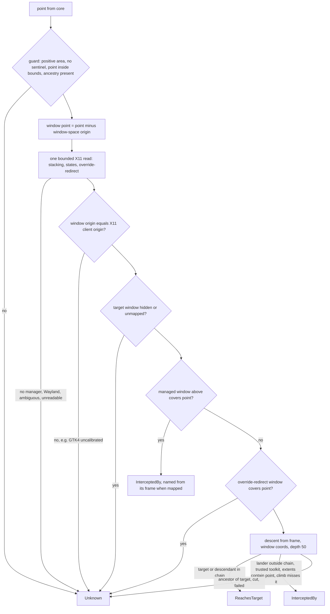
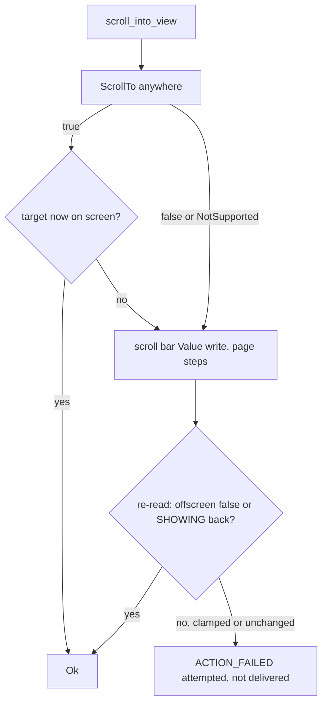

# Linux Actionability and Occlusion (Sub-phase 3.6) - Plan

## Goal Capsule

- **Objective:** an agent on a GNOME desktop that asks to click, hover or drag a control is told, by the same envelopes as on macOS and Windows, whether the control can take the event: a covered, disabled, off-screen or zero-size control is refused with the checked reason, a reachable one proceeds to dispatch, and whatever the desktop cannot prove is reported as unknown and never guessed in either direction.
- **Means:** the Linux adapter implements `hit_test`, the live `offscreen` and `hidden` evidence, a minimal X11 `focus_window` and `scroll_into_view`, over 3.5's live reads and 3.4's X11 reader and window identity (KTD2-KTD11).
- **Authority:** `docs/phases.md` §3.6 as corrected by 3.0-3.5, and further corrected here where the ledger or the code disproves it (R12).
- **Stop conditions:** stop if a requirement needs a change under `crates/core`; if the 3.4/3.5 base loses the bounded X11 reader (`x11::start`, `PendingRead::finish`), the frame-to-X11 mapping (`match_client`), the window-id codec or the window gate (`resolve_gate.rs`, `resolve_window_strict`); if the handle stops carrying its ancestry (`AtspiElement::frame`, `scroll_container`, `in_web_document`); or if refs do not persist the window id and process instance core's headed focus needs; or if no window manager can run rootless in a private session (openbox does, L16-6). All of these hold on the 3.5 head the refresh gate read.
- **Execution profile:** U1 first; U3 after it; U4 after U3 (it consumes U3's stacking types); U5 after U3 and U4; U6 after U3 and U4; U7 after U3; U8 after U6; U10 after U5-U8; U11 after U10; U9 last because it records the dispositions U10 and U11 produce. U2 (ancestry) is already on the base and gates nothing.
- **Finishes and ships:** the implementer runs the box measurements and live verification, commits, and opens one PR stacked on `feat/linux-3.5-resolution`; nothing merges to `main`.

---

## Product Contract

### Summary

Make the auto-wait and occlusion gate real on Linux. After this sub-phase `hit_test` answers `ReachesTarget`, `InterceptedBy` or `Unknown` from X11 stacking and an AT-SPI descent, live state carries `offscreen` and a corrected `hidden`, a headed ref action can focus its window and so reach the gate, and `scroll_into_view` tries the two AT-SPI routes that exist without synthesizing input. Core is unchanged: `receives_events` stays core's and runs for Physical-delivery pointer actions once visible, stable and enabled pass: every headed click, hover and drag, and headless hover, drag and clicks on nodes with no `click` capability (`actionability/evaluate.rs`, `requirements.rs`).

### Problem Frame

The gate exists in core and is starved of Linux evidence. `hit_test` defaults to `PLATFORM_NOT_SUPPORTED`, so a headed click on a covered control passes blind, and the live reads feed `hidden` and `offscreen` that no Linux code sets honestly.

The ledger shows how little a single AT-SPI call proves. `Contains` is pure geometry: true for a covered control, a minimized one and a 0x0 rectangle, and false at six of twelve points where `GetAccessibleAtPoint` hit all twelve (`L6-2`, `L6-8`, `L13-7`). `GetAccessibleAtPoint` is per window and returns one child level, so it never sees another window's cover (`L6-4`); the only measured cross-window source is X11 stacking (`L6-3`). GTK4 reports screen extents that ignore the window position (`[0,0,w,h]` for nearly every node) while its window-coordinate extents are real, and a click built from the window extents plus the X11 client origin opened the control where one built from the screen extents landed on the sidebar (`L6-6`, `L13-6`, `L23-37`), so GTK4 screen extents are never a position and the window extents are. The state set cannot say off-screen: GTK3 offscreen rows carry the `INT32_MIN` sentinel with `SHOWING` absent, GTK4 keeps `SHOWING` 5,500 px outside the viewport, and 886 of 946 Firefox nodes (173 inside the frame) read `VISIBLE` without `SHOWING` (`L6-9`, `L3-27`). Neither toolkit exposes a working `ScrollTo` (`L6-11`, `L6-12`), and a GTK4 grid keeps only the realised items in the tree (`L14-7`).

One prerequisite is not 3.6's but decides what it can prove. Core focuses the target window before the headed battery runs (`crates/core/src/headed_focus.rs`), so without a `focus_window` no headed click reaches `hit_test`; the first sub-phase that scoped focus is 3.9. The live `hidden` rule 3.5 shipped already matches the evidence (`VISIBLE` and `SHOWING` both absent, `live_project.rs`), so 3.6 only adds `offscreen` (KTD8).

### Requirements

**Hit testing**

- R1. `hit_test` returns `ReachesTarget` only when two legs both hold: an AT-SPI descent from the target's window at the point lands on the target or a descendant, and X11 shows no window above the target's window, managed or override-redirect, covering the point. Proved live on GTK3, Qt and Chromium targets.
- R2. `hit_test` returns `InterceptedBy` only on corroborated evidence: a managed X11 window above the target's whose frame rectangle contains the point, or a same-window lander outside the target's ancestor chain on a toolkit whose measured self-hit rate is 100% and whose own extents contain the point. Role, name and bounds are filled from the lander when it can be read. Proved in both directions: a cover above the target intercepts, the same target raised reaches (`L6-3`).
- R3. Every other case is `Unknown`, never a verdict either way: a GTK4 target unless its window-extent position corroborates against a unique X11 mapping (U1's calibration, KTD6, `L23-37`), a Wayland session, no window manager, an ambiguous or missing X11 mapping, an override-redirect window over the point, an ancestor landing, a descent cut by the depth cap or the deadline, a rectangle with a zero axis, a negative size or the `INT32_MIN` sentinel, a minimized window, and any failed read.
- R3a. The bounds core reads for a pointer target are never a guess. `hover`, `drag` and the `mouse-*` ref forms take their point from `get_element_bounds` (`commands/pointer_action.rs`, `point_resolve.rs`), and the hit test they run afterwards answers `Unknown` for GTK4, which core accepts (`receives_events.rs`), so that read is the guard. For a toolkit whose screen extents are global by contract (GTK3, Qt, Chromium: `reports_global_position`) it returns the extents as read. For every other toolkit (GTK4, unknown) it returns screen-coordinate bounds only as the window-coordinate extents plus the X11 client origin when U1's calibration holds (KTD6), and returns no bounds otherwise (calibration not held, Wayland, an ambiguous or missing mapping). `get_live_element` returns the identical value whenever it is calibrated, so core's stability comparison sees one frame; when the position is not provable `get_live_element` keeps the raw extents (its consumers are semantic and visibility gates, and a physical click is blocked by the `Unknown` hit test, which core treats as blocking for a headed click). Core then does not move the pointer: with no bounds, `pointer_is_visible` is false, core calls `scroll_into_view` and ends `ACTION_FAILED` (`pointer_action.rs`), and `scroll_into_view` answers first with the precise cause (U8). GTK4 screen-coordinate extents, whose origin stays 0,0 after the window moves (`L17-19`), are never handed to a pointer.
- R4. `Component.Contains` is not read by any verdict (`L6-2`, `L13-7`).

**Visibility and enabled evidence**

- R5. Live state carries `offscreen: Some(true)` only on positive evidence: GTK3 `VISIBLE` with `SHOWING` absent and sentinel extents, extents wholly outside the window frame, or wholly outside the nearest scroll container, by more than the measured edge slack, or a screen rectangle sharing no area with any display (KTD8). `hidden` is `Some(true)` only when `VISIBLE` and `SHOWING` are both absent. An on-screen web node that reads `VISIBLE` without `SHOWING` is neither (`L3-27`, `L3-7`).
- R6. A minimized window is never reported reachable: `hit_test` is `Unknown` for it, and its elements read `offscreen` where the frame says `ICONIFIED` or X11 says `_NET_WM_STATE_HIDDEN` (`L6-10`).
- R7. `enabled` stays `ENABLED` or `SENSITIVE`, so a GTK4 control reads enabled and an insensitive GTK3 or GTK4 control reads disabled through the live path (`L3-6`).
- R8. A zero-axis rectangle is a value for `get_element_bounds` and fails `visible` with "bounds are zero-sized" through core; the CLI envelope is shown on a named zero-axis node if one can be staged (KTD12), and otherwise an unnamed zero-axis ref is refused as unverifiable by 3.5 before any read, the refusal Windows gives that ref class (`L2-18`, `L14-4`); the Files and Settings zero-axis containers receive no ref at all (17 of 17 and 10 of 10), so they are adapter-level geometry only (`L23-8`).

**Headed path and scrolling**

- R9. `focus_window` activates an X11 window through `_NET_ACTIVE_WINDOW` and returns success only when `_NET_ACTIVE_WINDOW` reads back as the target and the frame's AT-SPI `ACTIVE` is set within the deadline. It refuses a minimized, ambiguously mapped, Wayland or no-manager window before sending anything, never calls `GrabFocus` and never starts a subprocess (`L4-16`, `L5-6`, `L11-22`). Under a manager that ignores the message for a window that has never held focus (private mutter: `_NET_ACTIVE_WINDOW` stays unset and the frame never gains `ACTIVE`, 2 of 2 trials, `L23-14`) it returns `ACTION_FAILED`, not delivered, with `details.cause` `activation_not_granted`; it sends no input, so the click that does focus such a window is the fallback 3.9 adds on 3.8's pointer.
- R10. `scroll_into_view` tries `Component.ScrollTo` and then the nearest scroll container's `scroll bar` `Value` write, each judged by re-reading the target, never by the call's return, and synthesizes no input. When neither moves the target it returns an error that says so (`L6-11`, `L6-12`, `L14-7`).

**Process and proof**

- R11. `crates/core` is unchanged, no shipped source names a plan, phase or decision id, pure tests run on every host, and every other requirement is proved by a real run on the GNOME box in a private session now and on the live session once the owner restores its bus.
- R12. `docs/phases.md` states what was built and no longer states what the evidence disproved, and every ledger row naming 3.6 is disposed of.
- R13. A stranger dogfood is run and its report committed with at least one finding, each disposed of.
- R14. Latency is measured min-of-seven with the warm-up discarded, and the release binary stays under 15 MiB.

### Key Decisions

- KD1. **Core stays platform-neutral and Phase 3 is trait implementation only.** (session-settled: user-directed — chosen over adding Linux paths or fields in core: core is the shared surface.) Governs R11. `receives_events` is core's single producer; this sub-phase supplies `hit_test`, `scroll_into_view`, `focus_window` and the live fields they feed. Anything that would need a core change is written into `docs/phases.md` for the owner and not built.
- KD2. **Tests fail for a real reason, and real runs outrank suites.** (session-settled: user-directed — chosen over broad fixture-driven suites: probe scripts and captures are never read by tests and never committed.) Governs R11. Geometry and classification take plain values so they run on Linux CI, every new test is invert-verified, and live tests never kill by name and never waive an error wholesale.
- KD3. **Box access goes only through `scripts/remote-linux.sh`, never `sudo`, and live verification runs in a private session with a window manager started inside it.** (session-settled: user-directed — chosen over the live bus, which is broken until the owner restarts it.) Governs R1-R3, R9. The recipe is `L16-6`; a live-session re-run is a Definition of Done line.
- KD4. **The PR stacks on `feat/linux-3.5-resolution`; nothing merges to `main`.** (session-settled: user-directed — chosen over a PR against `main`.)
- KD5. **Unknown is never a false failure and never a false pass.** (session-settled: user-directed — chosen over a best-guess verdict when evidence is thin.) Governs R3, R5, R6. GTK4 hit tests stay `Unknown` unless X11 geometry corroborates, zero-axis and `INT32_MIN` bounds are `Unknown`, Wayland has no measured occlusion source and is `Unknown`, and `Contains` is geometry only.
- KD6. **`offscreen` is derived from extents against the window frame and the scroll container, not read from `SHOWING` alone.** (session-settled: user-directed — chosen over reading the state set: it cannot decide off-screen on Chromium, Gecko or GTK4, `L3-27`.) Governs R5. Whether `hidden` also enters the snapshot vocabulary is decided in KTD9.
- KD7. **Every `docs/phases.md` statement the evidence disproves is corrected in place, as its own unit, citing rows.** (session-settled: user-directed — chosen over leaving it for the next planner.) Governs R12.
- KD8. **The stranger dogfood is a gate.** (session-settled: user-directed — chosen over an author-run check: the operator gets only the shipped skill copy and the box binary.) Governs R13.
- KD9. **One PR; the size is stated and justified.** (session-settled: user-directed — chosen over two stacked PRs.) The reason is in Risks & Dependencies.

### Scope Boundaries

- No semantic actions (3.7), no input synthesis, wheel or pointer scroll (3.8), no launch, close or un-minimize (3.9), no screenshot (3.10), no event waits (3.11), no Linux platform skill (3.13).
- Considered and not built:
  - `Component.Contains` in any verdict (R4).
  - `GetMDIZOrder`, `GetLayer` and `GetAlpha`: constants on every node (`L6-14`).
  - Reading the target's parent chain to find its window: `Parent` disagreed with the walked parent on four nodes (`L2-2`). The ancestry is captured where the walk and the resolver already descend (KTD2). The one place a `Parent` climb is allowed is the ancestor test on a same-window landing, where it can only turn an interception into `Unknown`.
  - Emitting `offscreen` or `hidden` into snapshots (KTD9). Evidence that would change the call: a dogfood finding that agents cannot tell scrolled-out rows from a snapshot.
  - An X11 snapshot cached across the five candidate points: 3.4 keeps no connection between calls and the cost is measured first (U10).
  - An XShape input-region check on covering windows. Added only if U1 finds a shaped cover that passes input through.
  - Wayland occlusion by any compositor query: `GetWindows` is `AccessDenied` and the screenshot service is too (`L13-17`).
  - Modality as occlusion evidence. Modality is per application: a modal dialog in another app does not block activating or typing into the target (`L23-26`), and a same-app modal is seen only when its X11 window covers the point.
- Deferred to follow-up work, written into `docs/phases.md` in U9:
  - Coordinate and wheel scroll, which move the real pointer and need 3.8's input, receive the `scroll_into_view` fallback (`L6-11`, `L6-12`, `L13-17`, `L5-5`).
  - A target absent from the tree because a GTK4 grid virtualised it never reaches `scroll_into_view`: its ref does not resolve. A `scroll bar` `Value` write realises it about 1.3 s later (`L23-24`), so the realise-then-re-find leg is a `set-value` on the scroll bar ref in 3.7 and a harness leg in 3.12 (`L14-7`).
  - Un-minimizing a window stays 3.9's and is `ACTION_NOT_SUPPORTED` on this stack (`L11-22`); 3.9 extends this sub-phase's `focus_window` with the full focus policy, which includes the focus-by-click fallback for a never-focused window under mutter (`L23-14`).

---

## Planning Contract

### Key Technical Decisions

- KTD1. **Layout.** New files by the shared platform layout, one concern each, under the 400-line cap. `crates/linux/src/tree/`: `ancestry.rs`, `hit_test.rs`, `hit_guard.rs`, `hit_descent.rs`, `hit_verdict.rs`, `hit_occlusion.rs`, `frame_geometry.rs`, `toolkit_trust.rs`, `offscreen.rs`, `live_offscreen.rs`, `window_extents.rs` (the window-coordinate `GetExtents` read; `node_read.rs` is at 385 of 400 lines and reads screen coordinates only). `system/registry.rs` exposes its private `toolkit()` read (it is `async fn toolkit(connection, root)`) as `pub(crate)`; no new file. `crates/linux/src/system/x11/`: `stacking.rs`, `stacking_decode.rs`, `activate.rs`. `crates/linux/src/system/focus_window.rs`. `crates/linux/src/actions/`: `scroll_into_view.rs`, `scroll_plan.rs`, `scroll_observe.rs`. Each with its `_tests.rs`. `adapter.rs` only wires. `hit_test.rs` and `live_offscreen.rs` keep these names and stay single-concern files because the shell sub-phase (3.14) later edits both: `live_offscreen.rs` takes the handle (so it can branch on the frame's bus name) and calls the pure `offscreen.rs` for the ordinary rule. Governs R1-R10.
- KTD2. **The handle already carries the ancestry; this sub-phase only reads it.** (Landed in 3.4/3.5: `tree/ancestry.rs` `Ancestry {frame, scroll_container, in_web_document}`, filled by `ancestry::of_root` for the window root and `ancestry::child(parent, role)` for each descendant in `walker_expand::child_elements` and `path_descent::level_of`, stored by `AtspiElement::set_ancestry`, read by `frame()`, `scroll_container()`, `in_web_document()`; `StoredWindow::frame()` builds the frame handle with the ref's stored pid.) The frame address is the window root the ref was taken in, with the pid the ref was stamped with (`frame().pid()`, distinct from a cross-bus child's own bus-owner pid; `read_live` already uses it), so 3.7 can validate `expected_process` against the frame (A2). The container is the nearest scroll pane (49) or viewport (68) ancestor. Equality stays on the address. A handle without a frame (built elsewhere) gives `offscreen: None` and an `Unknown` hit test, never a guess; `read_evidence` already refuses such a handle with `INVALID_ARGS`. Chosen over a `Parent` climb per call (unreliable, `L2-2`). U2 therefore writes no production code.
- KTD3. **`hit_test` is two legs and a table.** Leg A is the in-window descent: from the target's frame, `GetAccessibleAtPoint` in window coordinates (type 1, `L13-7`) until a null reference or depth 50, collecting the (bus, path) chain. Leg B is the cross-window check from one bounded X11 read. `ReachesTarget` needs A to land on the target or below it and B clear. `InterceptedBy` follows from B naming a covering managed window regardless of A on a toolkit whose window-space origin passes KTD6's agreement test (the screen point is meaningless otherwise), or from A landing outside the target's ancestor chain under KTD4's trust rule. A landing on a node the target sits under is `Unknown`. Core's five candidate points each call `hit_test`; each call is independent. Governs R1-R3.
- KTD4. **Evidence tiers, stated.** Cross-window interception needs stacking order above the target's window, a frame rectangle (client geometry plus `_NET_FRAME_EXTENTS`) containing the point, mapped and not `_NET_WM_STATE_HIDDEN`, on the current desktop or sticky, and a type other than desktop; the covering window is named from its AT-SPI frame by the same descent when the 3.4 mapping finds it uniquely, and left unnamed otherwise. A same-window landing intercepts only when the toolkit is on the trusted list (KTD5), the lander's own window-coordinate extents have positive area and contain the point, and a verified `Parent` climb from the target does not meet the lander. An override-redirect window above the target that is mapped and contains the point (a GTK3 menu, a tooltip) is `Unknown`: it is real, but nothing proves it takes the event. Governs R2, R3.
- KTD5. **Toolkit trust is a measured table, defaulting to untrusted.** `toolkit_trust.rs` maps the app root's `ToolkitName` and `Application.Version` major to trusted or not for same-window interception and for geometry. GTK 4 is untrusted for same-window interception (Text Editor self-hit 3 of 9, `L13-7`); its geometry is trusted only as KTD6's window-extent model, if U1's calibration holds. A toolkit is trusted for same-window interception only when U1 measured a 100% self-hit rate at the centres of visible targets (Calculator reached 12 of 12 but Text Editor 3 of 9, `L13-7`). Unknown toolkits are untrusted. Governs R2, R3.
- KTD6. **Geometry is accepted only when it agrees with itself.** The point core passes is in the frame of the live bounds core read (`LiveElement.bounds`), which 3.5 derives from the same extents as `get_element_bounds`. `hit_test` reads the target's extents in both coordinate types; their origin difference is the position of window space in that frame, and the window-coordinate point is the point minus it. For toolkits whose screen extents are valid, the position is trusted only when it equals the X11 client origin within one pixel (`L6-5` holds this on GTK3). GTK4 fails the test as measured (`L6-6`, `L13-6`): its screen extents are `[0,0,w,h]` for nearly every node while its window-coordinate extents are real, and a click at the window-coordinate extents plus the X11 client origin opened the control (`L23-37`). `frame_geometry.rs` therefore carries a second model for GTK4, position = window-coordinate extents plus the X11 client origin with the screen extents ignored. U1 calibrates it by clicking at the computed position and observing the result over two window positions and two apps (`L23-37` is one app and one position), with and without `_GTK_FRAME_EXTENTS`, and the model ships only if that holds. Otherwise GTK4 is `Unknown`, pinned by a test. The same trust decision gates `get_element_bounds` (U6): where the position is trusted the bounds are the window-coordinate extents plus the client origin (on GTK3 and Qt, where the screen extents already agree, they are returned as read), and where it is not, the read returns no bounds, because core's `hover`, `drag` and `mouse-*` ref forms aim at the centre of whatever `get_element_bounds` returns and run no hit test. Governs R3, R3a. Three refinements from the landed code. (1) The agreement test, the X11 read and the toolkit read apply to `get_element_bounds` and `get_live_element` only for toolkits where `reports_global_position` is false (GTK4, unknown, unreadable): GTK3, Qt and Chromium return their raw extents with no extra read, because core's stability sampler polls `get_element_bounds` every 17 ms and a frame read plus an X11 read per poll would slow it; their agreement is checked inside `hit_test` only. (2) Core passes `hit_test` a point from `get_live_element.bounds` on the headed path and from `get_element_bounds` on the pointer-command path; both are the calibrated value when calibration holds, so `hit_test` converts its point by requiring it to lie inside the target's calibrated rectangle (within one pixel) or, for a global-position toolkit, inside the raw one, and answers `Unknown` for a point in any other frame. (3) When the position is not provable `get_live_element` keeps the raw rectangle and `get_element_bounds` returns `None`; the one core side effect is that `stable_preflight` samples `get_element_bounds` in a loop and, with `None` every time, runs to the deadline and ends `TIMEOUT` instead of the precise failed check, which happens only after the first report was already not actionable. That is the same behavior a 3.5 sentinel node already has, and it is an owner item (Open Questions), not a core change here.
- KTD7. **X11 additions extend 3.4's reader beside its trait; no tool is shelled to.** Landed: `system/x11/` holds `X11Source` (`read() -> X11State`, `Ready {active, clients}`, `NoWindowManager`, `Unavailable`), `X11Client {id, pid, title, extents, bounds}` (client rectangle in root coordinates from `translate_coordinates` plus `get_geometry`), `FrameFacts {pid, title, extents, global_position}`, `FrameExtents`, `X11Evidence`, the runner `x11::start(read) -> PendingRead` with `finish(deadline) -> Option<T>` (a short-lived thread and `recv_timeout`), the decoders `decode_cardinals` / `decode_frame_extents` in `snapshot.rs`, and `DisplayReader`, which connects on every read and keeps nothing. It reads `_NET_CLIENT_LIST`, not the stacking list, and keeps no state set, desktop or window type. So `stacking.rs` adds a separate `StackingSource` trait (the `MonitorSource` precedent, so existing `X11Source` fakes are untouched) whose `DisplayReader` impl returns a plain `StackingSnapshot`: bottom-to-top `_NET_CLIENT_LIST_STACKING` with per-client state set, desktop, window type, root-space client rectangle and frame extents, the current desktop, and the mapped override-redirect children of the root above a given frame. It reads only what the verdict needs (a client above the target's window, not all clients, and no titles), since the existing per-client read costs about eight round trips. `stacking_decode.rs` reuses `decode_cardinals`. `activate.rs` sends the `_NET_ACTIVE_WINDOW` client message. The 3.4 mapping is `x11::map::match_client(&FrameFacts, &[X11Client]) -> ClientMatch {One, Several, NoClient}`; the `map` module is private and only `evidence` is re-exported, so U3 re-exports `match_client` and `ClientMatch`. `x11rb` is pinned `=0.14.0` with `default-features = false, features = ["randr"]`; the activation message needs only the core protocol, so `Cargo.toml` does not change. Which display server a session uses comes from the one detector, `system::display_server::session_server() -> DisplayServer {Wayland, X11(display), Unavailable(..)}` (a configured server is chosen only when its socket connects, so a stale `WAYLAND_DISPLAY` with a working `DISPLAY` is X11; a reachable Wayland wins). `mod display_server` is private to `system`, so U3 widens it to `pub(crate)` for `tree/`. `StackingSource::read` calls `session_server()` once and returns an enum, `Ready(snapshot)`, `NotX11`, `NoManager` (`_NET_SUPPORTING_WM_CHECK` absent) or `Unavailable`, so a Wayland session or no manager yields "no X11 evidence" and the verdict is `Unknown`. Governs R1-R3, R9.
- KTD8. **Offscreen and hidden are separate evidence and `hidden` is narrowed.** `offscreen.rs` is a pure function of the node's window-coordinate rect, the frame rect, the container rect, the `VISIBLE` and `SHOWING` bits, the sentinel flag and the window's minimized flag. `Some(true)` only on: GTK3 shape (`VISIBLE`, no `SHOWING`, sentinel, `L6-9`), a positive-area rect wholly outside the frame by more than the edge slack, a positive-area rect wholly outside a showing container, a minimized window, or a positive-area screen rectangle that shares no area with any RandR monitor (the monitors are read once per placement, off the calling thread; an unreadable list, an unknown position and a zero-area rectangle are never offscreen). `Some(false)` when the frame (and the container, if the handle has one) are known and the rect intersects them. `None` otherwise, including every `SHOWING`-absent on-screen web node. The edge slack is set from U1's largest measured GTK4 window offset (17 by 5 seen). The `SHOWING`-absent rule fails the `L3-27` population (Firefox 173 of 886 inside the frame, VS Code 12 of 402), and 3.5 already ships the right one: `live_project.rs` `is_hidden` is true only when the state read succeeded and `VISIBLE` and `SHOWING` are both absent, it pushes the `hidden` token and leaves `ElementState.hidden` `None`, which core's gate reads as failing through the token (`gates.rs`), and its tests pin `hidden: None`. U6 keeps that convention for `hidden` and U1 only confirms it on a widget the harness hides in GTK3, GTK4 and Qt. `enabled` is untouched (landed: `ENABLED` or `SENSITIVE`, a successful read with neither is disabled). On GTK4 the frame is still the toplevel child of the registry's application root, numeric role 23, whose `GetRoleName` is `application` (the role-name string GTK4 gives role 23, `L1-12`, `L3-2`, `L13-5`; the registry root above it is a different object and is never read as the frame, and one root can carry several such frames, `L18-12`); the frame address comes from the handle's ancestry (KTD2), its window-coordinate extents are the frame rect, `ICONIFIED` never appears, and minimized comes only from X11 `HIDDEN`, so that read is mandatory there. Tokens and fields move together for `offscreen`: `Some(true)` is paired with the `offscreen` token, `Some(false)` and `None` carry no token, and `live_element` already returns `states_complete: true` only for a successful state read, so core's gate and `is visible` (which reads tokens only) agree. Governs R5-R7.
- KTD9. **Snapshots do not carry `hidden` or `offscreen`.** (Decided from evidence.) The gate reads `ElementState` from the live read, never the snapshot's tokens (`crates/core/src/actionability/gates.rs`), so a snapshot token cannot change a verdict; deriving it at walk time would duplicate the rule with a second, staler input and widen 3.3's golden tests for no gate benefit. The `SHOWING`-absence counts in `L3-27` also mean any snapshot `hidden` would be wrong for web content. Revisit on the dogfood evidence named in Scope Boundaries. Governs R5.
- KTD10. **Focus is a minimal X11 activation judged by observation.** `focus_window` returns `Ok` at once when the target is already active by both measures; otherwise it refuses before sending when the window is `_NET_WM_STATE_HIDDEN`, unmapped, ambiguously mapped, on Wayland or without a window manager, then sends `_NET_ACTIVE_WINDOW` (source indication, timestamp and raise behavior chosen from U1's measurement under openbox and `gnome-shell --x11`) and polls inside `lease.deadline()` until `_NET_ACTIVE_WINDOW` equals the target and the frame carries `ACTIVE` (the same two-measure agreement 3.4's `decide_focus` uses for `is_focused`, so a granted focus also shows in `list-windows`). A refusal by the window manager is `ACTION_FAILED`, not delivered, not retryable. A window that has never held focus under mutter ignores the message: `_NET_ACTIVE_WINDOW` stays unset and `windowactivate` alone changes nothing in 2 of 2 trials (also after a window move), a real click on the window makes it active, and once another window is active the same activation is honored (3 of 3; `L23-14`, `L23-25`); openbox focuses a window on map. The poll therefore ends in `ACTION_FAILED` with `details.cause` `activation_not_granted` and a suggestion naming a never-focused window. This sub-phase does not click, because it ships no input: the focus-by-click fallback is 3.9's, on 3.8's pointer click and under the cursor policy, so a headed action on such a window is refused honestly here and never reported as a pass. Chosen over `GrabFocus` (`L4-16`) and over `xdotool` (a 2016 build in a user directory, `L5-1`). Governs R9.
- KTD11. **`scroll_into_view` is a two-rung ladder judged by observation.** Rung one calls `Component.ScrollTo` (type anywhere); a `true` return is only a reason to look, and `false` or `NotSupported` moves on. Rung two finds the bar by enumerating the container's children and its parent's children inside the deadline, then writes the vertical or horizontal `scroll bar` `Value.CurrentValue` toward the target (page steps, direction from the sibling index when the target has no position), re-reading the target between steps. Success is the target's derived `offscreen` turning `Some(false)` (or `SHOWING` returning on GTK3) inside the lease deadline, polled for at least 2 s when the lease allows: a `Value` write to a GTK4 Files scroll bar realised the virtualised rows 1.23-1.31 s later in 5 of 5 runs, and a read at 0.6 s saw nothing (`L23-24`). GTK4 exposed no scroll pane in the measured app (`L6-12`), so without a container U1 finds there rung two returns `ACTION_NOT_SUPPORTED` naming the missing container. Rung two ships on a toolkit only if U1 shows a `Value` write moves content there; U1 produces a table of toolkit, rung and moved or not, and each rung that works on a toolkit has at least one positive live case; a toolkit where nothing moves it returns `ACTION_FAILED` "attempted, not delivered" and the wheel route is written into 3.8. Governs R10.
- KTD12. **Zero-bounds takes the route the evidence allows.** The gate's "bounds are zero-sized" message is reached by `wait --predicate actionable` and by a ref action on a ref that survives 3.5's unverifiable refusal, which an unnamed zero-axis node cannot. The live proof therefore uses the real unnamed Files `group` for `get_element_bounds` and `hit_test` called on the adapter (the Files and Settings zero-axis containers receive no ref, 17 of 17 and 10 of 10, so no CLI route reaches them, `L23-8`), and for the CLI envelope the two ref-bearing zero-size classes found on stock apps: the unnamed Calculator history `listbox` (a ref at height 0, whose outcome is 3.5's unverifiable refusal) and the named GNOME Terminal hidden-menu-bar items (refs at the `INT32_MIN` sentinel, where `visible` fails; `L23-8`, `L23-9`). No stock app presents a named ref-able control with a zero axis, so U1 stages one in Qt (`setFixedHeight(0)`) or GTK4; if none can be staged the report says so. `phases.md` stops implying an index-path route to the gate. Governs R8.
- KTD13. **Errors are explicit and closed.** `hit_test` returns `Ok` always except a deadline expiry (core's timeout) or an invalid handle (`INVALID_ARGS`); every unreadable thing is `Unknown`. `focus_window` and `scroll_into_view` return `AdapterError` with the codes in the units and `details.physical_delivery_started: false`. Governs R3, R9, R10.
- KTD14. **Every call races the deadline.** Each descent level, each polling read and the X11 read run inside `within(deadline, ...)` (`system/bus_deadline.rs`) or `x11::start(..).finish(deadline)`, with `deadline.is_expired()` and `deadline.timeout_error()` checked between levels (`ensure_budget` is macOS-only), so a stopped app cannot exceed the command budget (`L11-15`). Governs R3.

- KTD15. **Positions on toolkits without global position are placed per node.** (Decided from `L27-40`.) A GTK4 node's screen extents are `[0,0,w,h]`, not its window extents, so `snapshot`, `find` and the live bounds place a node at its window-coordinate rectangle moved to the window's X11 client origin: one `GetExtents` in window coordinates per placed node, bounded in flight, and one client lookup per window (`tree/node_position.rs`, `system/window_position.rs`, `frame_geometry::pointer_bounds`). `list-windows` uses the unique client's origin with the reported size. It also marks a window minimized and not visible when its unique client carries `_NET_WM_STATE_HIDDEN`, from the same single X11 read (the 3.6 stranger dogfood listed an iconified GTK4 window as shown). A node or window that cannot be placed has no bounds, never `[0,0,w,h]`; the resolver's stored-size comparison is unchanged and simply has nothing to compare for such a ref. The registry reads the toolkit per property (`L27-20`) so GTK3 and Qt keep their global positions. A covering window is named by its X11 client title when no other client shares its process and title; `hit_test` is reached only through resolved refs, whose handles carry the frame ancestry (`L27-27`).

### High-Level Technical Design

### Assumptions

- The base is the 3.5 head. Verified against it: the session detector `display_server::session_server`; the bounded X11 reader (`x11::start`, `PendingRead::finish`, `X11Source`, `DisplayReader`); the mapping `x11::map::match_client` (needs a re-export); the window-id codec `window_id::{encode, decode}` (the id is the frame's bus name and path); `resolve_window_strict(bus, &WindowInfo, deadline)` (it lists every window, so it is a heavy check); the window gate in `resolve_gate.rs` (`StoredWindow::{frame, check_process, check_owner}`); the walk with ancestry; 3.5's `resolve_element_strict`, `resolve_locator_anchor`, `Source`/`BusSource`, `read_node`, `NodeReader`/`read_live`/`with_reader`, `live_project.rs` and `NodeEvidence`. The resolver compares stored geometry through `resolve_match::usable_size` on evidence bounds taken from `projection::bounds_of` (raw extents), never through `get_element_bounds` or `live_bounds`, so U6's pointer-safe bounds leave it untouched.
- Refs persist `source_window_id`, `source_window_title`, `process.pid` and `process_instance`, which core's headed focus requires (`headed_focus.rs`). Ledger rows `L1`-`L14`, `L16`-`L20` and `L25` are on the base; the `L23-*` rows this plan cites (and `L21`, `L22`, `L24`) are not in `probes/linux/FINDINGS.md` at the 3.5 head, so `scripts/check-linux-findings.py` rejects a `docs/phases.md` citation of them until they land (owner item). There is no `L15` area; the old mention is removed.
- Openbox 3.6.1 and `gnome-shell --x11` both run as the window manager in a private Xvfb with the packages extracted at `~/ad-wt/wm-pkgs` (`L16-6`). `xprop` and `xwininfo` are on the box; the 2016 `xdotool` is under `~/.local/ad-tools` and is a probe aid only (`L5-1`).
- Xvfb has no pointer-driving harness besides `xdotool`, used in U1 only to calibrate GTK4 positions and to stage covers; no product code uses it.
- The live AT-SPI bus is broken until the owner restarts it, so every verification runs in a private session; Gecko is unmeasurable there (`L16-15`) and its leg is a live-session line in the Definition of Done.
- Inferred bets, recorded so a reviewer can overturn them: the page step for rung two is the container viewport extent; the edge slack is the largest GTK4 offset U1 measures; the override-redirect rule stays `Unknown` for any covering window until U1 shows which are input-transparent.

### Sequencing

U1 → U3; U3 → U4; (U3, U4) → U5; (U3, U4) → U6; U3 → U7; U6 → U8; (U5, U6, U7, U8) → U10 → U11 → U9. U2 is landed.

---

## Implementation Units

### U1. Measurements before code

- **Goal:** settle by measurement every parameter the code depends on, as ledger rows in the next free area.
- **Requirements:** R1-R3, R5, R6, R9, R10.
- **Dependencies:** none.
- **Files:** `probes/linux/FINDINGS.md` (rows only; probe scripts and captures stay outside the repository and no test reads them).
- **Approach:** all in a private session under a rootless window manager. Measurements, each with its failing direction where one exists:
  1. **Stacking and states under openbox and `gnome-shell --x11`.** `_NET_CLIENT_LIST_STACKING` order, `_NET_WM_STATE_HIDDEN`, `_NET_WM_DESKTOP`, `_NET_FRAME_EXTENTS`, and which popups are override-redirect (a GTK3 Terminal menu, a tooltip). A cover with `_NET_WM_STATE_ABOVE` and an ordinary cover: both managers behaved identically in `L23-25` (an ordinary cover is removed by activating the target, an `ABOVE` cover survives it), and U1 re-reads that with the product's own X11 read.
  2. **Activation.** Also record when frame `ACTIVE` appears on GTK3, GTK4 and Qt after a granted activation, and which node carries it. Send `_NET_ACTIVE_WINDOW` with source 1 and 2, timestamp 0 and a real server time, with no foreign window active and with one active, under both managers; record whether `_NET_ACTIVE_WINDOW`, the frame's `ACTIVE` and the stacking order (a raise) change and how long they take. Include a window that has never been focused under `gnome-shell --x11` (it ignores the message, `L23-14`) and the same window after another window is made active (honored, `L23-25`). This decides KTD10 and re-measures `L4-23`.
  3. **Descent and coordinates per toolkit.** `GetAccessibleAtPoint` type 1 self-hit rate at the centres of visible targets on GTK3 (Terminal), GTK4 (Calculator, Text Editor, Files, plus the newest GTK4 on the box), Qt, Chromium and Electron; the `Application.Version` value each reports; extents in both coordinate types against the X client origin.
  4. **GTK4 calibration.** Click, with the probe-only `xdotool`, at X client origin plus window-coordinate centre (the `L23-37` model), with and without `_GTK_FRAME_EXTENTS`, over two window positions and two apps, and observe whether the button fires; a click built from the screen extents is the failing direction. Decides KTD6.
  5. **`hidden`.** The `VISIBLE` and `SHOWING` bits of a widget the harness hides, in GTK3, GTK4 and Qt; the `SHOWING`-absent rate among nodes with positive extents inside the frame for GTK3, GTK4, Qt, Chrome and VS Code.
  6. **Scroll.** `ScrollTo` and `ScrollToPoint` on Qt and Electron; a `Value` write on a `scroll bar` for GTK3, GTK4, Qt and Chromium with the unit of the value, read-back clamping, polling for the content to move for several seconds, not 0.6 s (`L23-24`: a write to the maximum on the Files 300-file grid reads back 9961 of 10419 and realises the end of the list after 1.23-1.31 s, 5 of 5); the roles that enclose scrolled rows per toolkit (scroll pane 49, viewport 68) and whether GTK4 exposes any.
  7. **Zero-axis stage.** Whether a named ref-able node with a zero axis can be produced in Qt or GTK4 (none exists on the stock apps, `L23-8`).
  8. **Wayland.** A private `gnome-shell --headless --wayland`: `hit_test` inputs available, window extents, no X11 evidence.
  9. **Costs.** One `GetAccessibleAtPoint` round trip and one bounded X11 read, min-of-seven with the warm-up discarded.
- **Test expectation:** none -- measurement only. Rows carry the harness version, the toolkit versions and the number of runs.
- **Verification:** `python3 scripts/check-linux-findings.py` exits 0; each decision in KTD5, KTD6, KTD8, KTD10 and KTD11 names the row that settles it.

### U2. Ancestry on the handle (landed)

- **Goal:** confirm what the base provides and pin the two gaps no landed test covers.
- **Requirements:** R5, R6, R10.
- **Dependencies:** none.
- **Files:** `crates/linux/src/tree/ancestry_tests.rs` only.
- **Approach:** KTD2. The base already has `Ancestry`, `of_root`, `child`, the walker and path-descent producers, and `StoredWindow::frame()`; `ancestry_tests.rs` covers nearest-container, no-ancestry, address equality and the web flag. Add a test that a handle built under a cross-bus child keeps the frame's pid distinct from the child's own pid (A2), and one that the container is the viewport when a viewport sits inside a scroll pane. No production code.
- **Test scenarios:**
  - A frame, panel, scroll pane, viewport, list, row chain built with `ancestry::child` gives the viewport as the container and the frame as the frame.
  - An element under a cross-bus child holds the frame's pid via `frame().pid()` and its own bus-owner pid as different values.
- **Verification:** the scenarios pass; inverting nearest-wins in `child` fails the first. The existing 3.4 and 3.5 tests still pass.

### U3. X11 stacking, states and activation

- **Goal:** one bounded read that returns everything the occlusion and focus decisions need, and the activation message.
- **Requirements:** R1-R3, R9.
- **Dependencies:** U1.
- **Files:** `crates/linux/src/system/x11/stacking.rs`, `crates/linux/src/system/x11/stacking_decode.rs`, `crates/linux/src/system/x11/activate.rs`, `crates/linux/src/system/x11/stacking_tests.rs`, `crates/linux/src/system/x11/stacking_decode_tests.rs`, `crates/linux/src/system/x11/mod.rs` (declarations and re-exports of `match_client`, `ClientMatch`, `StackingSource`, `StackingSnapshot`), `crates/linux/src/system/x11/reader.rs` (the `DisplayReader` impl of `StackingSource`, reusing its `atom` and `property` helpers), `crates/linux/src/system/mod.rs` (`display_server` becomes `pub(crate)`).
- **Approach:** KTD7. The new `StackingSource` trait returns `Ready(StackingSnapshot)`, `NotX11`, `NoManager` or `Unavailable`; the snapshot is a bottom-to-top client list with per-client state set, desktop, window type, root-space client rectangle and frame extents, the current desktop, and the override-redirect children above a named frame window. Decoding is pure over raw property bytes and reuses `decode_cardinals`. `activate.rs` builds and sends the client message with the parameters U1 settles. The 3.4 mapping `match_client` is called from U5 and U7, not reimplemented.
- **Patterns to follow:** 3.4's `bounded.rs` runner, `docs/solutions/logic-errors/a-deadline-cannot-interrupt-a-blocking-os-call.md`.
- **Test scenarios:**
  - A raw `_NET_CLIENT_LIST_STACKING` of three ids keeps bottom-to-top order; a truncated value is rejected.
  - `_NET_WM_STATE` carrying `HIDDEN` and `ABOVE` atoms decodes to both flags; an unknown atom is ignored; `_NET_WM_DESKTOP` `0xFFFFFFFF` decodes as sticky.
  - `_NET_FRAME_EXTENTS` `0, 0, 37, 0` expands a client rectangle `{100,157,320,200}` to `{100,120,320,237}` (`L8-5`).
  - A reader that blocks returns "unavailable" within the deadline; no window manager returns "no manager"; a session the shared detector classifies as Wayland returns "no X11 evidence" without opening a connection, and a stale `WAYLAND_DISPLAY` with a working `DISPLAY` is read as X11 through the same detector (B1).
  - The activation message encodes the target id, the source indication and the timestamp fields as laid out in the specification.
- **Verification:** the scenarios pass; inverting the frame-extent arithmetic or the order reversal fails its test. Live: the snapshot of a private session lists the clients in `xprop -root _NET_CLIENT_LIST_STACKING` order.

### U4. Geometry, classification and the verdict table

- **Goal:** all decisions as pure functions over plain values.
- **Requirements:** R1-R6.
- **Dependencies:** U1, U3.
- **Files:** `crates/linux/src/tree/hit_guard.rs`, `crates/linux/src/tree/frame_geometry.rs`, `crates/linux/src/tree/hit_occlusion.rs`, `crates/linux/src/tree/hit_verdict.rs`, `crates/linux/src/tree/toolkit_trust.rs`, `crates/linux/src/tree/offscreen.rs`, and their `_tests.rs`.
- **Approach:** KTD3-KTD6, KTD8. `hit_guard.rs` rejects a rectangle with a zero axis, a negative size or the `INT32_MIN` sentinel and a point outside the bounds. `frame_geometry.rs` derives the window point and applies the agreement test. `hit_occlusion.rs` takes the stacking snapshot, the target's window and the point and returns covered-by, clear, override-redirect-over, or unknown, applying the filters of KTD4. `hit_verdict.rs` combines the two legs. `toolkit_trust.rs` is the measured table. `offscreen.rs` is KTD8.
- **Patterns to follow:** `crates/windows/src/tree/hit_test_classify.rs`, `hit_test_corroborate.rs`.
- **Test scenarios:**
  - Guard: `[0,0,710,0]`, `[0,0,0,0]`, `[-1,-1,-1,-1]`, `[INT32_MIN,INT32_MIN,1,1]` and a point 40 px right of a button each give `Unknown`; a positive-area rectangle with the point inside passes.
  - Window point: screen `[100,137,420,34]` against window `[0,0,420,34]` turns screen point (310,154) into (210,17); the same arithmetic for window `[17,5,420,34]` is exercised and the agreement test rejects it against a client origin of (100,137); for the GTK4 model, window extents `[329,285,558,54]` with client origin (302,260) give screen bounds `[631,545,558,54]`, the point conversion subtracts the origin, and the screen extents `[0,0,558,54]` are ignored (`L23-37`).
  - Agreement: origin (100,137) against client (100,137) agrees; off by one agrees; off by two does not.
  - Occlusion, each a separate case: a window above the target containing the point covers; the same window below the target does not; a `HIDDEN` window above does not; a window on another desktop does not and a sticky one does; a desktop-type window does not; a window above whose frame contains the point only through its title bar covers (the frame, not the client, is tested); an override-redirect window above containing the point gives override-redirect-over; an unmapped target gives unknown.
  - Verdict table, every row pinned: (lands on target, clear) is `ReachesTarget`; (lands on target, override-redirect-over) `Unknown`; (lands on target, X11 unavailable) `Unknown`; (lands on ancestor, clear) `Unknown`; (lands elsewhere, trusted, extents contain, clear) `InterceptedBy`; (lands elsewhere, untrusted toolkit, clear) `Unknown`; (lands elsewhere, extents do not contain the point) `Unknown`; (anything, on a toolkit whose origin agrees, covered-by) `InterceptedBy` naming the cover; (descent cut at depth 50) `Unknown`; (GTK4, calibration not held) `Unknown` for every input; (GTK4, calibration held, covered-by) `InterceptedBy` naming the cover; (GTK4, lander elsewhere in the window, clear) `Unknown`, since a same-window lander is untrusted.
  - Trust: GTK major 3, Qt and Chromium follow the U1 table; GTK major 4 and an unknown toolkit are untrusted; a missing version is untrusted.
  - Offscreen: GTK3 `VISIBLE` without `SHOWING` with sentinel extents is `Some(true)`; the same bits with extents inside the frame (Chromium on-screen shape, `[542,619,304,35]` in `[40,112,1200,800]`) is `None`; a rect `[2,5526,420,22]` in a 420x420 frame is `Some(true)`; a rect straddling the frame edge is `Some(false)`; a rect wholly outside the container but inside the frame is `Some(true)`; a rect 10 px outside the frame edge, inside the slack, is `None`; no frame is `None`; a minimized window is `Some(true)` whatever the rect.
- **Verification:** the scenarios pass. Invert each: ignoring the cross-window leg in `ReachesTarget`, testing the client instead of the frame rectangle, dropping the sentinel guard, trusting GTK 4, and treating `SHOWING` absence as offscreen on the web shape each fail a named test.

### U5. `hit_test`

- **Goal:** the adapter method, orchestrating the reads and the table.
- **Requirements:** R1-R4, R6.
- **Dependencies:** U3, U4.
- **Files:** `crates/linux/src/tree/hit_test.rs`, `crates/linux/src/tree/hit_descent.rs`, `crates/linux/src/tree/hit_descent_tests.rs`, `crates/linux/src/tree/hit_live_tests.rs`, `crates/linux/src/adapter.rs` (the `ObservationOps` impl), `crates/linux/src/tree/mod.rs`, `crates/linux/src/system/registry.rs` (`toolkit()` to `pub(crate)`).
- **Approach:** KTD3, KTD4, KTD13, KTD14. `hit_test.rs` decodes the handle (`atspi_element`, then `frame()`; no frame is `Unknown`), reads the target's extents in both types (`read_node` for screen, `window_extents.rs` for window coordinates), reads the frame with `read_node` for its title, screen extents, `ICONIFIED` and role, and reads the toolkit with `toolkit()` on the frame's bus name at `REGISTRY_ROOT_PATH` (the application root path the registry lists); those build the `FrameFacts` for `match_client`. It then runs the guard, the point-frame test of KTD6 (2) and the X11 read, then the descent, then the table. A stopped target process is classified with `resolve_errors::stopped_app` as 3.5's reads do. `hit_descent.rs` loops `GetAccessibleAtPoint` type 1 with a depth cap of 50 and the deadline, returning the chain and why it stopped, and runs the verified `Parent` climb for the ancestor test only on an outside landing. The covering window's name is read by the same descent on its mapped frame.
- **Patterns to follow:** `crates/macos/src/tree/hit_test.rs`, `crates/windows/src/tree/hit_test.rs`.
- **Test scenarios:**
  - A fake node source whose frame answers a chain ending at the target returns `ReachesTarget` with a clear stacking; ending one level below the target also does; ending at the target's parent returns `Unknown`; ending at an unrelated node on a trusted toolkit returns `InterceptedBy` with that node's role, name and bounds.
  - A descent that never reaches a null reference stops at depth 50 and is `Unknown`; a descent whose deadline expires is the timeout, not a verdict.
  - A counting fake that records every node-source method called shows `Contains` is never called for covered, minimized, zero-size and sentinel targets; adding a `Contains` call to the module fails it.
  - A handle with no ancestry is `Unknown`, and a handle from another platform is `INVALID_ARGS` (`atspi_element`).
  - A point inside the raw rectangle of a GTK4 target but outside its calibrated rectangle is `Unknown` (the frame mismatch of KTD6 (2)); a point inside the calibrated rectangle proceeds to the table.
  - The climb: a lander that the target's verified parent chain passes through gives `Unknown`; a chain whose step fails verification gives `Unknown`.
  - Live, private session under openbox, called on the adapter: a GTK3 Terminal control with an `ABOVE` cover over its centre is `InterceptedBy`; the same control after the cover is lowered is `ReachesTarget` (both directions of `L6-3`); an ordinary cover (a second app window exactly over the target) is `InterceptedBy` until the target is activated and `ReachesTarget` after, on both managers, while an `ABOVE` cover stays `InterceptedBy` after activation (`L23-25`); a GTK4 Calculator button is `Unknown` where U1's calibration did not hold and, where it held, `InterceptedBy` only from a covering X11 window and `ReachesTarget` only when the descent lands on the target; the same on a Wayland session is `Unknown`; a Qt button covered and uncovered; a Chromium page node covered and uncovered; a minimized window is `Unknown`; the Files `group [0,0,710,0]` is `Unknown`; a GTK3 closed-menu sentinel node is `Unknown`; an app under `SIGSTOP` returns the timeout inside the budget and never a verdict.
- **Verification:** the scenarios pass; the live legs hold in both directions; inverting the cross-window leg or the trust gate fails its test.

### U6. Live state: offscreen and hidden

- **Goal:** the live state projection carries the derived evidence.
- **Requirements:** R5-R8.
- **Dependencies:** U3, U4.
- **Files:** `crates/linux/src/tree/live_offscreen.rs`, `crates/linux/src/tree/live_offscreen_tests.rs`, `crates/linux/src/tree/window_extents.rs`, `crates/linux/src/tree/frame_geometry.rs`, 3.5's `live_project.rs`, `live_project_tests.rs`, `live_read.rs` and `live_read_tests.rs`.
- **Approach:** KTD8. The landed shape is `NodeReader` (`read(&mut self, element) -> NodeEvidence`, `stopped_app`), `read_live`, `with_reader(bus, handle, deadline, project)` and the pure `live_state(read, evidence)`, `live_bounds(read)`, `live_element(read, evidence)`. `NodeEvidence` is shared with the resolver, so it is not widened. `NodeReader` gains a second method, `placement(&mut self, element, deadline) -> Placement`, called only by the live-state and bounds entry points: the node's window-coordinate extents, the frame's and the container's window-coordinate extents, the frame's `ICONIFIED` bit, and the toolkit (only when `offscreen` or the bounds rule needs it), all in flight together with the X11 `HIDDEN` and client-origin read, which runs only when the node is otherwise on screen or the toolkit is not global-position, once per call. The `NodeReader` fakes in `live_read_tests.rs` gain the method. `with_reader`'s projection closure receives the reader so the second read can happen. `live_state` takes the `Placement` and sets `offscreen` (token and `Some(true)`/`Some(false)`/`None`); the `hidden` rule is unchanged (landed, KTD8). `enabled` and value are unchanged. Bounds change in one way (R3a, KTD6): `get_element_bounds` and `live_element` take the screen rectangle from `frame_geometry.rs` for non-global-position toolkits and are otherwise as read; `live_bounds` keeps its pure raw-extents semantics (zero and `-1` extents stay values, the `INT32_MIN` position stays `None`); a zero-axis rectangle is still a value (R8).
- **Patterns to follow:** 3.5's `live_project.rs`; `crates/windows/src/tree/live_read.rs`.
- **Test scenarios:**
  - A node with `VISIBLE` and no `SHOWING` and positive extents inside the frame (Chromium shape) has no `hidden` token and `offscreen` unset, so core's `is_visible` is true (the landed `hidden` rule, kept).
  - A node with neither bit keeps the `hidden` token with `ElementState.hidden` `None` as 3.5's tests pin, so `is_visible` is false.
  - A GTK3 sentinel row has `offscreen: Some(true)` and the token; a GTK4 row at `[2,5526,420,22]` too; a row inside the viewport has `Some(false)`.
  - The frame read failing makes `offscreen` `None`, not `Some(false)`; the container read failing does the same when the handle has a container.
  - A frame with `ICONIFIED` makes every descendant `offscreen`; X11 reporting `HIDDEN` for a GTK4 window with no `ICONIFIED` does too; X11 unavailable leaves it `None`.
  - A `[0,0,710,0]` rect projects as a bounds value (not `None`) and a live state read of it leaves `visible` to fail on "bounds are zero-sized" in core's gate; the sentinel projects as `None`.
  - `ENABLED` alone and `SENSITIVE` alone are enabled; neither is disabled with the `disabled` token (`L3-6`).
  - On the Chromium shape, `is_visible` and the core gate's `visible` check agree (both pass) because `states_complete` is true and no token is set; on the both-bits-absent shape both fail.
  - GTK4: the frame is the toplevel child of the registry root that the ancestry names (numeric role 23, role name `application`), and its window extents serve as the frame rect; with two such frames under one root, a node under the second is judged against the second frame's rect, not the first's and not the root's; a minimized GTK4 window is `offscreen` only through the X11 `HIDDEN` read, and with X11 unavailable it is `None`.
  - Pointer-safe bounds: a GTK4 node whose screen extents read `[0,0,498,34]` with the client origin at (302,260) yields bounds `[302,260,498,34]` (plus the frame offset if U1's calibration holds) and, with calibration failed or the mapping ambiguous, no bounds; a GTK3 node whose screen extents agree is returned as read; the same GTK4 node after the fake's window moves yields the moved bounds, never `[0,0,...]`; with no bounds, a fake core pointer request for hover and for drag ends `ACTION_FAILED` ("Pointer target is not visible in the live accessibility tree", after core called `scroll_into_view`, which U8 answers with the precise cause) with the pointer fake receiving nothing; `get_live_element` for the same uncalibrated GTK4 node keeps the raw rectangle, and calibrated GTK4 returns the same value from `get_live_element` and `get_element_bounds`; a GTK3 or Qt node's bounds are returned with no X11 read and no frame read (a counting fake); the resolver's width/height comparison (`resolve_match::usable_size`) is unchanged and still sees raw extents for a GTK4 node whose pointer bounds are withheld.
  - One node read: a counting fake shows `get_live_state` costs the node read plus at most the frame, the container and one X11 read, never one per field.
- **Verification:** the scenarios pass; inverting the both-bits rule, the sentinel rule or the pointer-safe bounds rule (returning the raw GTK4 extents) fails its test; the live run compares `is visible` with the extents against the frame on GTK3, GTK4, Qt and Chromium.

### U7. `focus_window`

- **Goal:** a headed ref action can reach the gate.
- **Requirements:** R9.
- **Dependencies:** U3.
- **Files:** `crates/linux/src/system/focus_window.rs`, `crates/linux/src/system/focus_window_tests.rs`, `crates/linux/src/system/adapter.rs` (the `SystemOps` impl).
- **Approach:** KTD10. The signature is `focus_window(&self, win: &WindowInfo, lease: &InteractionLease)`; the deadline is `lease.deadline()`, and core has already compared the live window's id, pid and `process_instance` with the ref's (`headed_focus.rs`). The adapter still rechecks cheaply with `window_id::decode(&win.id)` and `process_facts::lookup(win.pid)` against `win.process_instance` (`Found` with a different instance or `Gone` ends the ref's life; `Unreadable` is neither, so it proceeds to the X11 evidence), not `resolve_window_strict` (it lists every window), unless U10 shows that is affordable. The `FrameFacts` come from the `WindowInfo` (pid, title, bounds as extents) plus the toolkit read of U5; the frame's `ACTIVE` bit is read from the frame with `read_node` and `window_filter::frame_state`. A pure decision over the window state, the mapping outcome and the session kind, then the send and a polling wait inside the lease deadline for the two conditions. The wait is a loop on the reads, never a sleep followed by a check. A refusal is `AdapterError` `ACTION_FAILED` with `with_details` carrying `physical_delivery_started: false` and `cause`, and `.with_disposition(DeliverySemantics::not_delivered())` as core's own refusals do.
- **Patterns to follow:** `crates/windows/src/system/focus_window.rs`; 3.4's focus decision.
- **Test scenarios:**
  - Already active by both measures returns `Ok` and sends nothing.
  - `_NET_WM_STATE_HIDDEN`, an unmapped window, an ambiguous mapping, a Wayland session and no window manager each fail before any send, with `physical_delivery_started: false`.
  - Active by X11 but the frame lacks `ACTIVE` for the whole deadline is `ACTION_FAILED`, never `Ok` (`L5-6`).
  - A window manager that ignores the message leaves the old window active and is `ACTION_FAILED`.
  - A window that has never held focus, whose manager accepts the message and changes nothing for the whole deadline, is `ACTION_FAILED` with `details.cause` `activation_not_granted`, `physical_delivery_started: false`, and nothing else is sent; the same window after another window became active succeeds (`L23-14`, `L23-25`).
  - A different process instance or a window id of another format is refused before any send.
  - A stale `WAYLAND_DISPLAY` pointing at a dead socket with a working `DISPLAY` is classified X11 by the shared detector and `focus_window` proceeds to the send (B1).
  - Live, private session under openbox and `gnome-shell --x11`: a background GTK3, GTK4 and Qt window each become active within the deadline and report `ACTIVE`, read per toolkit (frame or dialog roles only, never the `mutter-x11-frames` helper's child, `L8-3`; on GTK4 the numeric-role-23 frame, whose role name is `application`, taken from the handle's ancestry and never the registry root); with a foreign window active the manager either grants, and `Ok` implies both conditions, or refuses, and the result is exactly `ACTION_FAILED`. A freshly mapped window under `gnome-shell --x11` returns the `activation_not_granted` failure and is `Ok` under openbox, which focuses on map (`L23-14`).
- **Verification:** the scenarios pass; inverting the second condition (X11 alone) fails the `L5-6` test.

### U8. `scroll_into_view`

- **Goal:** the ladder of KTD11.
- **Requirements:** R10.
- **Dependencies:** U6.
- **Files:** `crates/linux/src/actions/scroll_into_view.rs`, `crates/linux/src/actions/scroll_plan.rs`, `crates/linux/src/actions/scroll_observe.rs`, their `_tests.rs`, `crates/linux/src/adapter.rs`.
- **Approach:** KTD11. The signature is `scroll_into_view(&self, handle, lease: &InteractionLease) -> Result<(), AdapterError>`; the deadline is `lease.deadline()`, and the container comes from `atspi_element(handle)?.scroll_container()`; the bar is found by `list_children` and the numeric role `role_numbers::SCROLL_BAR` (48). Core calls it from `ref_action.rs` after a failed preflight and from `pointer_action.rs` whenever `pointer_is_visible` is false, which includes a withheld-bounds target (R3a) that is plainly on screen. For that case the call first derives `offscreen` (U6); if the target is not `Some(true)` offscreen it writes nothing and returns `ACTION_FAILED` with `details.cause` `bounds_not_provable` (the GTK4 position is uncalibrated, X11 unavailable or ambiguous), `physical_delivery_started: false`, so core's misleading "not visible" is preceded by the true reason in the error it propagates. `scroll_plan.rs` is pure: from the container rect, the bar's minimum, maximum and current value, the page extent and either the target's window-coordinate rect or its index delta from a visible neighbour, it returns the next value to write and the direction, and refuses a write that would not move. `scroll_observe.rs` re-reads the target through U6's derivation and polls inside the lease deadline. Rungs are skipped for toolkits U1 showed inert, and that table is data in `scroll_plan.rs`.
- **Patterns to follow:** `crates/windows/src/actions/scroll_into_view.rs`; judged-by-observation delivery.
- **Test scenarios:**
  - A target 5,526 px below a 420 px viewport with a bar of range 0 to 10,482 gets a write that brings its top to the viewport top, clamped to the maximum; a target above gets a smaller value.
  - A GTK3 target with sentinel extents and a sibling index delta of +250 picks the forward direction and the page step; delta of -3 picks backward.
  - A bar already at the maximum for a forward target writes nothing and the call reports "attempted, not delivered".
  - `ScrollTo` returning `true` with the target still off-screen after the polling window moves on to the bar; returning `false` or `NotSupported` does too.
  - A target that is already on screen and whose bounds are provable returns `Ok` without a write; one that is on screen but whose pointer bounds are withheld returns `ACTION_FAILED` `bounds_not_provable` without a write.
  - A write whose reads at 0.6 s show the target still off-screen and whose read at 1.3 s shows it on screen is `Ok`; judging at 0.6 s fails it (`L23-24`).
  - No container in the handle and `ScrollTo` inert is `ACTION_NOT_SUPPORTED` naming the missing container.
  - Live, per U1's table: every rung and toolkit pair U1 shows moving content has a positive case that reaches `SHOWING` (GTK3) or an on-screen derived rect (others); every pair it shows inert returns `ACTION_FAILED` or `ACTION_NOT_SUPPORTED` as specified, asserted as that exact error; if no pair moves content, `scroll_into_view` ships as attempted-not-delivered and §3.8 carries the wheel route as a stated outcome; the Files 300-file grid's absent items never reach this call; Qt and Chromium per U1's table; `ScrollTo` returning `true` is never accepted without the re-read.
- **Verification:** the scenarios pass; inverting the re-read (trusting the return) fails the "true but unmoved" test. No pointer or key event is issued: the live test reads the pointer position before and after.

### U9. Roadmap and ledger corrections

- **Goal:** `docs/phases.md` and the ledger state what was built and what the evidence showed, each correction citing rows.
- **Requirements:** R12.
- **Dependencies:** U10, U11.
- **Files:** `docs/phases.md`, `probes/linux/FINDINGS.md`.
- **Approach:** KD7. Corrections in place, no annotations, rebased onto 3.5's edits to the same section:
  1. §3.6 scope and Key APIs: `hit_test` is the two legs, `Contains` is dropped and `Component.GetAccessibleAtPoint` stays (`L6-2`, `L13-7`); the window-coordinate conversion and the geometry agreement test (`L6-5`, `L6-6`); the override-redirect and minimized rules.
  2. `receives_events` evidence: core-owned, derived from `hit_test`, reachable only for headed click, hover and drag; the line says what 3.6 ships (the Windows precedent).
  3. Visibility: `hidden` is both-bits-absent, `offscreen` as KTD8, snapshots carry neither (KTD9, `L3-27`, `L3-7`); the sentence that `showing` alone decides off-screen is removed.
  4. Zero-bounds: the route of KTD12, and the statement that no index-path route reaches the gate (`L14-4`, 3.5's unverifiable refusal).
  5. `scroll_into_view`: what ships (the two rungs and the judged-by-observation rule) and the wheel and pointer route moved to §3.8 with `L6-11`, `L6-12`, `L13-17`, `L5-5`; the absent-item leg stays with 3.7 and 3.12 (`L14-7`).
  6. `focus_window`: §3.6 gains the minimal enabling surface sentence as Windows' 2.6 has; §3.9 is narrowed to extend it; `L4-23` is closed or re-assigned by U7's measurement.
  7. §3.5's handoff sentence about `hidden` and `offscreen` and §3.7's ordering line are updated to what shipped.
  8. §3.6 exit criteria enumerate: occluded in both directions, same-window overlay, disabled, offscreen on GTK3 sentinel and GTK4 derived, zero-bounds per KTD12, minimized guard, GTK4 `Unknown`, Wayland `Unknown`, `focus_window` verified, `scroll_into_view` observed; and the live-session re-run.
  Every ledger row naming 3.6 gets its disposition; rows the roadmap cites under other sub-phases are re-tagged. New ledger rows take the next free area number the orchestrator assigns (the base's highest is `L25`; `L21`-`L24` are taken by other sub-phases' probes), and the `L23-*` rows must be on the branch before any `docs/phases.md` text cites them.
- **Test expectation:** none -- documentation. `scripts/check-linux-findings.py` is the check.
- **Verification:** the script exits 0; `--sub-phase 3.6` lists no `DEFERRED` row.

### U10. Live verification and performance

- **Goal:** prove R1-R10 on real apps and measure the cost.
- **Requirements:** R1-R11, R14.
- **Dependencies:** U5, U6, U7, U8.
- **Files:** ignored live tests beside each unit (`hit_live_tests.rs`, `live_offscreen_live_tests.rs`, `focus_window_live_tests.rs`, `scroll_into_view_live_tests.rs`); the new rows in `probes/linux/FINDINGS.md`.
- **Approach:** through `scripts/remote-linux.sh`, in a private session (`R=$(mktemp -d $HOME/ad-wt/rt.XXXXXX); chmod 700 $R; XDG_RUNTIME_DIR=$R dbus-run-session -- xvfb-run -a ...`) with openbox, then `gnome-shell --x11`, started inside it. Apps are launched inside the session and stopped by the pid the test started. Covers and overlays are harness-owned windows. Costs, min-of-seven with the warm-up discarded, reported as min with median and max: one `hit_test` call (descent plus X11 read) on Calculator, Terminal, a Qt window and Chrome; one X11 read; `get_live_state` before and after U6; `focus_window`; `scroll_into_view` per rung. The release size against 15 MiB.
- **Test expectation:** the live tests are the unit scenarios marked live above, plus one: a GTK4 window moved with the window manager, then `get_element_bounds` on one of its controls, whose centre lies inside the window's X11 frame in the new position or is absent, on both managers; nothing asserts a node count or coordinate from a live app.
- **Verification:** every live scenario passes in the private session under both managers; the numbers are recorded; the live-session re-run is listed as outstanding with what it covers.

### U11. Stranger dogfood

- **Goal:** find what a new agent hits using only the shipped skill and the built binary.
- **Requirements:** R13.
- **Dependencies:** U10.
- **Files:** `docs/dogfood-reports/<date>-feat-linux-3-6-actionability-dogfood.md` (the repository's existing reports carry a date and serial prefix; this one follows them).
- **Approach:** KD8. The operator is a subagent told that it holds the built release binary and the text of `skills/agent-desktop/` (from `agent-desktop skills get core`) and nothing else, in a private session under openbox whose apps and covers the harness launched. The harness stages the UI outside the operator's tools and raises or lowers covers by pid. The operator executes every example in bash verbatim, reads every `ok`, waits with `wait` and never sleeps, treats any undocumented flag, variable or ordering as a finding, confirms a failure twice and measures each claim in the passing and the failing direction. Probes:
  1. Covered, with a cover that makes all five candidate points intercepted (one `Unknown` among them makes a non-failing blocking `Unknown`, `receives_events.rs`): an `ABOVE` cover over a GTK3 and a Qt button. `click @ref --headed` expects `ACTION_FAILED` with `checks[receives_events]` and an occluder, `not_delivered`; after the harness lowers the cover the same call passes the gate and ends `PLATFORM_NOT_SUPPORTED` naming `execute_action` until 3.7, which the brief names so the operator does not report it as a defect. An ordinary cover is raised past by the focus step and so proceeds, which is correct and is checked (`L23-25`: an ordinary cover is removed by activation and an `ABOVE` cover survives it, on both managers).
  2. Same-window overlay on a trusted toolkit, and the same on GTK4 expecting a blocking `Unknown` and no false interception.
  3. Disabled: an insensitive GTK3 and GTK4 button, `is enabled`, `wait --predicate actionable`.
  4. Offscreen: a Terminal closed-menu item, a GTK3 row 250 of 300, a GTK4 row below the viewport, a VS Code or Chrome page node: `is visible`, `wait --predicate visible`, a headed click triggering the scroll recovery and its `scroll_into_view_attempted` detail.
  5. Zero size: the staged named node if U1 found one, the Calculator history `listbox` and the Terminal hidden-menu-bar items (`L23-8`, `L23-9`), and the Files `group`, which has no ref and so no CLI route (`L23-8`).
  6. Minimized: `is visible`, `wait`, a headed click.
  7. Headless routes: `wait --predicate actionable` on a click-capable node does not claim occlusion because its delivery is semantic and skips the hit test; a headless `hover` or `drag`, or a click on a node with no `click` capability, is Physical and does reach `hit_test`, with no `focus_window` first, so a cover that focus would raise past stays; the report states what the skill says about each.
  8. Wayland and no window manager: a headed action ends in `focus_window` refusing before the gate, so those `hit_test` arms are observed through a headless `hover` and through direct adapter calls in U10. Hostile: `SIGSTOP` the target during a headed click, a window manager that never grants activation (a freshly mapped window under `gnome-shell --x11`, `L23-14`), no window manager.
  Every verdict is compared with an independent observation: a second snapshot, `xprop -root _NET_CLIENT_LIST_STACKING`, `/proc`.
- **Test expectation:** none -- a run and a report; each finding is disposed as fixed with a named test that fails when the fix is removed, owned elsewhere with the receiving scope written in `docs/phases.md`, or accepted with the reason. After any code fix, U10's live and performance rows are re-run.
- **Verification:** the report is committed with at least one finding, every finding has one disposition, and every fixed finding's test has been seen to fail with the fix removed.

---

## Verification Contract

| Check | Command or method | Proves |
|---|---|---|
| Lint | `cargo clippy --locked -p agent-desktop-core -p agent-desktop-linux -p agent-desktop -p agent-desktop-ffi --all-targets -- -D warnings` on the box | quality gate |
| Unit | `scripts/cargo-test-isolated-home.sh test --locked -p agent-desktop-linux` | U3-U8 pure behavior, on every host |
| Live, private session | through `scripts/remote-linux.sh`, `XDG_RUNTIME_DIR=$R dbus-run-session -- xvfb-run -a` with openbox then `gnome-shell --x11` started inside: `cargo test --locked -p agent-desktop-linux -- --ignored hit_live offscreen_live focus_window_live scroll_into_view_live` | R1-R10 on real apps without the broken live bus |
| Live, Wayland | a private `gnome-shell --headless --wayland` session (recipe in the orchestration notes): the Wayland scenarios of U5 and U6 | R3 Wayland arm |
| Live, live session | the same ignored tests on the live session once the owner restores its bus, including a Gecko target | the legs the private session cannot show |
| Invert | break each named rule (cross-window leg, frame-versus-client rectangle, sentinel guard, GTK4 trust, both-bits `hidden`, web-shape `offscreen`, second focus condition, trusting the `ScrollTo` return, nearest container), watch its test fail, restore | the tests guard what they name |
| MSRV | `cargo +1.89.0 check --locked -p agent-desktop-linux --all-targets` | toolchain floor |
| Isolation | `cargo tree -p agent-desktop-core` shows no platform crate and `git diff -- crates/core` is empty | KD1, R11 |
| Source rules | `scripts/check-rust-file-size.sh`, `scripts/check-no-phase-references.sh`, `scripts/check-stale-ref-constructor-misuse.sh`, `cargo fmt --all -- --check` | 400-line cap, no plan ids in source |
| Ledger | `python3 scripts/check-linux-findings.py` exits 0, then `--sub-phase 3.6` lists the existing rows and U1's, none `DEFERRED` | citations valid, dispositions possible |
| Perf and size | min-of-seven with the warm-up discarded for the rows in U10; release size against 15 MiB | R14 |
| Dogfood | the committed report with every finding disposed | R13 |

Requirement-to-check map: R1 → U4 verdict rows, U5 live reach; R2 → U4 occlusion and verdict rows, U5 live both directions; R3 → U4 guard, agreement and verdict rows, U5 GTK4, Wayland, minimized, sentinel and stopped-app scenarios; R4 → U5's counting-fake scenario (invert: add a `Contains` call); R5 → U4 offscreen rows, U6 scenarios, U10 compare; R6 → U4 offscreen minimized row, U5 minimized scenario, U6 `ICONIFIED` and `HIDDEN` scenarios; R7 → U6 enabled scenarios, U11 disabled probe; R8 → U5 zero-axis scenario, U6 zero-axis and sentinel bounds scenarios, U11 zero-size probe; R9 → U7 scenarios and live; R10 → U8 scenarios and live; R11 → isolation and source rules; R12 → U9 and the ledger check; R13 → U11; R14 → perf and size.

## Definition of Done

- Every Verification Contract row passes in the private session under both window managers, the invert check has been run for each rule it names, and the live-session re-run (including Gecko) is either done or listed in the PR description as outstanding with what it covers.
- Every ledger row naming 3.6, and every row the roadmap cites for it, is disposed of in the PR description, implemented, owned elsewhere with the receiving scope in `docs/phases.md`, or accepted with the reason:
  - `L6-1`, `L6-2`, `L13-7`: implemented, `Contains` is unused and `GetAccessibleAtPoint` type 1 is the descent (U4, U5).
  - `L6-3`, `L6-4`, `L6-5`: implemented, stacking plus frame rectangle, the descent, and client-origin comparison (U3-U5).
  - `L6-6`, `L13-6`, `L13-17`: GTK4 is `Unknown` unless U1's calibration holds; the disposition names which (U1, U4).
  - `L6-7`, `L6-8`, `L14-4`, `L2-18`: implemented and re-tagged; zero-axis is a value and `Unknown` for hit tests (U4, U6, KTD12).
  - `L6-9`, `L3-27`, `L3-7`: implemented, `offscreen` and `hidden` by KTD8 (U4, U6).
  - `L6-10`, `L3-6`: implemented, minimized from `ICONIFIED` or `HIDDEN`, `enabled` unchanged (U6).
  - `L6-11`, `L6-12`, `L6-13`: implemented as the two-rung ladder; the pointer route owned by 3.8 (U8, U9).
  - `L14-7`: the realised-but-offscreen leg implemented, the absent-item leg owned by 3.7 and 3.12 (U8, U9).
  - `L6-14`: accepted, constants, unused.
  - `L4-16`, `L4-23`, `L5-6`, `L11-22`, `L16-6`, `L16-16`: `focus_window` uses none of `GrabFocus`; `L4-23` closed or re-assigned by U7's measurement; the rest cited by its guards (U7).
  - `L23-14`: implemented as the `activation_not_granted` refusal (U7); the click fallback is owned by 3.9.
  - `L23-25`, `L23-26`: implemented as the cover pair of the live and dogfood legs (U5, U11); modality is not evidence (Scope Boundaries).
  - `L23-24`: implemented as the 2 s observation window (U8); the realise-then-re-find leg is owned by 3.7 and 3.12.
  - `L23-37`: implemented as the GTK4 window-extent model if U1's calibration holds (U1, U4, U6).
  - `L23-8`, `L23-9`: implemented as KTD12's zero-size targets.
  - U1's new rows: each with its verdict and a disposition.
- The dogfood report is committed with every finding disposed of and every fixed finding's test invert-verified.
- `crates/core` diff is empty, no shipped source names a plan, phase or decision id, and no probe script, capture or box identity is committed.
- `docs/phases.md` states what was built and no longer states what the evidence disproved, and 3.5's landed `hidden` rule matches KTD8 (verified at the refresh gate; nothing to change).
- No abandoned experiment code remains.

## Risks & Dependencies

| Risk | Mitigation |
|---|---|
| 3.4 lands without the X11 reader, mapping or window identity this plan extends | the Goal Capsule stops on it; U3, U5 and U7 are the only consumers |
| Withheld GTK4 pointer bounds make core's `stable_preflight` loop to the deadline | only after a first report that was already not actionable; owner item; calibrated GTK4 returns values (KTD6 (3)) |
| `get_element_bounds` gets slower for GTK4 | only non-global-position toolkits pay the extra reads; U10 measures it min-of-seven before and after |
| The window manager raises the target on activation, so an ordinary cover disappears before the gate | the occluded proofs use `ABOVE` covers and same-window overlays, and an ordinary cover is checked to proceed (U11 probe 1; `L23-25` measured both on openbox and mutter) |
| A covering window is shaped or input-transparent | interception needs mapped, unhidden, stacked and containing; U1 looks for a shaped cover and the XShape check is added only if it finds one |
| GTK4, the stock apps, may stay `Unknown` | stated; the occluded envelopes are proved on GTK3, Qt and Chromium; U1 confirms the `L23-37` window-extent model and, if it holds, GTK4 gains cross-window verdicts, otherwise the arm is pinned as `Unknown` |
| The window manager refuses activation, or ignores it for a never-focused window (mutter, `L23-14`) | `focus_window` reports `ACTION_FAILED` with `activation_not_granted`, never `Ok`; the click fallback is 3.9's on 3.8's pointer; the live result is recorded for both managers |
| A `Value` write moves nothing on a toolkit | rung two is data-gated by U1; the call reports not delivered and the wheel route is in 3.8 |
| Per-point cost: five candidate points each pay a descent and an X11 read, and `get_live_state` pays one X11 `HIDDEN` read for otherwise on-screen nodes | measured in U10 min-of-seven and reported in the PR for the owner; an X11 snapshot cache is considered only on that number |
| PR size exceeds the roadmap's ~1.2k estimate and the ~2k guideline | about 2.8k lines of product code and tests; the estimate predates the X11 stacking additions, `focus_window`, ancestry and the live derivation, each of which the exit criteria need; the seam after U5 (hit test) versus U6-U8 (state, focus, scroll) is noted for information only, KD9 keeps one PR |
| The live AT-SPI bus is broken | all verification runs in a private session; the live-session re-run waits for the owner |
| Gecko cannot run in a private session (`L16-15`) | its offscreen leg is a live-session Definition of Done line |

## Open Questions

### Deferred to implementation

- The activation message parameters, set from U1's grant table.
- Whether the `L23-37` GTK4 model (window-coordinate extents plus the X11 client origin) holds across window positions and apps, and whether `_GTK_FRAME_EXTENTS` shifts it (KTD6), and so whether GTK4 verdicts are produced.
- The trusted-toolkit table rows, the edge slack, the page step and the rung-two toolkit table.
- Whether a named zero-axis node can be staged (KTD12).

### For the owner

- Core's `stable_preflight` (`ref_action.rs`) samples `get_element_bounds` until stable and never gives up on `None` before the deadline; for a target whose pointer bounds are withheld on uncalibrated GTK4, a non-actionable first report becomes `TIMEOUT`. A core change (stop sampling on `None`) is the owner's call. Likewise `pointer_action.rs` reports a withheld-bounds target as "not visible"; the Linux adapter supplies the true cause through `scroll_into_view`'s error.
- The `L21`-`L24` ledger rows (`L23-*` are cited throughout this plan) are not in `probes/linux/FINDINGS.md` on the 3.5 head; they must land before 3.6's ledger check can pass.
- The live session's AT-SPI bus must be restarted before the live-session re-run, and a Wayland session and Gecko are needed for the legs the private session cannot show.
- Whether snapshots should carry `offscreen` (KTD9) once the dogfood shows whether agents miss it.
- Wayland focus: `focus_window` refuses a Wayland session here, yet GTK4 windows carry `ACTIVE` once a seat keyboard exists (`L23-29`). Whether headed Wayland ref actions are a refusal leg or a measured focus route is the owner's call; core's pre-dispatch focus ordering stays unchanged.

## Sources & Research

- `probes/linux/FINDINGS.md` rows `L2-2`, `L2-18`, `L3-6`, `L3-7`, `L3-27`, `L4-16`, `L4-23`, `L5-1`, `L5-5`, `L5-6`, `L6-1` to `L6-14`, `L8-3`, `L8-5`, `L11-15`, `L11-22`, `L11-23`, `L13-6`, `L13-7`, `L13-17`, `L14-4`, `L14-7`, `L16-6`, `L16-15`, `L16-16`; pre-code rows `L23-8`, `L23-9`, `L23-14`, `L23-24`, `L23-25`, `L23-26`, `L23-37`.
- `crates/core/src/adapter/observation.rs` (`hit_test`), `adapter/actions.rs` (`scroll_into_view`), `adapter/system.rs` (`focus_window`), `hit_test.rs`, `headed_focus.rs`, `actionability/` (`gates.rs`, `evaluate.rs`, `receives_events.rs`, `requirements.rs`, `report.rs`), `state.rs`, `element_state.rs`, `action.rs`.
- `crates/macos/src/tree/hit_test.rs` and `crates/windows/src/tree/hit_test*.rs`, `crates/windows/src/actions/scroll_into_view.rs` and `crates/windows/src/system/focus_window.rs` as the pattern; `docs/plans/2026-08-06-001-feat-windows-actionability-occlusion-plan.md` and its dogfood report for the verification shape and the J1-J6 cases.
- `docs/plans/2026-10-18-0946-feat-linux-observation-plan.md` (KTD10-KTD13, U8-U10) and `docs/plans/2026-10-18-1026-feat-linux-resolution-plan.md` (KTD10, KTD12, KTD14) for what 3.6 builds on and amends.
- `docs/solutions/best-practices/real-app-tests-are-the-platform-adapter-gate.md`, `one-measurement-is-not-a-measurement.md`, `a-test-that-cannot-fail-is-not-coverage.md`, `a-fixed-sleep-is-not-a-synchronization-primitive.md`, `a-shared-live-desktop-is-shared-state.md`; `docs/solutions/logic-errors/tri-state-evidence-collapses-under-negation.md`, `emit-state-on-a-positive-claim-never-on-a-default.md`, `a-deadline-cannot-interrupt-a-blocking-os-call.md`.
