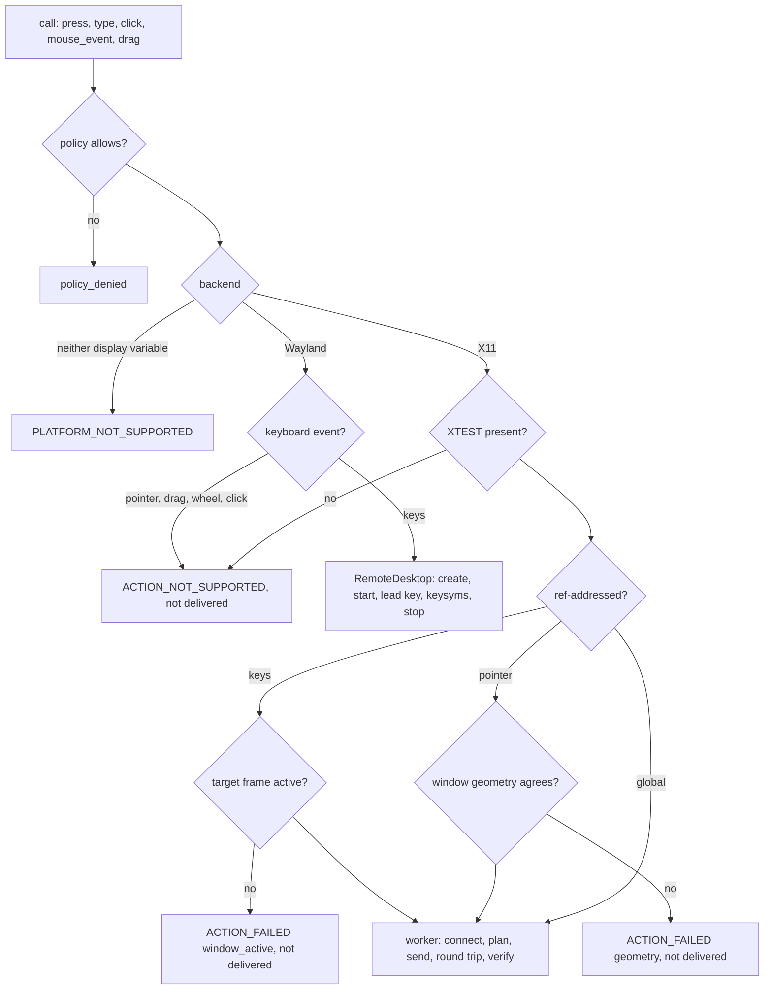
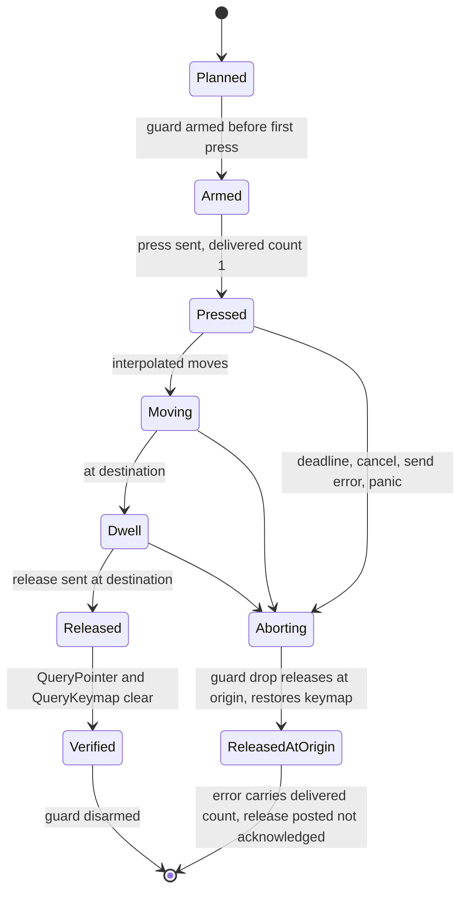

# Linux Input Synthesis (Sub-phase 3.8) - Plan

## Goal Capsule

- **Objective:** an agent on a GNOME desktop that asks to press a key, type text, click, hover, wheel or drag with `--headed` sees the input land in the app it targeted, or is told by the same envelopes as on macOS and Windows that nothing was sent and why. No key or button is ever left pressed, input aimed at a window that does not hold the keyboard is refused instead of typed blind, and whatever the desktop cannot do (aim a pointer on Wayland, send a held edge) is stated and never faked.
- **Means:** the Linux adapter implements `InputOps` (`mouse_event`, `key_event`, `drag`) and the physical legs of `execute_action` over XTEST on the already pinned `x11rb`, with mutter RemoteDesktop for Wayland keyboard input, release guards that mirror Windows, and no subprocess (KTD1-KTD13).
- **Authority:** `docs/phases.md` §3.8 as corrected by 3.0-3.7, and further corrected here where the ledger or the code disproves it (R12).
- **Stop conditions:** stop if a requirement needs a change under `crates/core`; if 3.7 lands without a physical seam that carries `request.policy`, `request.verified_point()`, the bus and the lease; if the handle carries no frame address (`AtspiElement::frame()` is `None` for a bare walk element, so U6 refuses such a handle with `check: window_active`); if the shared session detector (`system::display_server`) is bypassed; if the `xtest` feature cannot be added to the `x11rb` pin without a second connection type (the reader code is not extended: input opens its own `RustConnection`); or if no window manager can run rootless in a private session (openbox does, `L16-6`).
- **Execution profile:** U1 first; then four lanes with disjoint files run in parallel and 3.7 may still be in flight (Parallel Build below): lane B (U2, U3 planning), lane A (U4, U5 X11 transport, after the lane B types), lane C (U7 Wayland and session bus), lane D (U6 legs and gate against the frozen seam, U11 pure rule); lane I integrates after 3.7 lands (seam body, capability call, adapter wiring), then U8, U10, and U9 last because it records the dispositions U8 and U10 produce.
- **Finishes and ships:** the implementer runs the box measurements and live verification, commits, and opens one PR stacked on `feat/linux-3.7-semantic-actions`; nothing merges to `main`.

---

## Product Contract

### Summary

Land raw OS input on Linux. After this sub-phase `press`, `type`, `click`, `hover`, `drag`, `scroll`, `mouse-move`, `mouse-click` and `mouse-wheel` deliver physical input on X11 through XTEST, `press` and `type` deliver keys on Wayland through mutter RemoteDesktop, every multi-event gesture runs under a guard that releases what it pressed, and on X11 a keyboard event is sent only when the target frame reports `active`. Core is unchanged. The four held-input names stay fail-closed in core, and the adapter rejects the standalone edges too because FFI reaches `InputOps` directly.

### Problem Frame

Semantic actions cover the headless path, and the ledger says where they stop: popovers and menus do not answer `DoAction` (`L14-8`, `L14-14`), selection is not activation on GTK4 rows (`L4-9`), no `cancel` action exists (`L4-19`), and `scroll` has no AT-SPI route that moves content on GTK4 (`L6-12`). Those cases need real keys and a real pointer. Every `InputOps` method defaults to `ACTION_NOT_SUPPORTED`, and `crates/linux/src/input/mod.rs` is empty.

The roadmap's route is a subprocess, and the ledger removes it. Stock GNOME 46 has no `xdotool`, `xclip` or `wmctrl` (`L1-2`), the one on the box is a 2016 build extracted into a user directory (`L5-1`), and 3.4 already decided to read X11 over `x11rb` because tools are not guaranteed installed. `xdotool` itself speaks XTEST, and under Xwayland the working form is XTEST, not `--window` `SendEvent` (`L13-14`).

Three facts bound what input can prove. A synthetic pointer path always moves the real cursor (`L5-5`), so there is no headless pointer. Keys follow focus, and focus is not what `_NET_ACTIVE_WINDOW` says: with a shell system dialog pending, both grabs were held, XTEST keys went to the grab holder and no frame became `active` for 15 s (`L5-6`). On Wayland an ordinary client can send keysyms through mutter RemoteDesktop but cannot aim a pointer, because no global window origin is readable (`L13-16`, `L13-17`), and the `/dev/uinput` route is `root:root 0600` (`L5-2`, `L13-15`).

Nothing in the ledger is a saved capture of input landing on an app: `L5-7`, `L5-8`, `L5-9` and `L5-11` are DEFERRED behind the live session's input grab, and GNOME Text Editor under X11 showed no effect from accepted keys (`L14-3`); the cause is a window that was never focused under mutter and not the toolkit, since XTEST typing reached the GTK4 Text Editor once its window was active (`L23-12`, `L27-10`). The first unit therefore measures, in private sessions where no grab exists, through the product's own sender.

### Requirements

**Keyboard**

- R1. On X11, a `press` chord and `type` text are delivered by XTEST as modifiers down, key down, key up, modifiers up, with the key name resolved through the live keyboard mapping and the Shift level it needs. The step reports a physical synthetic mechanism and `verified: false`; the result is never called acknowledged (`A9-3` analogue, KTD5).
- R2. A character the layout cannot produce is typed by the route U1 shows works on GTK3, GTK4 and Qt, or refused before any key is sent with an error naming the character class; typed text never appears in an error, trace or detail (KTD4).
- R3. On X11 a ref-addressed key event is sent only when the target's frame reports `active` within a bounded wait; on Wayland frame `active` appears only once a seat keyboard exists (after a RemoteDesktop session and its first key, `L23-29`), so the same gate is read after the lead key and before the real keys on the shapes that reach it (R10), and the key step carries `focus_verified: false` and `verified: false` only if that read is unavailable. When the gate fails the call fails not delivered with `check: window_active` and a suggestion that names a pending system dialog as a cause (`L5-6`). A null-handle `press` sends globally with no element gate.
- R4. Long text is sent in chunks with the target re-verified between chunks, and a deadline crossed mid-text stops at a chunk boundary with the delivered count in the error.

**Pointer**

- R5. On X11, `mouse_event` delivers `Move`, `Click{count}` and `Wheel` with modifiers; `Down` and `Up` are rejected. Wheel uses buttons 4-7, with the sign convention of the Windows adapter for the same delta.
- R6. A headed ref-addressed `click`, `double-click`, `right-click`, `triple-click` and `scroll` that core classes as physical is delivered at the point core hit-tested when the request carries one, else at a point computed from the window-coordinate extents plus the X11 client origin, which is the GTK4 position (`L23-37`; screen extents are valid on GTK3 and Qt), and is refused, not aimed blind, where that position cannot be established (`L6-6`, `L13-6`). `hover` and `drag` reach the adapter as `mouse_event` and `drag` at the point core resolved from `get_element_bounds`, so their aim rests on 3.6's bounds and hit test. `scroll @ref --headed` reaches that leg only because eligible scroll targets carry the `Scroll` capability in both the snapshot and the live projection, which core's supported-action gate requires and the headed policy does not bypass (C1, KTD14).
- R7. `drag` delivers press at origin, interpolated moves, a dwell and release at destination under core's `DragParams` caps, and an abort releases at the origin.

**Release and held input**

- R8. After any call, success or failure, no key, button, modifier or temporary keymap change made by that call remains. On X11 this is verified by `QueryPointer` and `QueryKeymap`; an abort error carries the delivered-event count and states that emergency release was posted and not acknowledged.
- R9. `key_event` and `Down`/`Up` mouse events return `ACTION_NOT_SUPPORTED` with `raw_input_emitted: false` and `requires_daemon_owned_transaction: true`, not delivered, with nothing moved.

**Wayland and policy**

- R10. On Wayland, keys are delivered through mutter RemoteDesktop with the lead-key policy U1's evidence selects, on the command shapes that reach the key leg: a global `press` (null handle), and a ref `type` or `press` under a policy that does not demand `focus_window`. A `--headed` ref action calls core's `focus_window` first and 3.6's `focus_window` refuses a Wayland session (`wayland_session`, not delivered), so that shape ends there and is stated as such, not faked (owner item 29 decides a Wayland focus route). `mouse_event`, `drag`, physical click, hover and wheel return `ACTION_NOT_SUPPORTED` with `physical_delivery_started: false` and a suggestion to use the semantic action. No `/dev/uinput`, `ydotool` or `libei` code ships.
- R11. `is_blocked_combo` blocks the Linux shortcuts that take the foreground or change the session, with Windows' superset rule, and `ForceClick` stays `ACTION_NOT_SUPPORTED` (`L5-10`).

**Process and proof**

- R12. `crates/core` is unchanged, no shipped source names a plan, phase or decision id, no subprocess is spawned for input, pure tests run on every host, and every other requirement is proved by a real run on the GNOME box in private sessions now and on the live session once the owner restores it. `docs/phases.md` states what was built and no longer states what the evidence disproved, and every ledger row naming 3.8 is disposed of.
- R13. A stranger dogfood is run and its report committed with at least one finding, each disposed of.
- R14. Latency is measured min-of-seven with the warm-up discarded against `L5-5`, and the release binary stays under 15 MiB with the size delta of the `xtest` feature reported.

### Key Decisions

- KD1. **Core stays platform-neutral and Phase 3 is trait implementation only.** (session-settled: user-directed — chosen over adding Linux paths or fields in core: core is the shared surface.) Governs R9, R12. The held names fail closed in core; this sub-phase implements `InputOps` and the physical legs, and anything needing core is written into `docs/phases.md` for the owner.
- KD2. **Tests fail for a real reason, and real runs outrank suites.** (session-settled: user-directed — chosen over broad fixture-driven suites: probe scripts and captures are never read by tests and never committed.) Governs R12. Key-map, combo and gesture planning take plain values and a fake sink, as the Windows adapter does, every new test is invert-verified, and live tests never kill by name and never waive an error wholesale.
- KD3. **Box access goes only through `scripts/remote-linux.sh`, never `sudo`, and live verification runs in private sessions.** (session-settled: user-directed — chosen over the live session, whose shell holds an input grab and whose AT-SPI bus is broken until the owner restarts it.) Governs R1-R10. X11 input is verified in a private Xvfb with openbox (`L16-6`), Wayland in a private headless `gnome-shell` (`L13-3`); a live-session re-run is a Definition of Done line.
- KD4. **The PR stacks on `feat/linux-3.7-semantic-actions`; nothing merges to `main`.** (session-settled: user-directed — chosen over a PR against `main`.)
- KD5. **Every `docs/phases.md` statement the evidence disproves is corrected in place, as its own unit, citing rows.** (session-settled: user-directed — chosen over leaving it for the next planner.) Governs R12.
- KD6. **The stranger dogfood is a gate.** (session-settled: user-directed — chosen over an author-run check: the operator gets only the shipped skill copy and the box binary.) Governs R13.
- KD7. **One PR; the size is stated and justified.** (session-settled: user-directed — chosen over two stacked PRs.) The reason is in Risks & Dependencies.

### Scope Boundaries

- No semantic actions (3.7), no `focus_window` policy (3.9, which adds the focus-by-click fallback for a never-focused window under mutter on this sub-phase's click, `L27-10`), launch, close, window operations or `press_key_for_app` (3.9), no clipboard or screenshot (3.10), no event waits (3.11), no Linux platform skill (3.13).
- Considered and not built:
  - A `xdotool`, `ydotool` or `wmctrl` subprocess. Stock GNOME lacks them and the box copy is a 2016 build (`L1-2`, `L5-1`); XTEST through `x11rb` does what `xdotool` does for X11 clients (`L13-14`). Evidence that would change the call: an X11 environment without XTEST, which U1 checks for.
  - AT-SPI `DeviceEventController.GenerateKeyboardEvent` and `GenerateMouseEvent` (`L5-4`). U1 measures their effect on apps; they would add a second path on X11 only, move the cursor like XTEST (`L5-5`) and add nothing XTEST lacks.
  - `/dev/uinput`, `ydotool` and `ydotoold` (`L5-2`, `L13-15`, `L1-17`). They need root or a privileged daemon; building and detecting a path nothing in the product can reach is dead code. `docs/phases.md` states the route, its detection test and who measures it (U9).
  - `libei` and the EIS handshake (`L13-18`). RemoteDesktop keysyms already work rootless; libei stays a documented alternative.
  - A wheel rung inside `scroll_into_view` (KTD9).
  - Held keys and buttons (`key-down`, `key-up`, `mouse-down`, `mouse-up`): they need a daemon-owned transaction (R9).
  - `LongPress`: core has no such `Action`; U1 measures the hold timing for the roadmap row and nothing is implemented.
  - Restoring the cursor to its start position after a headed gesture. Windows does not, and the headed policy exists because input moves it (`L5-5`).
  - Measuring shell-bound blocked combos under `gnome-shell --x11`: an unmeasured entry stays blocked and `--force` bypasses it, so the measurement can only shorten a safe list.
  - A pre-gesture sweep of already-held buttons. It cannot tell the user's from ours; U1 measures whether a killed process leaves input held, and the result goes to 3.13's skill scope if it does.
- Deferred to follow-up work, written into `docs/phases.md` in U9:
  - A policy-carrying `scroll_into_view` for the core owner, so the coordinate-wheel fallback 3.6 handed to this sub-phase can run only headed (KTD9).
  - The live-session closure of `L5-3` and the Wayland-live legs to 3.12's harness.
  - The root-capable measurement of `ydotool` (`L5-2`, `L5-12`, `L13-15`, `L1-17`) to 3.15.
  - `is_protected_process`: the input evidence names no process-specific block; 3.9 receives that statement (`L11-28`).
  - The `L14-3` cause to 3.12's harness scope, and the input behaviours the Linux skill must state to 3.13's skill scope.
- Handoff to 3.14 (stated here so neither plan assumes the other covers it; not 3.8 scope, nothing in it is built or tested here):
  - 3.14 needs a shell-only Wayland pointer route through `org.gnome.Mutter.RemoteDesktop` using relative motion from a known home position, because shell extents are global screen coordinates and the route worked in a private shell (`L21-21`). This sub-phase keeps its Wayland pointer refusal for ordinary windows (`L13-17`); 3.14 U6 (`input/shell_pointer_wayland.rs`) and its KTD8 own the route and the scoping of it to shell handles, and they consume `SessionBus` and `remote_desktop.rs` from U7.
  - The extent-level off-screen check (reject an extent that intersects no display, for example the autohidden dock at `x=-84` or the `-2147483648` sentinels, without rejecting a merely negative origin on a multi-monitor layout, `L21-21`) is owned by 3.14 U6 (`input/shell_aim.rs`), because it needs 3.4's display list and a node's extents, which this sub-phase's pointer primitive does not receive. This sub-phase's primitive takes a point and validates it against the root geometry (U5); the U5 test below keeps that point check from rejecting a negative coordinate by sign.

---

## Planning Contract

### Key Technical Decisions

- KTD1. **Layout.** New files by the shared platform layout, one concern each, under the 400-line cap, each with its `_tests.rs`. `crates/linux/src/input/`: `mod.rs`, `backend.rs`, `blocked_combo.rs`, `standalone.rs`, `release_state.rs`, `release_guard.rs`, `keyboard.rs`, `key_names.rs`, `keymap.rs`, `key_plan.rs`, `text_plan.rs`, `pointer_plan.rs`, `wheel_plan.rs`, `drag_plan.rs`. `crates/linux/src/input/x11/`: `mod.rs`, `sink.rs`, `xtest_sink.rs`, `session.rs`, `keyboard_send.rs`, `mouse_send.rs`, `drag_send.rs`, `verify.rs`. `crates/linux/src/input/wayland/`: `mod.rs`, `remote_desktop.rs`, `keysym_send.rs`, `lead_key.rs`. `crates/linux/src/actions/`: `physical_target.rs`, `physical_keyboard.rs`, `physical_click.rs`, `physical_scroll.rs`. `crates/linux/src/system/`: `session_bus.rs` (KTD15). `crates/linux/src/tree/`: `scroll_capability.rs` (KTD14). `adapter.rs` and `system/adapter.rs` only wire. Governs R1-R11.
- KTD2. **XTEST through the existing `x11rb` pin, no subprocess.** (Evidence: `L1-2`, `L5-1`, `L13-14`; rejected: `xdotool`, AT-SPI `GenerateKeyboardEvent`.) `crates/linux/Cargo.toml` adds the `xtest` feature to `x11rb =0.14.0`; `Cargo.lock` changes with it, and the size delta against the 15 MiB limit is measured in U8. Input backend selection consumes the one session detector that exists, `system::display_server` (`session_server()` returning `DisplayServer::{Wayland, X11(String), Unavailable(Unavailable)}`, testable through `detect(&DisplayEnv, &dyn Probe)`); this sub-phase carries no detection of its own. A live Wayland socket decides before X11 even when `DISPLAY` is set, and the X11 arm carries the canonical display name that `RustConnection::connect(Some(&name))` takes, which has no connect deadline, so the connect runs on the worker thread of KTD3. The detector decides by a connectable socket, not by the variable alone, so a stale `WAYLAND_DISPLAY` whose socket is dead with a working `DISPLAY` is X11; it never reads `XDG_SESSION_TYPE` (`L1-4`, `L13-1`, `L13-2`); when neither display works the answer is a `PLATFORM_NOT_SUPPORTED` that names the two variables (B1). A server without the XTEST extension returns `ACTION_NOT_SUPPORTED` naming it. Governs R1, R5, R12.
- KTD3. **One connection per `InputOps` call, owned by a worker thread.** Unlike 3.4's connect-per-read, a drag at 16 ms ticks cannot reconnect per event and the release at the origin must go out on the connection that pressed. `session.rs` spawns a short-lived worker that opens the connection, runs the planned gesture against the `X11Sink` trait, and owns the release guard; the caller waits with `recv_timeout` on the remaining deadline. If the deadline passes the worker sees a shared cancel flag at the next event boundary, releases, and exits, so a caller that gave up never orphans a pressed button (`docs/solutions/logic-errors/a-deadline-cannot-interrupt-a-blocking-os-call.md`). Pacing sleeps between synthetic events are pacing, not waiting for state; waits for state (frame `active`) poll the condition. Governs R4, R7, R8.
- KTD4. **Keyboard is a plan over plain values.** `keymap.rs` holds the live `GetKeyboardMapping` and `GetModifierMapping` as plain tables; `key_names.rs` maps `KeyCombo.key` (letters, digits, named keys, `f1`-`f24`, arrows, `return`, `tab`, `escape`, `space`, `backspace`, `delete`, `home`, `end`, `pageup`, `pagedown`, `insert`) and modifier names (`ctrl`, `shift`, `alt`, `super`, `meta`) to keysyms; `key_plan.rs` turns a combo into an ordered event list with the Shift level the keysym needs; `text_plan.rs` turns text into chunks of at most 32 characters. A character absent from the layout is typed by one of two routes, chosen by U1's measurement: a temporary remap of an unused keycode through `ChangeKeyboardMapping` (server-global, visible to every client, and racing `MappingNotify`, so it carries a settle wait and a restore under the release guard), or a refusal before any event with an error that names the class of character. If the remap is unreliable on any of GTK3, GTK4 or Qt it does not ship. Text never enters an error, trace or detail. Governs R1, R2, R4.
- KTD5. **Delivery evidence is honest because `fake_input` is a void request.** After each burst the worker makes one round trip (`GetInputFocus`) so protocol errors from the burst surface; pointer gestures then read `QueryPointer` for position and button mask; keys have no read-back, so a key step is `physical_synthetic`, `verified: false`, and an interrupted one is `delivered_unverified` with `delivered_events`, `emergency_release_posted: true`, `emergency_release_acknowledged: false`, the shape `crates/windows/src/input/release_state.rs` gives (`A9-3`). On a clean exit `verify.rs` reads `QueryPointer` and `QueryKeymap` and fails the call loudly if the mask or keymap still shows what this call pressed. Governs R1, R7, R8.
- KTD6. **Release guards mirror Windows.** `release_state.rs` is the armed-and-counted state shared by every gesture; `release_guard.rs` is a `Drop` on the worker that releases believed-held buttons at the origin point (never at the destination), believed-held keys and modifiers in reverse order, and restores any temporary keymap. It arms before the first state-changing request (the keymap remap or the first press, whichever comes first), disarms after the last release and keymap restore, and runs on panic unwinding too. Chosen over releasing in the caller, which a timed-out `recv_timeout` skips (`docs/solutions/best-practices/abort-state-guidance-multi-step-physical-input.md`). Governs R7, R8.
- KTD7. **The focus gate is the frame's `ACTIVE` state.** `physical_target.rs` reads the target frame's AT-SPI `ACTIVE` (the frame address 3.6 puts on the handle, and 3.6's `focus_window` has already tried to make it so) and polls it inside the lease deadline for up to a short measured budget; 3.6's `focus_window` has already required `_NET_ACTIVE_WINDOW` to equal the target, so the gate does not repeat that read; U1 question 6 checks whether any case has frame `ACTIVE` true while keys still go elsewhere, and the second condition is added only if one appears. Failure is `ACTION_FAILED`, `not_delivered`, `details.check: window_active`, with the pending-system-dialog suggestion (`L5-6`). Chunked text re-checks between chunks. On Wayland frame `active` is absent until a seat keyboard exists and present afterwards, on the focused window, with the later-mapped window taking focus (`L23-29`; `L13-16` saw none before any key), so, on the shapes that reach the key leg at all (R10: a `--headed` ref action stops earlier at `focus_window`'s Wayland refusal), the gate applies there after the lead key of KTD8: a window still not `active` after the lead key fails the call not delivered with `check: window_active` (U1 question 9 confirms it), and only an unreadable frame leaves the key step with `focus_verified: false` and the result `verified: false`. Governs R3, R4.
- KTD8. **Wayland keyboard uses mutter RemoteDesktop over a deadline-bounded session-bus connection, never the accessibility one.** `org.gnome.Mutter.RemoteDesktop` lives on the session bus, while the crate's shared connection (`SharedBus` in `system/bus.rs`) is the accessibility bus: a RemoteDesktop call over it fails with a missing-service error on a healthy desktop (A4). `remote_desktop.rs` makes `CreateSession`, `Start`, a keysym burst, and `Stop` over the connection `session_bus.rs` provides (KTD15), inside one call under the crate's existing deadline pattern (`crates/linux/src/system/bus_deadline.rs`); the session is per call because the CLI is stateless. The first key of a sequence is dropped (`L13-16`; `L23-30`: the first key after `Start` was lost, then `hello` arrived intact 3 of 3 and after a warm-up tap, and the seat gains its keyboard only after the first input); U1 decides whether that is start latency or inherent, and `lead_key.rs` implements the cheapest harmless lead (a modifier tap, never a printable key, provided U1 shows a modifier tap also creates the seat keyboard) or a measured settle wait, whichever the evidence supports, with a read-back that the lead was absorbed before the real keys. Modifiers and a clipboard paste (`wl-copy` then Ctrl+V) went through the same path, and keys reach only the focused window (`L23-30`). Access control on a live user session is unmeasured (`L5-3`): an `AccessDenied` or missing service is `ACTION_NOT_SUPPORTED` with a suggestion to use the semantic action, and the live closure is a Definition of Done line. The pointer arm returns the honest error of R10 because no global window origin is readable (`L13-17`). Governs R10.
- KTD9. **The wheel primitive is provided where policy exists, not inside `scroll_into_view`.** (Conflict with the brief: it asked for a wheel primitive that 3.6's `scroll_into_view` can call. `scroll_into_view(&self, handle, lease)` carries no `InteractionPolicy`, `InteractionLease` holds only a deadline, and core calls it from headless `click`, `set-value` and `type` recoveries (`crates/core/src/ref_action.rs`), so a wheel there would move the real cursor (`L5-5`) without `--headed`. Suboptimal but workable, not blocking.) `wheel_plan.rs` and `mouse_send.rs` expose the wheel to `mouse_event` Wheel (core gates it with the cursor policy) and to the headed `Action::Scroll` leg of `execute_action`, which has `request.policy`. `scroll_into_view` stays as 3.6 ships it, and a policy-carrying `scroll_into_view` is written into `docs/phases.md` for the core owner. An agent whose headed click hits an off-screen row sees `scroll_into_view_attempted` and can run `scroll --headed` itself. Governs R5, R6.
- KTD10. **Pointer aim comes from geometry that agrees with itself.** `physical_target.rs` delivers a ref click at `request.verified_point()` when core's hit test supplied one, as `crates/windows/src/actions/physical_target.rs` does; only when it is absent does it take the centre of `crate::tree::get_element_bounds(bus, handle, deadline)`, which is already 3.6's pointer-frame rectangle: the screen extents where 3.6's `origins_agree` holds (GTK3, Qt, Chromium) and the window-coordinate extents moved to the X11 client origin for GTK4, whose screen extents are `[0,0,w,h]` (`L23-37`, `L27-40`, `L27-43`). This leg derives no geometry of its own and edits neither `toolkit_trust.rs` nor `frame_geometry.rs`. Where `get_element_bounds` returns `None` (an ambiguous or missing X11 mapping, or a calibration that did not hold) the leg refuses with `ACTION_FAILED`, not delivered, `check: geometry`, instead of clicking at a guess. Hover, drag and the `mouse-*` commands receive their point from core's `get_element_bounds` read, so the GTK4 aim problem is closed by 3.6 (R3a: `get_element_bounds` returns screen bounds only when they agree with the window extents plus the client origin, and no bounds otherwise, which core refuses before any event); this sub-phase consumes that and asserts it end to end in U8 case 3a rather than re-deriving geometry. U1 calibrates the aim by clicking and observing on GTK3, GTK4 and Qt, and the table of toolkits that aim correctly is a ledger row; 3.6's `toolkit_trust.rs` is read and not extended. Raw-coordinate commands (`mouse-click` and the rest) take the agent's point as given and need no geometry. Governs R6.
- KTD11. **Blocked combos are reasoned from the same question, then measured.** Membership test: does the shortcut take the foreground away or change the session. Candidate list: `alt+f4`, `alt+tab`, `super+l`, `ctrl+alt+delete`, `ctrl+alt+backspace`, `ctrl+alt+f1` to `ctrl+alt+f12`, `super`-only overview and `ctrl+alt+l`. Unlike Windows, `ctrl+alt+delete` is not excluded: XTEST can deliver it, and GNOME answers it. Superset matching and canonical modifier order as in `crates/windows/src/input/blocked_combo.rs`; core honours `--force`. Openbox has none of the shell's keybindings, so shell-bound entries are not measured; an unmeasured entry stays on the list because `--force` bypasses it, and the list states which entries are reasoned only. `is_blocked_combo` is a `SystemOps` method; the Linux override calls `blocked_combo.rs`. Governs R11.
- KTD12. **Held edges are rejected by shape, in the adapter.** `standalone.rs` returns the `ACTION_NOT_SUPPORTED` of R9 for `key_event` in either direction and for `Down` or `Up`, with `raw_input_emitted: false`, `requires_daemon_owned_transaction: true` and a not-delivered disposition, identical to `crates/windows/src/input/keyboard.rs` and `mouse.rs`. Governs R9.
- KTD13. **Errors are explicit and closed.** A policy failure is `policy_denied_for_policy`; a missing XTEST extension, a missing RemoteDesktop service or a Wayland pointer is `ACTION_NOT_SUPPORTED` with `physical_delivery_started: false`; the gate and geometry failures are `ACTION_FAILED` not delivered; a deadline expiry before any event is `TIMEOUT` with `physical_delivery_started: false`, after the first event it is the enriched abort error of KTD5. Governs R3, R6, R8, R10.
- KTD14. **The `Scroll` capability is emitted for eligible scroll targets, through the one path both projections use.** (C1.) 3.7 deliberately emits no `Scroll` token, and core's supported-action gate (`actionability/gates.rs`) requires the directional-scroll capability for `Action::Scroll`, so without a token `scroll @ref --headed` ends in `ACTION_NOT_SUPPORTED` before reaching the wheel leg. `scroll_capability.rs` adds the rule to the capability table 3.7 owns (`capability_rules.rs`): a node is an eligible scroll target when its role is a scroll container (scroll pane or viewport) or a list, tree, table or document role whose measured behaviour is that a wheel at its centre moves content (U1 question 14 fixes the role list per toolkit), and it is emitted only when the shared session detector reports X11, because the Wayland session has no pointer leg (R10) and the gate's `ACTION_NOT_SUPPORTED` is the honest answer there. A `scroll bar` `set-value` (3.7) realises virtualised content headlessly on the toolkits where it works (`L23-24`), so the wheel is the headed route and not the only one. The snapshot projection and the live projection (`get_live_actions` through 3.5's `live_project.rs`) both call the same function, so ref-ability, the gate and dispatch cannot drift, and 3.7's expectation that no node gets `Scroll` is updated in this stack to expect it for eligible targets. Governs R6.
- KTD15. **One deadline-bounded session-bus facility, distinct from the accessibility connection.** (A4.) `session_bus.rs` provides `SessionBus::get(deadline)` returning a session-bus connection opened under `bus_deadline`, with the same open-on-first-use and forget-on-failure shape as `SharedBus` but a separate slot, so no caller can mistake one bus for the other and no accessibility call goes to the session bus. 3.4's `display_mutter.rs` already opens a local session connection inside its own call; this sub-phase generalises that open into the facility and `display_mutter.rs` consumes it (a one-function edit to 3.4's file, behaviour unchanged, its tests kept), so the crate has one session-bus open and 3.10's portal calls reuse it. A RemoteDesktop session ends when its client disconnects, so the connection outlives `Start` through `Stop` within one call. Governs R10.

### High-Level Technical Design





Key and text planning, directional grammar:

```text
combo      := modifiers key
plan(combo) := for m in modifiers: down(keycode(m))
               [down(shift) if level(key) needs it]
               down(keycode(key)); up(keycode(key))
               up(shift?); for m in reverse(modifiers): up(keycode(m))
text(s)    := chunks of <= 32 chars
              for chunk: gate(); for c in chunk: plan(c) | remap-plan(c) | refuse(class(c))
```

### Assumptions

- 3.7 lands one seam, `actions/physical_delivery.rs`, that its single-match `dispatch.rs` calls for a verb-less `Click` or `RightClick`, `DoubleClick`, `TripleClick`, `Scroll`, a `TypeText` under a focus-fallback policy on a node without the `TypeText` token, and `PressKey` with an element or the null handle; `Hover`, `Drag`, `KeyDown` and `KeyUp` never reach it (core delivers them through `mouse_event`, `drag` and `key_event`). Its body is `ACTION_NOT_SUPPORTED` in 3.7 and this sub-phase replaces only that body, so `dispatch.rs` is not edited. The frozen signature (SEAM below) carries the bus and the lease because the frame `ACTIVE` read and the bounds read need the bus; 3.7's draft carries neither and must add both. A `type @ref --headed` on a node that carries the `TypeText` token is delivered by 3.7's semantic route and never reaches a key, so U8 case 1 and U10 probe 1 choose targets without the token (or `press`) for the physical leg and say which route each case proves.
- 3.6 lands with the frame address and the nearest scroll container on the handle, a frame `ACTIVE` read, the X11 client origin from 3.4's mapping, the agreement test and `toolkit_trust`, and a minimal X11 `focus_window` that returns `Ok` only when the target is active by both measures. If 3.6 lands without the agreement test or the frame `ACTIVE` read, U6 reads both extents types and the frame state itself over the handle's frame address and says so.
- 3.4's X11 module keeps the trait-and-bounded-runner shape (`system/x11/{bounded,client,reader,snapshot,source,state}.rs`); the input module reuses its display rule and `bounded.rs` runner and does not reach into its reader.
- 3.4 lands with the shared session detector (a connectable-socket decision between X11 and Wayland) and with `display_mutter.rs` opening its own session-bus connection; this sub-phase consumes the first and generalises the second (KTD15). If the detector is absent, the stop condition applies.
- Ledger areas `L15` and `L16` (including `L16-6`) are on the 3.4 branch, the base of this stack; 3.6 ends at area `L27`, so U1's rows go in the first free area after 3.7's. Rows `L21-21`, `L23-12`, `L23-24`, `L23-29`, `L23-30` are not in the committed ledger at the 3.6 head (only `L23-37` is, and the never-focused mutter fact is committed as `L27-10`): `check-linux-findings.py` would reject `docs/phases.md` text that cites them. U1 re-measures each and commits it as a new row, and every later citation (U9 included) uses the new id; until then the plan names them as pre-code observations only.
- Openbox 3.6.1 runs in a private Xvfb with the packages extracted at `~/ad-wt/wm-pkgs` (`L16-6`); `gnome-shell --headless --wayland --virtual-monitor 1280x800` runs privately for Wayland with the retry-and-health-gate loop (`L13-3`).
- X.Org's Xvfb ships XTEST. This is standard but not recorded for the box; U1 records it as a row before any code depends on it.
- The live session's AT-SPI bus is broken and its shell holds an input grab (`L5-6`) until the owner logs out and in, so every verification runs in a private session.

---

## Implementation Units

### U1. Measure first: input on a private X11 and Wayland session

- **Goal:** replace every unmeasured assumption this plan rests on with a ledger row before code depends on it.
- **Requirements:** R1-R11, R14.
- **Dependencies:** none.
- **Files:** `probes/linux/FINDINGS.md` (new rows only; probe scripts and captures stay in the dev-only probes directory, are never committed and never read by tests).
- **Approach:** through `scripts/remote-linux.sh`, in private sessions (`scripts/private-session.sh --wm -- <command>`, which owns the 0700 runtime dir, session bus, Xvfb and openbox and pushes `DISPLAY` into the bus activation environment, `L18-17`), and a private headless Wayland shell for Q9-Q10. Apps are the real ones (Text Editor, Calculator, a GTK3 app, a Qt app, Files). Each claim is measured in the passing and the failing direction, twice. Questions:
  0. Re-record as committed rows the pre-code observations this plan leans on (`L21-21` off-screen and negative-origin extents, `L23-12` typing landing once the window is active, `L23-24` wheel counts on the Files grid, `L23-29` and `L23-30` Wayland seat keyboard and first-key loss), each measured twice through the product's sender where one exists.
  1. Is XTEST present on the private Xvfb, and does one key and one button through `x11rb` `fake_input` land on a GTK3 entry, read back by AT-SPI `Text.GetText`?
  2. Does the same land on GNOME Text Editor under openbox and under `gnome-shell --x11` (`L14-3`)? `L23-12` measured typing landing under openbox with the window active (`xdotool type`, 2 of 2 variants) and `L27-10` measured no focused window, and so no effect, on a freshly mapped window under mutter until a click; U1 repeats both through `x11rb` `fake_input` and records which of the grab, the toolkit and the missing focus explains each outcome.
  3. Keymap: key names, Shift levels, `GetModifierMapping`, and characters outside the layout (`é`, `ü`, `你好`, an emoji, a 2,000-character string) through a spare-keycode remap on GTK3, GTK4 and Qt, with and without a settle wait, and whether `MappingNotify` races.
  4. Pointer: motion, click, double-click timing per toolkit, right-click, and wheel buttons 4-7 on a scrollable list, with `QueryPointer` read-back; the wheel sign convention against the Windows tests; the click aim on GTK3, GTK4 and Qt using 3.6's geometry, including window offsets (`L23-37`: window-coordinate extents plus the X11 client origin opened the GTK4 control, screen extents landed on the sidebar); and how many wheel clicks reach the end of the 300-file Files grid and how fast (`L23-24`: 60 clicks in 10 s did not, 260 did).
  5. Release: kill the process mid-drag, and abort with a held modifier; do `QueryPointer` and `QueryKeymap` show the input still down, and does closing the connection release XTEST-pressed input?
  6. Focus: where do keys go to a background window, a window under a grab-holding probe client that calls `XGrabKeyboard`, and a minimized window; does frame `ACTIVE` track the real keyboard holder (`L5-6`)?
  7. Whether the combos of KTD11 that openbox handles (`alt+f4`, `alt+tab`) behave as listed in the private session.
  8. AT-SPI `GenerateKeyboardEvent` and `GenerateMouseEvent` effect on apps (`L5-4`), and the hold timing of a press-sleep-release (`L5-9`).
  9. Wayland: does `NotifyKeyboardKeysym` drop only the first key of a session or the first after idle, which lead (a modifier tap, a settle wait) survives, whether and when frame `ACTIVE` appears (`L23-29`: after a RemoteDesktop session and its first key, on the focused window), whether a modifier-tap lead creates the seat keyboard as the first key did (`L23-30`), and whether the call works for a plain client with no consent step.
  10. Costs, min-of-seven with the warm-up discarded: one key, one click, one 300 ms drag, one worker connect, one RemoteDesktop session, against the `L5-5` baselines.
  11. `/dev/uinput` mode and group membership on the box (`L5-2`), unchanged by this unit.
  12. Whether `type` needs the element to report `FOCUSED` or the frame gate suffices, and how long frame `ACTIVE` takes to appear after `focus_window`, which sets the gate's polling budget.
  13. Wayland modifier-versus-selection isolation (`L13-25`), owned here because the keyboard implementation is what a modifier fault would repair (E1). With the target focused in a Wayland-native GTK4 editor, send Ctrl+V and a plain printable key through `NotifyKeyboardKeysym` in the passing and the failing direction, with the clipboard selection owned by a foreign producer (`wl-copy` in the private session, and separately a GTK app that copied the text itself), each at least three times (`L23-30` landed `wl-copy` text with Ctrl+V once): does the plain key land every time, does Ctrl+V paste the foreign selection, the self-copied one, or neither. The row names whether a paste failure is in the modifier path (then `lead_key.rs` and `keysym_send.rs` repair it in this PR, with a regression test and a live case) or in the selection offer (then 3.10 consumes the row as its measured cause and 3.8 changes nothing). 3.10 carries no keyboard repair.
  14. Scroll targets. For GTK3, GTK4, Qt and Chromium, which roles move content under a wheel at their centre on X11 and which do not (a scroll pane with no overflow, a list inside a scroll pane, a document), read back by an independent scroll position or the first visible row. This fixes KTD14's eligible-role list; a `scroll bar` `Value` write also moved the Files grid content after about 1.3 s (`L23-24`), which U1 records as the headless alternative on the toolkits where it works.
- **Test expectation:** none -- a measurement; its output is rows that cite their captures, read by `scripts/check-linux-findings.py`.
- **Verification:** each question has a row with a verdict and a disposition; the rows pass `python3 scripts/check-linux-findings.py`; the decisions U2-U7 leave open (remap or refuse, lead key, Wayland gate, element focus requirement, toolkit aim table, blocked-combo measured set) are each settled by a named row.

### U2. Keyboard vocabulary, planning and the blocked list

- **Goal:** all key decisions as pure functions over plain values.
- **Requirements:** R1, R2, R4, R11.
- **Dependencies:** U1.
- **Files:** `crates/linux/src/input/key_names.rs`, `keymap.rs`, `key_plan.rs`, `text_plan.rs`, `blocked_combo.rs`, `keyboard.rs`, and their `_tests.rs`.
- **Approach:** KTD4, KTD11. `keymap.rs` parses the two protocol replies into tables and answers keysym to (keycode, shift level) and the spare keycode to remap. `key_plan.rs` and `text_plan.rs` return event lists and chunks, never touching a connection. `blocked_combo.rs` is the canonicalising superset matcher. `keyboard.rs` is the facade `physical_keyboard.rs` calls.
- **Patterns to follow:** `crates/windows/src/input/keyboard_map.rs`, `keyboard_event.rs`, `keyboard_text.rs`, `blocked_combo.rs`.
- **Test scenarios:**
  - `ctrl+a` plans ctrl down, `a` down, `a` up, ctrl up in that order; `ctrl+shift+a` presses both modifiers in the given order and releases them in reverse.
  - An uppercase `A` with no explicit shift plans a Shift wrapper from the mapping's level; a keysym on level 2 of a keycode on a two-level mapping resolves to that keycode with Shift.
  - A mapping with no keycode for `é` plans the remap route or the refusal exactly as U1 settled, and the refusal error contains the class name and none of the text.
  - A 2,000-character text is split into chunks of at most 32 characters whose concatenation equals the input; a deadline already past yields zero chunks and the pre-delivery error.
  - An unknown key name returns `INVALID_ARGS` naming the accepted forms; `f13` resolves, `f25` does not.
  - `alt+shift+tab` is blocked by the `alt+tab` entry; `ctrl+alt+f3` is blocked; `ctrl+a` is not; modifier order and key-name aliases (`control`, `cmd` rejected, `super`) canonicalise to one form.
- **Verification:** the scenarios pass; inverting the reverse-order release, the shift wrapper, the chunk bound and the superset rule each fails its test.

### U3. Pointer, wheel and drag planning, and release state

- **Goal:** the gesture arithmetic and the shared delivery state as pure code.
- **Requirements:** R5, R7, R8, R9.
- **Dependencies:** U1.
- **Files:** `crates/linux/src/input/pointer_plan.rs`, `wheel_plan.rs`, `drag_plan.rs`, `release_state.rs`, `standalone.rs`, and their `_tests.rs`.
- **Approach:** KTD5, KTD6, KTD9, KTD12. `pointer_plan.rs` maps button and click count to press/release pairs with the hold and gap U1 measured (Windows uses 10 ms and 20 ms) and wraps modifiers. `wheel_plan.rs` turns a finite `f64` delta per axis into signed button counts for buttons 4-7 with the Windows rounding (a non-zero delta never rounds to zero) and caps (10 per event, 1,000 per axis), splitting a large delta so a deadline crossed mid-wheel reports the delivered count. `drag_plan.rs` turns `DragParams` into a tick list (16 ms, 200 ms pickup, dwell, defaults 300 ms and 500 ms) with the preflight reservation the Windows adapter makes. `release_state.rs` and `standalone.rs` are the shapes of R9 and KTD5.
- **Patterns to follow:** `crates/windows/src/input/mouse.rs`, `mouse_coord.rs`, `drag.rs`, `drag_state.rs`, `release_state.rs`, `keyboard.rs` (`reject_standalone_key_state`).
- **Test scenarios:**
  - A double-click plans press/release/press/release with the gap between pairs and no gap inside a pair; `Click{count:0}` and `count` above the cap are `INVALID_ARGS`.
  - `Wheel{dy: 2.4}` plans 2 steps on one button and `dy: -0.2` plans 1 step on the opposite button; `dx` uses buttons 6 and 7; a delta of `1001` or `NaN` is `INVALID_ARGS`; zero on both axes is `INVALID_ARGS`.
  - The sign of `dy` matches the Windows adapter's for the same delta (read from its wheel tests).
  - A delta of 260 plans 26 events of 10 steps within the per-axis cap, and the plan's pacing at the rate U1 measures completes inside the default budget (`L23-24`: 260 clicks reached the end of a 300-row list, 60 did not).
  - A drag of 300 ms yields interpolated ticks whose first point is the origin and last the destination, a dwell before release, and a preflight that rejects a budget shorter than pickup plus duration plus dwell with `physical_delivery_started: false`.
  - `release_state` with zero delivered enriches an error as `not_delivered`; with three delivered it adds `delivered_events: 3`, `emergency_release_posted: true`, `emergency_release_acknowledged: false`.
  - `Down`, `Up` and `key_event` in either direction return the R9 error with all three details.
- **Verification:** the scenarios pass; inverting the origin-release rule, the never-rounds-to-zero rule and the pre-delivery classification each fails its test.

### U4. X11 sink, session worker and guard

- **Goal:** the only code that touches the display: a trait over plain requests, its XTEST implementation, the worker that owns a call, and the guard.
- **Requirements:** R5, R7, R8, R12.
- **Dependencies:** U1, U3.
- **Files:** `crates/linux/Cargo.toml`, `Cargo.lock`, `crates/linux/src/input/backend.rs`, `release_guard.rs`, `crates/linux/src/input/x11/{mod,sink,xtest_sink,session,verify}.rs`, and `sink_tests.rs`, `session_tests.rs`, `release_guard_tests.rs`, `verify_tests.rs`.
- **Approach:** KTD2, KTD3, KTD5, KTD6. `sink.rs` is the trait: send key, send button, move to, query pointer, query keymap, round trip, read and change the keyboard mapping. `xtest_sink.rs` implements it with `x11rb` `fake_input` (event types 2-6) and the core requests, behind the `xtest` feature. `session.rs` spawns the worker with the cancel flag and the guard, and waits with `recv_timeout`. `verify.rs` compares the post-call pointer mask and keymap with what the call pressed. `backend.rs` maps the shared detector's answer to a backend (KTD2). The fake sink records the event stream and can be told to fail on the nth event, so the guard and abort paths are tested without a display.
- **Patterns to follow:** `crates/linux/src/system/x11/bounded.rs`, `crates/windows/src/input/mod.rs` (fake sink), `docs/solutions/logic-errors/a-deadline-cannot-interrupt-a-blocking-os-call.md`.
- **Test scenarios:**
  - A sink that fails on the 4th event during a drag leaves the recorded stream ending in a release at the origin and the delivered count 3; the caller receives the enriched error.
  - A worker handed a cancel flag set mid-gesture releases and exits before the next event; a caller whose deadline expired gets `TIMEOUT` with delivered evidence and the worker's release is still recorded.
  - A worker that panics after a press still releases (guard `Drop` on unwinding).
  - A temporary keymap change is restored after success, after failure and after cancel, and after a failure injected between the remap and the first press; the fake sink's mapping equals its start.
  - `verify` reports a leftover button in a mask that the call pressed, and ignores a button held that the call did not press.
  - Backend selection over a fake detector (B1): an answer of X11 selects the XTEST sink, Wayland selects the RemoteDesktop path, and neither is `PLATFORM_NOT_SUPPORTED` naming both variables; the stale-socket case (the detector answering X11 although `WAYLAND_DISPLAY` is set to a dead socket) selects X11 and no Wayland call is made, and a test that reads the environment variables in `backend.rs` instead of the detector fails the source scan.
- **Verification:** the scenarios pass; inverting the origin target of the corrective release, the unwinding release, the keymap restore and the pressed-by-this-call filter each fails its test; `cargo tree -p agent-desktop-core` still lists no platform crate.

### U5. X11 `InputOps`: mouse, drag, held-edge rejection and wiring

- **Goal:** `mouse_event`, `key_event` and `drag` answer through the trait on X11.
- **Requirements:** R5, R7, R8, R9, R12.
- **Dependencies:** U3, U4.
- **Files:** `crates/linux/src/input/x11/mouse_send.rs`, `drag_send.rs`, `keyboard_send.rs`, `crates/linux/src/input/mod.rs`, `crates/linux/src/adapter.rs`, `mouse_send_tests.rs`, `drag_send_tests.rs`, `input_trait_tests.rs`.
- **Approach:** KTD3, KTD5, KTD9, KTD12, KTD13. The adapter's `InputOps` forwards `mouse_event` to the mouse path with `lease.deadline()`, `key_event` to `standalone.rs`, and `drag` to the drag path after the deadline reservation. Each send path builds a plan (U3), runs it in a session (U4), and verifies. A move is a single absolute `MOTION_NOTIFY` in root coordinates validated against the root geometry. Modifiers on a mouse event are pressed around the gesture under the guard.
- **Patterns to follow:** `crates/windows/src/adapter.rs` (`InputOps` impl), `crates/windows/src/input/mouse.rs`, `drag.rs`, `docs/plans/2026-08-07-002-feat-windows-input-synthesis-plan.md`.
- **Test scenarios:**
  - Through the trait, `key_event(&combo, true, &lease)` and `mouse_event` with `Down` return the R9 error and the fake sink records no event.
  - `mouse_event` `Click{count:2}` at a point records move, two press/release pairs, then a position read; a point outside the root geometry is `INVALID_ARGS` with no event.
  - The point check is a containment test against the root geometry's rectangle, not a sign test on the coordinates: the `-2147483648` sentinel point and a point beyond the right or bottom edge are `INVALID_ARGS` with no event, and a point on the root's first row or column is delivered (`L21-21`; invert: drop the containment test and the sentinel and edge tests fail).
  - `Wheel` with a modifier records modifier down, the wheel buttons, modifier up.
  - A `drag` whose deadline expires during the dwell returns the enriched error with release at the origin recorded; the wire shape equals the Windows adapter's for the same abort (the parity test of `crates/windows/src/actions/input_envelope_parity_tests.rs`).
- **Verification:** the scenarios pass; the trait-level rejection test fails if the adapter forwards `key_event` to a sender. Live (U8): a click, double-click, right-click, wheel and drag land on Calculator, GTK3, Qt and Files rows, observed through AT-SPI or `QueryPointer`, and `QueryPointer` shows the mask clear after each.

### U6. Delivery gate and the physical legs of `execute_action`

- **Goal:** headed ref actions and global `press` reach the senders, behind the focus gate and the geometry check.
- **Requirements:** R1, R3, R4, R6, R10, R11.
- **Dependencies:** U2, U5; 3.6's frame and geometry; 3.7's dispatch seam.
- **Files:** `crates/linux/src/actions/physical_target.rs`, `frame_active.rs`, `physical_keyboard.rs`, `physical_click.rs`, `physical_scroll.rs`, their `_tests.rs`, `crates/linux/src/actions/physical_delivery.rs` and its tests (3.7's seam: body only), `crates/linux/src/system/adapter.rs` (`is_blocked_combo`), `physical_envelope_parity_tests.rs`. `dispatch.rs` is not touched.
- **Approach:** KTD7, KTD9, KTD10, KTD11, KTD13. `physical_target.rs` holds `ensure_keyboard_policy` (focus permission), `ensure_headed_click_policy` (focus and cursor), the frame-active poll and the aim point from `get_element_bounds`. `frame_active.rs` reads the frame's `ACTIVE` state (`read_node` on `AtspiElement::frame()` and `system::window_filter::frame_state`) because the existing read lives in the private `LiveWorld` of `focus_window`. `physical_keyboard.rs` runs `type_text_steps`, `press_key_element_steps` and `press_key_global` with the per-chunk verifier; step labels follow the Windows pattern with an X11 or RemoteDesktop mechanism name and `physical_synthetic`. `physical_click.rs` serves click, double, right and triple click; `Action::Hover` and `Action::Drag` are rejected at the adapter level as Windows does, because core reaches them through `mouse_event` and `drag`; `physical_scroll.rs` serves the headed `Action::Scroll` as wheel steps at the centre of the target's own `get_element_bounds` rectangle (KTD14 makes the target the scroll container; the ancestor returned by `scroll_container()` is an address without ancestry, so no frame placement can be read for it). On Wayland each leg returns the R10 error before computing anything, except keys, which route to U7.
- **Patterns to follow:** `crates/windows/src/actions/physical_target.rs`, `physical_keyboard.rs`, `physical_click.rs`, `dispatch.rs`, `input_envelope_parity_tests.rs`.
- **Execution note:** start with the failing parity test for the abort and pre-injection envelopes; the gate and geometry refusals are the behaviours most likely to be silently loosened.
- **Test scenarios:**
  - Headless policy on a physical key leg returns `policy_denied` with no event; focus-only policy permits keys and denies a click; headed permits both.
  - A frame that never reports `active` within the budget fails not delivered with `check: window_active` and sends nothing; a frame that becomes active after two polls proceeds.
  - A frame that loses `active` between chunk 2 and chunk 3 of a long text stops at the boundary with `delivered_events` equal to chunk 2's total.
  - The frame of a never-focused window under mutter, which ignores activation until clicked (`L27-10`), never reports `active`: the call fails not delivered with `check: window_active` and sends nothing; after 3.9's focus click makes it active the same call proceeds.
  - A click request carrying a verified point is delivered at that point and the geometry is not consulted; without one, a GTK4 target is aimed at its window-coordinate centre plus the X11 client origin and its screen extents `[0,0,w,h]` are ignored (`L23-37`), a target whose X11 mapping is ambiguous or missing, or a GTK4 window where 3.6's calibration did not hold, is refused with `check: geometry` and no event, and on a toolkit with valid screen extents the point equals window origin plus window-coordinate centre.
  - `Action::Hover` and `Action::Drag` through `execute_action` return the adapter-level rejection with nothing sent; `ForceClick`-class requests return `ACTION_NOT_SUPPORTED` with nothing sent.
  - A null-handle `press` sends with no gate; a blocked combo is refused by core before the adapter and `is_blocked_combo` returns true for `alt+f4`.
  - The envelope of an abort and of a pre-injection error equals the Windows envelope field for field.
- **Verification:** the scenarios pass; inverting the frame-active gate, the chunk re-check and the geometry refusal each fails its test. Live (U8): `type` into Text Editor, Calculator and a GTK3 entry lands and reads back; a grab-holding probe client makes `type` fail with the `window_active` error and types nothing.

### U7. Wayland keyboard through RemoteDesktop

- **Goal:** keys on a Wayland session, and an honest refusal for everything pointer-shaped.
- **Requirements:** R3, R10.
- **Dependencies:** U1, U2.
- **Files:** `crates/linux/src/input/wayland/{mod,remote_desktop,keysym_send,lead_key}.rs`, `crates/linux/src/system/session_bus.rs`, `crates/linux/src/system/display_mutter.rs` (the open only), their `_tests.rs`, `session_bus_tests.rs`.
- **Approach:** KTD8. `session_bus.rs` is the KTD15 facility, and `display_mutter.rs` moves its session open onto it; `remote_desktop.rs` is a thin typed proxy over that session connection and never over `SharedBus`; `keysym_send.rs` turns U2's key plans into `NotifyKeyboardKeysym` calls (keysym based, so characters need no remap); `lead_key.rs` is the measured policy. The proxy sits behind a trait so the sequence (create, start, lead, keys, stop) and the stop-on-every-path rule are tested over plain values.
- **Patterns to follow:** `crates/linux/src/system/bus.rs`, `bus_deadline.rs`, `bus_fault.rs`.
- **Test scenarios:**
  - The call sequence for `ctrl+a` is create, start, lead, ctrl down, `a` down, `a` up, ctrl up, stop, in that order; a failure at any step still issues stop.
  - A text containing `你好` produces keysyms and no remap call; the error for a failed call contains no text.
  - A missing service name or `AccessDenied` maps to `ACTION_NOT_SUPPORTED` with the semantic-action suggestion and `physical_delivery_started: false`.
  - A deadline that expires before `Start` returns `TIMEOUT` and issues `Stop` for the created session.
  - The first key of a session is dropped and the next ones arrive intact (`L23-30`): the sequence is create, start, lead, read-back that the lead was absorbed, then the real keys; the frame `ACTIVE` gate is read after the lead (`L23-29`) and a still-inactive frame fails not delivered with `check: window_active`; a fake that drops the first key cannot lose a real one.
  - `mouse_event` Move, Click and Wheel, and `drag`, on a Wayland backend return the R10 error with no D-Bus call.
  - Through core with a counting fake adapter whose `focus_window` is 3.6's Wayland refusal, `type @ref --headed` ends at `focus_window` with nothing sent, and a null-handle `press` reaches the key leg; the test names both shapes so R10's claim cannot drift.
  - Each call reaches the correct bus (A4): over two recording fake buses, every RemoteDesktop call lands on the session fake and none on the accessibility fake; `display_mutter`'s `GetCurrentState` also lands on the session fake through the same facility; an accessibility read lands on the accessibility fake only; a test that routes `remote_desktop.rs` through `SharedBus` fails.
  - `SessionBus::get` with an expired deadline returns the timeout before connecting; a failed open is returned and the next call retries; a connection from `SharedBus` is never returned by it.
- **Verification:** the scenarios pass; inverting stop-on-failure fails its test, and routing the proxy through the accessibility connection fails the bus test. Live (U8): in a private headless Wayland shell, a RemoteDesktop call over the session bus succeeds while the same call over the accessibility bus returns a missing-service error (the negative control that proves the two buses differ), `press` and `type` read back in a Wayland-native GTK4 editor with the lead policy U1 chose, and the pointer commands return the refusal.

### U11. Scroll capability for eligible scroll targets

- **Goal:** `scroll @ref --headed` passes core's supported-action gate and reaches the wheel leg, so the follow-up the core skill documents is usable (C1).
- **Requirements:** R6.
- **Dependencies:** U1 (question 14), U6; 3.7's `capability_rules.rs`.
- **Files:** `crates/linux/src/tree/scroll_capability.rs`, `crates/linux/src/tree/scroll_capability_tests.rs`, 3.7's `capability_rules.rs` and its tests, `crates/linux/src/tree/projection.rs` and its tests, 3.5's `live_project.rs` only if its action list is not already fed by `capability_rules.rs`.
- **Approach:** KTD14. `scroll_capability.rs` is a pure rule over role, interface list and the session kind; `capability_rules.rs` calls it so the snapshot projection and `get_live_actions` share it. 3.7's no-`Scroll` scenario in `action_names_tests.rs` and `capability_rules_tests.rs` is changed here to expect the token on eligible targets and its absence elsewhere.
- **Test scenarios:**
  - A scroll pane, a viewport and each U1-listed list, tree, table or document role gets `Scroll` on an X11 session; a button, a label and a scroll pane under a Wayland session do not.
  - The snapshot projection and the live action list of the same node agree (a drift test over a table of nodes), and a node whose role is not in the list gets no token in either.
  - Through core with a counting fake adapter: `scroll @ref --headed` on an eligible target passes the supported-action check and reaches `execute_action` with `Action::Scroll`; without the token the same request fails at the gate, so the test fails if the token is dropped; headless `scroll @ref` is refused by the policy gate and not by the capability.
  - 3.7's expectations that no node gets `Scroll` are replaced, not deleted: a node outside the list still gets none.
- **Verification:** the scenarios pass; dropping the token for eligible targets fails the gate test, and emitting it for a non-listed role fails the negative scenario. Live (U8): `scroll @ref --headed` moves content on a Files list, a GTK3 scroll pane, a Qt list and a Chromium page.

### U8. Live verification, performance and size

- **Goal:** prove R1-R11 and R14 on real apps in private sessions, and record the costs.
- **Requirements:** R1-R11, R14.
- **Dependencies:** U5, U6, U7, U11.
- **Files:** ignored live tests beside each unit (`physical_keyboard_live_tests.rs`, `physical_click_live_tests.rs`, `input_release_live_tests.rs`, `wayland_input_live_tests.rs`); new rows in `probes/linux/FINDINGS.md`.
- **Approach:** through `scripts/remote-linux.sh` in private sessions under openbox for X11 and a private headless Wayland shell, apps launched inside the session and stopped by the pid the test started. Every effect is read independently (AT-SPI `Text.GetText`, a state, `QueryPointer`, `QueryKeymap`), never from the command's `ok`. Cases, each with its failing direction:
  1. `type` on a target without the `TypeText` token (a ref `type` on a token-carrying field is 3.7's semantic route and proves nothing here) and global `press`: ASCII, non-ASCII per U1's route, a 2,000-character string; the same with the target in the background (refused) and under a grab-holding client (refused, nothing typed).
  2. `press` chords and shift+arrows selection, read back by selection state.
  3. Click, double-click, right-click, wheel and hover on a GTK3, a Qt and a GTK4 target; GTK4 click aim by window-coordinate extents plus the client origin (`L23-37`), refused where U1's table says the position is untrusted.
  3b. First focus by click (the line 3.6 handed over, `L27-10`): in a private `gnome-shell --x11` session with a never-focused GTK3, GTK4 and Qt window, `focus_window` ends `activation_not_granted`, then a raw `mouse-click --headed` at a point inside the window's client area through `mouse_event` makes the frame `ACTIVE` and `_NET_ACTIVE_WINDOW` equal the window (read independently), and the same `focus_window` then returns `Ok`; the failing direction is a click outside the window. 3.9 consumes this as its fallback and this case is its evidence.
  3a. GTK4 aim after a move, through complete commands: with a GTK4 window moved by the window manager from its first position, `hover @ref` and `drag @ref --to ...` on one of its controls land where an independent `QueryPointer` and the app's own effect (hover state, the dragged item's new position) show the control to be after the move (`L23-37`), or, where 3.6's calibration did not hold, are refused with `ACTION_FAILED` and zero pointer events (`QueryPointer` unchanged, no XTEST record); never an event at the window-relative origin. The same pair on a GTK3 and a Qt window lands. Break 3.6's pointer-safe bounds rule and this case fails.
  4. Drag with a mid-flight abort (deadline) and a kill of the worker's caller; `QueryPointer` and `QueryKeymap` show nothing held; the corrective release was at the origin.
  5. Held names through the CLI and through the trait; nothing moves.
  5b. Qt (the line 3.6 handed over, `L27-5`, `L27-37`): `scroll_into_view` through a headless recovery still ends `ACTION_NOT_SUPPORTED` `no_scroll_container` with no event sent (KTD9: it carries no policy), while `scroll @ref --headed` on the same Qt list moves content through the wheel leg.
  5a. `scroll @ref --headed` end to end through core on a Files list, a GTK3 scroll pane, a Qt list and a Chromium page: the content moves, read back by an independent scroll position or first visible row; the same ref headless is refused by policy; an ineligible ref is refused at the gate (C1).
  6. Wayland keys with the chosen lead, on a global `press` and on a ref action under a policy that skips `focus_window`; `type @ref --headed` shown to end at `focus_window`'s Wayland refusal with nothing sent; pointer refusals; a RemoteDesktop call over the session bus succeeds and the same call over the accessibility bus fails with a missing service (A4).
  6a. Stale-socket scenario through complete commands (B1): a private X11 session (Xvfb with openbox) with `WAYLAND_DISPLAY` set to a socket path nothing listens on and a working `DISPLAY`: `type`, `press`, a headed `click` and `mouse-click` through the CLI deliver on X11 and read back, with `list-displays`-style display enumeration and window focus taking the same X11 route; the same environment with `DISPLAY` unset fails as `PLATFORM_NOT_SUPPORTED` naming both variables; a live Wayland socket with `DISPLAY` also set stays on Wayland.
  7. Costs, min-of-seven with the warm-up discarded, reported as min with median and max: one key, one click, one drag, one worker connect, one RemoteDesktop session, against `L5-5`. The release binary size with and without `xtest` against 15 MiB.
- **Test expectation:** the live tests are the unit scenarios marked live above; nothing asserts a coordinate from a live app.
- **Verification:** every live case passes in the private sessions; the numbers are recorded; the live-session re-run is listed as outstanding with what it covers.

### U9. Correct `docs/phases.md` and dispose of the ledger rows

- **Goal:** the roadmap states what was built and no longer states what the evidence disproved.
- **Requirements:** R12.
- **Dependencies:** U8, U10; applied after 3.7's `docs/phases.md` commit lands.
- **Files:** `docs/phases.md`, `probes/linux/FINDINGS.md`.
- **Approach:** KD5. Edit in place, no annotations, citing rows, anchored by section and prose:
  1. §3.8 scope and Key APIs: the keyboard and mouse bullets name XTEST through `x11rb`, not `xdotool`; the tool-check and 2016-version sentences are removed (the version fact stays in the ledger); `ydotool` is stated as an unbuilt root-gated option with its detection test; the Wayland bullet states the measured RemoteDesktop route, the lead-key outcome and that pointer input is not available; Key APIs list `x11rb` XTEST and `org.gnome.Mutter.RemoteDesktop`.
  2. §3.8 exit criteria: GNOME/X11 headed gestures and keys, GNOME/Wayland keys through global `press` and the semantic actions, no Wayland pointer gesture (`L13-17`).
  3. Linux API Mapping rows for Scroll, Keyboard and Mouse; objective P3-O3 and the `LongPress` mapping in P3-O13 and the capability map (XTEST button hold, no core `Action`).
  4. Display Server Detection (the input-tools bullet), Minimum OS (the X11 `xdotool` line), the Key Risks row "Input tool availability", and New Dependencies (`x11rb` feature `xtest`).
  5. Receivers: the policy-carrying `scroll_into_view` for the core owner (KTD9); `L5-3` and the live Wayland legs to 3.12; the `L14-3` cause U1 separated, with its closure in 3.12's harness scope; the root-capable `ydotool` measurement to 3.15; to 3.9 the statement that input evidence names no process-specific block, for `is_protected_process` (`L11-28`); to 3.13's skill scope the input behaviours an agent must read (a killed process may leave input held if U1 shows it, Wayland keys carry `focus_verified: false`, the `scroll --headed` follow-up after a failed scroll recovery, the held names are unsupported).
  5a. §3.8 lines 3.6 handed over, corrected in place: the wheel for `scroll_into_view` is not built (it has no policy, KTD9) and the wheel is the headed `scroll` leg; §3.6's sentence that Qt ends `no_scroll_container` until the wheel route lands states instead that headless recovery on Qt stays refused and `scroll --headed` is the route; the focus-by-click fallback names `mouse_event` Click as the primitive and U8 case 3b as its evidence; the §3.8 Wayland bullet states that a `--headed` ref action ends at `focus_window`'s Wayland refusal (owner item 29).
  6. Named for their owners, not edited: 3.9's `window_op` and `Key APIs` mentions of `xdotool`/`wmctrl`, and 3.13's skill checklist lines on input tools.
  7. `probes/linux/FINDINGS.md`: each DEFERRED row naming 3.8 changed to its disposition.
- **Test expectation:** none -- documentation; `python3 scripts/check-linux-findings.py` exits 0 and `--sub-phase 3.8` lists none `DEFERRED`.
- **Verification:** a reader of §3.8 learns what shipped, what was refused and who owns the rest; every cited row contains the cited fact.

### U10. Stranger dogfood

- **Goal:** find what a new agent hits using only the shipped skill and the built binary.
- **Requirements:** R13.
- **Dependencies:** U8.
- **Files:** `docs/dogfood-reports/<date>-<serial>-feat-linux-3-8-input-dogfood.md`.
- **Approach:** KD6. The operator is a subagent told that it holds the built release binary and the text of `skills/agent-desktop/` (from `agent-desktop skills get core`) and nothing else, in a private Xvfb session under openbox, plus a private Wayland leg. Apps are Text Editor, Calculator, a GTK3 app, a Qt app and Files, launched and arranged by the harness outside the operator's tools. The operator runs every example in bash verbatim, reads every `ok`, waits with `wait` and never sleeps, treats any undocumented flag, variable or ordering as a finding, confirms a failure twice, and measures each claim in the passing and the failing direction. Probes:
  1. `type` ASCII, non-ASCII, long text; the same without `--headed` and against a background window and a grab-holding client.
  2. `press` chords; a blocked combo and the same with `--force` on a throwaway window.
  3. `mouse-move`, `mouse-click`, double and right click, `mouse-wheel`, `hover`, each with and without `--headed`.
  4. `drag` to completion and with a short `--timeout`; then `QueryPointer` and `QueryKeymap` show nothing held.
  5. `key-down`, `key-up`, `mouse-down`, `mouse-up` return `ACTION_NOT_SUPPORTED` and nothing moves.
  6. A headed click on an off-screen row: the `scroll_into_view_attempted` detail and the `scroll --headed` follow-up the core skill already documents.
  7. Wayland: `press` and `type` work, `mouse-click` and `hover` return the documented refusal.
  8. No XTEST (a private server without it) and no display variable: the error and exit code.
  9. A stale `WAYLAND_DISPLAY` with a working `DISPLAY`: `type`, `press`, `click --headed` and `mouse-click` deliver on X11, and `DISPLAY` unset in the same environment ends in the documented error (B1).
  10. `scroll @ref --headed` on a list after a failed scroll recovery, and the headless form refused by policy (C1).
  Every effect is compared with an independent observation.
- **Test expectation:** none -- a run and a report; each finding is disposed as fixed with a named test that fails when the fix is removed, owned elsewhere with the receiving scope written in `docs/phases.md`, or accepted with the reason. After any code fix, U8's live and performance rows are re-run.
- **Verification:** the report is committed with at least one finding, every finding has one disposition, and every fixed finding's test has been seen to fail with the fix removed.

---

## Parallel Build

3.8 builds in parallel with 3.7 because everything it adds lives in new files (`input/`, `system/session_bus.rs`, new `actions/physical_*.rs` and `actions/frame_active.rs`, `tree/scroll_capability.rs`) and the only 3.7 surface it consumes is one seam. Paths are relative to `crates/linux/src`. `crates/core` stays untouched.

**SEAM (frozen, owned by 3.7's `actions/physical_delivery.rs`; 3.8 replaces the body only):**

```rust
pub(crate) fn physical_delivery(
    bus: &SharedBus,
    action: &Action,
    element: Option<&AtspiElement>,
    request: &ActionRequest,
    lease: &InteractionLease,
) -> Result<ActionResult, AdapterError>;
```

3.8 must not touch these 3.7 files: `actions/dispatch.rs`, `chain*.rs`, `mutation*.rs`, `write_call*.rs`, `action_call.rs`, `click.rs`, `toggle_state.rs`, `disclosure.rs`, `value_write.rs`, `text_write.rs`, `numeric_write.rs`, `select*.rs`, `focus.rs`, `scroll_wrap.rs`, `tree/action_names.rs`, `tree/text_*.rs`. The two touches that wait for 3.7 to land are lane I's: the body of `physical_delivery.rs` (and its not-supported test, which becomes the Wayland and policy cases) and one call to `scroll_capability::eligible` inside 3.7's `tree/capability_rules.rs` with its two expectation changes (U11). Until then 3.8's legs are tested through their own entry points over fakes.

**Lane A, X11 transport (U4, U5).** Owns `input/backend.rs`, `release_state.rs`, `release_guard.rs`, `input/x11/**`, `Cargo.toml`, `Cargo.lock`. Depends on lane B's `step.rs` and `keymap.rs` types only.

```rust
pub(crate) trait X11Sink { fn key(&mut self, code: u8, down: bool) -> Result<(), SinkError>; fn button(&mut self, code: u8, down: bool) -> Result<(), SinkError>;
    fn move_to(&mut self, x: i16, y: i16) -> Result<(), SinkError>; fn round_trip(&mut self) -> Result<(), SinkError>;
    fn pointer(&mut self) -> Result<PointerRead, SinkError>; fn keys_down(&mut self) -> Result<[u8; 32], SinkError>;
    fn keymap(&mut self) -> Result<Keymap, SinkError>; fn edit_keymap(&mut self, edit: &KeymapEdit) -> Result<(), SinkError>; }
pub(crate) fn backend() -> Result<Backend, AdapterError>;                       // Backend::{X11(String), Wayland}
pub(crate) fn run(display: &str, plans: Vec<Plan>, gate: &mut dyn FnMut() -> Result<(), AdapterError>, deadline: Deadline) -> Result<Delivery, AdapterError>;
pub(crate) fn live_keymap(display: &str, deadline: Deadline) -> Result<Keymap, AdapterError>;
```

**Lane B, pure planning (U2, U3 minus `release_state.rs`).** Owns `input/{step,keymap,key_names,key_plan,text_plan,pointer_plan,wheel_plan,drag_plan,blocked_combo,standalone,keyboard}.rs`. No connection, no bus.

```rust
pub(crate) enum Step { Key { code: u8, down: bool }, Button { code: u8, down: bool }, MoveTo { x: i32, y: i32 }, Pause(Duration), Keymap(KeymapEdit) }
pub(crate) struct Plan { pub(crate) steps: Vec<Step>, pub(crate) release_origin: Option<(i32, i32)> }
pub(crate) struct Delivery { pub(crate) delivered_events: u32, pub(crate) mechanism: &'static str }
pub(crate) fn plan_combo(map: &Keymap, combo: &KeyCombo) -> Result<Plan, AdapterError>;
pub(crate) fn plan_text(map: &Keymap, text: &str) -> Result<Vec<Plan>, AdapterError>;      // chunks of at most 32 characters
pub(crate) fn plan_click(map: &Keymap, at: Point, button: &MouseButton, count: u32, mods: &[Modifier]) -> Result<Plan, AdapterError>;
pub(crate) fn plan_wheel(map: &Keymap, at: Point, dx: f64, dy: f64, mods: &[Modifier]) -> Result<Vec<Plan>, AdapterError>;
pub(crate) fn plan_drag(params: &DragParams, deadline: Deadline) -> Result<Plan, AdapterError>;
pub(crate) fn plan_keysyms(combo: &KeyCombo) -> Result<Vec<KeysymStep>, AdapterError>;     // KeysymStep { keysym: u32, down: bool }
pub(crate) fn plan_text_keysyms(text: &str) -> Vec<Vec<KeysymStep>>;
pub(crate) fn is_blocked(combo: &KeyCombo) -> bool;
pub(crate) fn reject_standalone(what: &'static str) -> AdapterError;
```

**Lane C, Wayland keys and the session bus (U7).** Owns `input/wayland/**`, `system/session_bus.rs`, and the single session-open edit in `system/display_mutter.rs`. Depends on lane B's `KeysymStep` only.

```rust
pub(crate) fn get(deadline: Deadline) -> Result<zbus::Connection, AdapterError>;           // session_bus::SessionBus, never the accessibility bus
pub(crate) fn send_keys(keys: &[KeysymStep], gate: &mut dyn FnMut() -> Result<(), AdapterError>, deadline: Deadline) -> Result<Delivery, AdapterError>;
pub(crate) fn pointer_refusal(what: &'static str) -> AdapterError;                       // R10 error
```

**Lane D, delivery gate and legs (U6, U11 pure rule).** Owns `actions/{physical_target,frame_active,physical_keyboard,physical_click,physical_scroll}.rs` and `tree/scroll_capability.rs` with their tests. It calls the facade below and never `x11/` or `wayland/` directly.

```rust
pub(crate) fn frame_active(bus: &SharedBus, frame: &AtspiElement, deadline: Deadline) -> Result<Option<bool>, AdapterError>;
pub(crate) fn deliver(bus: &SharedBus, action: &Action, element: Option<&AtspiElement>, request: &ActionRequest, lease: &InteractionLease) -> Result<ActionResult, AdapterError>;
pub(crate) fn press_global(bus: &SharedBus, combo: &KeyCombo, policy: InteractionPolicy, deadline: Deadline) -> Result<ActionResult, AdapterError>;   // consumed by 3.9's press_key_for_app
pub(crate) fn eligible(role: u32, interfaces: &[String], session: &DisplayServer) -> bool;     // scroll_capability
```

**Lane I, integration.** Owns `input/mod.rs`, `input/deliver.rs` (matches `Backend` to `x11::run` or `wayland::send_keys`), `adapter.rs` (`InputOps`), `system/adapter.rs` (`is_blocked_combo`), `system/mod.rs`, `actions/mod.rs`, the 3.7 seam body, the capability call, `docs/phases.md`, the ledger, the live tests and U8-U10. A skeleton commit creates every new file as a compiling stub with all `mod` lines, so the registration files are frozen before the lanes start (the 3.6 model).

## Verification Contract

| Check | Command or method | Proves |
|---|---|---|
| Lint | `cargo clippy --locked -p agent-desktop-core -p agent-desktop-linux -p agent-desktop -p agent-desktop-ffi --all-targets -- -D warnings` on the box | quality gate |
| Unit | `scripts/cargo-test-isolated-home.sh test --locked -p agent-desktop-linux` | U2-U7 pure behavior, on every host |
| Live, X11 private session | through `scripts/remote-linux.sh`, `XDG_RUNTIME_DIR=$R dbus-run-session -- xvfb-run -a` with openbox started inside: `cargo test --locked -p agent-desktop-linux -- --ignored physical_keyboard_live physical_click_live input_release_live` | R1-R9, R11 on real apps without the grabbed live session |
| Live, Wayland private session | a private `gnome-shell --headless --wayland` session with the retry-and-health-gate loop: `-- --ignored wayland_input_live` | R10 |
| Live, live session | the same ignored tests on the live session once the owner restores it, including the `L5-3` access-control question | the legs the private sessions cannot show |
| Invert | break each named rule (the session-bus routing, the detector use in backend selection, the `Scroll` capability emission, reverse-order release, shift wrapper, chunk bound, superset block, origin release, never-rounds-to-zero wheel rule, pre-delivery classification, unwinding release, keymap restore, pressed-by-this-call filter, frame-active gate, chunk re-check, geometry refusal, stop-on-failure, trait-level rejection), watch its test fail, restore | the tests guard what they name |
| MSRV | `cargo +1.89.0 check --locked -p agent-desktop-linux --all-targets` | toolchain floor |
| Isolation | `cargo tree -p agent-desktop-core` shows no platform crate and `git diff -- crates/core` is empty | KD1, R12 |
| No subprocess | a search of `crates/linux/src/input` and `crates/linux/src/actions` finds no `Command::new` | KTD2, R12 |
| Source rules | `scripts/check-rust-file-size.sh`, `scripts/check-no-phase-references.sh`, `scripts/check-stale-ref-constructor-misuse.sh`, `cargo fmt --all -- --check` | 400-line cap, no plan ids in source |
| Ledger | `python3 scripts/check-linux-findings.py` exits 0, then `--sub-phase 3.8` lists none `DEFERRED` | citations valid, dispositions made |
| Perf and size | min-of-seven with the warm-up discarded for the rows in U8; release size with and without `xtest` against 15 MiB | R14 |
| Dogfood | the committed report with every finding disposed | R13 |

Requirement-to-check map: R1 -> U2 plan rows, U8 case 1 and 2; R2 -> U2 no-layout row, U8 case 1; R3 -> U6 gate rows, U8 case 1 grab-holder; R4 -> U2 chunk row, U6 chunk re-check row; R5 -> U3 wheel and click rows, U5 trait rows, U8 case 3; R6 -> U6 geometry rows, U11 scenarios, U8 cases 3 and 5a; R7 -> U3 drag rows, U5 abort row, U8 case 4; R8 -> U4 guard and verify rows, U8 case 4; R9 -> U3 and U5 rejection rows, U8 case 5; R10 -> U7 rows including the bus-routing rows, U8 cases 6 and 6a; R11 -> U2 blocked rows, U6 `is_blocked_combo` row, U6 ForceClick row; R12 -> isolation, no-subprocess, source rules, ledger and U9; R13 -> U10; R14 -> perf and size.

## Definition of Done

- Every Verification Contract row passes in the private sessions, the invert check has been run for each rule it names, and the live-session re-run (including `L5-3`) is either done or listed in the PR description as outstanding with what it covers.
- Every ledger row naming 3.8, and every row the roadmap cites for it, is disposed of in the PR description, implemented, owned elsewhere with the receiving scope in `docs/phases.md`, or accepted with the reason:
  - `L5-7`, `L5-8`, `L5-11`: measured in the private session by U1 and U8, and cited by the behaviours they decided.
  - `L5-9`: the hold timing measured by U1; no core `Action`, so nothing implemented; the roadmap row is corrected (U9).
  - `L5-3`: the private-bus result recorded; live-session closure owned by 3.12 (U9).
  - `L5-2`, `L5-12`, `L13-15`, `L1-17`: the rootless parts (RemoteDesktop, headless shell) measured; the `/dev/uinput` part owned by 3.15 as a root-capable lab step, with no `ydotool` code shipped (U9).
  - `L5-4`: measured by U1 and not adopted.
  - `L5-1`, `L1-2`: implemented as the removal of the subprocess dependence (KTD2); the version fact stays in the ledger.
  - `L5-5`, `L5-10`: implemented, headed-only placement holds and `ForceClick` is unsupported.
  - `L5-6`: implemented as the frame-active gate (KTD7).
  - `L13-13`, `L13-14`, `L13-16`, `L13-17`, `L13-18`: implemented or confirmed by U7 and the Wayland refusals; libei not adopted.
  - `L14-3`, `L23-12`, `L27-10`: cause separated (a never-focused window under mutter; XTEST reaches GTK4 once the window is active) and re-measured by U1; closure stays with 3.12 and `docs/phases.md` states the cause; the focus click is 3.9's.
  - `L4-19`: `Escape` synthesis available through `press`; `Action::Cancel` does not exist in core.
  - `L1-4`, `L13-1`, `L13-2`: implemented as the display rule (KTD2).
  - `L13-25`: the modifier-versus-selection isolation measured by U1 question 13 with a foreign producer; a modifier-path cause is repaired here, a selection-offer cause is handed to 3.10 as its measured input (E1).
  - `L23-29`, `L23-30`: implemented as the Wayland gate read after the lead key and the lead-key policy (U7).
  - `L23-37`, `L23-24`: implemented as the GTK4 aim and the wheel pacing (U3, U6); the headless scroll bar route is 3.7's.
  - `L1-3`, `L13-6`, `L7-8`, `L13-8`, `L13-9`: confirmed or implemented by U1 and U8 (version fact stays in the ledger; the AT-SPI-first rule holds on Wayland; `GrabFocus` is never used).
  - `L4-9`, `L18-4`, `L18-10`: the keyboard path now exists (`press`, `Escape`), so 3.7's GTK4 navigation-list fallback and 3.11's `--menu-closed` can use it; each row names its consumer.
  - `L27-5`, `L27-10`: the wheel leg and the focus click (U8 cases 3b and 5b); `L27-10`'s fact replaces the uncommitted `L23-14` citations.
  - U1's new rows, including the re-recorded `L21-21`, `L23-12`, `L23-24`, `L23-29`, `L23-30`: each with its verdict and a disposition.
- The dogfood report is committed with every finding disposed of and every fixed finding's test invert-verified.
- `crates/core` diff is empty, no shipped source names a plan, phase or decision id, no input subprocess exists, and no probe script, capture or box identity is committed.
- `docs/phases.md` states what was built and no longer states what the evidence disproved; the `scroll_into_view` policy gap, the live-session legs, the root measurement and the `is_protected_process` statement are written into their receivers.
- No abandoned experiment code remains.

## Risks & Dependencies

| Risk | Mitigation |
|---|---|
| 3.7's seam lacks the bus or the lease (its draft passes only the deadline) | the SEAM signature in Parallel Build is sent to 3.7 now; U6 is the only consumer |
| The frame `ACTIVE` read is private to `focus_window`'s `LiveWorld` | `actions/frame_active.rs` reads it through `read_node` and `frame_state`; geometry comes from `get_element_bounds` |
| XTEST is absent from a target X server | `ACTION_NOT_SUPPORTED` naming the extension; U1 records whether Xvfb, Xorg and Xwayland have it |
| A keymap remap is unreliable or disturbs other clients | U1 decides; the remap ships only if it passes on GTK3, GTK4 and Qt, otherwise out-of-layout characters are refused before any key is sent and `type` through `EditableText` (3.7) covers them |
| A killed process leaves input held | measured in U1; if it does, 3.13's skill scope states it and the guard's `Drop` covers every other exit; no sweep can tell the user's input from ours |
| GTK4 click aim is wrong | aimed by window-coordinate extents plus the client origin (`L23-37`), refused with `check: geometry` where 3.6's calibration did not hold; the semantic action is the route |
| A never-focused window under mutter ignores activation (`L27-10`) | the frame gate refuses with `check: window_active`; 3.9's focus click is the fallback; U1 question 2 measures both managers |
| The shell-bound blocked combos cannot be measured under openbox | the list is reasoned from the membership test and says which entries are unmeasured; `--force` stays the escape |
| Wayland keys are typed into the wrong window | frame `active` appears there only after a seat keyboard exists (`L23-29`), so the gate is read after the lead key; headed ref actions are stopped earlier by 3.6's `focus_window`, so the exposure is global `press`, written into 3.13's skill scope and carried in the step as `focus_verified: false` when the frame is unreadable |
| RemoteDesktop is closed to ordinary clients on a live session | `ACTION_NOT_SUPPORTED` with the semantic suggestion; the live closure is a Definition of Done line |
| Per-call connection cost | measured in U8 against `L5-5`; in-process XTEST is expected at or below the GI figure |
| PR size exceeds the ~2k guideline | about 3k lines of product code and 1.5k of tests; the Windows input module without clipboard is 3.7k lines for the same surface; the roadmap's ~2k estimate predates the keymap and remap work, the Wayland session and the release guards, each of which the exit criteria need; the seam after U5 (X11 trait) versus U6-U7 (gate, legs, Wayland) is noted for information only, KD7 keeps one PR |
| The live session holds an input grab and its bus is broken | all verification runs in private sessions; the live-session re-run waits for the owner |

## Open Questions

### Deferred to implementation

- Remap versus refuse for characters outside the layout, the settle wait, and the per-toolkit table (KTD4), from U1.
- The lead key or settle wait on Wayland and, given `L23-29`, when frame `ACTIVE` can be read there (KTD7, KTD8), from U1.
- The click hold and gap per toolkit, the polling budget for the frame gate (U1 question 12), and the wheel step size; the pickup delay is the 200 ms U3 states.
- Whether the element must also report `FOCUSED` for `type`, or the frame gate suffices.

### For the owner

- A policy-carrying `scroll_into_view` in core, so the coordinate-wheel fallback for headed pointer actions can exist without moving the cursor in headless runs (KTD9).
- The live session must be restarted to clear the shell's input grab before the live-session re-run, and a Wayland session is needed for `L5-3`.
- Whether a root-capable lab step for `ydotool` is wanted at all (3.15).

## Sources & Research

- `probes/linux/FINDINGS.md` rows `L1-2`, `L1-4`, `L1-17`, `L4-9`, `L4-19`, `L5-1` to `L5-12`, `L6-6`, `L6-12`, `L7-8`, `L11-28`, `L13-1` to `L13-3`, `L13-6`, `L13-8`, `L13-9`, `L13-13` to `L13-18`, `L13-25`, `L14-3`, `L14-8`, `L14-14`, `L16-6`; pre-code rows `L23-12`, `L27-10`, `L23-24`, `L23-29`, `L23-30`, `L23-37`.
- `crates/core/src/adapter/input.rs`, `adapter/actions.rs` (`scroll_into_view` takes no policy), `adapter/system.rs` (`is_blocked_combo`), `interaction_policy.rs`, `interaction_lease.rs`, `action.rs` (`headed_requirement`, `requires_scroll_into_view`), `ref_action.rs`, `commands/pointer_action.rs`, `commands/input_hold_policy.rs`, `commands/mouse_wheel.rs`, `drag_params.rs`.
- `crates/windows/src/input/` (`keyboard*.rs`, `mouse*.rs`, `drag*.rs`, `release_state.rs`, `blocked_combo.rs`) and `crates/windows/src/actions/` (`physical_*.rs`, `dispatch.rs`, `input_envelope_parity_tests.rs`) as the pattern; `docs/plans/2026-08-07-002-feat-windows-input-synthesis-plan.md` and its dogfood report for the verification shape.
- `crates/linux/src/system/x11/` (`bounded.rs`, `reader.rs`), `system/bus.rs` (the accessibility connection), `system/display_mutter.rs` (the session-bus open), `system/bus_deadline.rs`, `system/interaction_lease.rs`, `docs/plans/2026-10-18-0946-feat-linux-observation-plan.md` (KTD12, KTD13) for what 3.8 builds on, and the 3.6 plan for the frame, geometry and `focus_window` it consumes.
- `x11rb` 0.14.0: feature `xtest` and `xtest::fake_input`; core requests `GetKeyboardMapping`, `ChangeKeyboardMapping`, `GetModifierMapping`, `QueryPointer`, `QueryKeymap`.
- `docs/solutions/best-practices/abort-state-guidance-multi-step-physical-input.md`, `real-app-tests-are-the-platform-adapter-gate.md`, `one-measurement-is-not-a-measurement.md`, `a-test-that-cannot-fail-is-not-coverage.md`, `a-fixed-sleep-is-not-a-synchronization-primitive.md`, `a-shared-live-desktop-is-shared-state.md`; `docs/solutions/logic-errors/a-deadline-cannot-interrupt-a-blocking-os-call.md`, `a-path-resolved-tool-is-not-the-tool-you-measured.md`, `emit-state-on-a-positive-claim-never-on-a-default.md`.
