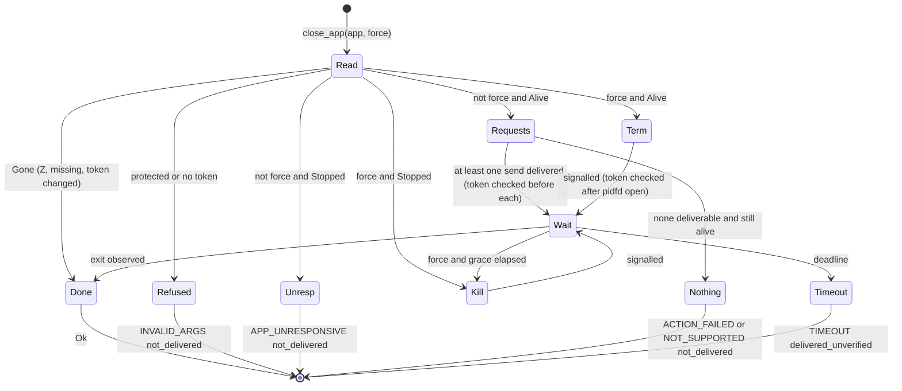
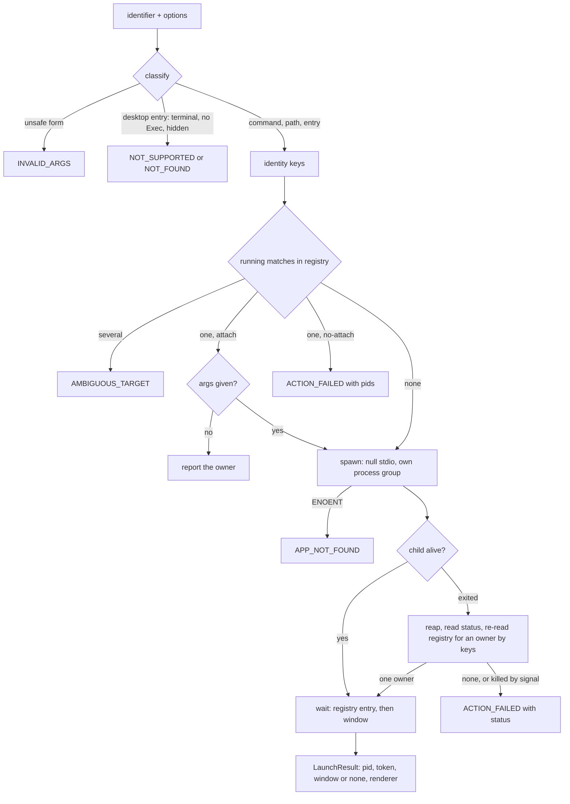
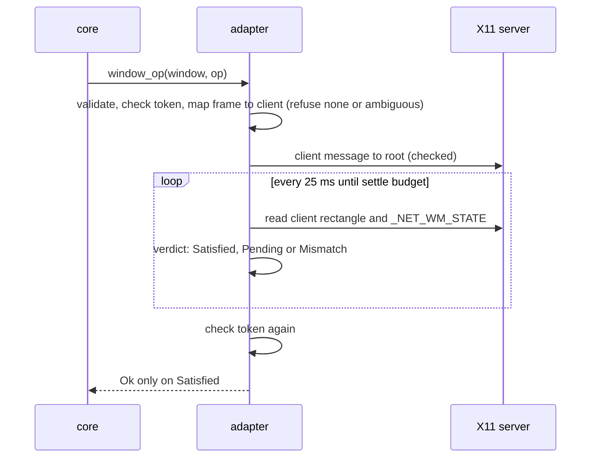

# Linux System Lifecycle (Sub-phase 3.9) - Plan

## Goal Capsule

- **Objective:** an agent on a GNOME desktop can start an application, bring it forward, move and size its windows, tell a frozen app from a slow one, and close it, by the same envelopes as on macOS and Windows, and every success the CLI prints (`closed`, `moved`, a launched pid) is true because the desktop was observed afterwards, never because a call returned.
- **Means:** the Linux adapter implements `launch_app`, `close_app`, `window_op`, `process_state`, `is_protected_process` and `press_key_for_app`, extends 3.6's `focus_window`, and adds the first X11 writes, over 3.4's process facts, registry pass and window identity (KTD1-KTD18).
- **Authority:** `docs/phases.md` §3.9 as corrected by 3.0-3.8, and further corrected here where the ledger or the code disproves it (R20).
- **Stop conditions:** stop if a requirement needs a change under `crates/core`; if 3.4 lands without the registry pass (`read_registry`, whose `RegistryApp.answered` is false when the root did not answer inside its 300 ms slice; there is no per-pid registry lookup and this plan adds none), without a `list_apps` that keeps a SIGSTOPped app listed under the same name it had while responsive, without a scoped window listing that reports a verified-stopped target as `APP_UNRESPONSIVE` instead of an empty list (both landed, `app_name.rs`, `unresponsive.rs`: A3 and A5), without the shared session detector (`display_server::session_server`), without `resolve_window_strict`, the window-id codec, `process_facts` or the bounded X11 reader (`DisplayReader::clients_within` and `read_within`); if 3.4's frame-to-X11 mapping (`x11/map.rs`) is absent, in which case only `window_op` is blocked, since `close_app` does not use it (KTD5); if 3.6 lands without its `_NET_ACTIVE_WINDOW` `focus_window` (`FocusWorld`, `Cause::OverviewOpen`, `overview.rs`) or the stacking read (`StackedWindow.flags` holds only `hidden`, `above` and `mapped`; maximized state, `WM_STATE` and transient-for are not decoded and this plan decodes them itself, U4); if 3.8 lands without `input::deliver::send_plans(plans, gate, deadline)` (the `Gate` hook) and the `physical_keyboard` chord path, in which case only `press_key_for_app` (U10) is blocked and is handed back to the owner; if no window manager can run rootless in a private session (openbox does, L16-6); or if adding `rustix` changes the dependency set beyond the linux crate's own entry.
- **Execution profile:** U1 first; U2, U4 and U8 in any order after it; U8a after U8 and before U12; U3 after U2; U5 after U2 and U4; U6 after U4; U7 after U6; U9 after U2, U7 and U8; U10 after U7; U12 after U3, U5, U6, U7, U9 and U10; U13 after U12; U11 last, because it records the dispositions U12 and U13 produce. The units run as four parallel lanes plus integration (Implementation Split below); the order above is the dependency order across them.
- **Finishes and ships:** the implementer runs the box measurements and live verification, commits, and opens one PR stacked on `feat/linux-3.8-input`, from branch `feat/linux-3.9-lifecycle`; nothing merges to `main`.

---

## Product Contract

### Summary

Make lifecycle real on Linux. After this sub-phase `launch` starts an app from a command name, a path or a desktop id and reports the pid of the app itself, `close-app` closes it and says so only after the process is gone, `move-window`, `resize-window`, `minimize`, `maximize` and `restore` change a window and say so only after X11 shows the change, `focus-window` can also lift a minimized window where the window manager allows it, and a frozen app is reported as `APP_UNRESPONSIVE` instead of hanging for 25 seconds. Core is unchanged: it prints `closed: true` and `moved: true` whenever the adapter returns `Ok`, so every `Ok` here means the effect was read back.

### Problem Frame

Core trusts the adapter's `Ok`. `close_app` prints `closed: true` unconditionally, the window commands print `moved: true`, and `wait --event` treats any error from `process_state` as "the app is gone". Linux gives an adapter many ways to produce a false `Ok`: `kill(pid, 0)` succeeds on a zombie (`L11-9`), `wmctrl` returns 0 for a dead window id (`L11-24`), `xdotool windowclose` aborts the app while the tool reports success (`L11-12`), and AT-SPI geometry on GTK4 is `[0,0,w,h]` whatever the window does (`L13-6`).

The ledger also contradicts the roadmap's lifecycle text in four places. `SIGTERM` is not a graceful close for GTK4: the app dies at once with no cleanup (`L11-8`). `gio launch` and `gtk-launch` exit and leave the app reparented to the user service manager, so the launcher reports no pid for it (`L11-2`). An exit code exists only for a process this invocation spawned and waited on (`L11-13`), which a one-command-per-invocation CLI almost never holds. A stopped app answers nothing over AT-SPI for 25 seconds with the default timeout (`L11-15`) while the bus daemon, the registry and the X server answer in milliseconds (`L11-16`), so the evidence of a frozen app is cheap to get and expensive to wait for.

Several things the roadmap leaves to this sub-phase are unmeasured: the protected-process list (`L11-28`), window operations on a Wayland-native window (`L11-27`, `L13-24`), un-minimizing on any window manager but mutter (`L11-22`), what a graceful close does to an app with an unsaved document (`L11-10`), and whether a blocked-main-loop app is distinguishable from a stopped one (`L11-14`). U1 measures them before any code depends on them.

### Requirements

**Launch**

- R1. `launch` of a command name, an absolute path, a desktop id or a desktop entry `Name` starts the application and returns the pid of the application itself, never of a launcher, with its process instance token and its first window when one appears inside the budget. A launch that produces no window is a valid result (`L11-1`, `L11-2`, `L11-26`).
- R2. An identifier that names nothing is `APP_NOT_FOUND`/`not_delivered` (`L11-7`); a relative path containing a separator, or text with an interior NUL, is `INVALID_ARGS`; a desktop entry with `Terminal=true`, or with no `Exec`, is `ACTION_NOT_SUPPORTED` naming the entry.
- R2a. `--app` accepts a desktop entry's `Name` as a match alias for a running process whose executable basename equals the basename of the entry's `Exec` program (or its `TryExec`), so `Files`, `Calculator` and `Text Editor` resolve to `nautilus`, `gnome-calculator` and `gnome-text-editor`; the alias also matches while the process is stopped (the registry name is unreadable then), the name `list-apps` shows is unchanged (the executable basename from `/proc`), exact-basename matching keeps working, and an alias that names more than one running process is `AMBIGUOUS_TARGET` through the commands that resolve the app first (`close-app`, `wait`, `list-surfaces`, `screenshot`), while `snapshot --app` and `list-windows --app` pick one window by focus, visibility and accessibility when both processes have windows, because core's `resolve_window` calls its app resolver only when the window list is empty (`L23-36`; the 3.4 dogfood F3 and J10, `L19-1`); that core behaviour is an owner item, not Linux code.
- R3. The attach decision is made before spawning. One running match attaches (spawning only when arguments must be forwarded); `--no-attach` with a match is `ACTION_FAILED` naming the pids; several matches are `AMBIGUOUS_TARGET` (`L11-4`, `L11-5`, `L11-6`). Whether a spawn with arguments forwards to the running owner depends on the app: Files, Terminal, Settings and Text Editor forward and the second launcher exits 0 within 0.1 s, while Calculator does not and leaves a second process (`L23-2`), so the owner reported is the one absent before the spawn.
- R4. A spawned process that exits before the budget ends is reaped and its status read; the running owner is then found in the registry and reported with its own pid and token (Terminal: the launcher exits 0 in 0.3 s and the owner is `gnome-terminal-server` with parent pid 1, `L23-1`). When no owner can be attributed, or the process was killed by a signal, the result is `ACTION_FAILED` carrying the exit status (`L11-4`, `L11-13`).
- R5. The launched app holds none of the caller's pipes: the CLI's output reaches end-of-file when the CLI exits while the app keeps running. `args`, `env` and `cwd` apply when the launch creates the process; what a handoff discarded is stated in the result's `suggestion` (`L11-5`). `activate` focuses the new window; `renderer` is `chromium` for Chromium-family apps.

**Close**

- R6. Graceful `close-app` sends a close request to every X11 top-level of the process and returns `Ok` only after the process is observed gone (`/proc` state `Z`, entry missing, or start-time token changed). It never sends a signal (`L11-8`, `L11-9`, `L11-10`, `L11-26`).
- R7. A graceful close whose process is still alive at the deadline is `TIMEOUT`/`delivered_unverified` with the remaining windows and any dialog counted in `details`, so an unsaved-document prompt is reported as the reason and never answered (`L11-10`).
- R8. A graceful close with nothing deliverable (no window manager, a Wayland session, no X11 top-level for the pid) while the process is alive is `ACTION_FAILED` or `ACTION_NOT_SUPPORTED` with `not_delivered` and a `--force` suggestion; a stopped process is `APP_UNRESPONSIVE`/`not_delivered` at once rather than a full-deadline wait (`L11-17`).
- R9. `--force` sends `SIGTERM`, waits a bounded grace, then `SIGKILL`; a stopped process goes straight to `SIGKILL`. The start-time token is checked after the process handle is opened and before every signal. `Ok` only after observed exit; a deadline is `TIMEOUT`/`delivered_unverified` (`L11-8`, `L11-17`).
- R10. A process that is already gone, a zombie, or a different instance of the same pid is a benign `Ok`, and no signal reaches whatever now holds the pid.

**Windows and focus**

- R11. `move-window`, `resize-window`, `minimize`, `maximize` and `restore` write by EWMH and ICCCM client messages through the X11 connection and return `Ok` only when X11 geometry and `_NET_WM_STATE` read back the requested result within the measured tolerance. A result the window manager changed (clamped, refused) is `ACTION_FAILED` carrying requested and observed values (`L11-18`, `L11-20`, `L11-21`, `L11-24`).
- R12. Window operations refuse before any write when they cannot be proved: a Wayland session or no window manager is `ACTION_NOT_SUPPORTED`, an ambiguous frame-to-window mapping is `AMBIGUOUS_TARGET`, a window with no X11 client is `ACTION_NOT_SUPPORTED`, a changed process instance is `STALE_REF`, and the write never starts in any of them (`L13-22`, `L13-24`, `L16-6`).
- R13. Restoring a minimized window, by `restore` or by `focus-window`, is attempted and judged by observation: `Ok` where the window manager un-minimizes, `ACTION_NOT_SUPPORTED` naming the manager where it does not. The claim is measured on openbox and on `gnome-shell --x11` and scoped to those (`L11-22`).
- R14. `focus-window` keeps 3.6's contract (`Ok` only when `_NET_ACTIVE_WINDOW` reads back as the target and the frame is `ACTIVE`) and gains the minimized path of R13; it sends no input, and the click fallback of the roadmap is decided by U1 probe F1 and KTD10 (`L5-6`, `L11-23`, `L16-16`, `L27-45`); `LaunchOptions.activate` reuses it.

**Process state and protection**

- R15. `process_state` is `Exited { code: None }` for a missing entry, a zombie or a changed token; `Unresponsive` when the kernel reports the process stopped and a bounded probe timed out or is impossible, or (only if U1 enables it) when an alive process times out two consecutive bounded probes; `Running` otherwise, and it never returns an error for a slow or unreadable app. Every accessibility read it makes carries an explicit short timeout (`L11-13`, `L11-14`, `L11-15`, `L11-16`).
- R16. A frozen app stays listed by `list-apps` under the name it had while responsive, and a scoped window listing of a verified-stopped app answers `APP_UNRESPONSIVE`, so core's upgrade of `STALE_REF` or `APP_NOT_FOUND` to `APP_UNRESPONSIVE` fires on a ref action and a `snapshot --app` against a SIGSTOPped app. This sub-phase consumes both behaviours from 3.4 (A3, A5) and proves them live on Calculator and on Files, whose accessible name (`Files`, from `org.gnome.Nautilus`) differs from its executable basename (`nautilus`), through the ref-action path and the snapshot path (`L11-15`, `L11-16`).
- R17. `is_protected_process` refuses exactly the session processes U1's evidence names, by exact case-insensitive name, `comm` cut at 15 characters, or executable basename, and refuses no substring match (`L16-1`, `L16-2`, `L11-28`).
- R18. `press_key_for_app` delivers a chord to a process only while its window is the active one, verified before synthesis and never by activating anything, and ends `delivered_unverified` (`L5-6`).

**Process and proof**

- R19. `crates/core` is unchanged, no shipped source names a plan, phase or decision id, tests that touch processes act only on children they spawned, and every other requirement is proved by a real run on the GNOME box in a private session now and on the live session once the owner restores its bus.
- R20. `docs/phases.md` states what was built and no longer states what the evidence disproved, and every ledger row naming 3.9 is disposed of.
- R21. A stranger dogfood is run, and its findings, each disposed of, go in the pull request description; no report file is committed.
- R22. Latency is measured min-of-seven with the warm-up discarded, `cargo deny` stays green with the new dependency, and the release binary stays under 15 MiB.

### Key Decisions

- KD1. **Core stays platform-neutral and Phase 3 is trait implementation only.** (session-settled: user-directed — chosen over adding Linux paths, fields or a verification step in core: core is the shared surface.) Governs R19. Because core prints `closed: true` and `moved: true` on `Ok`, the adapter's `Ok` carries the proof (R6, R9, R11). Anything that would need a core change is written into `docs/phases.md` for the owner and not built.
- KD2. **Tests fail for a real reason, and real runs outrank suites.** (session-settled: user-directed — chosen over broad mocked suites: probe scripts and captures are never read by tests and never committed.) Governs R19. Decision logic takes plain values so it runs on every host, every new test is invert-verified, and a test that signals or closes a process does so only to a child it spawned.
- KD3. **Box access goes only through `scripts/remote-linux.sh`, never `sudo`, and live verification runs in a private session with a window manager started inside it.** (session-settled: user-directed — chosen over the live bus, which is broken until the owner restarts it.) Governs R11-R16. A live-session re-run is a Definition of Done line.
- KD4. **The PR stacks on `feat/linux-3.8-input`; nothing merges to `main`; the size is stated.** (session-settled: user-directed — chosen over splitting the sub-phase.) The reason is in Risks & Dependencies.
- KD5. **Every `docs/phases.md` statement the evidence disproves is corrected in place, as its own unit, citing rows.** (session-settled: user-directed — chosen over leaving it for the next planner.) Governs R20.
- KD6. **The stranger dogfood is a gate.** (session-settled: user-directed — chosen over an author-run check: the operator gets only the shipped skill copy and the box binary.) Governs R21.

### Scope Boundaries

- No semantic actions (3.7), no key or pointer synthesis beyond calling 3.8's chord primitive (3.8), no screenshot or clipboard (3.10), no event waits (3.11), no Linux platform skill or example fixes (3.13), no change to `AppInfo` construction: `bundle_id` stays `None` (3.4).
- Considered and not built:
  - A graceful path through `org.gtk.Actions.Activate("quit")` (`L11-11`): it needs the app's well-known name, which neither the registry nor the process gives, and the failure it would cover (no graceful close on Wayland) is reported with a `--force` suggestion, not hidden. Evidence that would change the call: a Wayland dogfood finding that agents cannot close apps without data loss.
  - A close request through `WM_DELETE_WINDOW` sent directly to the window: it works without a window manager but bypasses the manager's own handling, and without a manager there is no client list to enumerate (`L16-6`).
  - Activation of D-Bus-activatable entries with no `Exec`: they are `ACTION_NOT_SUPPORTED` naming the entry. Evidence that would change the call: a stock GNOME app whose entry has no `Exec`.
  - Mapping a desktop id with a dash to a subdirectory of `applications/`, and `[Desktop Action]` sections: no measured app uses either.
  - Disambiguating two same-title windows by which one is active: 3.6's `focus_window` refuses ambiguous windows, so the agent could not reach the active state through the adapter anyway.
  - A pidfd-based exit wait (`poll` on the descriptor): `/proc` state is the zombie-aware truth and the 25 ms poll is bounded by the deadline.
  - A `kill(2)` fallback when `pidfd_open` is unavailable: the minimum OS is Ubuntu 22.04 and Fedora 38 (kernel 5.15 and later); a refusal by a sandbox is reported, not worked around.
  - Refusing pid 1 and the adapter's own pid by number: close targets come from the accessibility registry, which lists neither. The adapter's ancestors are not refused either: closing the terminal that hosts the calling agent is a legitimate request, and its effect is immediately visible to whoever asked. Evidence that would change the call: a dogfood finding of an agent closing its own host unintentionally.
  - A setsid-based new session for the launched app (see KTD11 for the condition under which this is revisited).
  - A bounded focus-steal budget like Windows' `window_activate.rs`: the policy gate is in core before `focus_window` is called, and an X11 activation is one message judged by observation.
- Deferred to follow-up work, written into `docs/phases.md` in U11:
  - Window operations on a Wayland-native window and on an Xwayland client in a Wayland session, if U1 finds a compositor route; otherwise they stay `ACTION_NOT_SUPPORTED` with the measured reason.
  - A launcher or window id that survives an app restart: ids change on every restart (`L16-4`; `L23-36`: the id's bus unique-name counter moves, `w-1.3-...` to `w-1.6-...`, and the old id is `WINDOW_NOT_FOUND`).
  - Skill text for launch, close, window and focus behaviour, with the macOS-named examples replaced, is 3.13's.

---

## Planning Contract

### Assumptions

- The minimum OS (Ubuntu 22.04, Fedora 38) has kernel 5.15 or later, so `pidfd_open` and `pidfd_send_signal` exist; the box runs 7.0 (`phases.md` Minimum OS Requirements).
- A session the shared detector owned by 3.4 classifies as Wayland has no X11 route in this adapter, as in 3.4's reader and 3.6's focus; X11 evidence applies only to a session it classifies as X11, and a stale `WAYLAND_DISPLAY` with a working `DISPLAY` is X11 (B1). This sub-phase has no detection of its own.
- 3.4 owns two behaviours this plan relies on and does not build: the inventory name of an application is stable across a stop (`core`'s `app.name == expected_name` check in the unresponsive upgrade compares it), and a scoped window listing of an app whose `/proc` state is stopped answers `APP_UNRESPONSIVE` before core sees an empty list. If either is absent the stop condition applies.
- 3.4, 3.6 and 3.8 land with the units their plans name. The implementer reads their code, reconciles file and function names, and the stop conditions apply where a named capability is missing.
- Coordinates passed to `move-window` and `resize-window` are the client rectangle in root coordinates, the rectangle X11 reports for readback; U1 confirms it on both window managers (KTD8).
- Arguments to `launch` that carry file or URL field codes in the desktop entry replace the code; with no field code they are appended. Nothing is dropped silently (KTD12).
- A desktop id is looked up before a bare name is searched on `PATH`, since ids carry dots and command names rarely do; a name that matches neither is looked up as an entry `Name`, exactly and case-insensitively, and is `APP_NOT_FOUND` if it matches nothing.

### Key Technical Decisions

- KTD1. **Layout.** New files by the shared platform layout, one concern each, under the 400-line cap, each with its `_tests.rs`. `crates/linux/src/system/`: `proc_stat.rs`, `liveness.rs`, `signal.rs`, `process_state.rs`, `process_state_classify.rs`, `close.rs`, `close_plan.rs`, `window_op.rs`, `window_op_verdict.rs`, `restore_minimized.rs`, `desktop_entry.rs`, `desktop_exec.rs`, `desktop_lookup.rs`, `launch_target.rs`, `launch.rs`, `launch_attach.rs`, `launch_observe.rs`, `protected.rs`, `key_dispatch.rs`, `window_client.rs` (extracted from `focus_window.rs`), `app_alias.rs`. `crates/linux/src/system/x11/`: `control.rs`, `control_display.rs`, `control_send.rs`, `client_message.rs`, `window_facts.rs`. `system/process_facts.rs` and `system/focus_window.rs` are modified; `system/adapter.rs` only wires. Governs R1-R18.
- KTD2. **Liveness is `/proc` state plus the start-time token, never `kill(pid, 0)`.** `proc_stat.rs` parses `/proc/<pid>/stat` once: the state letter and the start time, both counted from after the last `)` because `comm` may contain spaces and parentheses; `process_facts.rs` reuses it so there is one parser. `liveness.rs` turns the parse and an expected token into `Alive`, `Stopped` (`T` or `t`) or `Gone` (`Z`, `X`, entry missing, token changed). A zombie is `Gone`: `kill(pid, 0)` succeeds on one (`L11-9`). A relaunch after a kill gave a new pid and a new start time for every app measured, so (pid, start time) is the process generation (`L23-4`). Governs R6, R9, R10, R15.
- KTD3. **Signals go through a pidfd, with `rustix`.** `rustix =1.1.5` with `default-features = false` and features `std` and `process` (checked in U2 against the features x11rb already enables), no new crate: it is already in `Cargo.lock` through x11rb, exposes safe `pidfd_open`, `pidfd_send_signal` and `kill_process`, and its licence is in `deny.toml`'s allowed list. `signal::send(pid, token, signal)` reads the token, opens the pidfd, reads the token again (a pid recycled between the two reads is caught; the descriptor then names that process for good), sends through the descriptor, and returns `Delivered`, `AlreadyGone` or `Replaced`. `ESRCH` is `AlreadyGone`; `EPERM` and a sandbox's refusal of `pidfd_open` are `ACTION_FAILED`/`not_delivered` with the errno in `platform_detail`. Chosen over `libc` (every call is `unsafe`, and the crate has none today) and over `std::process::Child::kill` (only for a child this invocation spawned). Governs R9, R10.
- KTD4. **Close is two paths and the non-force one never signals.** Without `--force`: close requests only (KTD5), then wait. With `--force`: `SIGTERM`, a bounded grace, `SIGKILL`; a `Stopped` process skips `SIGTERM` because it stays pending until `SIGCONT` (`L11-17`). `SIGTERM` is not offered as graceful: GTK4 apps die at once with no cleanup (`L11-8`). `close_plan.rs` is the pure decision from (force, liveness, elapsed, grace) to the next step. Chosen over a force path that tries close requests first: `--force` means the caller wants the process gone, and waiting out a save prompt first would stall it. Governs R6-R9.
- KTD5. **Close requests go to every X11 client with `_NET_WM_PID` equal to the pid, not through the frame-to-window map.** `_NET_WM_PID` equals the app pid for GTK4 and handoff windows join the first pid (`L11-26`), the client list holds dialogs too, and a same-title ambiguity (3.4's map) never arises because nothing here picks one window. The message is `_NET_CLOSE_WINDOW` to the root window per the EWMH section of that name, the request `wmctrl -c` sends (`L11-10`). Each send follows a token check; one failing send never cancels the rest; nothing delivered while the process is alive is R8. Governs R6, R8.
- KTD6. **`Ok` is exit observed, and a deadline is `TIMEOUT` with `delivered_unverified`.** The exit wait polls `liveness` every 25 ms inside the lease deadline. A graceful close that times out re-reads the pid's X11 top-levels and puts `windows_remaining` and `dialogs` (windows of type dialog or transient, whichever U1 shows a GTK4 and a GTK3 save prompt carries) in `details`, with the suggestion that a prompt may be open, that an app which stays resident after its last window closes needs `--force` when `windows_remaining` is zero, and that `--force` discards unsaved work. The pair `TIMEOUT`/`delivered_unverified` with `retry: unsafe` is the one macOS and Windows pin for the same condition. Dispositions: `not_delivered` before the first send or signal, `delivered_unverified` after. Governs R6-R9.
- KTD7. **The X11 layer is a trait with a bounded real implementation, now with writes.** `control.rs` defines the trait over plain values: top-levels of a pid, window facts (client rectangle in root coordinates, `_NET_WM_STATE` flags, `WM_STATE`), and the sends. `control_display.rs` implements it over `x11rb =0.14.0` with the core protocol only (no new feature; confirmed in U2's size run), connecting per call. Reads run on the landed bounded thread (`x11::start` and `PendingRead::finish`, already generic over the value, and `stacking::bounded`); nothing new is added there. Writes follow 3.6's `activate::request_via` split: the connection, the atoms and the server time are prepared on a worker the deadline can abandon, and the message is written only from the calling thread while the lease is held, so no worker sends after the call was told it failed (`docs/solutions/logic-errors/a-deadline-cannot-interrupt-a-blocking-os-call.md`). `control_send.rs` reuses `activate.rs`'s `prepare`, `server_time` and `connect` (made `pub(super)` by the lane that owns the file) and does not copy them. A send is `send_event` to the root with substructure-redirect and substructure-notify masks followed by a round trip that is checked, so `BadWindow` surfaces as an error where `wmctrl` answered 0 (`L11-24`). Message layouts follow EWMH `_NET_CLOSE_WINDOW`, `_NET_MOVERESIZE_WINDOW`, `_NET_WM_STATE` and ICCCM 4.1.4 `WM_CHANGE_STATE`, built in the pure `client_message.rs`; U1 confirms each against both window managers. The top-levels of a pid are `X11State::Ready.clients` filtered by `X11Client.pid` (the landed `clients_within`), joined by id to the `StackedWindow.kind` of a `read_within` for the dialog test. `_NET_WM_STATE` maximized atoms, `WM_STATE` and `WM_TRANSIENT_FOR` are not in any landed record, so `window_facts.rs` decodes them. A session the shared session detector classifies as Wayland, an unreachable display or no `_NET_SUPPORTING_WM_CHECK` is "no X11 route", never a guess; `control_display.rs`, window mapping and activation all take the display from that detector (`session_server()`) and not from the environment variables (B1). A fresh private `gnome-shell --x11` starts with the Activities Overview open and ignores input and activation until it is closed (`L28-2`, `L28-17`, `L27-45`): every live run under mutter closes it first (Escape, then a wait of at least 2 s, never 1 s) and the harness asserts `OverviewActive` is false before it measures. Governs R6, R8, R11, R12.
- KTD8. **`window_op` writes by message, reads back by X11, and judges the readback.** Move and Resize are one `_NET_MOVERESIZE_WINDOW` message with only the changed fields flagged and static gravity 10 makes x and y mean the client rectangle on both managers (a resize-only request uses gravity 0 so the position holds, `L31-10`, `L31-32`). Minimize is `WM_CHANGE_STATE` to iconic, Maximize and Restore-from-maximized are `_NET_WM_STATE` add or remove of both maximized atoms (`L11-20`, `L11-21`). After the write the call polls the window facts every 25 ms until `window_op_verdict.rs` says `Satisfied`, or the settle budget (250 ms with a tolerance of 2 px, capped by the lease, `L31-11`) ends in `Pending`; a final read that differs is `Mismatch`. `Ok` only on `Satisfied`; `Mismatch` is `ACTION_FAILED`/`delivered_unverified` with requested and observed in `details` and a suggestion that the window manager or the window's size hints constrained it (the editor clamps at the screen, `L11-18`). The frame-to-X11 window comes from 3.4's `x11/map.rs`; none or ambiguous refuses before the write (R12). The process instance is checked before and after. A window that was maximized is given back the client rectangle saved in a private file under the runtime directory, by a static-gravity move and, where the manager skips it, a move 40 px away and back (`L31-33`); on a Wayland session the X11 route is the Xwayland display, and a Wayland-native window or an un-minimize is refused with cause `wayland_session` (`L31-19`, `L31-20`). The coordinate system differs from `list-windows` bounds on GTK4 (window-relative, `L13-6`); the skill note and the 3.4 owner are told in U11. Governs R11, R12.
- KTD9. **Un-minimize is attempted and judged, per window manager.** `restore` on a hidden window and `focus_window` on one send `_NET_ACTIVE_WINDOW` with source indication 2 and no timestamp to the root, then poll the facts for the hidden flag to clear within the settle budget; this is the only route sent, because the server-time form was refused by mutter for most minimized windows once another window was active and every other route (map, `WM_CHANGE_STATE` normal, `_NET_WM_STATE` remove HIDDEN) was ignored by mutter (`L31-5`, `L31-30`, `L31-31`). Cleared is `Ok`; still hidden is `ACTION_NOT_SUPPORTED` naming the window manager read from `_NET_SUPPORTING_WM_CHECK`'s `_NET_WM_NAME`, with `delivered_unverified`, not retryable. Mutter ignores or delays the request in a window about 1 to 2 s after the minimize (`L31-53`), which the refusal reports. Governs R13.
- KTD10. **Focus: 3.6's contract plus the minimized path, a stamp-free resend and the desktop switch; no click fallback.** 3.6's `focus_window.rs::run` (over the `FocusWorld` trait, `focus_world.rs::LiveWorld`, `focus_cause.rs`) refused before any send when the AT-SPI frame said `minimized` and when the X11 client carried `_NET_WM_STATE_HIDDEN`; both now go through KTD9's attempt (`FocusWorld::lift`), and a window still hidden keeps its cause with a suggestion that names the manager and does not point at `restore` (`L31-50`). A stamped activation the manager refuses is followed by exactly one activation without a timestamp, never more and none after `frame_not_active` or a failed send: the stamp-free form took effect 20 of 20 where the stamped form was refused for Qt and some sequences, and a click on the title band failed 16 of 16, so the click fallback of `docs/phases.md` is not built (`L31-1`, `L31-2`, `L31-46`); the stamp-free form bypasses the manager's focus-stealing check and is an owner-confirmed policy (`OWNER-ITEMS.md`). A window the manager hides only because its desktop is not current gets `_NET_CURRENT_DESKTOP` switched to its desktop before the request (`L31-4`, `L31-48`); a modal dialog that takes the focus is named in `details` and is never a success (`L31-3`, `L31-47`); a stopped target is `APP_UNRESPONSIVE` before anything is sent (`L31-6`, `L31-49`). The success rule, the refusal of ambiguous, Wayland and no-manager windows, `Cause::OverviewOpen`, and the absence of `GrabFocus` and of subprocesses stay as 3.6 shipped them. Governs R14.
- KTD11. **Launch parses the desktop entry and spawns it directly.** `desktop_lookup.rs` finds `<id>.desktop` under `$XDG_DATA_HOME/applications` and each `$XDG_DATA_DIRS/applications` in order (Flatpak and snap exports appear there when installed); `desktop_entry.rs` reads the `[Desktop Entry]` group's `Type`, `Name`, `Exec`, `TryExec`, `Path`, `Terminal`, `Hidden`, `StartupWMClass` and `Icon` (`Name` feeds the `--app` alias of U8a and the `%c` field code, never the listed name); `desktop_exec.rs` tokenizes `Exec` with the specification's quoting and expands the field codes (deprecated codes dropped); `launch_target.rs` classifies the identifier: an absolute path, a desktop id, a bare command name found on `PATH`, and last a desktop entry `Name` through U8a's index, so `launch Calculator` and `launch gnome-calculator` reach the same entry (the `--app` alias and the launch name are one table). The child is `std::process::Command` with stdin, stdout and stderr on the null device and `process_group(0)`, so the app holds no caller pipe and no terminal job control reaches it; the child pid is the app pid for the GApplication apps measured (`L11-1`). Chosen over `gio launch` and `gtk-launch` (the launcher exits and the app reparents, so no pid is reported, `L11-2`), over libgio bindings (LGPL, outside `deny.toml`, and a system library link), over a `gio launch` child with registry attribution (a tool dependency on `PATH` of the kind 3.4 avoided for `xprop` and `wmctrl`, `L8-6`, and it gives up the exit status and the direct child pid that `L11-1` shows is the app's), and over `xdg-open` (it opens a document and blocks, `L11-3`). `CommandExt::process_group` is a process group, not a session, and `setsid` needs an `unsafe` `pre_exec`; U1 (2) measures whether the app survives the CLI and a closed terminal and holds no pipe, and a `setsid` block is added only if that shows harm. The specifications are read as the freedesktop Desktop Entry Specification and the XDG Base Directory Specification; the box comparison with `gio launch` is U1 (1). Governs R1, R2, R5.
- KTD12. **Arguments, environment and working directory.** `LaunchOptions.args` replace the field codes `%F`, `%U`, `%f` or `%u` where the entry has one and are appended otherwise; the entry's `Path` is the working directory when `cwd` is unset; `env` is added to the inherited environment (the display, bus and runtime variables must reach the app). Error text names the identifier and exit statuses, never argument or environment values (`docs/solutions/conventions/keep-raw-arguments-out-of-trace-reachable-error-messages.md`). Core's `--cdp` appends `--remote-debugging-port=<n>` and `--remote-debugging-address=127.0.0.1` to `LaunchOptions.args` before the adapter runs (`crates/core/src/commands/launch.rs`), so option-shaped arguments reach the field-code expansion: the arguments go where the entry's file code stands, or at the end, in the order the caller gave them, so an option keeps its value and a `--` keeps its place. Chromium started for a live test needs `--password-store=basic` (with `--no-sandbox --ozone-platform=x11 --force-renderer-accessibility` on the box) or its keyring prompt becomes the active window and holds the grab (`L28-16`); the product injects none of these, the tests pass them. Governs R5.
- KTD13. **Attach and handoff are decided from the registry, never the exit code.** `launch_attach.rs` is a pure function of the target's identity keys (desktop id, `Exec` first word's basename, `TryExec` basename, `StartupWMClass`, or the command's basename), the running apps' registry names, `comm` cut at 15 characters and executable basenames (`L16-1`), and `attach_if_running`: no match spawns; one match attaches (no spawn unless arguments exist, in which case the spawned process forwards them and the existing owner is reported, `L11-5`); several are ambiguous; a match with `attach_if_running` false is `ACTION_FAILED` naming the pids. `launch_observe.rs` polls 50 ms growing to 250 ms: while the child is alive it waits for the pid to appear in the registry and a window to list; if the child exits it is reaped by `try_wait`, its status recorded, and the registry re-read for an owner matching the keys, preferring one absent before the spawn. A single-instance app that forwarded and exited 0 (`L11-4`; Files, Terminal, Settings and Text Editor do, the second launcher exiting 0 in 0.1 s with the owner unchanged, `L23-2`) and a launcher that forked (Terminal: launcher exit 0 in 0.3 s, owner `gnome-terminal-server` with parent pid 1, `L23-1`, `L16-1`) are both this path; Calculator is multi-instance, so its second launch is a second owner absent before the spawn. The Terminal key set therefore includes `gnome-terminal-server`, matched exactly, and among several candidates an owner whose `/proc` environment names the caller's runtime directory is preferred (`L23-1`, `L23-3`). U1 (1) produces the key table for Files, Terminal, Settings, Calculator, Text Editor and Yelp; an app whose keys match nothing ends in `ACTION_FAILED` with the exit status, which is honest, and is a ledger row. While the child is alive and its own pid has no registry entry, the loop also looks for an owner matching the identity keys (preferring one absent before the spawn); no window inside the budget with no owner found is `Ok` with `window: None` and a suggestion when the pid is alive but not yet on the accessibility bus, saying the pid is the spawned process's and may be a wrapper. Governs R3, R4.
- KTD14. **Launch errors.** Spawn `ENOENT` and an entry that resolves to nothing are `APP_NOT_FOUND`/`not_delivered` (`L11-7`); Windows maps the same condition to `INVALID_ARGS`, so the pair is recorded as a platform-specific lifecycle envelope in the parity test. A child killed by a signal is `ACTION_FAILED`, `Crashed` shaped in `details`. Failures before `spawn` are `not_delivered`; after it, `delivered_unverified`. Governs R2, R4.
- KTD15. **`process_state` is a pure classifier over three observations.** `process_state_classify.rs` takes the liveness and up to two probe outcomes (`Answered`, `TimedOut`, `Unavailable`) and returns: `Gone` is `Exited { code: None }`; `Stopped` with a timeout or no probe possible is `Unresponsive` (the kernel says it is stopped, `L11-14`); `Stopped` with an answer is `Running`; `Alive` with an answer, with a single timeout, or with no probe is `Running`; `Alive` with two consecutive timeouts is `Unresponsive` only if U1 (5) shows a blocked-main-loop app reads `S` and two 300 ms-class timeouts never occur on a healthy app under load. A single timeout is `Running`, not an error, because core's `wait --event` reads any `Err` as "gone" (`crates/core/src/commands/wait_event.rs`) and Windows treats one hung probe as `Running`. The probe is `read_registry` (landed; every root `Name` read has its own 300 ms slice, `registry.rs::ROOT_SLICE`, and runs concurrently) and a search of its apps for the pid: found with `answered` is `Answered`, found without it is `TimedOut`, not found or no budget is `Unavailable`. There is no per-pid registry lookup; U1 (5) measures the cost of the whole-registry read against a pid-scoped read and a scoped one is built only if the whole read is too slow for the 50 ms healthy-app bound of U3. The deadline clips the read; the 25 s default is never reached (`L11-15`). The token is re-read after the probes. The classifier decides the answer for a pid; it does not name the app, and the stable inventory name and the scoped-listing `APP_UNRESPONSIVE` that make core's upgrade fire come from 3.4 (A3, A5). Governs R15, R16.
- KTD16. **Protected processes are decided from the session, matched exactly.** `protected.rs` holds a table of names, each with its evidence row; U1 records the user session's process tree and which processes register on the accessibility bus (`gnome-shell` and `mutter-x11-frames` do, `L16-2`), and the table is the session processes whose termination ends or breaks the desktop, nothing broader. A name matches when the user text or the registry name equals an entry case-insensitively, after reducing a path to its basename, or equals it cut to 15 characters (`comm`); `gnome-shell-calendar-server` does not match `gnome-shell`. `bundle_id` is `None` on Linux (3.4), so the user text and `app.name` reach the matcher from core; `close_app` also feeds it the live `comm` and executable basename read from `/proc` for `app.pid`, so a session process registered under another name is still refused. Governs R17.
- KTD17. **`press_key_for_app` is a verify-only gate around 3.8's chord path, mirroring Windows.** 3.8 left `physical_keyboard::press_global` as a placeholder (`#[expect(dead_code, reason = "the application-targeted press calls it")]`), `send_combo` private, and a global press with no gate (`|| Ok(())`, which delivered `z` to a grab holder, `L28-20`). `ensure_keyboard_policy` refuses any physical keyboard without focus-steal permission, so it must not run on an already-active target (Windows delivers to an active target under any policy and refuses only a background one: `focus_verify_failed` when the policy allows stealing, `background_fail_closed` when not). The unit replaces `press_global` with `press_for_process(world, process, combo, policy, deadline)` in `physical_keyboard.rs` and removes the `expect`. Order: re-read the token (`process_facts::lookup`); read whether the process owns the active window (X11: `_NET_ACTIVE_WINDOW` maps through `X11Client.pid` to the pid, and `focused_window` names a window of that pid and instance with the frame `ACTIVE`, the stricter of the two under a grab, `L28-20`; Wayland: the frame `ACTIVE` alone, since no X11 evidence exists); not active is the policy-dependent refusal above, before any event; then `send_plans`/`send_keysyms` with a `Gate` that repeats the active check between chunks; then re-read the token and return `ActionResult::delivered_unverified("press_key")`, or the error with `delivered_unverified` when the token changed. It never activates a window: core already focused it in headed mode (`crates/core/src/commands/press.rs`). Governs R18.
- KTD18. **Every wait races the deadline.** Registry probes run inside `within(deadline, ...)`, X11 calls on the bounded thread, polls between `ensure_budget` checks; a stopped app therefore cannot exceed the command budget (`L11-15`). Waiting uses polls on the observed condition, never a sleep followed by a check (`docs/solutions/best-practices/a-fixed-sleep-is-not-a-synchronization-primitive.md`). Governs R6, R9, R11, R15.

### High-Level Technical Design

Close, with the token checks that guard every signal:



Launch, from identifier to a pid that is the app's:



A window operation, write then judged readback:



---

## Implementation Split

Four lanes with disjoint files, plus integration. Paths are under `crates/linux/src`. Only `crates/linux`, `docs/` and `probes/` change; the `crates/core` diff stays empty. The model is `3.6-split.md`.

**Step 0 (integration, one commit, before any lane starts).** Creates every new file below as a compiling stub (pure functions return the unknown or `not_supported` answer; no `unwrap`, no `todo!`), adds every `mod` line and the whole `SystemOps` wiring, adds `rustix` to `crates/linux/Cargo.toml` and `Cargo.lock`, makes `activate.rs`'s `prepare`, `server_time` and `connect` `pub(super)`, and extracts `facts_of` and `client_of` from `focus_window.rs` into `system/window_client.rs` with the behaviour and tests unchanged. After it the registration files are frozen: `system/mod.rs`, `system/adapter.rs`, `system/x11/mod.rs`, `actions/mod.rs`, `Cargo.toml`, `Cargo.lock`, `deny.toml`. The root `adapter.rs` is not touched: `SystemOps` is implemented in `system/adapter.rs`. Stub items carry `#[expect(dead_code, reason = "stub the owning lane replaces")]`, removed at the first caller.

**Frozen interfaces (Rust signatures; integration writes them into the stubs).**

```rust
// system/window_client.rs (integration, step 0)
pub(crate) trait ClientWorld { fn global_position(&self) -> bool; }
pub(crate) fn facts_of(win: &WindowInfo, global_position: bool) -> FrameFacts;
pub(crate) fn client_of(world: &impl ClientWorld, win: &WindowInfo, clients: &[X11Client]) -> Result<u32, Cause>;

// Lane A: system/proc_stat.rs, liveness.rs, signal.rs, close.rs, protected.rs, process_state.rs
pub(crate) enum ProcState { Running, Sleeping, DiskSleep, Stopped, Zombie, Dead, Idle, Other }
pub(crate) struct ProcStat { pub(crate) state: ProcState, pub(crate) start_time: u64 }
pub(crate) fn parse(stat: &str) -> Option<ProcStat>;                    // proc_stat.rs
pub(crate) enum Liveness { Alive, Stopped, Gone }
pub(crate) fn liveness(pid: u32, instance: &str) -> Liveness;            // liveness.rs
pub(crate) enum Signal { Term, Kill }
pub(crate) enum Sent { Delivered, AlreadyGone, Replaced }
pub(crate) fn send(pid: u32, instance: &str, signal: Signal) -> Result<Sent, AdapterError>;   // signal.rs
pub(crate) fn close_app(bus: &SharedBus, app: &AppInfo, force: bool, lease: &InteractionLease) -> Result<(), AdapterError>;
pub(crate) fn process_state(bus: &SharedBus, process: ProcessIdentity, deadline: Deadline) -> Result<ProcessState, AdapterError>;
pub(crate) fn is_protected(identifier: &str) -> bool;                    // protected.rs

// Lane B: system/x11/{control,control_display,control_send,client_message,window_facts}.rs, window_op*.rs, restore_minimized.rs
pub(crate) enum ControlRead<T> { Ready(T), NotX11, NoManager, Unavailable }
pub(crate) enum ControlError { NoDisplay, SendFailed, BadWindow, TimedOut }
pub(crate) struct Toplevel { pub(crate) id: u32, pub(crate) kind: WindowKind, pub(crate) transient: bool }
pub(crate) fn toplevels_of(pid: u32, deadline: Deadline) -> ControlRead<Vec<Toplevel>>;
pub(crate) fn request_close(window: u32, deadline: Deadline) -> Result<(), ControlError>;
pub(crate) struct WindowFacts { pub(crate) client: Extents, pub(crate) hidden: bool, pub(crate) maximized_vertical: bool, pub(crate) maximized_horizontal: bool }
pub(crate) fn read_facts(window: u32, deadline: Deadline) -> ControlRead<WindowFacts>;
pub(crate) fn manager_name(deadline: Deadline) -> Option<String>;
pub(crate) enum WindowWrite { MoveResize { x: Option<i32>, y: Option<i32>, width: Option<u32>, height: Option<u32> }, Iconify, SetMaximized(bool) }
pub(crate) fn write_window(window: u32, write: &WindowWrite, deadline: Deadline) -> Result<(), ControlError>;
pub(crate) enum Lifted { Cleared, StillHidden { manager: String } }
pub(crate) fn lift(client: u32, deadline: Deadline) -> Result<Lifted, AdapterError>;                 // restore_minimized.rs
pub(crate) fn window_op(bus: &SharedBus, win: &WindowInfo, op: WindowOp, lease: &InteractionLease) -> Result<(), AdapterError>;

// Lane C: system/desktop_{entry,exec,lookup}.rs, launch_{target,attach,observe}.rs, launch.rs, app_alias.rs
pub(crate) fn launch_app(bus: &SharedBus, id: &str, options: &LaunchOptions, lease: &InteractionLease) -> Result<LaunchResult, AdapterError>;
pub(crate) fn aliases_for(exe_basename: &str) -> Vec<String>;            // app_alias.rs
pub(crate) fn name_matches(query: &str, name: &str, registry_name: Option<&str>, facts: &ProcessFacts, aliases: &[String]) -> bool;   // app_name.rs

// Lane D: system/focus_{window,world,cause}.rs, key_dispatch.rs, actions/physical_keyboard.rs
// FocusWorld gains: fn lift(&self, client: u32) -> Result<Lifted, AdapterError>;   // calls B's lift
pub(crate) fn press_key_for_app(bus: &SharedBus, process: ProcessIdentity, combo: &KeyCombo, policy: InteractionPolicy, lease: &InteractionLease) -> Result<ActionResult, AdapterError>;
pub(crate) fn press_for_process(world: &impl PhysicalWorld, combo: &KeyCombo, policy: InteractionPolicy, gate: Gate<'_>, deadline: Deadline) -> Result<ActionResult, AdapterError>;
```

**Lane A, process (U2, U3, U5).** Owns `system/{proc_stat,liveness,signal,process_state,process_state_classify,close,close_plan,protected}.rs` and their `_tests.rs`, `close_live_tests.rs`, `process_state_live_tests.rs`; edits `system/process_facts.rs`, `process_facts_tests.rs`, `app_ops.rs` and `unresponsive.rs` (the three stat readers move to `proc_stat`; no other lane edits these). Consumes B's `toplevels_of` and `request_close` (stubs, then B's code), `read_registry`, `process_facts`. Merges after B.

**Lane B, X11 control and window operations (U4, U6, the `lift` half of U7).** Owns `system/x11/{control,control_display,control_send,client_message,window_facts}.rs` and `_tests.rs`, `system/{window_op,window_op_verdict,restore_minimized}.rs` and `_tests.rs`, `window_op_live_tests.rs`. Consumes `activate.rs`, `bounded`, `clients_within`, `window_client.rs`, `display::list_displays`. Merges first.

**Lane C, launch and aliases (U8, U8a, U9).** Owns `system/{desktop_entry,desktop_exec,desktop_lookup,launch_target,launch,launch_attach,launch_observe,app_alias}.rs` and `_tests.rs`, `launch_live_tests.rs`, `app_alias_live_tests.rs`; edits `app_name.rs`, `app_name_tests.rs`, `registry_app.rs`, `proc_scan.rs` (the two `name_matches` callers). Consumes `focus_window::focus_window`, `process_facts`, `read_registry`, `list_windows`. Merges last.

**Lane D, focus and keys (U7 focus half, U10).** Owns `system/{focus_window,focus_world,focus_cause}.rs` and their tests, `focus_window_live_tests.rs`, `key_dispatch.rs` and `_tests.rs`, `key_dispatch_live_tests.rs`, `actions/physical_keyboard.rs` and `physical_keyboard_tests.rs`. Consumes B's `lift` (stub first), `window_client.rs`, `focused_window`, `X11Client.pid`.

**Integration (U1, step 0, U11, U12, U13).** Owns the registration files, `probes/linux/FINDINGS.md`, `docs/phases.md`, `OWNER-ITEMS.md`, the dogfood findings for the pull request description and any live harness helper not listed above. U1 starts at step 0 and delivers its constants as named consts in the owner file (tolerance and settle budget in `window_op_verdict.rs` (B), grace in `close_plan.rs` (A), key table in `launch_attach.rs` (C), protected names in `protected.rs` (A)) plus a message; lanes use placeholders until then. The F1 result decides whether lane D writes anything beyond the pin test in U7.

**Order.** Step 0, then A, B, C and D start together in worktrees cut from the step-0 commit. Merge B, then A, D, C (each rebased on the previous; the file sets are disjoint). Integration verification: the Verification Contract rows, then U11, U13, and a re-run of U12 for any fix. Fix commits go to the owning lane's files; a signature change is a message to integration, who edits the stub and tells the lanes.

---

## Implementation Units

### U1. Measurements before code

- **Goal:** replace every unmeasured claim this plan depends on with a ledger row, and settle the data-gated parameters.
- **Requirements:** R1-R17, R20.
- **Dependencies:** none.
- **Files:** `probes/linux/FINDINGS.md`; new 3.9 rows take ledger area L31 (L27 is 3.6, L28 is 3.8, L29 is 3.10, L30 is 3.7); the rows this plan cites from the 3.12 probe corpus (`L23-1`, `L23-2`, `L23-4`, `L23-14`, `L23-29`, `L23-33`, `L23-36`, kept in the probe rows file `agent-desktop-probes/linux/rows/L23.md`) are not in the repository ledger yet, so U1 copies exactly those rows verbatim into `FINDINGS.md` under their own ids and the 3.12 owner adds the rest without duplicating them. Probe scripts and captures stay outside the repository.
- **Approach:** through `scripts/remote-linux.sh`, every bus-using run in a private session (`R=$(mktemp -d $HOME/ad-wt/rt.XXXXXX); chmod 700 $R; XDG_RUNTIME_DIR=$R dbus-run-session -- xvfb-run -a ...`), openbox from the extracted directory (`~/ad-wt/wm-pkgs`, the `L16-6` recipe; it is not on `PATH`) and then `gnome-shell --x11`, plus a headless Wayland session. `xprop`, `xwininfo` and `/proc` are the oracles; `wmctrl` and `xdotool` are absent from the box and are not used by the product. Measure, in both directions where a claim is made:
  1. How the new window of a launched app is found: the child's `_NET_WM_PID`, the registry pid, `StartupWMClass`, and a before-and-after diff of `list_windows` for the owner, on a forwarding app (Text Editor), a forking launcher (Terminal) and a multi-instance app (Calculator). Direct exec of a parsed `Exec` against `gio launch`: inherited environment, `GIO_LAUNCHED_DESKTOP_FILE*`, cgroup, window arrival, and for Files, Terminal, Settings, Calculator, Text Editor and Yelp the child pid, the app pid, and the registry name, `comm` and executable name (the key table of KTD13). `L23-1` and `L23-2` already measured these in a private session (launcher pid against registry owner, and a second launch while the first is alive); U1 repeats them through the product's spawn.
  2. Caller pipes and job control: an app spawned with inherited stdio and with null stdio, with and without `process_group(0)`, from a parent whose output is a pipe; whether the pipe reaches end-of-file at parent exit, and whether the app survives the parent and a closed controlling terminal.
  3. A SIGSTOPped app against `list-apps`, `snapshot --app`, `click @ref`: does `list-apps` keep it with the same name and token (on Calculator and on Files, whose accessible name differs from its executable basename), and what does each command return, including `snapshot --app` against the already stopped app.
  4. `_NET_CLOSE_WINDOW` on one- and two-window apps; Terminal and Files graceful close (whether the process outlives its last window); Text Editor with an unsaved document (what window appears, its `_NET_WM_WINDOW_TYPE` and `WM_TRANSIENT_FOR`, whether the process stays); minimize through `WM_CHANGE_STATE` and through `_NET_WM_STATE`; un-minimize by `_NET_ACTIVE_WINDOW` and by `_NET_WM_STATE` removal, on openbox and on `gnome-shell --x11`, three runs each; and the focus of a never-focused window by the activation message, by a click on the decoration band and by a click on the client area (`L23-14`).
  5. A blocked-main-loop app (a small GTK script that blocks its main thread): `/proc` state, and `read_registry`'s `answered` flag for its pid (the 300 ms root slice), repeated on a healthy app under six busy processes; the cost of the whole-registry read against a read scoped to one bus name; whether two consecutive unanswered reads separate the blocked case from load.
  6. `_NET_MOVERESIZE_WINDOW` gravity and flags: whether static gravity makes x and y the client rectangle on both managers, GTK3 (Terminal), GTK4 (Calculator, with its `_GTK_FRAME_EXTENTS` shadow and no `_NET_FRAME_EXTENTS`, `L11-18`) and Qt (whose frame is a `filler`); tolerance; settle time per operation; clamping at the screen edge (RandR bounds from `list_displays`) and the minimum size; against `_NET_CLOSE_WINDOW`, `WM_DELETE_WINDOW` sent to the client and a plain `SIGTERM` for the close request (probe 4), which one each manager and each toolkit honours.
  7. `pidfd_open` and `pidfd_send_signal` on a child, a non-child, a zombie, and (with signal 0 only, delivering nothing) a process of another user; `rustix` feature unification with x11rb; release-size delta.
  8. Wayland: a headless `gnome-shell --headless --wayland` session with a Wayland-native GTK4 window: what an X11 client sees, whether any ordinary-client route exists for move, resize, minimize or close, closing `L11-27` and `L13-24` with a measured answer.
  9. The user session's process tree (`ps` on the live session, read-only) and the registry listing of a private `gnome-shell --x11` session: which session processes register as apps, which names `close-app` could therefore reach.
  10. Probe F1 (decides KTD10): on a private `gnome-shell --x11` with `OverviewActive` false (Escape, wait 2 s), a window that never held focus (`set_focus_on_map(False)`, GTK3, GTK4, Qt): does the `_NET_ACTIVE_WINDOW` request succeed on the first request, as `L27-45` says for 2 of 2, or does `activation_not_granted` still occur (`L23-14`, `L28-17`)? Three runs per toolkit, and the same with a raw click made at the title-bar band afterwards. A residual refusal with the Overview closed is the only evidence that a click fallback exists to build.
  11. Overview interplay: do `_NET_CLOSE_WINDOW`, `_NET_MOVERESIZE_WINDOW`, `_NET_WM_STATE` and the un-minimize request take effect while `OverviewActive` is true? The answer decides whether `close_app` and `window_op` refuse on `overview_open` as `focus_window` does or send regardless.
- **Test expectation:** none -- measurement. Each row has a disposition; the open parameters (key table, tolerance, settle budget, probe slice, blocked-loop rule, protected names, dialog signal, gravity, minimize message) are written into the rows the later units cite.
- **Verification:** `scripts/check-linux-findings.py` exits 0 and lists no `DEFERRED` row for 3.9 once U11 lands; `L8-9`, `L11-27`, `L11-28` and `L13-24` are closed by rows, not re-deferred.

### U2. Process facts, stat state and signals

- **Goal:** one stat parser, a zombie-aware liveness verdict, and token-checked signals.
- **Requirements:** R6, R9, R10, R15.
- **Dependencies:** U1.
- **Files:** `crates/linux/src/system/proc_stat.rs`, `liveness.rs`, `signal.rs` and their `_tests.rs`; `crates/linux/src/system/process_facts.rs` and `process_facts_tests.rs`; `crates/linux/Cargo.toml`; `Cargo.lock`; `deny.toml` only if `cargo deny` requires.
- **Approach:** KTD2, KTD3. `process_facts.rs` already holds three stat readers, `parse_start_time`, `parse_stopped` and `is_stopped` (callers: `app_ops.rs::scoped`, `unresponsive.rs`, `process_facts_tests.rs`); all three become uses of `proc_stat` with their callers and tests moved in the same change, so there is one parser and `Lookup` (`Found`, `Gone`, `Unreadable`) stays as landed. `signal.rs` takes a `Signal` and the pure outcome type; tests and the close flow pass the same token strings `process_facts` makes. The dependency is added exact (`=1.1.5`); the lock diff must show only the linux crate's dependency line.
- **Patterns to follow:** `crates/windows/src/system/process_identity.rs` (token compare before and after); 3.4's `process_facts.rs`.
- **Test scenarios:**
  - A stat line whose `comm` is `a (b) c` with spaces parses state and start time from after the last `)`; text with no `)` or with `)` before `(` is rejected.
  - Each state letter `R S D T t Z X I` maps to its class; an unknown letter is `Other`, not `Alive`.
  - `Z` is `Gone`; a missing entry is `Gone`; a token whose boot-id prefix differs is `Gone`; `T` and `t` are `Stopped`; `S` with the matching token is `Alive`.
  - Live, no display: a spawned `sleep` child, an unreaped child that has exited (`kill -0` still succeeds, liveness is `Gone`), a SIGSTOPped child (`Stopped`).
  - `signal::send` with the right token delivers and the child exits; with a wrong token it returns `Replaced`, nothing is signalled and the child is still running afterwards; on a process that already exited it returns `AlreadyGone`.
  - An injected permission error from the pidfd layer maps to `ACTION_FAILED`/`not_delivered` with the errno in `platform_detail`; no test signals a process it did not spawn.
- **Verification:** the scenarios pass; treating `Z` as alive (the `kill -0` shortcut) fails the zombie test; skipping the second token read fails the recycled-pid test (a pid whose token is changed between the reads by the test's injected reader); `cargo deny check` and `cargo tree -p agent-desktop-linux -i rustix` show no new crate; the release size is recorded.

### U3. `process_state`

- **Goal:** the two-signal liveness answer.
- **Requirements:** R15, R16.
- **Dependencies:** U2; 3.4's stable inventory name and scoped-listing liveness answer.
- **Files:** `crates/linux/src/system/process_state.rs`, `process_state_classify.rs`, `process_state_tests.rs`, `process_state_classify_tests.rs`, `crates/linux/src/system/adapter.rs`.
- **Approach:** KTD15, KTD18. The flow reads liveness, then, unless `Gone`, makes the probe by `read_registry(bus, deadline)` and a search for the pid (KTD15; `RegistryApp.answered` is the answer, the 300 ms slice is the landed `ROOT_SLICE`); a first timeout while not `Stopped` is followed by one more probe only if U1 (5) enabled the blocked-loop arm. A pid with no registry entry or no budget left makes the probe `Unavailable`; `stopped_target` and `settle_matches` in `unresponsive.rs` are consumed as landed and not rewritten. The classifier is the only place that decides.
- **Patterns to follow:** `crates/windows/src/system/process_state.rs` (`classify_hang`, identity re-check before and after).
- **Test scenarios:**
  - `Gone` gives `Exited { code: None }` whatever the probes say.
  - `Stopped` with `TimedOut` is `Unresponsive`; `Stopped` with `Unavailable` is `Unresponsive`; `Stopped` with `Answered` is `Running`.
  - `Alive` with `Answered` is `Running`; `Alive` with one `TimedOut` is `Running`, not an error.
  - `Alive` with two `TimedOut` is `Unresponsive` when the blocked-loop arm is on and `Running` when it is off (both asserted).
  - A token that changed between the first read and the end is `Exited`.
  - An exhausted deadline before the probe still returns the liveness-only answer and never `Err`.
  - Live, private session: a SIGSTOPped Calculator is `Unresponsive` in under the probe slice plus a margin and `list-apps` still lists it with the same name and token (R16); after `SIGCONT` it is `Running`; a healthy Calculator is `Running` in under 50 ms; a killed one is `Exited`.
  - Live, an app whose accessible name differs from its executable basename (A3): Files (`org.gnome.Nautilus`, listed as `Files`, executable `nautilus`) is listed under the same name before `SIGSTOP`, while stopped and after `SIGCONT`; through the CLI, a ref taken before the stop, used with `click` while it is stopped, ends in `APP_UNRESPONSIVE`, not `STALE_REF` or `APP_NOT_FOUND`, which fails if the name changes across the stop.
  - Live, the snapshot path (A5): `snapshot --app Files` and `snapshot --app Calculator` against the already stopped app end in `APP_UNRESPONSIVE`, not `WINDOW_NOT_FOUND` and not a 25 s hang; the same command against a healthy windowless app (a launched app with its last window closed and the process resident) is still the ordinary no-window answer, so the stopped case is not confused with it.
- **Verification:** the scenarios pass; inverting the `Stopped` rule or returning `Err` on a timeout fails its test; the live run records the elapsed time of the stopped case against the 25 s default; the Files and snapshot cases fail when 3.4's stable name or its scoped-listing answer is removed, which is how this plan shows it consumes them.

### U4. X11 control layer

- **Goal:** the first X11 writes, bounded, with checked errors, over plain values.
- **Requirements:** R6, R8, R11, R12.
- **Dependencies:** U1.
- **Files:** `crates/linux/src/system/x11/control.rs`, `control_display.rs`, `control_send.rs`, `client_message.rs`, `window_facts.rs`, their `_tests.rs`, `crates/linux/src/system/x11/activate.rs` (visibility of `prepare`, `server_time`, `connect` only) and `crates/linux/src/system/x11/mod.rs`. `bounded.rs` exists and is generic; it is not created or changed.
- **Approach:** KTD7. Reads use the landed `x11::start`/`PendingRead` and `stacking::bounded`; writes use `activate::request_via`'s prepare-on-worker, send-on-caller split (KTD7), and the unit tests assert that the send closure runs on the calling thread. `client_message.rs` builds the five message kinds as format-32 data arrays from typed arguments (action, flags, source indication). `window_facts.rs` decodes `_NET_WM_STATE` and `WM_STATE` property bytes into `{hidden, maximized_vertical, maximized_horizontal}` and the client rectangle from translate-coordinates plus geometry; `stacking_wire.rs` decodes only `hidden`, `above` and `mapped`, so nothing is imported for the maximized atoms, and `hidden` is read once, by this file, for window operations. Top-levels of a pid are the `clients_within` entries whose `X11Client.pid` matches, joined by id to `StackedWindow.kind` for the dialog test, with `WM_TRANSIENT_FOR` read here.
- **Patterns to follow:** 3.4's `x11/reader.rs` and `bounded.rs`; 3.6's `x11/activate.rs`.
- **Test scenarios:**
  - The `_NET_MOVERESIZE_WINDOW` data for Move flags only x and y, for Resize only width and height, carries the source indication and gravity U1 fixed, and leaves unflagged fields zero.
  - `_NET_WM_STATE` data for maximize adds both atoms in one message with the add action; restore removes both.
  - `WM_CHANGE_STATE` carries the iconic value; `_NET_CLOSE_WINDOW` carries the current-time timestamp and the source.
  - A `_NET_WM_STATE` property of three atoms with `HIDDEN` among them decodes `hidden: true`; an empty property decodes all false; a truncated or wrong-format property decodes to "unknown", not false.
  - The bounded run returns the value when the closure finishes in time and "no answer" when it does not, and a panicking closure is "no answer".
  - Live, private session under both managers: a send to a live window takes effect (a second window of the app closes); a send to a destroyed window id returns the checked `BadWindow` error; the same call to a window of another display is refused.
- **Verification:** the scenarios pass; changing a flag bit in the Move builder fails the layout test and the live move; the live dead-window case fails if `.check()` is dropped.

### U5. `close_app` and protected processes

- **Goal:** `Ok` only when the process is gone, and never for a session process.
- **Requirements:** R6, R7, R8, R9, R10, R17.
- **Dependencies:** U2, U4.
- **Files:** `crates/linux/src/system/close.rs`, `close_plan.rs`, `protected.rs`, `close_tests.rs`, `close_plan_tests.rs`, `protected_tests.rs`, `close_live_tests.rs`, `crates/linux/src/system/adapter.rs`.
- **Approach:** KTD4-KTD6. The flow is the state machine above; `close_plan.rs` is the pure next-step decision. KTD16: the table in `protected.rs` is exactly what U1's rows name, each entry carrying its row id in the doc comment of the table, and `is_protected_process` is wired to it. The protected check runs first on `app.name` and on the pid's `comm` and executable basename (the adapter's own guard beside core's), then the token requirement (`INVALID_ARGS`, `not_delivered`), then liveness. The grace between `SIGTERM` and `SIGKILL` is U1's measured value capped by half the remaining budget. On a graceful timeout the remaining top-levels and dialogs are read once more for `details`.
- **Patterns to follow:** `crates/windows/src/system/close.rs` and `close_tests.rs` (fan-out, deadline, benign cases); `lifecycle_envelope_parity_shared_tests.rs`.
- **Test scenarios:**
  - The plan: `Alive` and not force is "requests"; `Stopped` and not force is "unresponsive"; `Alive` and force is "term"; `Stopped` and force is "kill" with no term; term with the grace elapsed is "kill"; any state with `Gone` is "done".
  - A graceful close whose sends all fail while the process is alive is `ACTION_FAILED`/`not_delivered` with the `--force` suggestion; the same with a Wayland session or no manager is `ACTION_NOT_SUPPORTED`; the same when the process has exited meanwhile is `Ok`.
  - A token that changed since the app was listed is a benign `Ok` and the live pid is untouched; a missing token is `INVALID_ARGS`/`not_delivered`; a protected name is refused before any read.
  - A timeout with zero remaining top-levels and no dialog reports the resident-app suggestion, not the prompt suggestion.
  - One of three sends failing still sends the other two; a deadline in the middle of the fan-out ends as `TIMEOUT`, not as a failure of the sends made.
  - Live, private session: Calculator one window, graceful: `Ok` with the process gone in `/proc` and not a zombie; Text Editor with two windows, graceful: both closed and exit, `Ok`; Text Editor with an unsaved document, graceful: `TIMEOUT`/`delivered_unverified` with the process alive, a dialog counted in `details`, no signal sent, and the document unchanged; the same app with `--force`: `Ok` and gone; a SIGSTOPped app graceful: `APP_UNRESPONSIVE` at once, with `--force`: `Ok` (`SIGKILL`) and the app leaves the registry within about 0.12 s, so `list-apps` stops listing it and `snapshot --app` is `APP_NOT_FOUND` (`L23-33`); a child that ignores `SIGTERM` (a spawned shell trap) reaches `SIGKILL` after the grace.
  - Envelope parity: the graceful deadline pins `TIMEOUT`/`delivered_unverified`/`retry: unsafe`, the same wire shape as macOS and Windows; the windowless refusal and the protected refusal are recorded beside Windows'.
  - Every protected-table entry matches by exact name, by uppercase, by a path ending in the name, and by its 15-character `comm` form; `gnome-shell-calendar-server`, `gnome-text-editor` and an empty string do not match; the user text and `app.name` are both consulted.
  - A benign `app.name` whose pid's `comm` is a table entry is refused as `INVALID_ARGS`/`not_delivered` before any send or signal.
  - Live, private session: the refusal is proved against spawned decoys (a copy of a benign binary in a temporary directory named after each table entry, registered or not) and against the private session's own shell; the decoy is still running afterwards. By-name live closes and launches first assert that the registry holds exactly one match and that it is the process the test spawned, and abort otherwise.
  - Tests signal only children they spawned, by pid and token; none targets the test runner.
- **Verification:** the scenarios pass; inverting each of the zombie rule, the stopped-skips-term rule, the second token read, the "no signal in graceful" rule and the exact-match rule (substring) fails its test; every table name is backed by a ledger row; the live unsaved-document case fails if a signal is sent.

### U6. `window_op`

- **Goal:** the five operations, proved by readback.
- **Requirements:** R11, R12.
- **Dependencies:** U4.
- **Files:** `crates/linux/src/system/window_op.rs`, `window_op_verdict.rs`, `window_op_tests.rs`, `window_op_verdict_tests.rs`, `window_op_live_tests.rs`, `crates/linux/src/system/adapter.rs`.
- **Approach:** KTD8. Validation follows Windows' bounds (finite, positive size, magnitude at most one million) with `INVALID_ARGS`/`not_delivered`. The process instance is required (`STALE_REF` when absent) and compared before and after. The window comes from one bounded `clients_within` read and the mapping that `focus_window` already performs, `facts_of` and `client_of` with its second pass on `global_position` (private to `focus_window.rs` today): integration extracts them into `system/window_client.rs` first, and `window_op` and `focus_window` both call it, so the two commands cannot disagree about which client a window is. A clamped result names the display bounds from `display::list_displays` (RandR) beside the requested and observed values. The verdict is a pure function of (operation, before, observed, tolerance) and `Pending`/`Mismatch` are decided only at the settle limit. Restore from maximized is here; Restore of a hidden window is U7's.
- **Patterns to follow:** `crates/windows/src/system/window_op.rs` (validation, identity before and after, tolerance, wait-then-reread).
- **Test scenarios:**
  - Verdict: a Resize to 562x693 observed at 562x693 is `Satisfied`; observed within the tolerance is `Satisfied`; observed mid-transition at 400x300 is `Pending` before the limit and `Mismatch` at it; Move is judged on x and y only; Maximize needs both atoms; Minimize needs hidden; Restore from maximized needs neither maximized atom.
  - A resize to 982x802 on a 1280x800 screen observed at the clamped height is `Mismatch`, and the error carries requested, observed and the display bounds (`L11-18`). The file is `window_op.rs`; the landed `window_ops.rs` is the window listing and is not touched.
  - Wayland session, no manager, no X11 client for the window, an ambiguous mapping: each refuses before any write with the code of R12 and a counting fake records zero sends.
  - NaN, infinity, zero or negative size, a coordinate beyond the limit: `INVALID_ARGS`/`not_delivered`.
  - A process instance that changed after the write is reported as `WINDOW_NOT_FOUND`/`delivered_unverified`.
  - Live, private session under openbox and `gnome-shell --x11`, on GTK3 (Terminal), GTK4 (Calculator) and Qt: move, resize, maximize, restore-from-maximized and minimize each read back by `xwininfo` and `xprop` to the stated tolerance and `Ok`; a window id of a destroyed window is not-found rather than success (`L11-24`).
  - Live, a stale `WAYLAND_DISPLAY` pointing at a dead socket in the same X11 session (B1): `move-window`, `focus-window` and graceful `close-app` through the CLI proceed on X11 and read back, because the shared detector classifies the session as X11; with `DISPLAY` unset in that environment they are the documented refusals.
- **Verification:** the scenarios pass; inverting the settle (judging the first read) fails the mid-transition test; inverting the clamped-result rule fails the clamp test; the live comparison uses `xwininfo`, never the command's own output.

### U7. Restore from minimized and `focus_window`

- **Goal:** the attempt-and-judge path of KTD9 for `restore` and `focus-window`.
- **Requirements:** R13, R14.
- **Dependencies:** U4, U6.
- **Files:** `crates/linux/src/system/restore_minimized.rs`, `restore_minimized_tests.rs`, `crates/linux/src/system/focus_window.rs`, `focus_world.rs`, `focus_cause.rs`, `focus_window_tests.rs`, `focus_overview_tests.rs` and `focus_window_live_tests.rs` (3.6's), `crates/linux/src/system/window_op.rs`.
- **Approach:** KTD9, KTD10. `restore_minimized.rs` sends the activation message, polls the hidden flag to clear inside the settle budget, and returns cleared or the window manager's name for the refusal. `window_op` calls it for Restore on a hidden window; `focus_window` calls it, through the new `FocusWorld::lift`, in the two places `run` refuses today (the frame's `minimized` and the client's `hidden`), then continues with 3.6's success rule and its `Cause::OverviewOpen` ending. The manager name is read from `_NET_SUPPORTING_WM_CHECK`. `focus_cause.rs` suggestions for `WindowMinimized` and `WindowHidden` become per-outcome: where the attempt was made and the window stayed hidden the text says the window manager does not restore it and the caller must; the 'restore' suggestion stays only where `restore` works as measured.
- **Patterns to follow:** 3.6's `focus_window.rs` decision and wait loop.
- **Test scenarios:**
  - A hidden window whose flag clears inside the budget: `restore` is `Ok`, `focus_window` continues to its active check.
  - A hidden window whose flag stays set: `ACTION_NOT_SUPPORTED` naming the manager, `retry` not safe, and `focus_window` does not report success.
  - A visible, non-maximized window: `restore` is `Ok` without a write.
  - A never-focused window whose activation is ignored (`activation_not_granted`) with `overview_open()` false or unreadable: `focus_window` sends exactly one activation message, no pointer event (a counting `FocusWorld` fake has no click method and a `mouse_event` call count of zero is asserted on the live path), and ends `ACTION_FAILED` with `details.cause` `activation_not_granted`; with `overview_open()` true it ends `overview_open`, as 3.6 shipped. The click fallback is added only if probe F1 finds a residual case and the owner accepts a policy-carrying `focus_window` (KTD10); until then this test is the pin.
  - 3.6's two refusal tests are replaced, one for the frame-`minimized` refusal and one for the client-`hidden` refusal: each window now receives exactly one activation message and ends `Ok` or the per-outcome refusal.
  - The suggestion text of `WindowMinimized` and `WindowHidden` after a failed attempt names the window manager and does not contain `'restore'` (invert: restore the old text, watch the test fail).
  - Live, private session: openbox and `gnome-shell --x11`, minimize then restore and minimize then `focus-window`, three runs each, the outcome written into the ledger and asserted as measured, one assertion per manager. Each run closes the Overview first (`L28-2`, `L28-17`: Escape, a wait of at least 2 s). Probe F1's measured outcome for a freshly mapped never-focused window under `gnome-shell --x11` is asserted as measured, and under openbox the message alone is enough (`L27-3`).
- **Verification:** the scenarios pass; the live assertions name the observed outcome per manager; inverting the "judge the flag" rule (trusting the send) fails the stays-set test.

### U8. Desktop entries and launch targets

- **Goal:** turn an identifier into a command, an argument list, a working directory and identity keys, without running anything.
- **Requirements:** R1, R2, R5.
- **Dependencies:** U1.
- **Files:** `crates/linux/src/system/desktop_entry.rs`, `desktop_exec.rs`, `desktop_lookup.rs`, `launch_target.rs`, their `_tests.rs`.
- **Approach:** KTD11, KTD12. `desktop_exec.rs` is pure (string to argument vector with field-code expansion over a context of arguments, icon, name and file path); `desktop_entry.rs` is pure over text; `desktop_lookup.rs` reads directories from the environment values it is given; `launch_target.rs` classifies: an absolute path, a name containing a separator (`INVALID_ARGS`), a desktop id (installed entry found), a bare command name on `PATH`, or an entry `Name` (U8a's index); the order is the order listed.
- **Patterns to follow:** `crates/windows/src/system/launch_path.rs` (identifier validation).
- **Test scenarios:**
  - `Exec=gnome-text-editor --gapplication-service %U` with two file arguments expands to the program, the flag and both files; with none, to the program and the flag.
  - `Exec="/opt/My App/run" --flag %f` keeps the quoted path as one word; an escaped quote inside quotes survives; `%%` becomes a literal percent; `%i` becomes `--icon` and the icon name only when `Icon` is set; deprecated codes vanish.
  - An entry without field codes and with arguments appends them; an entry with `%F` and three arguments substitutes all three.
  - `Terminal=true` and a missing `Exec` classify as unsupported naming the entry; `Hidden=true` and a `TryExec` that is not on `PATH` classify as not found; `Type=Link` is not an application.
  - Lookup walks `XDG_DATA_HOME` before `XDG_DATA_DIRS` entries in order and returns the first file; an empty or unset `XDG_DATA_DIRS` falls back to the specification's default directories.
  - `Calculator` classifies as the `org.gnome.Calculator` entry when no file named `Calculator` is on `PATH`, case-insensitively, and a `PATH` file of that name wins over the `Name`; `Calc` matches nothing.
  - The caller's arguments keep their order: `--user-data-dir /tmp/p --new-window https://x` reaches the program as given, an option keeps its value, and a `--` keeps its place.
  - A relative path with a separator and a name with an interior NUL are `INVALID_ARGS`; a bare name that matches no entry and no `PATH` file is not found; a desktop id wins over a same-named file on `PATH`.
  - Identity keys for an entry are its id, the first `Exec` word's basename, the `TryExec` basename and `StartupWMClass`, deduplicated and lower-cased.
- **Verification:** the scenarios pass; dropping quote handling or the `%F` substitution fails its test; no test reads or writes outside a temporary directory.

### U8a. Desktop-entry `Name` aliases for `--app`

- **Goal:** `--app Files`, `--app Calculator` and `--app "Text Editor"` resolve, as the roadmap promises and the dogfood found missing, without changing any listed name.
- **Requirements:** R2a.
- **Dependencies:** U8.
- **Files:** `crates/linux/src/system/app_alias.rs`, `app_alias_tests.rs`, `app_alias_live_tests.rs`, and edits to 3.4's `crates/linux/src/system/app_name.rs` (`name_matches` takes the alias names of the process), `registry_app.rs` and `proc_scan.rs` (the two callers), `desktop_entry.rs`.
- **Approach:** `app_alias.rs` builds an index from every readable `.desktop` file under `$XDG_DATA_HOME/applications` and each `$XDG_DATA_DIRS/applications` (U8's lookup and parser): the lower-cased basename of the entry's `Exec` program (field codes dropped, an `env VAR=...` prefix skipped) and of `TryExec` map to the entry's `Name`; entries with `Hidden=true` or `Type` other than `Application` are skipped, and the first entry in directory order wins for the same file id, as in U8. The index is keyed by the directories' modification times and rebuilt only when one changes, so a `list-apps`-sized query set reads the disk once. `name_matches(query, name, registry_name, facts, aliases)` gains a fifth argument, the names the index holds for the process's executable basename, matched exactly and case-insensitively like the other candidates; the listed name (`app_name`) is not touched, so `list-apps`, the stopped-app name stability and the core upgrade of `STALE_REF` stay as 3.4 and U3 pin them. The unit does not guess from substrings, from `StartupWMClass` or from localised `Name[xx]` values. The index also carries the launch key table, so an entry whose `Exec` names a launcher (Terminal: `gnome-terminal`, which runs as `gnome-terminal-server`) reaches the process that owns the window (`L31-40`).
- **Patterns to follow:** `crates/linux/src/system/app_name.rs` as shipped; `desktop_lookup.rs` of U8.
- **Test scenarios:**
  - Over a temporary applications directory holding `org.gnome.Nautilus.desktop` (`Name=Files`, `Exec=nautilus --new-window %U`), `org.gnome.Calculator.desktop` (`Name=Calculator`, `Exec=gnome-calculator`) and `org.gnome.TextEditor.desktop` (`Name=Text Editor`, `Exec=gnome-text-editor --gapplication-service %U`): a process whose executable basename is `nautilus` matches the queries `Files` and `files`; `gnome-calculator` matches `Calculator`; `gnome-text-editor` matches `Text Editor`.
  - The listed name of each process is still its executable basename; a query for the old name (`nautilus`) still matches; a query `Files` does not match a process named `files-helper`, nor a process of a different executable.
  - `Hidden=true`, `Type=Link` and an entry with no `Exec` contribute no alias; `Exec=env FOO=1 /opt/app/bin/tool %f` yields the basename `tool`; `TryExec=/usr/bin/other` yields a second basename mapped to the same name.
  - Two entries with the same executable basename and different names both match their process; two running processes under one alias are both candidates and the query is ambiguous exactly as two same-named processes are today for the commands that resolve the app first, and both processes' windows are listed for `list-windows --app` (`L23-36`).
  - A process stopped by `SIGSTOP` still matches its alias (no registry read is needed).
  - Index reuse: a counting reader shows one directory read for ten queries; touching a directory's modification time causes one rebuild.
  - Live, private session with the box's stock entries: `snapshot --app Files` and `--app Calculator` against the running apps resolve to the same process `--app nautilus` and `--app gnome-calculator` do; the same two commands against the `SIGSTOP`ped apps end in `APP_UNRESPONSIVE`.
- **Verification:** the scenarios pass; removing the alias argument from `name_matches` fails the first scenario; letting the listed name follow the alias fails the listed-name scenario; matching on a substring fails the `files-helper` scenario.

### U9. `launch_app`

- **Goal:** spawn, attribute, observe.
- **Requirements:** R1-R5.
- **Dependencies:** U2, U7, U8.
- **Files:** `crates/linux/src/system/launch.rs`, `launch_attach.rs`, `launch_observe.rs`, `launch_tests.rs`, `launch_attach_tests.rs`, `launch_live_tests.rs`, `crates/linux/src/system/adapter.rs`.
- **Approach:** KTD11-KTD14. The attach decision and the owner attribution are pure over registry records; spawning and `try_wait` are the only effects. `process_facts::read` gives the token and the web family for `renderer`. A launch that outlives `activate` calls U7's focus on the first window. A handoff that discarded environment or working directory appends that to the result's `suggestion`.
- **Patterns to follow:** `crates/windows/src/system/launch.rs` (attach policy, polling schedule, dispositions).
- **Test scenarios:**
  - Attach decision: zero matches spawns; one match with attach and no arguments reports the owner without spawning; one match with arguments spawns and reports the owner (the existing one when the spawned process forwarded and exited, the one absent before the spawn when it stayed alive, as Calculator does, `L23-2`); one match with `attach_if_running` false is `ACTION_FAILED` naming the pid; two matches are `AMBIGUOUS_TARGET`.
  - Matching: a key equal to the registry name, the executable basename, or the 15-character `comm` matches; a substring does not; `gnome-terminal` does not match `gnome-terminal-server` by substring, and the Terminal key set includes `gnome-terminal-server` exactly (`L23-1`).
  - Observation: a child alive with no registry entry yet keeps polling; a child that exited 0 with one new owner reports that owner's pid and token, not the child's; exited with none attributable is `ACTION_FAILED` carrying the status; killed by a signal is `ACTION_FAILED` marked crashed; two candidate owners prefer the one absent before the spawn, and a tie is ambiguous.
  - `activate: true` calls focus once on the first listed window and `activate: false` never does; no window means no focus call.
  - `ENOENT` is `APP_NOT_FOUND`/`not_delivered`; the error text contains no argument or environment value (asserted by passing a marker value and searching the serialized error).
  - Live, private session: `launch gnome-calculator` by command name, by `org.gnome.Calculator`, and by path report the pid found as `_NET_WM_PID` of the new window and the registry's pid for it; a second launch of Text Editor with a file reports the first pid, creates no second application process (the forwarding launcher may run and exit) and opens the file in the first window, with the environment drop stated; a second launch of Files or Terminal leaves the owner unchanged and adds a window, Settings raises the existing window, and a second launch of Calculator is a second process reported as the new owner (`L23-2`); `--no-attach` against it is `ACTION_FAILED` naming the pid; Terminal's launch is attributed to the server or ends in the honest failure U1 predicted; a pipe-capturing parent sees end-of-file at CLI exit while the app lives; a missing name is `APP_NOT_FOUND`; Chrome launched by path with `--password-store=basic --no-sandbox --ozone-platform=x11 --force-renderer-accessibility` is `renderer: chromium`, and without the first flag the test records that the keyring prompt became the active window (`L28-16`) instead of failing on it; `launch Calculator` (the entry `Name`) reaches the same app as `launch gnome-calculator`; `launch --cdp` appends the two debugging switches in the position KTD12 states.
- **Verification:** the scenarios pass; inverting the attach decision, the owner-over-child rule or the null stdio fails its test (the pipe case holds the read end open if stdio is inherited).

### U10. `press_key_for_app`

- **Goal:** a chord delivered to a process only while it owns the active window.
- **Requirements:** R18.
- **Dependencies:** U1, U7.
- **Files:** `crates/linux/src/system/key_dispatch.rs`, `key_dispatch_tests.rs`, `key_dispatch_live_tests.rs`, `crates/linux/src/actions/physical_keyboard.rs` and `physical_keyboard_tests.rs` (3.8's: `press_global` becomes `press_for_process`, its `#[expect(dead_code)]` goes), `crates/linux/src/system/adapter.rs`.
- **Approach:** KTD17. KTD17. `key_dispatch.rs` re-reads the token with `process_facts::lookup`, reads the active window and its owning pid from one bounded `clients_within` read, takes the focused window from `focused_window` (frame `ACTIVE` and X11 agreeing), and hands the gate to `physical_keyboard::press_for_process`, which runs 3.8's `send_combo` path with that gate in place of the element gate; on a changed token after delivery it returns the error with `delivered_unverified`. The result of an active target does not depend on `allow_focus_steal`; a background target does (KTD17).
- **Patterns to follow:** `crates/windows/src/system/key_dispatch.rs` (verify-only gate, `require_process` before and after).
- **Test scenarios:**
  - The target owns the active window and the gate holds: synthesis is called once and the result is `delivered_unverified`, under a headless policy as under a headed one (invert: apply `ensure_keyboard_policy` first, watch the headless-active case fail).
  - A GTK popup grab in another app with `_NET_ACTIVE_WINDOW` naming the target: the frame is not `ACTIVE`, nothing is sent (`L28-8`, `L28-20`).
  - Wayland: the gate is the frame `ACTIVE` alone and delivery goes through 3.8's RemoteDesktop path (`L28-21`); an inactive frame sends nothing.
  - The target is in the background with focus-steal allowed: fails as "focus did not reach the app"; with it forbidden: fails closed as a background refusal; neither calls synthesis.
  - The token changed before synthesis: refused with no synthesis; changed after: `delivered_unverified` error.
  - Live, private session: with Text Editor active, `press ctrl+n` yields a second top-level of the pid (counted by `xprop`), and with it in the background and headless policy nothing is sent (the top-level count is unchanged); if 3.8's delivery does not reach GTK4 under X11 (`L14-3`), that is a finding with a disposition, not a waiver.
- **Verification:** the scenarios pass; moving the gate after synthesis fails the background case; removing the token re-read fails the changed-token case.

### U11. Roadmap and ledger corrections

- **Goal:** `docs/phases.md` and the ledger state what was built and what the evidence showed, each correction citing rows.
- **Requirements:** R20.
- **Dependencies:** U12, U13.
- **Files:** `docs/phases.md`, `probes/linux/FINDINGS.md`.
- **Approach:** KD5. Corrections in place, no annotations, rebased onto 3.4-3.8's edits to the same sections:
  1. §3.9 launch scope: direct spawn of a parsed `Exec` for a desktop id and `Command::spawn` for a name, replacing `gio launch`/`gtk-launch`; the pid is the child's, a handoff is resolved from the registry; null stdio and a process group; `ENOENT` is `APP_NOT_FOUND`; entries with `Terminal=true` or no `Exec` are unsupported; the key-APIs line loses `gio launch`/`gtk-launch` and `xdotool`/`wmctrl` (`L11-2`, `L11-7`, `L8-6`, `L11-25`).
  2. `close_app`: non-force sends close requests only, `--force` is `SIGTERM` then `SIGKILL`, `Ok` is exit observed, the unsaved-document result is `TIMEOUT` with the dialog counted (`L11-8`, `L11-9`, `L11-10`, `L11-17`, U1 row).
  3. `window_op`: raw EWMH and ICCCM client messages through x11rb, not `xdotool`/`wmctrl`; coordinate meaning; readback and tolerance; un-minimize per window manager as measured (`L11-18`, `L11-20`, `L11-22`, U1 rows); Wayland as measured (`L11-27`, `L13-24`, U1 row).
  4. `ProcessState`: the sentence that a timeout alone is `TIMEOUT` is replaced by the two-signal rule and "never an error for a slow app", citing `crates/core/src/commands/wait_event.rs` (any error reads as "gone"); `Exited { code: None }` is the only exit answer outside the spawning invocation (`L11-13`, `L11-15`).
  5. `is_protected_process`: the list and its rows; `press_key_for_app`: the verify-only gate and 3.8's primitive.
  5a. §3.9's `focus_window` bullet: the click fallback "under the cursor policy" is replaced by what F1 and KTD10 decided (`focus_window` has no policy argument, `L27-45`, F1's row), the `restore` suggestion sentence states the measured per-manager outcome, and `OWNER-ITEMS.md` item 29 gains the policy-carrying `focus_window` request when F1 found a residual case; §3.9's `ProcessState` and `launch` bullets drop the per-pid registry and the `gio launch`/`gtk-launch` wording (KTD15, KTD11). The L23 rows this plan cites are copied into the ledger verbatim in U1, so the `check-linux-findings.py` run in U11 sees them.
  6. §3.6's pointer that "3.9 extends focus" states what 3.9 adds (the minimized path and the post-launch call); §3.4's note that `bundle_id` is `None` and that `list-windows` bounds are window-relative on GTK4 gains the `move-window` coordinate sentence; §3.13 gains the skill content for launch, close, window and focus claims, including the per-window-manager un-minimize scope.
  7. §3.9 exit criteria enumerate: launch by name, id and path; `APP_NOT_FOUND`; attach, no-attach, handoff and ambiguity; pipe release; renderer; graceful close one and two windows; unsaved document; windowless and stopped refusals; force `SIGTERM` and `SIGKILL`; zombie and replaced pid benign; protected refusal; move, resize, minimize, maximize, restore; restore from minimized on both managers; `focus-window` on a minimized window; `process_state` running, stopped, exited; `list-apps` with a stopped app and the `APP_UNRESPONSIVE` upgrade; `press_key_for_app` active and background; Wayland refusals; and the live-session re-run. The estimate line states the measured size.
  Every ledger row naming 3.9 gets its disposition: `L8-9`, `L11-1` to `L11-28`, `L13-22` to `L13-24`, plus U1's rows.
- **Test expectation:** none -- documentation. `scripts/check-linux-findings.py` is the check.
- **Verification:** the script exits 0; `--sub-phase 3.9` lists no `DEFERRED` row; and each numbered correction above is checked by reading the resulting `docs/phases.md` text against its cited rows and the landed code, since the script does not read roadmap prose.

### U12. Live verification and performance

- **Goal:** prove R1-R18 on real apps and measure the cost.
- **Requirements:** R1-R19, R22.
- **Dependencies:** U3, U5, U6, U7, U9, U10.
- **Files:** the ignored live tests beside each unit (`close_live_tests.rs`, `window_op_live_tests.rs`, `launch_live_tests.rs`, `process_state_live_tests.rs`, `key_dispatch_live_tests.rs`); new rows in `probes/linux/FINDINGS.md`.
- **Approach:** through `scripts/remote-linux.sh`, in a private session as in U1, under openbox then `gnome-shell --x11`, plus a headless Wayland session for the refusals. Apps are launched inside the session and stopped by the pid the test started; nothing is killed by name. Costs, min-of-seven with the warm-up discarded, reported as min with median and max: `launch` of Calculator to first window against `L11-1`'s 325 ms, graceful close to exit, force close to exit, one window operation to `Satisfied`, `process_state` healthy and stopped, one X11 write. The release size against 15 MiB.
- **Test expectation:** the live tests are the unit scenarios marked live above; nothing asserts a node count or a coordinate from a live app beyond the requested value.
- **Verification:** every live scenario passes under both managers; the numbers are recorded; the live-session re-run is listed as outstanding with what it covers.

### U13. Stranger dogfood

- **Goal:** find what a new agent hits using only the shipped skill and the built binary.
- **Requirements:** R21.
- **Dependencies:** U12.
- **Files:** none. The findings are written into the pull request description; no report file is committed.
- **Approach:** KD6. The operator is a subagent told it holds the built release binary and the text of `skills/agent-desktop/` (from `agent-desktop skills get core`) and nothing else, in a private session under openbox whose apps the harness launched. The harness holds the oracles (`xprop`, `xwininfo`, `/proc`, `kill -STOP`), stages the UI outside the operator's tools and judges each result by independent observation, never by `ok`. The operator executes every example in bash verbatim, reads every `ok`, waits with the tool's own `wait`, treats any undocumented flag, variable or ordering as a finding, confirms a failure twice and measures each claim in the passing and the failing direction. Nine scenarios:
  1. Launch by command name, desktop id and path; a missing name is `APP_NOT_FOUND`/`not_delivered`; the reported pid equals the window's `_NET_WM_PID` and the launcher's pid never appears.
  2. A second launch of Text Editor with a file: same pid, no second application process, file opened, dropped environment stated; `--no-attach` names the pid; Calculator is a second process per the attach rule (`L23-2`) while Files and Terminal gain a window under the same owner; Terminal's attribution.
  3. `list-windows`, `focus-window` between two windows of one app, `_NET_ACTIVE_WINDOW` and the frame `ACTIVE` agreeing; focus with no window manager is an error; `press --app` into Text Editor with the effect counted by `xprop`.
  4. `resize-window`, `move-window`, `maximize`, `restore`, `minimize`, compared with `xwininfo` and `_NET_WM_STATE`; `restore` after `minimize` on `gnome-shell --x11` and on openbox, both outcomes recorded.
  5. `close-app` graceful on a one-window and a two-window app, with an unsaved document (honest timeout, no data loss), then `--force`; `/proc` shows gone and not a zombie.
  6. `SIGSTOP` the app, once for Calculator and once for Files (accessible name differs from the executable basename, A3): the next `snapshot --app` (A5) and the next `click` on a ref taken before the stop are each `APP_UNRESPONSIVE` and not a 25 second hang, not `WINDOW_NOT_FOUND` and not `STALE_REF`; graceful `close-app` returns at once; `--force` kills; `SIGCONT` recovers a separate stopped app.
  7. `close-app gnome-shell` (the private session's shell) and `close-app` of a decoy named after another protected entry are `INVALID_ARGS`/`not_delivered` and nothing dies.
  8. A headless Wayland session: `move-window`, `focus-window` and graceful `close-app` on a Wayland-native window are honest refusals; `--force` works.
  9. Skill defects: the macOS-named examples, `skills get platform` having no Linux arm, and anything the operator reaches for that the skill does not document are findings.
- **Test expectation:** none -- a run and its findings; each finding is disposed as fixed with a named test that fails when the fix is removed, owned elsewhere with the receiving scope written in `docs/phases.md`, or accepted with the reason. After any code fix, U12's live and performance rows are re-run.
- **Verification:** the pull request description holds at least one finding, every finding has one disposition, and every fixed finding's test has been seen to fail with the fix removed.

---

## Verification Contract

| Check | Command or method | Proves |
|---|---|---|
| Lint | `cargo clippy --locked -p agent-desktop-core -p agent-desktop-linux -p agent-desktop -p agent-desktop-ffi --all-targets -- -D warnings` on the box | quality gate |
| Unit | `scripts/cargo-test-isolated-home.sh test --locked -p agent-desktop-linux` | pure decisions and the display-free process tests of U2, U3, U5, U8 on every host |
| Live, private session | through `scripts/remote-linux.sh`, `XDG_RUNTIME_DIR=$R dbus-run-session -- xvfb-run -a` with openbox (the extracted directory under `~/ad-wt/wm-pkgs`, not on `PATH`) then `gnome-shell --x11` started inside: `cargo test --locked -p agent-desktop-linux -- --ignored close_live window_op_live launch_live process_state_live key_dispatch_live` | R1-R18 on real apps without the broken live bus; `xprop`, `xwininfo` and `/proc` are the oracles, `wmctrl` and `xdotool` are absent |
| Live, Wayland | a private `gnome-shell --headless --wayland --virtual-monitor 1280x800` session: the refusal scenarios of U5, U6, U7 | R8, R12 Wayland arms |
| Live, stale socket | an X11 private session with `WAYLAND_DISPLAY` set to a dead socket: the window, focus and close scenarios of U6 | the shared detector is consumed through complete commands (B1) |
| Live, live session | the decoy-based and spawned-process forms of the same ignored tests on the live session once the owner restores its bus, each guarded by the exactly-one-match assertion; never a by-name close of the user's own apps | the legs the private session cannot show |
| Invert | break each named rule (zombie as alive, second token read, stopped skips term, no signal in graceful, settle judged on the first read, clamped result accepted, hung `Stopped` rule, attach decision, owner over child, null stdio, exact match, gate before synthesis, judge the un-minimize flag, `.check()` on sends), watch its test fail, restore | the tests guard what they name |
| Dependencies | `cargo deny check`, `cargo tree -p agent-desktop-linux -i rustix`, `git diff -- Cargo.lock` | the pin adds no crate and no licence outside `deny.toml` |
| MSRV | `cargo +1.89.0 check --locked -p agent-desktop-linux --all-targets` | toolchain floor |
| Isolation | `cargo tree -p agent-desktop-core` shows no platform crate and `git diff -- crates/core` is empty | KD1, R19 |
| Source rules | `scripts/check-rust-file-size.sh`, `scripts/check-no-phase-references.sh`, `scripts/check-stale-ref-constructor-misuse.sh`, `cargo fmt --all -- --check` | 400-line cap, no plan ids in source |
| Ledger | `python3 scripts/check-linux-findings.py` exits 0, then `--sub-phase 3.9` lists U1's rows and the existing ones, none `DEFERRED` | citations valid, dispositions possible |
| Perf and size | min-of-seven with the warm-up discarded for the rows in U12; release size against 15 MiB | R22 |
| Dogfood | the pull request description with every finding disposed | R21 |

Requirement-to-check map: R1 → U8 classification rows, U9 live launch by name, id and path; R2 → U8 unsupported and not-found rows, U9 `ENOENT` row, U13 scenario 1; R2a → U8a alias rows and live resolution, including the stopped case (invert: drop the alias argument); R3 → U9 attach decision rows, live second launch, U13 scenario 2; R4 → U9 observation rows, live Terminal and handoff cases; R5 → U8 expansion rows, U9 null-stdio live case (invert: inherit stdio), renderer case, U7 activate; R6 → U5 plan rows and live one- and two-window closes (invert: zombie as alive); R7 → U5 unsaved-document live case and parity row; R8 → U5 undeliverable and stopped rows, live; R9 → U2 signal rows, U5 force rows (invert: stopped skips term); R10 → U2 replaced-pid row, U5 benign rows; R11 → U6 verdict rows and live comparison (invert: first-read judgement); R12 → U6 refusal rows with the zero-send counter; R13 → U7 rows and live per manager; R14 → U7 focus rows; R15 → U3 classifier rows and live (invert: `Err` on timeout); R16 → U3 live stopped-app listing for Calculator and for Files, and the stopped-app `snapshot --app` case; R17 → U5 matcher rows and live refusal (invert: substring); R18 → U10 gate rows and live; R19 → isolation and source rules; R20 → U11 and the ledger check; R21 → U13; R22 → dependencies, perf and size.

## Definition of Done

- Every Verification Contract row passes in the private session under both window managers, the invert check has been run for each rule it names, and the live-session re-run is either done or listed in the PR description as outstanding with what it covers.
- Every ledger row naming 3.9, and every row the roadmap cites for it, is disposed of in the PR description, implemented, owned elsewhere with the receiving scope in `docs/phases.md`, or accepted with the reason:
  - `L11-1`, `L11-2`, `L11-3`, `L11-7`: implemented; the pid is the child's or the registry owner's, `gio` and `xdg-open` are not used, `ENOENT` is `APP_NOT_FOUND` (U8, U9).
  - `L11-4`, `L11-5`, `L11-6`, `L23-1`, `L23-2`: implemented as the attach decision and the handoff report, with Terminal's server attribution and Calculator's second owner (U9).
  - `L11-8`, `L11-9`, `L11-10`, `L11-17`, `L23-4`, `L23-33`: implemented as the close ladder, the zombie rule, the stopped rule and the process generation; the unsaved-document leg by U1's row (U2, U5).
  - `L11-11`, `L11-12`: accepted, the `quit` action is considered and not built, `xdotool windowclose` is never used.
  - `L11-13`, `L11-14`, `L11-15`, `L11-16`: implemented as `process_state`; the blocked-main-loop leg by U1's row; the keep-listed and stable-name legs by 3.4's `list_apps` and the stopped-target scoped listing by 3.4, consumed and proved by U3's live cases on Calculator, Files and the snapshot path (U3).
  - `L11-18`, `L11-19`, `L11-20`, `L11-21`, `L11-24`, `L11-25`: implemented as `window_op` over X11 readback (U6).
  - `L11-22`, `L8-9`: closed by U1's two-manager rows and U7.
  - `L11-23`, `L16-16`, `L23-14`: implemented in `focus_window` and `LaunchOptions.activate`, with the never-focused window's click fallback or its honest refusal (U7, U9).
  - `L11-26`: implemented, `_NET_WM_PID` selects the top-levels (U4, U5).
  - `L11-27`, `L13-22`, `L13-23`, `L13-24`: closed by U1's Wayland row; refusals pinned (U6).
  - `L11-28`, `L16-2`: closed by U1's session row and the table (U1, U5).
  - U1's new rows: each with its verdict and a disposition.
- The dogfood findings are in the pull request description with every finding disposed of and every fixed finding's test invert-verified.
- `crates/core` diff is empty, no shipped source names a plan, phase or decision id, no probe script, capture or box identity is committed, and `Cargo.lock` differs only by the linux crate's `rustix` entry.
- `docs/phases.md` states what was built and no longer states what the evidence disproved.
- No abandoned experiment code remains.

## Risks & Dependencies

| Risk | Mitigation |
|---|---|
| 3.4 lands without the registry pid lookup, the stable inventory name across a stop, the stopped-target `APP_UNRESPONSIVE` in scoped listing, the shared session detector, or `x11/map.rs` | the Goal Capsule stops on it; only U3, U6 and U9 consume them, and the dependency on the keep-listed, stable-name and scoped-listing rules is owned by the 3.4 code (A3, A5) |
| 3.6's `focus_window` and `activate.rs` differ from the plan | U7 and U4 read the landed code and extend it in place; the replaced 3.6 test is named in the PR description |
| 3.8 lands without a reusable chord primitive | U10's key leg is handed back to the owner; the rest of the PR is unaffected |
| A graceful close meets an unsaved-document prompt | reported as `TIMEOUT` with the dialog counted, nothing answered; `--force` is the caller's explicit choice |
| `process_group(0)` leaves the app tied to the CLI's session | U1 (2) measures survival and pipe release; a `setsid` block is added only on a measured harm |
| The blocked-main-loop case cannot be told from load | the classifier's third arm is off unless U1 (5) shows no false positives under load; the case then reports `Running` and `docs/phases.md` says so |
| A window manager clamps or ignores a move | the readback is the verdict: `ACTION_FAILED` with requested and observed, never `Ok` |
| Un-minimize works on openbox and not on mutter | attempted and judged per manager; the skill claim is scoped to the two measured |
| A recycled pid receives a signal | the token is read after the pidfd is opened and before the send; a test injects a changed token between the reads |
| A test signals or closes a process it does not own | tests act only on children they spawn, by pid and token (`docs/solutions/best-practices/a-test-that-acts-on-its-own-runner-acts-on-every-other-test.md`) |
| Terminal and other forking launchers cannot be attributed | stated in the result and recorded as a ledger row with a disposition |
| The live AT-SPI bus is broken | all verification runs in a private session; the live-session re-run waits for the owner |
| PR size exceeds the roadmap's ~1.8k estimate and the ~2k guideline | about 2.4k lines of product code and about 2k of tests; the estimate predates the X11 write layer, the desktop-entry parser and the signal layer, each of which an exit criterion needs (a launch from a desktop id, a graceful close, a window operation and an observed force close); the seam after U6 (close, windows, state) versus U8-U10 (launch, protection, keys) is noted for information only, KD4 keeps one PR |

## Open Questions

### Deferred to implementation

- The identity-key table for launch attribution, the tolerance, the settle budget, the `SIGTERM` grace and the probe slice, all set from U1's rows.
- Whether the blocked-main-loop arm of the classifier ships (KTD15) and whether a `setsid` block is needed (KTD11).
- Which signal marks a save prompt in `details` (window type, transient-for, or both), and the gravity and minimize message each window manager honours.
- The protected names beyond `gnome-shell` and `mutter-x11-frames`, from U1's session row.
- Whether `rustix`'s `std` feature is needed beside `process`, from U2's feature check.
- The names and shapes of the 3.4 registry lookup, 3.6 `stacking.rs` and 3.8 chord primitive, reconciled against landed code.

### For the owner

- The live session's AT-SPI bus must be restarted before the live-session re-run; a Wayland session with an Xwayland client is needed to settle R12's Xwayland leg, and Gecko-class apps cannot run in a private session (`L16-15`).
- Whether `AppInfo.bundle_id` should carry the desktop id so `close-app org.gnome.Calculator` and `launch org.gnome.Calculator` share one identifier (it is `None` today, so the two commands accept different names, `L16-1`).
- Core prints `closed: true`, `moved: true` and the other lifecycle successes unconditionally on `Ok`; Linux honours that by verifying inside the adapter. Whether core should carry a verified flag is a cross-platform decision for the owner, not built here.
- Policy-carrying `focus_window`: the landed trait method has no policy, so a focus-by-click fallback cannot be built without a core change (KTD10; `OWNER-ITEMS.md` item 29); it is asked for only if U1 probe F1 finds a case the Overview-closed activation does not grant.
- Wayland focus: this sub-phase's `focus_window` refuses a Wayland session, yet GTK4 windows carry `ACTIVE` once a seat keyboard exists (`L23-29`); whether headed Wayland ref actions are a refusal leg or a measured focus route is the owner's call, and core's pre-dispatch focus ordering stays unchanged.
- `snapshot --app` and `list-windows --app` with two same-name processes pick one window silently (`L23-36`); app-level ambiguity there is core's `resolve_window`, not Linux code.

## Sources & Research

- `probes/linux/FINDINGS.md` rows `L5-1`, `L5-6`, `L8-6`, `L8-7`, `L8-9`, `L11-1` to `L11-28`, `L13-6`, `L13-22` to `L13-24`, `L14-3`, `L16-1`, `L16-2`, `L16-4`, `L16-5`, `L16-6`, `L16-13`, `L16-15`, `L16-16`; pre-code rows `L23-1`, `L23-2`, `L23-4`, `L23-14`, `L23-29`, `L23-33`, `L23-36` (probe rows file, copied into the ledger by U1); landed rows `L27-3`, `L27-10`, `L27-11`, `L27-45`, `L28-2`, `L28-3`, `L28-8`, `L28-16`, `L28-17`, `L28-19`, `L28-20`, `L28-21`.
- `crates/core/src/adapter/system.rs`, `launch_options.rs`, `launch_result.rs`, `process_state.rs`, `window_op.rs`, `commands/close_app.rs`, `commands/launch.rs`, `commands/press.rs`, `commands/wait_event.rs`, `commands/window_focus.rs`, `headed_focus.rs`, `app_lookup.rs`, `ref_action_wait_support.rs`, `adapter_error.rs`, `delivery_semantics.rs`.
- `crates/windows/src/system/close.rs`, `launch.rs`, `launch_path.rs`, `window_op.rs`, `process_state.rs`, `key_dispatch.rs`, `lifecycle_envelope_parity_shared_tests.rs` as the pattern; `docs/phases.md` §2.9 for the lifecycle scope and the class-(b) envelope list.
- `docs/plans/2026-10-18-0946-feat-linux-observation-plan.md` (KTD9-KTD13, U7-U10) for process facts, the registry pass, window identity and the X11 reader this plan extends; `docs/plans/2026-10-18-1148-feat-linux-actionability-plan.md` (KTD7, KTD10, U3, U7) for `x11/stacking.rs`, `activate.rs` and the minimal `focus_window`.
- The freedesktop Desktop Entry Specification (`Exec` keys and field codes), the XDG Base Directory Specification, the EWMH sections `_NET_CLOSE_WINDOW`, `_NET_MOVERESIZE_WINDOW`, `_NET_WM_STATE`, `_NET_ACTIVE_WINDOW` and `_NET_SUPPORTING_WM_CHECK`, and ICCCM 4.1.4 `WM_CHANGE_STATE`; `rustix` 1.1.5 `process::pidfd_open` and `process::pidfd_send_signal` (feature `process`).
- `docs/solutions/best-practices/real-app-tests-are-the-platform-adapter-gate.md`, `one-measurement-is-not-a-measurement.md`, `a-test-that-cannot-fail-is-not-coverage.md`, `a-test-that-acts-on-its-own-runner-acts-on-every-other-test.md`, `a-fixed-sleep-is-not-a-synchronization-primitive.md`, `a-shared-live-desktop-is-shared-state.md`; `docs/solutions/logic-errors/a-deadline-cannot-interrupt-a-blocking-os-call.md`, `a-zero-success-value-is-not-the-answer-you-asked-for.md`, `tri-state-evidence-collapses-under-negation.md`; `docs/solutions/conventions/keep-raw-arguments-out-of-trace-reachable-error-messages.md`.
