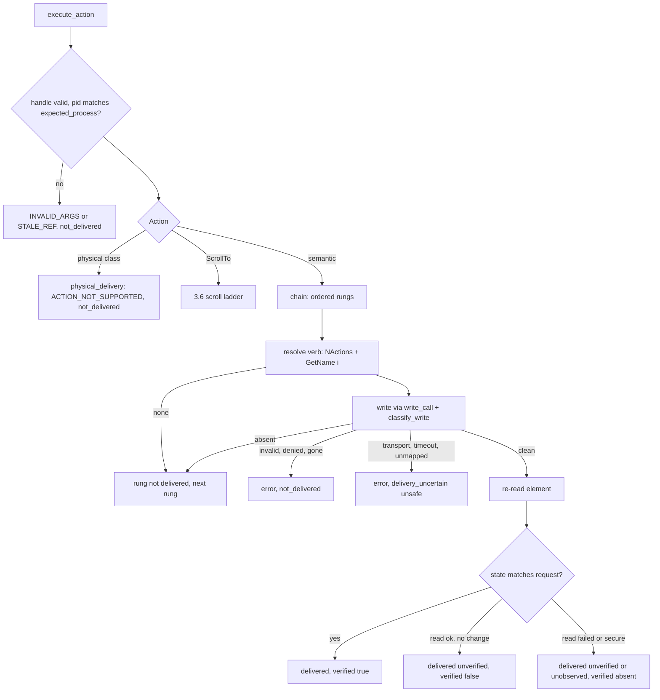
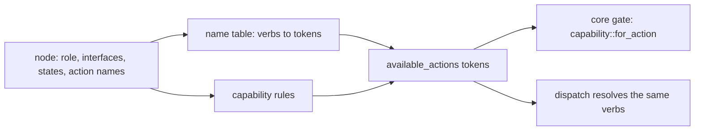

# Linux Semantic Action Tier (Sub-phase 3.7) - Plan

## Goal Capsule

- **Objective:** an agent on a GNOME desktop can click, toggle, check, expand, collapse, select, set a value, clear and type into real apps with no pointer, no focus change and no input device, and every result says what the desktop showed afterwards: delivered and observed, delivered and unobserved, not delivered and safe to retry, or uncertain and unsafe to retry. A D-Bus `true` that changed nothing is never reported as success.
- **Means:** the Linux adapter implements `execute_action` over AT-SPI `Action`, `EditableText`, `Selection` and `Value`, behind a write-path classifier and an activation chain, and extends its capability table so core's gates see the affordances the evidence supports (KTD1-KTD6).
- **Authority:** `docs/phases.md` §3.7 as corrected by 3.0-3.6, and further corrected here where the ledger or the code disproves it (R18). Base: the landed `feat/linux-3.6-actionability` head `846f32c5`; every symbol named below was read at that head, and the drift found is listed under Landed-Base Corrections.
- **Stop conditions:** stop if a requirement needs a change under `crates/core`; if no window manager can run rootless in a private session (openbox does through `scripts/private-session.sh --wm`, `L16-6`); or if U1 shows that no `DoAction` on any measured toolkit changes observable state (nothing then distinguishes delivered from not).
- **Execution profile:** U1 and the skeleton commit first; then four lanes in parallel with disjoint files (Parallel Lanes and Frozen Interfaces); the integration lane merges A, B, C, D in that order, then runs U11 wiring, U13, U14 and U12 last because it records the dispositions U13 and U14 produce. The unit dependency graph in Sequencing still holds inside each lane.
- **Finishes and ships:** the implementer runs the box measurements and live verification, commits, and opens one PR stacked on `feat/linux-3.6-actionability`; nothing merges to `main`.

---

## Product Contract

### Summary

Make `click`, `toggle`, `check`, `uncheck`, `expand`, `collapse`, `select`, `set-value`, `clear`, `type`, right-click and element `focus` real on Linux without touching the pointer or the active window. After this sub-phase a ref action reaches `execute_action`, which resolves the AT-SPI action by name, writes through one classifier that separates "not delivered" from "uncertain", and judges every write by re-reading the element. Core is unchanged. Gestures and keystrokes that need input synthesis report `ACTION_NOT_SUPPORTED` with `not_delivered` until the input tier lands.

### Problem Frame

The tier exists in core and has no Linux backend: `ActionOps` is empty, so every ref action ends in `PLATFORM_NOT_SUPPORTED`, and the capability table 3.4 ships cannot yet tell core that a slider takes a value or a disclosure takes a toggle, so core refuses those actions before dispatch.

The ledger shows how little an AT-SPI call proves. `DoAction` returns `true` on an insensitive button (`L4-21`), on a GTK4 popover toggle whose opening shows only after a settle of about 0.66 s (`L4-20`, `L23-15`, `L23-19`) and on a navigation row that does nothing (`L4-9`); `DeselectChild` returns `true` and deselects nothing (`L4-8`); `InsertText` returns `true` and inserts nothing when `length` cuts a UTF-8 sequence (`L4-13`); `Value.CurrentValue` clamps silently (`L4-17`). The only machine name for an action is `GetName(i)` (`L3-20`). No bare `expand`, `collapse`, `popup` or `cancel` name exists (`L3-19`, `L4-6`, `L4-18`, `L4-19`), though GTK4 Files tree rows carry the prefixed `listitem.toggle-expand`, `listitem.expand` and `listitem.collapse` (`L23-20`), and `doDefault` is on every Chromium node including static text (`L16-12`). Text offsets are Unicode code points while core's are UTF-16 (`L4-12`), and GTK4 text refuses caret and selection writes (`L4-15`).

Every behavioural row is GTK3 or GTK4. No row shows `DoAction` having an effect on Qt, Chromium or Gecko, and the macOS lesson that an advertised action can be a no-op on a readable Chromium tree applies. No write has been measured against a destroyed object or a stopped app, so the classifier that decides "retry is safe" has only read-path evidence behind it.

Two things are owed by nobody and decide whether `type` can be verified. Core verifies `TypeText` against `get_text_selection`, and no earlier sub-phase implements it. And 3.4's table emits `SetValue` only from the `editable` state on a text role, so a writable slider or spin button is refused at the gate.

### Requirements

**Delivery honesty**

- R1. `execute_action` handles every `Action` variant. Semantic routes are built where AT-SPI has one; gestures and keystrokes that need input synthesis return `ACTION_NOT_SUPPORTED` with `not_delivered` and a suggestion naming the missing delivery, through one seam function that receives the whole request (policy and verified point) and the deadline; hover, drag and held keys are rejected in dispatch because core delivers them through `mouse_event`, `drag` and `key_event`. `ScrollTo` wraps 3.6's scroll ladder in an `ActionResult` with observed evidence steps. A foreign or empty handle is `INVALID_ARGS`; a handle whose owning frame contradicts `expected_process`, or whose bus name is no longer owned by the process the handle recorded for the target, is `STALE_REF` with `not_delivered`, and a cross-bus child whose own pid differs from `expected_process` is not a contradiction (A2).
- R2. Every AT-SPI write reaches its caller through one write-path classifier with a per-outcome table: an absent affordance falls through the chain; a refusal, an invalid argument or a vanished target is `not_delivered` with its code (`PERM_DENIED`, `INVALID_ARGS`, `STALE_REF`); a transport failure, a timeout, a spent deadline after the message was sent and every unmapped error is `delivery_uncertain` with retry `unsafe`. The write classifier takes its error-name families from 3.5's absence classifier (`tree::absence`: `Failure`, `failure_of_name`, `Liveness::of`) and never re-derives absence from one error name; no action file calls `bus::classify`, `bus::classify_at`, `absence::gone_error` or `absence::read_failure`, because those read-path mappers turn `NameHasNoOwner` into `PLATFORM_NOT_SUPPORTED` and a gone object into `ELEMENT_NOT_FOUND`, and a write needs `STALE_REF`.
- R3. A D-Bus return is never evidence. Every step's `verified` comes from a re-read of the element after the write: `true` when the observed state matches, `false` when the re-read showed no change, absent when the re-read failed. A click that changes nothing on its own node reports `verified: false`.
- R4. Action indexes come only from the node read's index-aligned machine names (3.4's `read_actions` takes the count from `GetActions` and each name from `GetName(i)`, falling back to the listed name only when `GetName` fails or answers empty), matched case-insensitively with a per-index error tolerated. An empty list or a `false` return is `not_delivered`, never a click. `doDefault` is never a click verb. No code path calls `CopyText`, `CutText`, `PasteText` or `GrabFocus`.

**Capability evidence**

- R5. The capability table emits `Expand` and `Collapse`, `SetValue` for writable `Value` roles, `TypeText` and `Select` only where the evidence in U1 supports them, from the same table that dispatch resolves verbs through, so ref-ability and dispatch cannot drift. It emits no `Scroll` token: 3.8 adds it for eligible scroll targets through its own capability unit (C1).

**Actions**

- R6. `click` and `right-click` invoke the node's own click or context-menu verb. A node with no such verb, or a headed gesture that needs the pointer, is `ACTION_NOT_SUPPORTED`, never `ACTION_FAILED`. A headed `click` or `right-click` on a node that has a verb still dispatches the verb (core's pointer-delivery decision is `Physical` under a headed policy and does not force a headless one, and no pointer leg exists yet); the seam is reached only when the node has no verb.
- R7. `toggle`, `check` and `uncheck` read the checked state first, return `satisfied_without_delivery` when `check` or `uncheck` is already satisfied, invoke exactly once, and verify by reading `checked`. An indeterminate or incompletely read state is refused. A toggle-family action on a node whose role cannot carry `checked` is `ACTION_NOT_SUPPORTED`, `not_delivered`, with no write, because core's gate lets `toggle`, `check` and `uncheck` through on a `Click` token alone.
- R8. `expand` and `collapse` read the expanded state first, invoke the node's toggle-style verb only when the state is the known opposite, and verify by reading it back. A leaf is never invoked. The GTK4 menu button follows U1's measurement of which node accepts the action (KTD9).
- R9. `set-value` on a text node writes through `EditableText` and reads the full value back; on a slider or spin button it writes `Value.CurrentValue` and reports the stored, possibly clamped, value. `clear` empties a text node. A write that returned `true` and left a different value is `ACTION_FAILED` with `delivered_unverified`.
- R10. `type` inserts at the caret, replacing a non-empty selection, through `EditableText.InsertText` with the UTF-8 byte length, and never moves the caret. `get_text_selection` returns core's UTF-16 range converted from code points.
- R11. `select` by display value finds the named item among a container's descendants, selects it through `Selection.SelectChild` or the item's `select` verb, and verifies by the item's `selected` state or the container's value, never by the call's return. A node whose structure offers no route reports `ACTION_NOT_SUPPORTED`. A libadwaita combo row exposes no choices until its popover is open, an option label's only action is `clipboard.copy`, and selection works by a pointer open plus keyboard navigation (`L23-23`), so no semantic route exists for it: `select` there is `ACTION_NOT_SUPPORTED`, not delivered, with a suggestion naming the headed click and key route.
- R12. Element `SetFocus` is headed-only: a policy that does not allow focus steal reports `POLICY_DENIED` with `not_delivered`; a headed call uses only the node's own `SetFocus` verb and is verified by the `focused` state.
- R13. A write into a secure field lands without echo: no read of the field's text is issued, the step carries no `verified`, and no result, error or post-write state read contains the text written or found. The post-write read core issues is 3.5's live read, which withholds a secure field's value without issuing the read; this sub-phase depends on that and proves it end to end. A GTK4 `Gtk.Entry` with visibility off publishes as an ordinary text box with no secure marker (`L25-4`, accepted in 3.5), so nothing marks it secure and its write is read back like any text box; the secure cases are role 40 (`Gtk.PasswordEntry`, GTK3 and Qt password fields), and the shipped skill text says so.

**Environment**

- R14. Every semantic action except a headed element `SetFocus` is headless. Across the live corpus the pointer and `_NET_ACTIVE_WINDOW` are unchanged by each action class on X11, and `click`, `set-value` and `type` work on a Wayland session with no input device.
- R15. DoAction effects on Qt, Chromium and Gecko are measured and recorded before any action is built on them, and each toolkit's dispatch has a live positive case or a stated reason it has none.
- R16. Expand/collapse and select-by-display-value targets are searched in stock apps; a case with no stock target is written into the existing owner item for edge cases in `docs/phases.md`, and no fixture app or authored page is added.
- R17. The frame `ACTIVE` state versus `_NET_ACTIVE_WINDOW` question (`L4-23`) is closed by citing 3.6's measurements and one regression test: `L27-3` (openbox, 48 of 48 trials: root property, frame `ACTIVE` and stacking order agree within 2 to 4 ms), `L27-11` (12 of 12 activations agree) and `L27-10` (mutter: a window that never held focus is refused until another window has held it, neither signal set). The regression test pairs `focus_window` with the frame `ACTIVE` read under both managers.

**Process and proof**

- R18. `crates/core` is unchanged, no shipped source names a plan, phase or decision id, pure tests run on every host, and every other requirement is proved by a real run on the GNOME box in a private session now and on the live session once the owner restores its bus. `docs/phases.md` states what was built and no longer states what the evidence disproved, and every ledger row naming 3.7 is disposed of.
- R19. A stranger dogfood is run and its report committed with at least one finding, each disposed of.
- R20. Dispatch latency is measured min-of-seven with the warm-up discarded, and the release binary stays under 15 MiB.

### Acceptance Examples

- AE1. **Covers R3, R6.** `click` on Calculator's insensitive `Undo` ends before dispatch at core's enabled gate with the checked reason; the same call forced through the adapter reports a step with `verified: false`, never `delivered_verified`.
- AE2. **Covers R7.** `check` on the Settings Multitasking "Hot Corner" switch while it is already checked returns `satisfied_without_delivery` and changes nothing; `uncheck` flips it and a re-read of `checked` confirms it.
- AE3. **Covers R9.** `set-value 500` on the Mouse "Pointer Speed" slider (range -1 to 1) stores the clamp and returns `ACTION_FAILED` with `delivered_unverified` and the stored value in `post_state`; `set-value 0.2` is `delivered_verified`.
- AE4. **Covers R11.** `select` on the Settings sidebar row "Sound" is `ACTION_NOT_SUPPORTED` or carries `verified: false`; it is never reported as an observed selection.
- AE5. **Covers R2.** An adapter-level `execute_action` on a held handle whose app the harness stopped with `SIGSTOP` ends `delivery_uncertain` with retry `unsafe`, and after `SIGCONT` the harness reads whether the write landed; the same call after the harness killed the app is `STALE_REF` with `not_delivered`. Through the CLI an already-stopped app ends at resolution with `not_delivered`, before any write.

### Key Decisions

- KD1. **Core stays platform-neutral and Phase 3 is trait implementation only.** (session-settled: user-directed — chosen over adding Linux paths or fields in core: core is the shared surface.) Governs R1, R5, R18. The capability table is adapter code and is extended here; anything that would need a core change is written into `docs/phases.md` for the owner and not built.
- KD2. **Tests fail for a real reason, and real runs outrank suites.** (session-settled: user-directed — chosen over broad fixture-driven suites: probe scripts and captures are never read by tests and never committed.) Governs R18. The classifier, the chain decisions, the verb resolution and the text arithmetic are pure functions over plain values with injected judged-for seams (the Windows 2.7 shape), every test is invert-verified, and live tests never kill by name and never waive an error wholesale.
- KD3. **A D-Bus `true` is never evidence of effect.** (session-settled: user-directed — chosen over trusting the call's return: `L4-8`, `L4-9`, `L4-13`, `L4-20` and `L4-21` measured success without effect.) Governs R2, R3. Every action is judged by observation, and a deadline spent on a write maps to `delivery_uncertain`, not a plain `TIMEOUT` with no disposition.
- KD4. **Action names come only from `GetName(i)`, and `doDefault` is not a click.** (session-settled: user-directed — chosen over porting the roadmap's name list: `L3-20` and `L16-12` disprove it, and no bare `expand`, `collapse`, `popup` or `cancel` name exists, `L3-19`, `L4-6`, `L4-18`, `L4-19`; the prefixed `listitem.*` names on Files tree rows are the exception, `L23-20`.) Governs R4, R8. Expand and collapse go through a toggle-style verb on the node that the measurement of U1 names (`listitem.toggle-expand` on a Files tree row toggled `expanded` and the child rows both ways), or report not supported honestly.
- KD5. **Text follows the measured rules.** (session-settled: user-directed — chosen over code-point lengths, caret or selection writes and a clipboard fallback: `L4-12`, `L4-13`, `L4-15`, `L4-24`.) Governs R4, R9, R10. `InsertText` length is UTF-8 bytes; core's UTF-16 offsets are converted from code points; value writes are read back because they clamp silently (`L4-17`); `Copy`, `Cut` and `Paste` are never used; `GrabFocus` is out, and focus uses 3.6's X11 `focus_window` for windows.
- KD6. **Real apps only: no fixture app and no authored web page.** (session-settled: user-directed — chosen over a purpose-built fixture or harness page for the cases no stock app presents.) Governs R16. Targets are searched in GNOME Settings, Files list and sidebar, Text Editor, Calculator modes, Disks, System Monitor and the Qt script that already ships with the live tests; what no stock app presents is written into the existing owner item in `docs/phases.md`.
- KD7. **Qt, Chromium and Gecko effects are measured before they are assumed.** (session-settled: user-directed — chosen over generalising from the GTK rows.) Governs R15. U1 measures them in private sessions under openbox (`L16-6`); the Gecko recipe is the inner binary `/snap/firefox/current/usr/lib/firefox/firefox` with the snap library path and `GTK_A11Y=atspi`, and Chrome runs with `ACCESSIBILITY_ENABLED=1` (`L16-7`).
- KD8. **Wayland works through AT-SPI with no input device, and the headless invariant holds.** (session-settled: user-directed — chosen over a synthetic-input fallback inside the semantic path.) Governs R14. `L13-8` and `L13-9` show actions and `EditableText` need none; `L4-22` is the invariant to keep.
- KD9. **Every `docs/phases.md` statement the evidence disproves is corrected in place, as its own unit, citing rows.** (session-settled: user-directed — chosen over leaving it for the next planner.) Governs R18. This sub-phase closes `L4-23` and disposes every row that names it.
- KD10. **The stranger dogfood is a gate.** (session-settled: user-directed — chosen over an author-run check: the operator gets only the shipped skill text and the box binary, and probes are judged against independent channels.) Governs R19.
- KD11. **One PR; the size is stated and justified.** (session-settled: user-directed — chosen over two stacked PRs.) The reason is in Risks & Dependencies.
- KD12. **The PR stacks on `feat/linux-3.6-actionability`; nothing merges to `main`.** (session-settled: user-directed — chosen over a PR against `main`.)
- KD13. **Box access goes only through `scripts/remote-linux.sh`, never `sudo`, and live verification runs in a private session with a window manager started inside it.** (session-settled: user-directed — chosen over the live bus, which is broken until the owner restarts it.) Governs R14, R15, R17.

### Scope Boundaries

- In scope after the final end-to-end run, with the owner's approval: one platform-neutral change in core, `crates/core/src/actionability/gates.rs` `visibility()`. When no geometry is required and the live `offscreen` state is known false, `visible` passes without bounds (a known-on-screen node with zero-sized bounds still fails; an unknown `offscreen` and a required geometry behave as before). The adapter supplies the evidence: a node with `VISIBLE` and `SHOWING` on a mapped, non-iconified frame of a Wayland session whose toolkit reports no global position reads `offscreen: false` and `hidden: false` with no rectangle. The same rule reaches the headless semantic actions that use no pointer: with no bounds and `offscreen` known false, `visible` passes and `stable` passes ("no pointer use; not measurable without bounds"); pointer delivery (headed, hover, drag, a click with no verb) and any node with bounds are unchanged.
- No pointer or keyboard synthesis (3.8), no launch, close or window operations (3.9), no clipboard or screenshot (3.10), no event waits (3.11), no Linux platform skill (3.13).
- Considered and not built:
  - A directional `Scroll` token for `Action::Scroll`. A `scroll bar` `Value` write does realise virtualised content, about 1.3 s after the write (5 of 5 on the Files 300-file grid, `L23-24`; `L14-7` read at 0.6 s), so that route is `set-value` on the scroll bar ref (KTD6 role list), not `scroll`. The roadmap assigns the wheel to the input tier (260 wheel clicks were needed to reach the end of that list, `L23-24`); core's gate needs the token, so within this PR `scroll` stays `ACTION_NOT_SUPPORTED` at the gate, and 3.8 adds the token for eligible scroll targets together with the wheel leg (C1). Evidence that would change the call: a dogfood finding that agents need headless directional scroll.
  - `GrabFocus` as a headed element-focus rung. `L4-16` shows it focuses on GTK3 and moves the active window in two of three runs, and it is `NotSupported` on GTK4. Evidence that would change the call: U1 showing it focuses reliably under a granting window manager with `focused` read back.
  - `Increase` and `Decrease` (Qt) as action routes: core has no increment action, and `Value` writes cover the case.
  - A second enabled-state read inside the adapter before `DoAction`. Core's enabled gate runs before dispatch, and a race that lets `true` through on an insensitive widget is reported by the post-write re-read as `verified: false`, which surfaces at once to the caller.
  - A retry inside the adapter after a write that showed no change. A second invocation of a toggle that was merely slow double-toggles it; core's contract is one dispatch.
  - A clipboard-paste fallback for text (`L4-24`; no row measures a paste, and the clipboard is the clipboard tier's).
  - An `AT-SPI` `GenerateMouseEvent` or `GenerateKeyboardEvent` route: both move the real cursor or need an input path (`L5-4`, `L5-5`).
- Deferred to follow-up work, written into `docs/phases.md` in U12:
  - The `Scroll` token for eligible scroll targets and the wheel leg (3.8's capability unit and wheel leg), and a shared activation-chain engine in core to replace the per-platform copies (core owner).
  - Expand/collapse and select-by-display-value coverage for any case U1's stock-app search cannot reach (3.12 edge-case item).

---

## Planning Contract

### Key Technical Decisions

- KTD1. **Layout.** New files by the shared platform layout, one concern each, under the 400-line cap. `crates/linux/src/actions/`: `dispatch.rs`, `mutation.rs`, `write_call.rs`, `chain.rs`, `chain_step.rs`, `action_call.rs`, `click.rs`, `toggle_state.rs`, `disclosure.rs`, `value_write.rs`, `text_write.rs`, `numeric_write.rs`, `secure_write.rs`, `select.rs`, `select_search.rs`, `focus.rs`, `scroll_wrap.rs`, `physical_delivery.rs`. `crates/linux/src/tree/`: `text_units.rs`, `text_selection.rs`, `capability_rules.rs`, and extensions to `action_names.rs` and `state_bits.rs`. Each with its `_tests.rs`. `adapter.rs` only wires. Governs R1-R13. Added by the landed base: `actions/context.rs` (the frozen `Target`), `tree/action_read.rs` (the tree-side facade the action files read through, because `tree::absence`, `node_read::call` and `live_read::read_live` are private to `tree`), and the lane files named under Parallel Lanes and Frozen Interfaces. `adapter.rs`, `actions/mod.rs`, `tree/mod.rs` and `system/mod.rs` change only in the skeleton commit and the integration lane.
- KTD2. **Dispatch is one match over every `Action`.** `dispatch.rs` rejects a foreign handle with `INVALID_ARGS` (`invalid_native_handle`), calls `ensure_budget` (the skeleton re-exports it from `system`; it is private to `system::bus` today), validates `expected_process` in two separate checks (A2). First, `expected_process` against the verified owning frame: the frame's pid recorded on the handle (3.5's KTD18, kept by 3.6's ancestry) must equal `expected_process.pid`, and that pid's process instance from 3.4's process facts (`process_facts::lookup`: `Gone` and an instance mismatch are `STALE_REF`, `Unreadable` is a retryable `not_delivered` error because identity could not be read, never a guess) must equal the instance; this is the process core stamped on the ref, which is the window's, not the target's. Second, the target itself: the bus daemon's owner pid for the handle's bus name (`system::owner_process_id`, answered by the daemon even for a stopped app) must equal the pid the handle recorded for the target, so a bus name re-owned by another process is caught. A contradiction in either is `STALE_REF`, `not_delivered`, with no write; a child on another bus name whose pid differs from the window's passes both checks. Then it matches. Click, RightClick, Toggle, Check, Uncheck, Expand, Collapse, SetValue, Clear, TypeText, Select, SetFocus and ScrollTo have semantic arms. DoubleClick, TripleClick, Scroll, TypeText and PressKey (including a null-handle global key press), and a Click or RightClick with no semantic verb, go to the physical seam in `physical_delivery.rs`. Hover, Drag, KeyDown and KeyUp are rejected in `dispatch.rs` with `ACTION_NOT_SUPPORTED` "requires adapter-level handling" and `not_delivered`, because core delivers them through `mouse_event`, `drag` and `key_event`, not `execute_action` (the Windows shape). The seam is one function, `physical_delivery(bus, action, element, request, lease)`, taking the action, the resolved element (or none for a global key press), the whole `ActionRequest` (so `request.policy` and `request.verified_point()` reach the leg) and the deadline, and returning `Result<ActionResult, AdapterError>`. In this sub-phase its body returns `ACTION_NOT_SUPPORTED`, `not_delivered`, `details.physical_delivery_started: false`, with a suggestion to use the semantic action; the input tier replaces the body and wires only this file and the call sites in `dispatch.rs`, so dispatch is not reworked. A `TypeText` reaches the seam only under a focus-fallback policy on a node without the `TypeText` token. `ScrollTo` is not a seam arm: `scroll_wrap.rs` (KTD18) wraps 3.6's `scroll_into_view`. Governs R1. With `expected_process` absent (a caller outside core) both checks are skipped. A headed `Click` or `RightClick` on a node that has a semantic verb dispatches that verb: core's pointer-delivery decision is `Physical` under a headed policy and does not force a headless policy, no pointer leg exists until the input tier lands, and the step says `SemanticApi`; the seam is reached only when the node has no verb. After a post-send timeout the dispatch names a stopped target in `details` (`process_facts::is_stopped`, as 3.5's `stopped_aware` does) and leaves the disposition `delivery_uncertain`: a queued write can land after `SIGCONT`.
- KTD18. **`ScrollTo` is a wrapper over 3.6's routine, because the two core signatures differ.** `scroll_into_view` returns `Result<(), AdapterError>` and `execute_action` returns `Result<ActionResult, AdapterError>`, and both stay as core fixes them (A6). `scroll_wrap.rs` reads the target's live state (`get_live_state`: `offscreen` and the `hidden` token) before the call. A target with `offscreen == Some(false)` and no `hidden` token yields `ActionResult::satisfied_without_delivery` with a `satisfied` step and no call to the ladder; every other reading, `None` included, calls 3.6's ladder, because its `drive` owns the `target_hidden` and `bounds_not_provable` refusals and returns `Ok(())` untouched for an on-screen target. Otherwise it calls the ladder, propagates any `Err` unchanged (3.6 already stamps `physical_delivery_started: false`), and on `Ok(())` re-reads the target's visibility: derived `offscreen` turned `Some(false)` is a `delivered_verified` step labelled with the rung's AT-SPI call; a re-read that failed is `delivered_unobserved` with no `verified`; a re-read still off-screen after an `Ok` is `delivered_unverified` with `verified: false`, never success. When the before-read is unavailable, the wrapper calls the ladder and judges only by the after-read. Governs R1, R3.
- KTD3. **The write-path classifier is pure over plain values and kept apart from the read-path classifier.** `mutation.rs` takes the method kind, a failure reduced to a name (the D-Bus error name, an I/O kind, or a deadline mark), whether the call was on an interface the node advertised, and a corroboration outcome (alive, dead, timed out, not read). Its table:

  | Outcome of the write | Classification | Chain effect |
  |---|---|---|
  | clean return, effect pending observation | delivered | terminal; observation sets `verified` |
  | `false` from `DoAction`, `SelectChild`, `InsertText`, `SetTextContents` | affordance absent, not delivered | falls to the next rung (`L4-3`, `L4-8`) |
  | `NotSupported`, `PropertyReadOnly`, `UnknownProperty`; `UnknownMethod` or `UnknownInterface` on an interface the node did not advertise | affordance absent, not delivered | falls to the next rung |
  | `InvalidArgs` (index out of range, bad value) | `INVALID_ARGS`, not delivered | aborts (`L13-8`, `L4-8`) |
  | `AccessDenied` | `PERM_DENIED`, not delivered | aborts |
  | `NameHasNoOwner`, `ServiceUnknown` at send | `STALE_REF`, not delivered | aborts |
  | `UnknownObject`; `UnknownMethod` or `UnknownInterface` on an interface the node advertised | the suspect family, corroborated by the node's `GetRole` through `absence::Liveness::of`, as 3.5's classifier does: alive means affordance absent and not delivered, dead means `STALE_REF` not delivered, not read or timed out means the node's liveness is unknown (the error reply still means the write was not executed, so the disposition stays not delivered, and the chain stops with `ACTION_FAILED` rather than advancing on a guess) | per corroboration: alive falls to the next rung, dead and unknown abort (a single suspect is never enough: destroyed GTK4 objects answer `UnknownMethod` and destroyed Qt property reads answer `UnknownInterface`, `L17-1`, `L17-2`; `L2-7`, `L3-20`) |
  | `NoReply`, `TimedOut`, `Disconnected`, other I/O, a spent deadline after the message was sent | `delivery_uncertain`, retry `unsafe` | aborts |
  | `UnmappedGError` and every unmapped name | `delivery_uncertain`, retry `unsafe` (U1 may move `Code13` to absent, `L14-10`) | aborts |

  `fault_of(&zbus::Error)` is the only function that sees a `zbus::Error`, and it delegates the name families to `absence::failure_of_name`; the table adds only the write-specific rows. A source scan test keeps `bus::classify`, `bus::classify_at`, `absence::gone_error`, `absence::read_failure` and the banned calls `CopyText`, `CutText`, `PasteText` and `GrabFocus` out of `actions/`. `GetRole` answering is liveness of the node's own reads only: a destroyed GTK3 or Chromium object keeps answering it for 16 s (`L17-6`, `L25-5`), so presence is proved by 3.5's strict resolve, which runs through the parent's child list immediately before dispatch, and `Alive` here means only 'the node answered, so an absent interface is an absent affordance'. Governs R2, R4.
- KTD4. **A write-path wrapper turns a spent deadline into uncertainty.** `write_call.rs` runs a write inside the crate's deadline helper. A spent deadline before the message is sent is a `TIMEOUT` stamped `not_delivered`; once the message is on the wire, any `TIMEOUT` is stamped `delivery_uncertain` (retry `unsafe`). Core does not re-stamp a `TIMEOUT` returned from `execute_action`, so this needs no core change. Governs R2.
- KTD5. **The chain engine is Windows' shape, copied rather than shared.** `chain.rs` holds `ChainDef`, `ChainRung`, `DeliveryOutcome` (not delivered, satisfied without delivery, delivered unverified, delivered verified, delivered unobserved) and `execute_chain`: a clean not-delivered advances, any delivered outcome terminates, a genuine error aborts, exhaustion is `ACTION_FAILED` with the chain's suggestion. `chain_step.rs` builds `ActionStep`s with `StepMechanism::SemanticApi`; labels name the AT-SPI call. Platform crates cannot import each other and core has no chain, so the copy is deliberate and the shared engine is an owner item. `verified` is pinned once: `Some(true)` when the re-read shows the requested state or a change on the target's own node, `Some(false)` when the re-read succeeded and showed none (`L4-18`, `L4-20`), `None` when the re-read failed or the field is secure. Governs R3. Core fixes the report types: `ActionStep` labels are `&'static str`, so each label is a constant naming the AT-SPI call (`Action.DoAction`, `EditableText.SetTextContents`) and no per-call data rides in a label; `ActionResult` has no unobserved variant, `from_execution` yields `delivered_verified` only when every succeeded step carries `verified: Some(true)` and `delivered_unverified` otherwise, and a satisfied outcome is `ActionResult::satisfied_without_delivery(label)` (`not_delivered`). The chain's five outcomes therefore collapse to `NotDelivered`, `Satisfied` and `Delivered(Observed)` with `Observed` one of `Matched`, `Unchanged`, `Unread`.
- KTD6. **One table owns names, verbs and tokens.** `action_names.rs` keeps the case-insensitive name-to-token table 3.4 ships (no `doDefault`, `select` mapped to `Select`), changed in one place by `L18-16`: `check` stands for `Click` as well as `Toggle`, and a lone `check` is also the uncheck and the toggle on Gecko, so Uncheck tries `uncheck`, `toggle`, `switch`, `click` and then `check`, and Toggle ends with `check` and `uncheck` (`L30-13`, `L30-26`) (the table becomes name to a token list, so a Chromium checkbox keeps `Toggle` and gains `Click`), and `clickAncestor`, which 3.4's table maps to nothing, stands for `Click` (a generic node whose ancestor owns the handler is genuinely clickable through it, effect measured, and the headless gate needs the token to dispatch at all) and gains the inverse: for each core `Action`, the ordered verb list a dispatch tries (`Click`: click, press, activate, open, jump, check, clickAncestor, the last two from `L18-16`, where Chromium's checkbox `check` and generic node `clickAncestor` ran the page handler 30 of 30 times; `doDefault` stays out; `RightClick`: showContextMenu, menu, ShowMenu, menu.popup; toggle family: check or uncheck when the desired state fixes the verb, else toggle, switch, click; `SetFocus`: setfocus; `Expand`: listitem.toggle-expand, listitem.expand, then the click-class verbs the node's state permits; `Collapse`: listitem.toggle-expand, listitem.collapse likewise). `capability_rules.rs` derives the tokens that need more than a name: `Expand`/`Collapse` (the `EXPANDABLE` (bit 9, new in `state_bits.rs`) or `EXPANDED` state bit plus a click-class verb or a disclosure verb: `listitem.toggle-expand` gives both tokens, `listitem.expand` and `listitem.collapse` one each, `L23-20`), `SetValue` for `slider`, `spin button` and `dial` roles that advertise `Value`, and for a `scroll bar` that advertises `Value` (the table has no toolkit input, so the token is emitted on every toolkit and the write is judged by its read-back; `L27-4` measured the content-moving write on GTK3 and GTK4, and a Qt bar does not move content, `L27-37`, so the Qt write reports the mismatch honestly; U1 item 5 may instead decide to thread `ToolkitId` into the walk), `SetValue` and `TypeText` for text-entry roles that advertise `EditableText` (`TypeText` also `Text`) and carry `EDITABLE`, and `Select` for a container role that advertises `Selection` with children. `meter`, `level bar` and `progress bar` get no `SetValue`. A verb named `clipboard.copy` (the only action on a combo option label, `L23-23`) maps to no token. The landed `capabilities(actions, role, states)` has no interface, child-count or toolkit input, so it becomes `capabilities(node: &RawNode)` (call site `projection.rs` `evidence_of`, passing `&read.node`) and the 3.4 tests change with it. Governs R4, R5.
- KTD7. **Click verification observes the target and any popup it controls.** After a clean `DoAction` the chain re-reads the node's states, value, name and child count once after a short settle bounded by the lease deadline; a change means a difference in the checked, expanded, selected, pressed, value or name tokens or in child count; transient bits (focused, showing, armed) do not count. For ordinary controls any such change is `Some(true)`, none is `Some(false)`. For a popup push button or its inner toggle, verification additionally requires the shared menu classifier to observe the requested popup transition beneath the exact opener. The walk records the inner toggle's direct button parent; the action never guesses that parent from AT-SPI's inconsistent `Parent` property. Pressed/expanded without a popup is `ACTION_FAILED` with `popup_not_observed`, unverified delivery after invocation, and no verified-success step in the error receipt. An incomplete baseline refuses before invocation; an incomplete after-read cannot prove closure (df3-edges #42; df3-wayland #10, #48). A Calculator digit click changes another node, so it reports `Some(false)` on its own node and the caller verifies with `get` on the display (`L4-2`). Popover toggles report `Some(false)` only when the settle ends unchanged: the popover's items reached the tree 0.66 s after the toggle's `DoAction` here (157-331 ms in `L18-2`), and a read at 0.6 s sampled too early (`L23-15`, `L23-19`), so a node with `HAS_POPUP`, and a GTK4 menu button, polls the open state for at least 1 s inside the lease and not for the 300 ms click settle. Governs R3, R6. The re-read is `tree::action_read::read_node_view`: one node read (`read_evidence`) with tri-state fields and no placement or X11 read. `get_live_element` is not used inside the adapter because it adds a placement read and fails the whole read when one field is unread (`incomplete_live_evidence`). Core still issues its own `get_live_element` before and after the actions in `requires_state_readback` (`Check`, `Uncheck`, `Toggle`, `Expand`, `Collapse`, `SetValue`, `Clear`, `TypeText`), so those cost two reads; U13 measures the pair.
- KTD8. **Toggle, check and uncheck read first, invoke once, never retry.** Pre-read `checked` (refuse indeterminate or incomplete states, as core does); `check` or `uncheck` already satisfied is `satisfied_without_delivery`; otherwise one invocation of the verb KTD6 selects, then poll `checked` inside the lease until it matches or the settle budget ends. A no-change result is `delivered_unverified`, not a second call. Popup toggles also require KTD7's exact-opener popup observation; a checked/pressed change cannot verify an absent popup. GTK4 toggle roles read `pressed` as `checked` in 3.3's states (`L3-25`). Governs R7. The role guard of R7 applies before the pre-read: a role outside `check box`, `radio button`, check and radio menu items and `toggle button` (`states.rs` `can_be_checked`) is `ACTION_NOT_SUPPORTED` with no write.
- KTD9. **Disclosure acts only from a known opposite state; the GTK4 menu button is decided by measurement.** `disclosure.rs` pre-reads the expanded token with `states_complete`, never invokes a leaf, invokes the toggle-style verb only when the state is the known opposite, and polls the token. For the GTK4 menu button (outer push button with `has-popup`, inner toggle whose `PRESSED` is the open state, `L3-25`) U1 records which node accepts `DoAction` and whether `pressed` flips, in both directions, reconciling `L3-25` (pressed flips) with `L4-20` (nothing changes), polling for at least 1 s because the Calculator Main Menu toggle's `DoAction` `click` showed its popover items after 0.66 s (`L23-15`, `L23-19`), which makes `L4-20`'s 0.6 s read a timing artefact and Arm B the likelier outcome. Arm A, the default, emits no `Expand` or `Collapse` on menu buttons: the gate reports `ACTION_NOT_SUPPORTED`, and `click` runs with `verified: Some(false)`. Arm B applies only if the node that takes the action shows `pressed` flipping both ways and nothing else moves: the live projection (3.5's `live_project.rs`) then reports `expanded` from the inner toggle for a `has-popup` push button, the tokens are emitted, and the postcondition core reads is satisfiable. Arm B is built in this PR if U1 selects it: it costs one extra child read per menu button and edits 3.5's file in U7. Governs R8. As built, the outer push button of a menu button advertises `Expand` and `Collapse` while it has one child (the inner toggle) and also while it has two once `EXPANDED` is set, because the open popover is a second child; without that second case `collapse` after `expand` lost its token and was refused (`L30-27`). Expansion/collapse of a popup button additionally requires KTD7's popup observation; a state already at the requested value with an absent requested popup fails without claiming delivery.
- KTD10. **Text arithmetic lives in one pure module.** `text_units.rs` converts between code-point offsets and UTF-16 offsets given the text, computes the UTF-8 byte length passed to `InsertText`, rejects a length above `i32::MAX`, and never returns an offset inside a surrogate pair. `text_selection.rs` implements `get_text_selection`: it reads `CaretOffset` and the selection list from `Text`, returns the caret as an empty range when there are no selections (GTK4, `L4-15`), reads the text up to 3.4's field cap to convert, and returns unavailable evidence beyond the cap, for a secure field (without any read), or when a read fails. Governs R10.
- KTD11. **Text writes fall through only on explicit non-delivery.** `set-value` on text: rung one `SetTextContents(text)`; rung two (kept only if U1 shows a toolkit that rejects rung one and accepts it) `DeleteText(0, count)` then `InsertText(0, text, bytes)`. A `true` with a different value read back is terminal `delivered_unverified`, so a second rung never double-writes (`docs/solutions` selection-delivery-guard lesson). `clear` is `SetTextContents("")` with the delete-only rung under the same rule. `type` reads the caret and selection, deletes a non-empty selection, then `InsertText(caret, text, bytes)`; an unreadable caret is `ACTION_FAILED`, `not_delivered`, never a guess at the end of the text. Once the selection delete has returned cleanly, any later failure of the insert is `delivered_unverified` (`delivery_uncertain` for transport errors), never `not_delivered`, with a suggestion to read the field before retrying. The caret is not moved (`L4-15`). Governs R9, R10.
- KTD12. **Numeric writes read back the stored value.** `numeric_write.rs` parses a finite number, writes `Value.CurrentValue` with the property setter, reads it back and reports the stored value; a clamp or snap is a mismatch core turns into `ACTION_FAILED` with `delivered_unverified` and the stored value in `post_state` (`L4-17`). The spin button's read happens after commit (`L14-11`), and an AT-SPI read-back is not commit evidence for a fractional value: Settings "Number of Workspaces" read back `7.5` while `num-workspaces` stayed `7` and the reopened panel read `7.0` (`L23-27`). A spin button whose increment (U1 item 5 records `MinimumIncrement`) is a whole number therefore refuses a non-integral request as `INVALID_ARGS` before any write; where the increment is unreadable (GTK4 reads `0.0`, `L30-7`) the step carries no `verified` and the fraction is written. A `scroll bar`'s reachable maximum is below its advertised maximum (read-back 9961 of 10419, `L23-24`), so a write to the advertised maximum reports the stored value as the mismatch core turns into `ACTION_FAILED` with `delivered_unverified`, and the content has still moved. A property-read-only answer is `ACTION_NOT_SUPPORTED`. Governs R9.
- KTD13. **`TypeText` is emitted, following macOS.** (Decided from parity evidence.) macOS emits the token for roles that may insert text when the selected-text attribute is settable and verifies against `get_text_selection`; Windows emits none because UIA offers no insert-at-caret without input, so its headless `type` is `POLICY_DENIED` and its legs are `SendInput`. Linux has the macOS primitive, `EditableText.InsertText(position, ...)` at a readable caret, and it is the only text path on Wayland with no input device (`L13-9`). Emitting the token makes `type` a headless semantic action, passes core's `editable` gate and gives core the selection it needs to verify the insertion. Without the token a focus-fallback policy would reach a physical leg that does not exist yet. `get_text_selection` belongs to this sub-phase because no earlier plan ships it and `P3-O10` assigns it to Phase 3. Governs R5, R10. Core's `expected_insertion` needs `before.state.value` and the selection, so `TypeText` on a node with no value source (3.4's `value_source`: `ENTRY`, editable `TEXT` and `TERMINAL`, and `COMBO_BOX`, each with `Text`; none for a password field) ends `delivered_unverified` with `verification_reason: insufficient_evidence`, which is accepted. The `editable` gate passes `textfield` and `combobox` by role and every other role through the `SetValue` token.
- KTD14. **Select searches, then selects through the container's `Selection`.** `select_search.rs` matches the display value against the target's own name, then a bounded descendant search (2048 nodes, depth 8), case-insensitive after trimming, exact otherwise; two matches are `AMBIGUOUS_TARGET`. `select.rs` selects the matched item through `Selection.SelectChild(index)` on the nearest ancestor that advertises `Selection` (index checked against that ancestor's child list, since `Parent` disagreed with the walk on four nodes, `L2-2`) or through the item's own `select` verb. Verification: the item's `selected` state, else `IsChildSelected`, else `NSelectedChildren`; for a combo box the container's displayed value outranks the item's `selected` state. `SelectChild` returning `true` with nothing selected (`L4-9`) is `delivered_unverified` with `verified: false`. An item whose only advertised action is `clipboard.copy` (a libadwaita combo option label) has no select route: its `DoAction` copies and selects nothing, so it is never invoked for `select` (`L23-23`). GTK4 multi-select adds rather than replaces (`L4-7`), so a prior selection is cleared with `ClearSelection` only when the container is multi-select and the request expects a single choice (U1 settles the measured behaviour first). On a combo box the call goes to the combo itself with the item's index, because `click` on the menu item of a closed GTK3 combo answers `true` and changes nothing (`L30-25`); a closed Qt popup takes no semantic selection and reports `verified: false`, while a Qt list selects (`L30-25`). Governs R11. Core's gate passes `select` on a `Select` or `Click` token (and on a combo box with an expand token), so a Settings sidebar row that carries only `Click` reaches this action; with no `Selection` ancestor and no `select` verb the answer is `ACTION_NOT_SUPPORTED`, never a click.
- KTD15. **Element `SetFocus` is policy first and uses no input.** `focus.rs` returns `POLICY_DENIED`, `not_delivered`, `details.foreground_effect: true` when the policy does not allow focus steal. Otherwise it invokes the node's own `SetFocus` verb (Qt) and verifies the `focused` state; with no such verb the gate has already refused with `ACTION_NOT_SUPPORTED`. Window focus before a headed battery is core's call into 3.6's `focus_window`. U1 records whether Qt's verb moves the active window. Governs R12.
- KTD16. **The secure field gate sits in front of every read.** `secure_write.rs` decides from the role (`PASSWORD_TEXT`) and the `secure` token before any `Text` read is issued; the write goes through the same chain, the outcome is `DeliveredUnobserved`, errors carry `value_chars` and never text, and `get_text_selection` returns unavailable. U1 records what `Text.GetText` returns on such a field so the claim "no read" is a choice and not a workaround. Governs R13.
- KTD17. **Every call races the deadline.** Each D-Bus call and each polling read runs inside the deadline helper with `ensure_budget` between steps, so a stopped app cannot exceed the command budget (`L11-15`). Governs R2.

### High-Level Technical Design





### Assumptions

- Landed base facts this plan relies on, read at `846f32c5`: the capability table is `tree/action_names.rs` (`TABLE` of 15 names, `capability_of`, `capabilities(actions, role, states)`); `RawNode` carries `actions: Field<Vec<String>>` index-aligned machine names, `traits.interfaces`, `traits.states` words, `properties.child_count`; 3.5's single node read is `node_evidence::read_evidence` returning `NodeEvidence { read, evidence, liveness }` and the live reads are `tree::{get_live_value, get_live_state, get_live_actions, get_live_element, get_element_bounds}`; the handle is `AtspiElement` with `frame()` (pid of the owning frame), `pid()`, `scroll_container()`; `system::{owner_process_id, within, process_facts, SharedBus}`; 3.6 supplies `system::focus_window::focus_window(bus, win, lease)`, `actions::scroll_into_view(bus, handle, lease)`, `tree::live_offscreen::toolkit_of(bus, element, deadline)` and `toolkit_trust::{read_toolkit, kind}`. `ActionOps for LinuxAdapter` implements only `scroll_into_view`; `get_text_selection` is an `ObservationOps` method.
- Ledger: areas run to `L27` at the base, so U1's new rows go in area `L30`. Rows `L23-12`, `L23-14`, `L23-15`, `L23-19`, `L23-20`, `L23-21`, `L23-23`, `L23-24`, `L23-25` and `L23-27`, which this plan and the landed `docs/phases.md` and rows `L27-3`, `L27-4`, `L27-10` cite, are not in the committed ledger (area `L23` holds only `L23-37`); until U1 lands each as an `L30` row from its original capture or re-measures it, no source, test comment or doc may cite one, and where the plan cites one it names a measurement still owed. `L16-6` and `L16-7` are on the base.
- Openbox 3.6.1 runs through `scripts/private-session.sh --wm` (packages extracted at `~/ad-wt/wm-pkgs`, `L16-6`); `gnome-shell --x11` and a private `gnome-shell --headless --wayland` session provide the mutter and Wayland tiers, and the helper starts only openbox, so the mutter and Wayland sessions are started by the harness.
- The harness may set GSettings through the private keyfile backend: `org.gnome.nautilus.list-view use-tree-view=true` with `default-folder-viewer='list-view'` gives Files tree rows with the `expandable` state and `listitem.toggle-expand` (`L23-20`; unreached in `L14-6` only for lack of that setting).
- Inferred bets, recorded so a reviewer can overturn them: the click settle budget is the smaller of 300 ms and the lease's remaining time; the descendant-search caps are Windows' (2048 nodes, depth 8); `AMBIGUOUS_TARGET` for two equal display-value matches follows Windows; the scroll-bar role joins the `SetValue` roles on every toolkit because the table has no toolkit input, and the write is judged by read-back (`L27-4`).

### Sequencing

U1 → (U2, U3, U8); U1 → U4; (U2, U4) → U5; (U3, U5) → U6; (U3, U5, U6) → U7; (U2, U3, U8) → U9; (U3, U5) → U10; (U6, U7, U9, U10) → U11 → U13 → U14 → U12.

### Landed-Base Corrections

Read at `846f32c5`; each is applied in place above or in the unit it names.

1. Ledger: rows `L23-12` to `L23-27` are not committed (area `L23` holds `L23-37` only); new rows start at `L30-1`; the 3.7 row list is 31 rows, not 28 (U1 precondition, U12 items 8 and 9).
2. The read-path classifier is `tree::absence` (3.5), not `bus::classify`; the roadmap says the action path calls it. `mutation.rs` reuses `failure_of_name` and `Liveness::of` and bans the mappers that turn `NameHasNoOwner` into `PLATFORM_NOT_SUPPORTED` (KTD3, U2).
3. Action names are already index-aligned in `RawNode.actions` (`GetActions` count, `GetName(i)` names); no second `NActions` round (R4, KTD6, U5).
4. `capabilities(actions, role, states)` has no interface, child-count or toolkit input; it becomes `capabilities(&RawNode)`; `EXPANDABLE` (bit 9) is missing from `state_bits.rs` (KTD6, U4).
5. Core's gate lets `toggle`, `check`, `uncheck` and `select` through on a `Click` token alone, and passes `ScrollTo` always; the adapter guards the role itself (R7, KTD8, KTD14).
6. Under a headed policy core's pointer delivery is `Physical`; a headed `click` on a node with a verb still takes the verb because no pointer leg exists (R6, KTD2).
7. `ActionStep` labels are `&'static str` and `ActionResult` has no unobserved variant (KTD5).
8. `ensure_budget`, `tree::absence`, `node_read::call`, `read_evidence` and `live_read::read_live` are private; the skeleton commit exposes them or the `tree::action_read` facade wraps them (KTD1).
9. `ScrollTo`: 3.6's `drive` owns the hidden and unprovable-bounds refusals and returns `Ok(())` untouched for an on-screen target; the wrapper skips the ladder only on `offscreen == Some(false)` with no `hidden` token (KTD18).
10. `L4-23` is closed by 3.6's `L27-3`, `L27-10`, `L27-11`; U1 item 8 shrinks to the Qt `SetFocus` verb (R17).
11. `L25-4`: a GTK4 `Gtk.Entry` with visibility off has no secure marker; only role 40 is secure (R13).
12. `scripts/private-session.sh --wm` is the private-session helper; it starts only openbox (Assumptions, Verification Contract).
13. The input tier's plan is not in `docs/plans` at the base; the seam is frozen below.
14. `get_text_selection` is an `ObservationOps` method and the adapter wiring is the integration lane's, not U8's (U8, U11).

### Parallel Lanes and Frozen Interfaces

Paths are relative to `crates/linux/src`. Only `crates/linux`, `docs/` and `probes/` change; `git diff -- crates/core` stays empty.

**Step 0, integration lane, one commit before the lanes start: skeleton.** It creates every new file below as a compiling stub (pure functions return `Unknown`, `None` or `not_supported`, no `unwrap`, no `todo!`), adds all `mod` lines and all adapter wiring, and freezes the registration files: lanes never touch them. Registration files: `actions/mod.rs`, `tree/mod.rs` (new modules; `absence` becomes `pub(crate)`; new `pub(crate)` re-exports `read_node_view`), `system/mod.rs` (re-export `ensure_budget`), `adapter.rs` (`execute_action` in `impl ActionOps`; `get_text_selection` in `impl ObservationOps`), the dispatch match in `actions/dispatch.rs`, `actions/context.rs`. Stub items carry `#[expect(dead_code, reason = "stub the owning lane replaces")]`, removed when the item gains its first caller. Live-test modules are pre-registered as empty files. Unit `_tests.rs` files are wired by the owning file with `#[cfg(test)] #[path = "x_tests.rs"] mod tests;`.

**Frozen signatures** (the skeleton writes these into the stubs; a change is a message to the integration lane, who edits the stub):

```rust
// actions/context.rs (integration)
pub(crate) struct Target<'a> { pub(crate) bus: &'a SharedBus, pub(crate) handle: &'a NativeHandle,
    pub(crate) element: &'a AtspiElement, pub(crate) deadline: Deadline }

// tree/action_read.rs (lane B)
pub(crate) struct NodeView { /* one read_evidence outcome */ }
impl NodeView {
    pub(crate) fn role(&self) -> Option<u32>;
    pub(crate) fn state(&self, bit: u32) -> Option<bool>;          // None: state read failed
    pub(crate) fn tokens(&self) -> Option<&[String]>;              // canonical state tokens
    pub(crate) fn interfaces(&self) -> Option<&[String]>;
    pub(crate) fn action_names(&self) -> Option<&[String]>;        // index-aligned GetName(i)
    pub(crate) fn name(&self) -> Option<&str>;
    pub(crate) fn value(&self) -> Option<&str>;                    // None for a secure field
    pub(crate) fn child_count(&self) -> Option<usize>;
    pub(crate) fn secure(&self) -> bool;
    pub(crate) fn observation(&self) -> Observation;
}
pub(crate) struct Observation { /* checked, expanded, selected, pressed, value, name, child count */ }
impl Observation { pub(crate) fn changed_since(&self, before: &Observation) -> Option<bool>; } // focused, showing, armed never count
pub(crate) fn read_node_view(bus: &SharedBus, handle: &NativeHandle, deadline: Deadline)
    -> Result<NodeView, AdapterError>;
pub(crate) fn corroborate(bus: &SharedBus, element: &AtspiElement, deadline: Deadline) -> Corroboration;

// tree/action_names.rs (lane B)
pub(crate) fn verbs_for(action: &Action) -> &'static [&'static str];
pub(crate) fn toggle_verbs(desired: Option<bool>) -> &'static [&'static str];
pub(crate) fn capabilities(node: &RawNode) -> LocatorField<Vec<String>>;

// tree/text_units.rs, tree/text_selection.rs (lane B)
pub(crate) fn utf8_len(text: &str) -> Result<i32, TextUnitError>;
pub(crate) fn code_point_to_utf16(text: &str, offset: usize) -> Option<usize>;
pub(crate) fn utf16_to_code_point(text: &str, offset: usize) -> Option<usize>;
pub(crate) fn read_selection(bus: &SharedBus, handle: &NativeHandle, deadline: Deadline)
    -> Result<Option<std::ops::Range<usize>>, AdapterError>;
pub(crate) fn read_caret_and_selection(bus: &SharedBus, element: &AtspiElement, deadline: Deadline)
    -> Result<Option<(usize, Vec<std::ops::Range<usize>>)>, AdapterError>;      // code points, for lane D

// actions/mutation.rs, write_call.rs (lane A)
pub(crate) enum WriteKind { DoAction, SelectChild, ClearSelection, InsertText, DeleteText, SetTextContents, SetProperty }
pub(crate) enum Corroboration { Alive, Dead, TimedOut, NotRead }
pub(crate) enum WriteReply { Done, Absent }                         // Done: delivered, effect unobserved
pub(crate) fn invoke<B: Serialize + DynamicType>(target: &Target<'_>, interface: &'static str,
    method: &'static str, body: &B, kind: WriteKind, advertised: bool) -> Result<WriteReply, AdapterError>;
    // Err is already stamped: not_delivered with its code, or delivery_uncertain with retry unsafe

// actions/chain.rs, chain_step.rs (lane A)
pub(crate) enum Observed { Matched, Unchanged, Unread }
pub(crate) enum DeliveryOutcome { NotDelivered, Satisfied, Delivered(Observed) }
pub(crate) struct ChainDef { pub(crate) action: &'static str, pub(crate) suggestion: &'static str }
pub(crate) struct Rung<'a> { pub(crate) label: &'static str,
    pub(crate) run: Box<dyn FnMut() -> Result<DeliveryOutcome, AdapterError> + 'a> }
pub(crate) fn execute_chain(def: &ChainDef, rungs: &mut [Rung<'_>], deadline: Deadline)
    -> Result<ActionResult, AdapterError>;

// actions/action_call.rs (lane A)
pub(crate) fn resolve_verb(names: &[String], verbs: &[&str]) -> Option<i32>;
pub(crate) fn do_action(target: &Target<'_>, names: &[String], verbs: &[&str])
    -> Result<WriteReply, AdapterError>;                             // Absent when no verb matches

// lane C entry points (called only by dispatch)
pub(crate) fn click(t: &Target<'_>) -> Result<ActionResult, AdapterError>;                       // click.rs
pub(crate) fn right_click(t: &Target<'_>) -> Result<ActionResult, AdapterError>;                 // click.rs
pub(crate) fn toggle(t: &Target<'_>, desired: Option<bool>) -> Result<ActionResult, AdapterError>; // toggle_state.rs
pub(crate) fn set_expanded(t: &Target<'_>, expanded: bool) -> Result<ActionResult, AdapterError>;  // disclosure.rs
pub(crate) fn select(t: &Target<'_>, display_value: &str) -> Result<ActionResult, AdapterError>;   // select.rs
pub(crate) fn focus(t: &Target<'_>, policy: InteractionPolicy) -> Result<ActionResult, AdapterError>; // focus.rs

// lane D entry points
pub(crate) fn set_value(t: &Target<'_>, text: &str) -> Result<ActionResult, AdapterError>;       // value_write.rs
pub(crate) fn clear(t: &Target<'_>) -> Result<ActionResult, AdapterError>;                       // value_write.rs
pub(crate) fn type_text(t: &Target<'_>, text: &str) -> Result<ActionResult, AdapterError>;       // value_write.rs

// integration lane
pub(crate) fn execute_action(bus: &SharedBus, handle: &NativeHandle, request: ActionRequest,
    lease: &InteractionLease) -> Result<ActionResult, AdapterError>;                              // dispatch.rs
pub(crate) fn scroll_to(bus: &SharedBus, handle: &NativeHandle, lease: &InteractionLease)
    -> Result<ActionResult, AdapterError>;                                                       // scroll_wrap.rs
pub(crate) fn physical_delivery(bus: &SharedBus, action: &Action, element: Option<&AtspiElement>,
    request: &ActionRequest, lease: &InteractionLease) -> Result<ActionResult, AdapterError>;      // physical_delivery.rs (seam, frozen)
```

**Physical-delivery seam (frozen for the input tier).** The signature above is exact. This sub-phase ships `physical_delivery.rs` with a body that returns `ACTION_NOT_SUPPORTED`, `not_delivered`, `physical_delivery_started: false`; the input tier replaces only that body and edits no other file. This sub-phase owns, and the input tier does not touch: `actions/{dispatch,chain*,mutation*,write_call*,action_call,click,toggle_state,disclosure,value_write,text_write,numeric_write,select*,focus,scroll_wrap}.rs`, `tree/action_names.rs`, `tree/text_*.rs`. `tree/capability_rules.rs` also stays here; it carries one marked, empty function `scroll_tokens(node: &RawNode) -> Vec<&'static str>` that `capabilities` calls and that returns no token now, so the input tier's one later call to `scroll_capability::eligible` goes in that body alone. A ref `type` on a node with the `TypeText` token takes the semantic route (`type_text`) and never reaches the seam; the seam gets `TypeText` only under a focus-fallback policy on a node without the token. `dispatch.rs` passes the request, the element (`None` for a global key press) and the lease unchanged.

**Lane A, write engine (U2, U3, U5).** Owns `actions/{mutation,write_call,chain,chain_step,action_call}.rs`, their `_tests.rs`, `actions/action_scan_tests.rs`, `actions/live_write_tests.rs`. Consumes `tree::absence`, `SharedBus`, `within`, `ensure_budget`, B's `corroborate` (stub until B merges). Tests: U2, U3, U5 scenarios. Invert: corroboration rule, sent-or-not timeout, delivered-terminates, abort-on-error, name-versus-position. Live: held handle with `SIGSTOP` (`delivery_uncertain`, retry `unsafe`, then the landed-or-not read after `SIGCONT`), killed pid (`STALE_REF`), a destroyed widget per toolkit.

**Lane B, reads and capabilities (U4, U8, Arm B of U7).** Owns `tree/{action_names,capability_rules,state_bits,action_read,text_units,text_selection}.rs` and their `_tests.rs`, the `projection.rs` call-site line and `projection_tests.rs`, `live_project.rs` and `live_project_tests.rs` (Arm B only, after U1 chooses), `tree/capability_live_tests.rs`. Consumes `RawNode`, `read_evidence`, `absence::Liveness`. Tests: U4 and U8 scenarios, the verb-token drift test. Invert: `doDefault` exclusion, `EditableText` requirement, `check` to `Click`, emoji offsets. Live: tokens projected for Calculator, Settings, Files, Text Editor, the Qt script and a Chromium page against the expected set per role.

**Lane C, activation actions (U6, U7, U10, focus).** Owns `actions/{click,toggle_state,disclosure,select,select_search,focus}.rs` and `_tests.rs`, `actions/live_click_tests.rs`, `live_toggle_tests.rs`, `live_disclosure_tests.rs`, `live_select_tests.rs`. Consumes A's chain and `do_action`, B's `NodeView`, `toggle_verbs`. Tests: U6, U7, U10 scenarios and the focus half of U11. Invert: no-retry, pre-read, known-opposite, role guard, trusting `SelectChild`'s return, focus policy. Live: Calculator digits and insensitive `Undo`, Settings "Hot Corner", GTK3 Terminal "Read-Only", Files tree rows or the stated absence, the GTK4 menu button per U1's arm, select targets from U1, Qt widgets, right-click, headless and headed `focus`.

**Lane D, value writes (U9).** Owns `actions/{value_write,text_write,numeric_write,secure_write}.rs` and `_tests.rs`, `actions/live_text_tests.rs`, `live_value_tests.rs`. Consumes A's `invoke` and chain, B's `NodeView`, `utf8_len`, `read_caret_and_selection`. Tests: U9 scenarios. Invert: second-rung guard, UTF-8 length, secure no-read, partial-write upgrade. Live: Text Editor `set-value`, `clear`, `type` (ASCII, emoji, combining mark), Pointer Speed and Number of Workspaces against the private keyfile, a scroll bar write on the Files grid, a password field per toolkit with a substring scan of the full JSON result.

**Integration lane (U1, U11 minus focus, U12, U13 invariant and dispatch tests, U14).** Owns the skeleton and all registration files, `actions/{dispatch,scroll_wrap,physical_delivery,context}.rs` and `_tests.rs`, `actions/live_invariant_tests.rs`, `live_dispatch_tests.rs`, `probes/linux/FINDINGS.md`, `docs/phases.md`, `docs/dogfood-reports/`, the perf and size runs.

**Order.** (1) Integration: skeleton commit, and U1 starts at once on the box. (2) A, B, C, D start together in worktrees off the skeleton; no lane waits on another (cross-lane calls hit stubs or fakes). (3) Merge A, then B, then C, then D into the 3.7 branch, rebasing each on the previous; file sets are disjoint, so the integration lane resolves only compile errors in registration files. (4) Integration: dispatch wiring, then the Verification Contract rows (clippy, isolated-home tests, size, no-phase, stale-ref, fmt, MSRV, isolation), live under openbox, mutter and Wayland, invert-check, perf, then U14 and U12. A fix after the dogfood goes to the owning lane's files; the integration lane reassigns and never edits in parallel.

**Risks of the split.** `NodeView` is the shared read: any field a lane needs that is missing is a message to B, not an edit by the asker. `action_names.rs` is read by `projection.rs` and by dispatch verbs, both through B. The 400-line cap is checked per lane by `scripts/check-rust-file-size.sh`.

### Probes Before Code

Only the unknowns that change a design. Rows go in area `L30`; each in both directions where one exists.

1. GTK4 menu button (Text Editor main menu, Calculator main menu, Files view options): which node accepts `DoAction` and whether `pressed` flips both ways, polled 1 s or more. Decides KTD9's arm and whether lane B edits `live_project.rs`.
2. `DoAction` effect on Qt and Gecko (Chromium is `L18-16`): `Press`, `Toggle`, `SetFocus`; `switch`, `check`. Decides which verbs stay in the table for those toolkits.
3. Write error shapes: `DoAction`, `InsertText`, `SetTextContents`, `Properties.Set` against a destroyed widget (GTK3, GTK4, Qt, app alive), a `SIGSTOP`ped app (error name, elapsed, landed or not after `SIGCONT`), a read-only `Value` and an unmapped GLib code. Decides the last rows of KTD3's table.
4. Text and secure: does `SetTextContents` ever need rung two; caret after `InsertText`; the role and states of a password input on Chromium and Gecko. Decides KTD11's rung two and the per-toolkit secure signal.
5. Value: `MinimumIncrement` and fractional commit on the spin button; scroll bar `CurrentValue` write on Qt and Chromium. Decides KTD12's refusal and whether the table needs a toolkit input for `scroll bar`.
6. Stock targets: Files tree-view `toggle-expand` both directions and a GTK3 combo or notebook structure for `select`. Decides whether disclosure and select have a real-app target or go to the 3.12 owner item.

---

## Implementation Units

| U-ID | Unit | Key files | Depends on |
|---|---|---|---|
| U1 | Measurements before code | `probes/linux/FINDINGS.md` | none |
| U2 | Write-path classifier and write wrapper | `actions/mutation.rs`, `write_call.rs` | U1 |
| U3 | Activation chain and step building | `actions/chain.rs`, `chain_step.rs` | U1 |
| U4 | Verbs and capability rules | `tree/action_names.rs`, `capability_rules.rs`, `state_bits.rs` | U1 |
| U5 | Action call by name | `actions/action_call.rs` | U2, U4 |
| U6 | Click, right-click, toggle, check, uncheck | `actions/click.rs`, `toggle_state.rs` | U3, U5 |
| U7 | Expand and collapse | `actions/disclosure.rs` | U3, U5, U6 |
| U8 | Text arithmetic and `get_text_selection` | `tree/text_units.rs`, `text_selection.rs` | U1 |
| U9 | Set-value, clear, type, secure writes | `actions/value_write.rs`, `text_write.rs`, `numeric_write.rs`, `secure_write.rs` | U2, U3, U8 |
| U10 | Select by display value | `actions/select.rs`, `select_search.rs` | U3, U5 |
| U11 | Focus, dispatch and wiring | `actions/focus.rs`, `dispatch.rs`, `physical_delivery.rs`, `adapter.rs` | U6, U7, U9, U10 |
| U12 | Roadmap and ledger corrections | `docs/phases.md`, `probes/linux/FINDINGS.md` | U13, U14 |
| U13 | Live verification and performance | live tests in `crates/linux/src/actions/` | U11 |
| U14 | Stranger dogfood | `docs/dogfood-reports/` | U13 |

### U1. Measurements before code

- **Goal:** settle by measurement every parameter the code depends on, as ledger rows in the next free area, in both directions where one exists.
- **Requirements:** R2, R5, R8, R10, R12, R15-R17.
- **Ledger precondition:** first land the ten `L23-n` rows named under Assumptions as `L30` rows (from the original captures if the owner supplies them, else by re-measuring items 1, 5 and 7 below and the libadwaita combo of item 7); new rows start at `L30-1`.
- **Dependencies:** none.
- **Files:** `probes/linux/FINDINGS.md` (rows only; probe scripts and captures stay outside the repository and no test reads them).
- **Approach:** all in private sessions under a rootless window manager. Each effect is read from an independent channel: a state, value or name re-read, X11 window pixels, `_NET_ACTIVE_WINDOW`, GSettings, a file after save, or the app's own exported state. Measurements:
  1. **GTK4 menu button.** Call `DoAction` on the outer push button and on the inner toggle of Text Editor `Main menu` and `View`, Calculator `Main Menu` and Files `View Options`; record role, path, whether `pressed` flips and flips back, and what else moves, polling for at least 1 s (`L23-15` saw the popover items at 0.66 s). Reconcile `L3-25` with `L4-20`. Decides KTD9's arm.
  2. **Toolkit effects.** `DoAction` effects on Qt (`Press`, `Toggle`, `SetFocus`, `Increase`, `Decrease`) in the Qt script's app, Chromium (`click`, `press`, `check`, `uncheck`, `showContextMenu`) and Gecko (`switch`, `check`), recording which state bits each click action flips and whether Chromium and Electron nodes carry any click-class name other than `doDefault` with the recipes in KD7 and a settle wait (`L16-9`); each against the actions' names from `GetName(i)`, and whether Chromium advertises `check` and `uncheck` together or by state. Chromium's click names (`press`, `jump`, `check`, `clickAncestor`, `click`, `open`) and their effect are already measured (`L18-16`) and U4 consumes that row; U1 repeats only what it needs for the toolkit-effect table.
  3. **Write error shapes.** Each of `DoAction`, `SelectChild`, `InsertText`, `SetTextContents` and `Properties.Set` against: a destroyed object in two separate runs (a widget the harness destroys while its application stays alive, in GTK3, GTK4 and Qt, which is where `UnknownMethod` and `UnknownInterface` arise; and the whole application closed by pid, which is where `ServiceUnknown` arises and which does not exercise the suspect family), a `SIGSTOP`ed app (record the error name, the elapsed time, and after `SIGCONT` whether the write landed), an insensitive widget, a read-only `Value` (Settings `meter`) and a read-only text. Record the name each unmapped GLib code carries and whether `UnmappedGError Code13` appears only for a nonexistent action (`L14-10`).
  4. **Text.** For GTK3, GTK4, Qt, Chromium and Gecko text: whether `SetTextContents` and `InsertText` land and read back; whether rung two is ever needed; the offset unit (`L4-12` extended); whether the caret advances after `InsertText`; `CaretOffset` and the selection list on each; read-only fields (`READ_ONLY` and `EDITABLE` bits against write acceptance); what `Text.GetText` returns on a `PASSWORD_TEXT` field of a Qt script field or a Settings password entry, and for GTK3, GTK4, Qt, Chromium and Gecko password inputs the role, states and attributes the adapter sees, so the signal that marks a field secure is recorded per toolkit (a toolkit with no reliable signal has its text-field writes reported without a read-back and without `verified`); `EditableText` interface presence against `EDITABLE` on Gecko (`L3-17`).
  5. **Value.** Which roles accept `Properties.Set` on `CurrentValue` on GTK3, GTK4, Qt and Chromium (slider, spin button, dial, scroll bar), the failure shape on `meter`, `progress bar` and `level bar`, and snapping; the spin button's `MinimumIncrement` and whether a fractional write is held without being committed (`L23-27`); and for a `scroll bar`, whether a write realises virtualised content, polling for at least 2 s (`L23-24`: 1.23-1.31 s on the Files 300-file grid).
  6. **Select.** The child structure and names of a GTK3 combo box, list box and notebook; a Qt combo and list; Chromium `listbox` options and their `select` verb; whether a multi-select container keeps a prior selection (`L4-7`) and what `ClearSelection` does.
  7. **Stock-app targets (R16).** Disclosures: Files list view with `use-tree-view` and `default-folder-viewer` set in the private keyfile before launch (`L23-20` found `expandable` rows whose actions include `listitem.toggle-expand`, `listitem.expand` and `listitem.collapse`; Settings has none across 26 panels, `L23-21`), Disks, System Monitor, Text Editor, Calculator modes; record `EXPANDABLE` and `EXPANDED` bits, which node of a row carries the state and which the verbs, and which of the three names changes state in each direction (`toggle-expand` is measured both ways, `expand` and `collapse` are not). Select-by-display-value: a GTK3 combo or notebook in stock apps, Disks, the Qt script's widgets. The libadwaita combo (Settings Power > Screen Blank) is measured: closed it lists no choices, a pointer open shows ten named options whose only action is `clipboard.copy`, and keyboard navigation selects (`L23-23`). Each case with no target is listed for U12.
  8. **Element focus.** Qt's `SetFocus` verb and `focused` state, and whether any element-level route moves the active window. `L4-23` needs no new probe: `L27-3`, `L27-10` and `L27-11` measured the frame `ACTIVE` state against `_NET_ACTIVE_WINDOW` with the positive control, under openbox and mutter.
  9. **Wayland.** `DoAction`, `EditableText` and `Value` writes in a private `gnome-shell --headless --wayland` session with no input device, and pointer position unchanged where readable.
  10. **Costs.** `NActions` plus `GetName(i)` per index on a Chromium node (3-5 names), one `DoAction` round trip, and the post-write re-read, min-of-seven with the warm-up discarded.
- **Test expectation:** none -- measurement only. Rows carry the toolkit versions, the harness version and the number of runs.
- **Verification:** `python3 scripts/check-linux-findings.py` exits 0; KTD3's last row, KTD9's arm, KTD11's rung two, KTD12's roles, KTD14's multi-select rule and KTD15's verb each name the row that settles them.

### U2. Write-path classifier and write wrapper

- **Goal:** every AT-SPI write is classified once, by one pure table, into the outcome the chain and the caller act on.
- **Requirements:** R2, R3, R18.
- **Dependencies:** U1.
- **Files:** `crates/linux/src/actions/mutation.rs`, `crates/linux/src/actions/mutation_tests.rs`, `crates/linux/src/actions/write_call.rs`, `crates/linux/src/actions/write_call_tests.rs`, `crates/linux/src/actions/action_scan_tests.rs`, `crates/linux/src/actions/mod.rs`.
- **Approach:** KTD3, KTD4, KTD17. `mutation.rs` holds the table over plain values and `fault_of(&zbus::Error)`, the only place a `zbus::Error` is inspected; it reuses `absence::failure_of_name` and `Liveness::of` (the skeleton makes `tree::absence` `pub(crate)`). Corroboration is an input; the call that produces it is the caller's, chosen from U1's table. `write_call.rs` stamps the disposition by whether the message was sent. Error `details` carry `value_chars` for text writes, never the text (step labels are `&'static str`).
- **Patterns to follow:** `crates/windows/src/actions/mutation.rs` (the table and the scan test), 3.5's `absence.rs` (corroboration input).
- **Test scenarios:**
  - One case per row of the KTD3 table: each failure name and corroboration input yields its classification and error code, with retry `safe` only for `not_delivered`.
  - Each of `UnknownObject`, and `UnknownMethod` and `UnknownInterface` on an advertised interface, with corroboration alive is absent and falls to the next rung, dead is `STALE_REF` not delivered, timed out or not read aborts with `ACTION_FAILED` not delivered; `UnknownMethod` on an interface the node did not advertise falls to the next rung without corroboration.
  - A deadline spent before sending is `TIMEOUT` with `not_delivered`; spent after sending is `TIMEOUT` with `delivery_uncertain` and retry `unsafe`.
  - An I/O `TimedOut` and a `Disconnected` both classify as uncertain.
  - An error built for a text write carries the character count in `details` and not the text.
  - The scan test fails when an action file mentions `bus::classify`, `classify_at`, `gone_error`, `read_failure`, `CopyText`, `CutText`, `PasteText` or `GrabFocus`.
- **Verification:** scenarios pass; inverting the corroboration rule (treat a single `UnknownObject`, or a single `UnknownMethod` or `UnknownInterface` on an advertised interface, as absent or as gone) fails the corroboration case; removing the sent-or-not distinction fails the timeout pair; adding a banned call to an action file fails the scan.

### U3. Activation chain and step building

- **Goal:** the ordered-rung engine that turns classified outcomes into typed `ActionStep` delivery reports.
- **Requirements:** R2, R3.
- **Dependencies:** U1.
- **Files:** `crates/linux/src/actions/chain.rs`, `crates/linux/src/actions/chain_tests.rs`, `crates/linux/src/actions/chain_step.rs`, `crates/linux/src/actions/chain_step_tests.rs`.
- **Approach:** KTD5. `execute_chain` takes a definition and a slice of rungs and a deadline. Rungs are closures returning an outcome, so every test injects the judged result with no bus. `chain_step.rs` maps outcomes to `skipped` or `succeeded` steps with the `SemanticApi` mechanism and the `verified` rule.
- **Patterns to follow:** `crates/windows/src/actions/chain.rs` (`execute_chain`, `build_step`, `after_delivery`) and its 17-test spread.
- **Test scenarios:**
  - A not-delivered first rung advances to the second; a delivered first rung stops the chain and never calls the second.
  - A genuine error from a rung aborts the chain with that error and the later rungs are never called.
  - Exhaustion yields `ACTION_FAILED` carrying the chain's suggestion and the steps tried.
  - A satisfied-without-delivery outcome yields a result classified `not_delivered` with retry safe.
  - `verified` is `Some(true)` for a matching re-read, `Some(false)` for an unchanged re-read, absent for a failed re-read and for a delivered-unobserved outcome.
  - An expired deadline between rungs stops the chain with a timeout stamped not delivered, since no rung delivered.
- **Verification:** scenarios pass; inverting "any delivered outcome terminates" fails the stop test; inverting "a genuine error aborts" fails the abort test.

### U4. Verbs and capability rules

- **Goal:** the capability table emits the tokens core's gates need, from the same table dispatch resolves verbs through.
- **Requirements:** R4, R5.
- **Dependencies:** U1.
- **Files:** `crates/linux/src/tree/action_names.rs`, `crates/linux/src/tree/action_names_tests.rs`, `crates/linux/src/tree/capability_rules.rs`, `crates/linux/src/tree/capability_rules_tests.rs`, `crates/linux/src/tree/state_bits.rs`, `crates/linux/src/tree/projection.rs`, `crates/linux/src/tree/projection_tests.rs`.
- **Approach:** KTD6, KTD13. `action_names.rs` keeps its table and exposes `verbs_for(action)` over the same entries. `capability_rules.rs` takes the `RawNode` (role, interfaces, state words, child count, action names) and returns the extra tokens; `capabilities` changes from `(actions, role, states)` to `(node: &RawNode)` and `projection.rs` passes `&read.node`. `state_bits.rs` gains `EXPANDABLE` (bit 9). The text `SetValue` rule now also requires `EditableText` advertised, so the token is a claim dispatch can honour; this amends 3.4's rule and its test. The unit lands the U1-derived role lists.
- **Patterns to follow:** `crates/linux/src/tree/action_names.rs` as shipped, `crates/macos/src/tree/action_list.rs` for the shape of the token rules.
- **Test scenarios:**
  - Names `click`, `Press`, `activate`, `open`, `jump`, `clickAncestor` map to `Click`; `check` maps to both `Toggle` and `Click`; `uncheck` maps to `Toggle` only; a Chromium div whose only action is `clickAncestor` (plus `showContextMenu`) projects `Click` and `RightClick`; `doDefault` maps to nothing, including on a node whose only name is `doDefault`.
  - A node with `EXPANDED` and the verb `Activate` gets `Expand` and `Collapse`; the same node without a click-class verb gets neither; a node with neither state bit gets neither.
  - A node with `EXPANDABLE` and the verb `listitem.toggle-expand` gets `Expand` and `Collapse`; with `listitem.expand` only it gets `Expand`; a node whose only verb is `clipboard.copy` gets no token (`L23-20`, `L23-23`).
  - A slider with `Value` gets `SetValue`; a `meter` with `Value` and a spin button without `Value` do not.
  - A `scroll bar` with `Value` gets `SetValue` on every toolkit (the table has no toolkit input; the write is judged by read-back, `L27-4`, `L27-37`).
  - An editable entry with `EditableText` and `Text` gets `SetValue` and `TypeText`; the same entry without `EditableText` gets neither; a read-only entry gets neither; a password entry gets both.
  - A list box with `Selection` and children gets `Select`; one without children does not.
  - No node in this unit's table rows gets `Scroll`; 3.8's capability unit adds the token for eligible scroll targets and updates this expectation in the same stack (C1).
  - The verb list for `Check` puts `check` before the toggle verbs when the node advertises it and falls to `toggle`, `switch`, `click` otherwise.
  - Tokens and verbs agree: for every verb in `verbs_for`, its token is in the table (a drift test).
- **Verification:** scenarios pass; dropping the `EditableText` requirement fails the entry test; adding `doDefault` back, or dropping `clickAncestor` or the `check` to `Click` mapping, fails the first scenario.

### U5. Action call by name

- **Goal:** one place resolves a verb to an index and invokes it, so each action asks for a verb and never for an index.
- **Requirements:** R3, R4.
- **Dependencies:** U2, U4.
- **Files:** `crates/linux/src/actions/action_call.rs`, `crates/linux/src/actions/action_call_tests.rs`.
- **Approach:** KTD3, KTD6. Take the names from the pre-write node read (`NodeView::action_names`, index-aligned: `GetActions` supplies the count and the fallback, `GetName(i)` the name, per 3.4's `read_actions`); pick the first name matching the requested verb list in the list's order, case-insensitively; no match is a not-delivered rung. No second `NActions` or `GetName` round is issued, so an action costs one node read plus one `DoAction`. The invocation goes through `write_call` and the classifier; a `false` is not delivered. One `DoAction` per rung.
- **Test scenarios:**
  - Names `[Click]` against verbs `[click]` resolve index 0; `[win.close, click]` resolves 1.
  - An empty name list is not delivered and issues no write.
  - A name whose `GetName` failed and whose listed fallback is blank matches no verb while the next index still resolves; the index returned equals the name's position in the slice (`read_actions` keeps input order).
  - A name present only as `doDefault` for a click request is not delivered.
  - `DoAction` returning `false` is not delivered; `InvalidArgs` aborts with `INVALID_ARGS`.
  - Case differences (`TOGGLE`, `Toggle`) match.
- **Verification:** scenarios pass; resolving by position instead of name fails the second name test.

### U6. Click, right-click, toggle, check, uncheck

- **Goal:** the pointer-free activation actions with honest verification.
- **Requirements:** R3, R6, R7, R14.
- **Dependencies:** U3, U5.
- **Files:** `crates/linux/src/actions/click.rs`, `crates/linux/src/actions/click_tests.rs`, `crates/linux/src/actions/toggle_state.rs`, `crates/linux/src/actions/toggle_state_tests.rs`.
- **Approach:** KTD5, KTD7, KTD8. Each action is a chain with one semantic rung and a `*_judged_for` function that takes the invocation result and the before and after readings as plain values. Click and right-click have no second rung; a missing verb is not delivered and the dispatch turns it into `ACTION_NOT_SUPPORTED`. Toggle family reads the node through 3.5's live read.
- **Patterns to follow:** `crates/windows/src/actions/toggle_state.rs` (`SatisfiedNoDelivery`, poll), without its retry.
- **Test scenarios:**
  - Click with a changed node reading is `verified: true`; unchanged is `verified: false`; a failed re-read has no `verified`.
  - Right-click on a node with only `menu.popup` invokes it and reports `verified: false` when nothing changed.
  - `check` on a checked node is `satisfied_without_delivery` and issues no write; `uncheck` on an unchecked node likewise.
  - `check` on an unchecked node writes once and verifies when `checked` appears; when `checked` never appears inside the settle budget the result is `delivered_unverified` and no second write is issued.
  - `toggle` refuses an indeterminate or incompletely read state with no write.
  - A Chromium-style node advertising `check` uses `check` for `check`.
  - A `Click` on a Chromium checkbox advertising only `check` and `showContextMenu` dispatches `check` (one `DoAction`, the toggle judged by the `checked` re-read); a `Click` on a div advertising `clickAncestor` dispatches it; a `Click` on a node whose names are `doDefault` and `showContextMenu` is not delivered; for `Click` the verbs are tried in the order click, press, activate, open, jump, clickAncestor, check, so a node that offers a plain click verb never uses `check`.
  - A write answered `InvalidArgs` is `INVALID_ARGS` with no further rung.
  - A click after which only `focused` flipped is `verified: false`.
  - `toggle`, `check` and `uncheck` on a `push button` that advertises only `click` are `ACTION_NOT_SUPPORTED`, `not_delivered`, with no write (R7).
  - A headed-policy `Click` on a node with a `click` verb dispatches the verb with `SemanticApi` and never reaches the physical seam; the same request on a node with no verb reaches the seam (R6).
- **Verification:** scenarios pass; adding a retry fails the "no second write" scenario; skipping the pre-read fails the satisfied scenarios.

### U7. Expand and collapse

- **Goal:** disclosure that acts only from a known opposite state and proves the result.
- **Requirements:** R3, R8.
- **Dependencies:** U1, U3, U5, U6.
- **Files:** `crates/linux/src/actions/disclosure.rs`, `crates/linux/src/actions/disclosure_tests.rs`, 3.5's `crates/linux/src/tree/live_project.rs` and its tests (Arm B only). Lane B owns the `live_project.rs` edit.
- **Approach:** KTD9. `disclosure.rs` mirrors the toggle read-first rule with the `expanded` token and `states_complete`; the leaf and the already-in-state cases are not delivered with no write. Arm A or B is applied as U1 decided, and the arm is stated in the unit's commit and in `docs/phases.md`.
- **Test scenarios:**
  - `expand` on a collapsed node with `Activate` invokes once and verifies when `expanded` appears; `collapse` on an expanded node likewise.
  - `expand` on an already expanded node is `satisfied_without_delivery` with no write.
  - A Files tree row (`EXPANDABLE`, verb `listitem.toggle-expand`): `expand` from collapsed invokes the verb once and verifies `expanded` plus the child rows, and `collapse` invokes it once and verifies the children gone (both directions, `L23-20`).
  - A node with incomplete states is refused with no write.
  - A leaf (no `EXPANDABLE`, no `EXPANDED`) is never invoked.
  - Arm B only: a `has-popup` push button whose inner toggle reads `pressed` projects `expanded`; one whose inner toggle does not, or whose read failed, does not.
- **Verification:** scenarios pass; removing the known-opposite rule fails the already-expanded scenario.

### U8. Text arithmetic and `get_text_selection`

- **Goal:** one module owns the unit conversions, and core can verify `type`.
- **Requirements:** R10.
- **Dependencies:** U1.
- **Files:** `crates/linux/src/tree/text_units.rs`, `crates/linux/src/tree/text_units_tests.rs`, `crates/linux/src/tree/text_selection.rs`, `crates/linux/src/tree/text_selection_tests.rs`. The integration lane wires `get_text_selection` into the adapter's `ObservationOps` impl.
- **Approach:** KTD10, KTD16. Pure conversions over a string and an offset; `text_selection.rs` takes an injected reader for caret, selections and text so the conversion and the no-selection rule are tested without a bus. The integration lane wires `get_text_selection`; the read cap is 3.4's `MAX_TEXT_CHARACTERS` (64 Ki characters) and a value cut at `max_field_bytes` makes core's `expected_insertion` return unverified, never wrong.
- **Test scenarios:**
  - For `a` + U+1F600 + `e` + U+0301 + `b` (5 code points, 6 UTF-16 units, `L4-12`): code-point offset 2 converts to UTF-16 offset 3; UTF-16 offset 3 converts to code-point offset 2; an offset between a surrogate pair is rejected.
  - The UTF-8 byte length of the emoji is 4, of the whole string 9.
  - A value above `i32::MAX` bytes is rejected.
  - A caret of 3 with zero selections returns the empty range `4..4` in UTF-16 units for that string.
  - A selection of code points `1..2` returns UTF-16 `1..3`.
  - A secure field returns unavailable with no text read; a failed caret read returns unavailable; a text longer than the field cap returns unavailable.
- **Verification:** scenarios pass; treating offsets as UTF-16 fails the emoji scenario.

### U9. Set-value, clear, type, secure writes

- **Goal:** text and numeric writes with read-back, offsets in the right unit and no echo of secrets.
- **Requirements:** R3, R9, R10, R13.
- **Dependencies:** U2, U3, U8.
- **Files:** `crates/linux/src/actions/value_write.rs`, `crates/linux/src/actions/value_write_tests.rs`, `crates/linux/src/actions/text_write.rs`, `crates/linux/src/actions/text_write_tests.rs`, `crates/linux/src/actions/numeric_write.rs`, `crates/linux/src/actions/numeric_write_tests.rs`, `crates/linux/src/actions/secure_write.rs`, `crates/linux/src/actions/secure_write_tests.rs`.
- **Approach:** KTD11, KTD12, KTD16. `value_write.rs` picks the text or numeric path from the node's role and interfaces and wires the chains; the text, numeric and secure modules each take injected writers and readers.
- **Test scenarios:**
  - `SetTextContents("hello")` answered `true` with read-back `hello` is `delivered_verified`; read-back `hell` is terminal `delivered_unverified` and the second rung is never tried.
  - `SetTextContents` answered `false` falls to rung two when it exists: delete then insert, each classified; a delete that lands and an insert that fails is `delivered_unverified` with a suggestion to read the field.
  - `clear` on a field whose read-back is empty is verified; non-empty is not.
  - `type` with caret 3 and no selection issues one `InsertText` at 3 with the UTF-8 length; with a selection `1..2` it deletes that range first, then inserts at 1; with an unreadable caret it issues no write and is `ACTION_FAILED` not delivered.
  - `type` over a selection where the delete lands and the insert answers `InvalidArgs` is `delivered_unverified` with a read-the-field suggestion, not `not_delivered`.
  - `type` of an emoji passes length 4, never 1; a length cutting a sequence is impossible by construction (property check over the test string set).
  - `set-value 500` on a slider with range 0-100 reads back 100 and is a mismatch for core; `0.2` reads back `0.2`; a whole-increment spin button given `7.5` is `INVALID_ARGS` with no write, because the control reads `7.5` back and never commits it (`L23-27`); a scroll bar written to its advertised maximum reads back the lower reachable maximum as the mismatch (`L23-24`); a non-finite or non-numeric request is `INVALID_ARGS` with no write.
  - A property-read-only answer is `ACTION_NOT_SUPPORTED`.
  - A secure field write issues no `Text` read, carries no `verified`, and neither the result nor an injected failure contains the written text.
  - With a secure node, the live state read core calls after the write (3.5's projection, driven through the same injected reader) issues no `Text` call and returns no value, so the assembled `post_state` has no value.
- **Verification:** scenarios pass; reading the field in the secure path fails the no-read scenario; passing code-point length fails the emoji scenario; letting a `true` with wrong read-back fall to rung two fails the guard scenario.

### U10. Select by display value

- **Goal:** `select` that finds the item by name, selects it through the right route and proves it.
- **Requirements:** R3, R11, R16.
- **Dependencies:** U3, U5.
- **Files:** `crates/linux/src/actions/select.rs`, `crates/linux/src/actions/select_tests.rs`, `crates/linux/src/actions/select_search.rs`, `crates/linux/src/actions/select_search_tests.rs`.
- **Approach:** KTD14. The search takes an injected child reader; the selecting step takes injected `SelectChild` and read-back functions; verification precedence is a pure function.
- **Test scenarios:**
  - A target whose own name matches and which has a `select` verb uses the verb and verifies by `selected`.
  - A container whose descendant item matches at depth 3 selects it by index on the nearest `Selection` ancestor; the index is checked against that ancestor's child list.
  - Two equal matches are `AMBIGUOUS_TARGET`; no match is `ACTION_NOT_SUPPORTED` or `ELEMENT_NOT_FOUND` as Windows reports it, with no write.
  - `SelectChild` answering `true` while the item stays unselected is `delivered_unverified` with `verified: false` (the nav-list shape, `L4-9`).
  - `SelectChild` answering `false` is not delivered; `InvalidArgs` is `INVALID_ARGS`.
  - A combo option label whose only action is `clipboard.copy` is never invoked: `select` there is `ACTION_NOT_SUPPORTED`, not delivered, with no write, and a closed libadwaita combo row that lists no choices is the same (`L23-23`).
  - A combo box whose displayed value equals the request is verified even when the item's `selected` state is unread.
  - The search stops at 2048 nodes or depth 8 and reports incomplete rather than no match.
- **Verification:** scenarios pass; trusting the call's return fails the nav-list scenario.

### U11. Focus, dispatch and wiring

- **Goal:** `execute_action` handles every variant and the adapter wires it.
- **Requirements:** R1, R12, R14.
- **Dependencies:** U6, U7, U9, U10.
- **Files:** `crates/linux/src/actions/dispatch.rs`, `crates/linux/src/actions/dispatch_tests.rs`, `crates/linux/src/actions/scroll_wrap.rs`, `crates/linux/src/actions/scroll_wrap_tests.rs`, `crates/linux/src/actions/focus.rs`, `crates/linux/src/actions/focus_tests.rs`, `crates/linux/src/actions/physical_delivery.rs`, `crates/linux/src/actions/physical_delivery_tests.rs`, `crates/linux/src/actions/context.rs`, `crates/linux/src/adapter.rs`. Lane C owns `focus.rs`; the integration lane owns the rest.
- **Approach:** KTD2, KTD15. `dispatch.rs` is the single match; `ScrollTo` goes through `scroll_wrap.rs`, which calls 3.6's ladder; `focus.rs` is policy first with a `focus_from_delivery`-style judged seam; `physical_delivery.rs` is the one function physical-class arms call.
- **Test scenarios:**
  - A foreign handle and a null handle are `INVALID_ARGS` with `invalid_native_handle`; an expired deadline before dispatch is `TIMEOUT` with `not_delivered`.
  - A handle whose recorded frame pid contradicts `expected_process.pid`, or whose frame's process instance differs, is `STALE_REF` with `not_delivered` and no write.
  - Covers A2. A handle to a child on another bus name, whose own bus-owner pid (say 4242) differs from the window's pid in `expected_process` (say 1000), dispatches normally: the frame check passes against 1000 and the target check passes against 4242; the same handle with the bus daemon reporting a third pid for its bus name is `STALE_REF`, `not_delivered`, no write.
  - Every `Action` variant reaches an arm (an exhaustive-match test over a constructed list of all variants, failing when a variant is added without an arm).
  - DoubleClick, TripleClick, Scroll, TypeText (focus-fallback policy, no token), PressKey (element and null handle) and a verb-less Click or RightClick each reach `physical_delivery` with the original `ActionRequest` (a test double records the policy and `verified_point` it received) and return `ACTION_NOT_SUPPORTED`, `not_delivered`, `physical_delivery_started: false`.
  - Hover, Drag, KeyDown and KeyUp are rejected in dispatch with `ACTION_NOT_SUPPORTED` "requires adapter-level handling" and never reach the seam.
  - `SetFocus` with a policy that denies focus steal is `POLICY_DENIED`, `not_delivered`, `foreground_effect: true`, with no write; a headed call with the verb and a later `focused` state is verified; a headed call whose state stays unfocused is `delivered_unverified`.
  - `ScrollTo` with an injected 3.6 routine and injected visibility reads (A6): a target already on screen yields an `ActionResult` with a `satisfied_without_delivery` step and the routine is never called; an off-screen target with `Ok(())` and an after-read on screen yields a `delivered_verified` step; `Ok(())` with an after-read still off-screen yields `delivered_unverified` with `verified: false`; `Ok(())` with a failed after-read yields `delivered_unobserved` with no `verified`; an `Err` from the routine is returned unchanged with no result; an unavailable before-read calls the routine and judges by the after-read only.
- **Verification:** scenarios pass; removing an arm fails the exhaustive test; letting focus run headless fails the policy scenario; comparing `expected_process` against the target's bus-owner pid instead of the frame's fails the cross-bus scenario; reporting success on `Ok(())` without the after-read fails the unmoved-target scenario.

### U12. Roadmap and ledger corrections

- **Goal:** `docs/phases.md` states what was built and no longer states what the evidence disproved; every ledger row naming 3.7 has a disposition.
- **Requirements:** R16, R17, R18.
- **Dependencies:** U13, U14.
- **Files:** `docs/phases.md`, `probes/linux/FINDINGS.md`.
- **Approach:** KD9. Correct in place, never annotate, citing rows:
  1. §3.7 scope: remove `doDefault` from the click list (`L16-12`) and the clipboard-paste fallback (`L13-9` measures `InsertText` and `SetTextContents` only; `L4-24`); state the classifier, the verb and token tables, the `TypeText` token and `get_text_selection` ownership, the `SetFocus` policy, the secure write side and `ScrollTo` routing.
  2. The menu-button paragraph: state the arm U1 selected and the node that takes the action.
  3. §3.7 exit criteria rewritten to enumerate every capability: click, right-click, set-value, clear, type, select, toggle, check, uncheck, expand, collapse, `SetFocus` policy, secure write, each classifier outcome, popover `verified: false`, Wayland, text offsets, `doDefault`, headless invariant, `L4-23`, perf.
  4. The API mapping table rows for Click, Set text, Expand/Collapse, Select and Scroll; and `P3-O10` to add `get_text_selection` to 3.7's scope, `P3-O13` where U1 changes a mapping.
  5. 3.4 and 3.5 sentences about tokens, and the 3.6 note that a headed click ended in `PLATFORM_NOT_SUPPORTED` until this sub-phase.
  6. §3.8 scope: the `Scroll` token for eligible scroll targets and the wheel leg are the input tier's, with the gate reasoning; the owner items (shared chain engine in core, a policy-carrying `scroll_into_view`).
  7. §3.12 expand/collapse and select-by-display-value statements and the edge-case item: Files list-view tree rows for disclosure (`L23-20`), the libadwaita combo as a pointer-and-key select with the GSettings key as oracle (`L23-23`), and the targets U1 found, or the cases with none.
  8. `L4-23` re-tagged `CONFIRMS` or closed with its disposition citing `L27-3`, `L27-10`, `L27-11`; the 31 rows `scripts/check-linux-findings.py --sub-phase 3.7` lists at the base (the plan counted 28; `L16-11` is implemented by U4's table and `L16-20` is accepted: the action path names a stopped app through 3.5's resolve and `is_stopped` as evidence only) and U1's rows each get a disposition.
  9. Replace every `L23-n` citation that has no committed row (the landed ledger and the 3.6 text of `docs/phases.md` already cite `L23-8`, `L23-14`, `L23-24` and `L23-25` with no row behind them) by the `L30` row that carries the measurement.
  10. §3.7 hand-over from 3.6: the sentence that a `click @ref` that clears the gate ends `PLATFORM_NOT_SUPPORTED` naming `execute_action` is removed once U13's every-action test passes, and the 3.7 exit criteria text ('interim coverage via GNOME Files/Terminal ... expander waits on 3.12') is rewritten to the real-app targets U1 and U13 used.
- **Test expectation:** none -- documentation; the ledger script is the check.
- **Verification:** `python3 scripts/check-linux-findings.py` exits 0; `--sub-phase 3.7` lists no row `DEFERRED`; a reader of §3.7 and §3.8 finds the same state as the code.

### U13. Live verification and performance

- **Goal:** every requirement proved on real apps, and the cost of the hot path reported.
- **Requirements:** R3, R6-R15, R17, R20.
- **Dependencies:** U11.
- **Files:** `crates/linux/src/actions/live_click_tests.rs`, `live_toggle_tests.rs`, `live_disclosure_tests.rs`, `live_text_tests.rs`, `live_value_tests.rs`, `live_select_tests.rs`, `live_invariant_tests.rs`, `live_dispatch_tests.rs`, `live_write_tests.rs`, `tree/capability_live_tests.rs` (all `#[ignore]`, in the style of the 3.2 and 3.3 live tests; each lane owns the files for its units, named under Parallel Lanes and Frozen Interfaces).
- **Approach:** through `scripts/remote-linux.sh` with `AGENT_DESKTOP_REMOTE_LOCK=0` in a private session (`scripts/private-session.sh --wm`) under openbox, then `gnome-shell --x11` (a never-focused window refuses activation there until another window has held focus, `L27-10`, so a headed `SetFocus` case clicks a second window first), then the Wayland tier. Each live test launches its own app, reads the effect from an independent channel (the display text, `checked`, GSettings, the saved file, the app's exported state), restores what it changed, never kills by name, and never waives an error wholesale. Cases: Calculator digits and the insensitive `Undo`; Settings Multitasking "Hot Corner" `check`, `uncheck`, `toggle`; GTK3 Terminal "Read-Only" `click`; Pointer Speed and Number of Workspaces `set-value` (in range, clamped, `7.5` refused, each committed value read from the private GSettings keyfile: `speed`, `num-workspaces`; `L23-27`); Text Editor `set-value`, `clear`, `type` with ASCII, emoji and a combining mark; Qt widgets for each action class; a hostile case that holds a resolved handle, `SIGSTOP`s the harness-launched pid, calls `execute_action` directly and asserts `delivery_uncertain` with retry `unsafe`, then after `SIGCONT` reads whether the write landed, and repeats against a killed pid asserting `STALE_REF` with `not_delivered`; a cross-bus case (a handle to a child on another bus name, resolved through 3.5 and dispatched, asserting the frame check and the target-owner check separately; the constructed handle of U11 if no stock app exposes one); `ScrollTo` on a harness-staged off-screen row, asserting the step evidence for already-visible and scrolled outcomes against an independent read; a Chromium and a Gecko case per KD7; the GTK4 menu button; disclosure on the Files list-view tree rows (`L23-20`) and select targets from U1 or their absence stated (the libadwaita combo is `ACTION_NOT_SUPPORTED`, `L23-23`); a scroll bar `set-value` on the Files 300-file grid that realises the end rows within 2 s (`L23-24`); element `SetFocus` headless and headed; right-click. `live_invariant_tests.rs` reads the pointer position and `_NET_ACTIVE_WINDOW` before and after each action class on X11 and asserts both are unchanged for every action class including headless `SetFocus` (the `POLICY_DENIED` path); headed `SetFocus` is excluded from that assertion; a positive control moves the window and fails the assertion. A frame `ACTIVE` regression test pairs `focus_window` with the frame `ACTIVE` read (`L4-23`, cited rows `L27-3`, `L27-10`, `L27-11`). `live_dispatch_tests.rs` drives every ref action class through core's ref-action path on the box (`click`, `right-click`, `toggle`, `check`, `uncheck`, `expand`, `collapse`, `select`, `set-value`, `clear`, `type`, `focus`, `scroll-to`) and asserts none ends `PLATFORM_NOT_SUPPORTED` naming `execute_action`, the hand-over from 3.6's stranger dogfood. Performance: min-of-seven with the warm-up discarded, reported as min, median and max, for `NActions + GetName(i)` on a Chromium node and a Calculator `click` end to end beside 3.5's resolve cost; the release binary size.
- **Test expectation:** the live tests are the artifact; each invert-verified by breaking the rule it guards.
- **Verification:** all pass in the private session under both managers and Wayland; a live-session re-run (with Gecko) is done or listed as outstanding in the PR description with what it covers.

### U14. Stranger dogfood

- **Goal:** find what a new agent hits using only the shipped skill and the built binary.
- **Requirements:** R19.
- **Dependencies:** U13.
- **Files:** `docs/dogfood-reports/<date>-<serial>-feat-linux-3-7-semantic-actions-dogfood.md` (the existing reports carry a date and serial prefix; this one follows them).
- **Approach:** KD10. The operator is a subagent told it holds the release binary and the text of `agent-desktop skills get core` and nothing else, in a private session whose apps the harness launched. It runs every example verbatim in bash, reads every `ok` and `disposition`, waits with `wait` and never sleeps, treats any undocumented flag, variable or ordering as a finding, confirms a failure twice and measures each claim in the passing and the failing direction. Probes, each judged against an independent channel:
  1. Calculator `click` digits, then `get` on the display; pointer and `_NET_ACTIVE_WINDOW` unchanged.
  2. Settings "Hot Corner": `toggle`, then `check` on the already-checked state (`satisfied_without_delivery`), then `uncheck`, with GSettings read; the GTK3 Terminal "Read-Only" item.
  3. `set-value` on "Pointer Speed" in range and out of range (AE3) and on the spin with 7.5 (refused `INVALID_ARGS`; the keyfile `num-workspaces` is the oracle, `L23-27`).
  4. Text Editor `set-value`, `clear` and `type` with ASCII, emoji and a combining mark, compared through `get` and a saved file.
  5. A password entry in a Qt script field or a Settings entry: `set-value` and `type` leave no echo and `verification_reason` states why; the harness checks that no substring of the written secret appears anywhere in the full JSON result.
  6. The insensitive Calculator `Undo` (AE1).
  7. Settings sidebar row `click` and `select` (AE4).
  8. A GTK4 menu button `click` and `expand` per the arm U1 selected.
  9. Expand and collapse on a Files list-view tree row (`L23-20`), and the statement that Settings has none (`L23-21`).
  10. `select` on a GTK3 combo or notebook target, and on the libadwaita Screen Blank combo, which is `ACTION_NOT_SUPPORTED` (`L23-23`).
  11. The Wayland tier: probes 1 and 4 with no input device.
  12. Hostile: `SIGSTOP` the target before the call (the CLI ends at resolution with `not_delivered`, retry safe or a retryable `TIMEOUT`; the operator confirms it is never reported as delivered), kill the app (`STALE_REF`, `not_delivered`); the mid-write `delivery_uncertain` outcome is asserted at adapter level in U13, a Chromium page without `ACCESSIBILITY_ENABLED` (`L16-7`).
  13. `focus` headless against `--headed`, and a headed `click` on a node with no click verb (`ACTION_NOT_SUPPORTED`).
  The `skills get platform` failure on Linux is a known finding owned by the platform skill sub-phase.
- **Test expectation:** none -- a run and a report; each finding is disposed as fixed with a named test that fails when the fix is removed, owned elsewhere with the receiving scope written in `docs/phases.md`, or accepted with the reason. After any code fix, U13's live and performance rows are re-run.
- **Verification:** the report is committed with at least one finding, every finding has one disposition, and every fixed finding's test has been seen to fail with the fix removed.

---

## Verification Contract

| Check | Command or method | Proves |
|---|---|---|
| Lint | `cargo clippy --locked -p agent-desktop-core -p agent-desktop-linux -p agent-desktop -p agent-desktop-ffi --all-targets -- -D warnings` on the box | quality gate |
| Unit | `scripts/cargo-test-isolated-home.sh test --locked -p agent-desktop-linux` | U2-U11 pure behavior, on every host including the macOS pre-commit host |
| Live, private session | through `scripts/remote-linux.sh` with `AGENT_DESKTOP_REMOTE_LOCK=0` running `scripts/private-session.sh --wm -- <command>` (openbox), then a session whose window manager is `gnome-shell --x11`: `cargo test --locked -p agent-desktop-linux -- --ignored live_click live_toggle live_disclosure live_text live_value live_select live_invariant live_dispatch live_write capability_live` | R3, R6-R15, R17 on real apps without the broken live bus |
| Live, Wayland | a private `gnome-shell --headless --wayland` session: the Wayland scenarios of U13 | R14 Wayland arm |
| Live, live session | the same ignored tests on the live session once the owner restores its bus, including a Gecko target | the legs the private session cannot show |
| Invert | break each named rule (the classifier's corroboration, the two-part `expected_process` check, the `ScrollTo` after-read, sent-or-not timeout, delivered-terminates, abort-on-error, the partial-write upgrade in text writes, `doDefault` exclusion, `EditableText` requirement, no-retry, known-opposite disclosure, UTF-8 length, offset unit, secure no-read, the second-rung guard, `SelectChild` return trust, focus policy, exhaustive dispatch), watch its test fail, restore | the tests guard what they name |
| MSRV | `cargo +1.89.0 check --locked -p agent-desktop-linux --all-targets` | toolchain floor |
| Isolation | `cargo tree -p agent-desktop-core` shows no platform crate and `git diff -- crates/core` is empty | KD1, R18 |
| Source rules | `scripts/check-rust-file-size.sh`, `scripts/check-no-phase-references.sh`, `scripts/check-stale-ref-constructor-misuse.sh`, `cargo fmt --all -- --check` | 400-line cap, no plan ids in source |
| Ledger | `python3 scripts/check-linux-findings.py` exits 0, then `--sub-phase 3.7` lists the 31 existing rows and U1's, none `DEFERRED` | citations valid, dispositions possible |
| Perf and size | min-of-seven with the warm-up discarded for the rows in U13; release size against 15 MiB | R20 |
| Dogfood | the committed report with every finding disposed | R19 |

Requirement-to-check map: R1 → U11 dispatch and exhaustive scenarios, U13 headed-gesture case; R2 → U2 table rows and scan, U3 abort scenario, U9 partial-write scenarios, U13 and U14 hostile probes; R3 → U3 `verified` scenarios, U6 click scenarios, U13 insensitive and popover cases; R4 → U4 drift and `doDefault` scenarios, U5 name scenarios, U2 scan; R5 → U4 token scenarios, U13 gate cases; R6 → U6 click scenarios, U11 verb-less arm; R7 → U6 toggle scenarios, U13 Hot Corner; R8 → U7 scenarios, U13 disclosure or the stated absence; R9 → U9 text and numeric scenarios, U13 value cases; R10 → U8 and U9 type scenarios, U13 text cases; R11 → U10 scenarios, U13 select cases; R12 → U11 focus scenarios, U13 focus cases; R13 → U9 secure scenarios, U14 probe 5; R14 → U13 invariant tests (positive control), Wayland run; R15 → U1 rows, U13 per-toolkit cases; R16 → U1 search, U12 owner item; R17 → U13 frame `ACTIVE` test; R18 → isolation, source rules, ledger; R19 → U14; R20 → perf and size.

## Definition of Done

- Every Verification Contract row passes in the private session under both window managers and the Wayland tier, the invert check has been run for each rule it names, and the live-session re-run (including Gecko) is either done or listed in the PR description as outstanding with what it covers.
- Every ledger row naming 3.7, and every row the roadmap cites for it, is disposed of in the PR description, implemented, owned elsewhere with the receiving scope in `docs/phases.md`, or accepted with the reason:
  - `L3-17`, `L3-18`: implemented, interface presence is not the affordance test; `NActions` and the verb are (U4, U5).
  - `L3-19`, `L3-20`, `L4-4`: implemented, names from `GetName(i)` only, case-insensitive, per-index error tolerated (U4, U5).
  - `L3-25`, `L4-20`, `L23-15`, `L23-19`: implemented per U1's arm for the menu button (U7, per KTD9), polled for at least 1 s; popover toggles report `verified: false` only when the settle ends unchanged.
  - `L4-3`, `L4-21`: implemented, an empty list or `false` is not delivered; an insensitive widget is refused at core's enabled gate and by the re-read (U5, U6).
  - `L4-5`, `L14-9`: implemented, toggle family verified from `checked` (U6).
  - `L4-6`, `L14-6`, `L23-20`, `L23-21`: implemented for the GTK3 expander and the Files list-view tree rows (`listitem.toggle-expand`); Settings has no disclosure (U7, U12).
  - `L4-7`, `L4-8`, `L4-9`, `L14-10`, `L23-23`: implemented, select verified by observation; libadwaita combo rows report not supported and the pointer-and-key route is 3.8's headed click and press (U10).
  - `L4-10`, `L4-11`, `L4-12`, `L4-13`, `L4-15`: implemented, text rules of KD5 (U8, U9).
  - `L4-16`, `L4-24`: implemented as exclusions, pinned by the scan test (U2).
  - `L4-17`, `L14-11`, `L23-27`: implemented, numeric write read back and a fractional spin value refused (U9).
  - `L4-18`, `L4-19`: implemented as recorded mappings and `verified: false`; no `cancel` or `popup` route (U6, U12).
  - `L4-23`: closed by citing `L27-3`, `L27-10`, `L27-11` and U13's frame `ACTIVE` regression test.
  - `L13-8`, `L13-9`, `L4-22`: implemented and proved by U13's Wayland and invariant tests.
  - `L14-7`, `L27-4`: the scroll half is 3.6's, the wheel is the input tier's, and the unrealised-item half is a scroll bar `set-value` here and a harness leg in 3.12 (U9, U12).
  - `L16-11`: implemented, the table of U4 is the one table. `L16-20`: accepted, the action path reports a stopped app from 3.5's resolve and `is_stopped` as evidence and keeps `delivery_uncertain` after a post-send timeout.
  - U1's new rows: each with its verdict and a disposition.
- The dogfood report is committed with every finding disposed of and every fixed finding's test invert-verified.
- `crates/core` diff is empty, no shipped source names a plan, phase or decision id, and no probe script, capture or box identity is committed.
- `docs/phases.md` states what was built and no longer states what the evidence disproved; the 3.4, 3.5 and 3.6 plan sentences it contradicts are named in the PR description for their owners.
- No abandoned experiment code remains.

## Risks & Dependencies

| Risk | Mitigation |
|---|---|
| Drift between this plan and the landed 3.4 to 3.6 code | resolved at `846f32c5`: every symbol was read and the differences are listed under Landed-Base Corrections; a later change to `action_names.rs`, `projection.rs`, `live_project.rs` or `tree/mod.rs` on the base is a message to the integration lane |
| A write against a stopped or dead app has an error shape U1 did not predict | every unmapped name is `delivery_uncertain`, the unsafe default; U1 row 3 and the hostile dogfood probe measure it |
| `DoAction` is a no-op on Qt, Chromium or Gecko though advertised | U1 measures before U6-U10 are built on it; a toolkit with no effect gets its verb removed from the table and a stated reason |
| The GTK4 menu button has no node whose state is a trustworthy open signal | Arm A is the default and is honest; Arm B needs a both-directions measurement |
| Core's `TypeText` verification needs a selection the toolkit will not give | `get_text_selection` returns an empty range at the caret; where the caret is unreadable the result is unverified, not wrong |
| The Files list view or another stock app presents no expander | R16 routes the case to the owner item in `docs/phases.md`; no fixture is added |
| Per-call cost: name resolution reads `NActions` plus one call per name, and each action re-reads | measured in U13 min-of-seven and reported; no cache is added without that number |
| PR size exceeds the roadmap's ~2k estimate | about 2.6k lines of product code and 2.2k of tests; Windows 2.7 is the same size class and the roadmap calls it the closest to the cap; the classifier and chain (U2, U3) against the tiers (U6-U10) is the seam, noted for information only, and KD11 keeps one PR |
| The live AT-SPI bus is broken | all verification runs in a private session; the live-session re-run waits for the owner |
| Gecko cannot run in a private session (`L16-15`) | its leg is a live-session Definition of Done line |

## Open Questions

### Deferred to implementation

- KTD9's arm, KTD11's rung two, KTD12's role list, KTD14's multi-select behaviour, the `Code13` classification and the Qt `SetFocus` effect, all set from U1's rows.
- Which stock apps present an expander or a selectable combo (R16).
- The exact settle budget for click and toggle polling, set from U1's cost row.

### For the owner

- A shared activation-chain engine in core to replace the macOS, Windows and Linux copies.
- A policy-carrying `scroll_into_view`, and the `Scroll` token with the wheel leg, both with the input tier.
- The live session's AT-SPI bus must be restarted before the live-session re-run, and Gecko needs it.
- The ten `L23-n` rows cited by this plan and by the landed ledger and roadmap have no committed row: the owner supplies the captures or U1 re-measures them.

## Sources & Research

- `probes/linux/FINDINGS.md` rows `L2-2`, `L2-7`, `L3-17` to `L3-20`, `L3-25`, `L4-3` to `L4-13`, `L4-15` to `L4-24`, `L5-4`, `L5-5`, `L11-15`, `L13-8`, `L13-9`, `L14-6`, `L14-7`, `L14-9` to `L14-11`, `L16-6`, `L16-7`, `L16-9`, `L16-11`, `L16-12`, `L16-15`, `L16-20`, `L17-1`, `L17-2`, `L17-6`, `L17-11`, `L18-16`, `L25-4`, `L25-5`, `L25-9`, `L25-10`, `L27-3`, `L27-4`, `L27-10`, `L27-11`, `L27-37`; measurements still owed as `L30` rows (originally cited as `L23-12`, `L23-14`, `L23-15`, `L23-19` to `L23-21`, `L23-23`, `L23-24`, `L23-27`).
- `crates/core/src/adapter/actions.rs` (`execute_action`), `action.rs`, `action_request.rs`, `action_result.rs`, `action_step.rs`, `delivery_semantics.rs`, `post_action.rs` (read-back and the `TypeText` expectation), `ref_action.rs` (headless forcing for semantic delivery), `actionability/gates.rs` (`action_supported`, `editable`), `capability.rs`, `value_matches.rs`, `commands/type_text.rs`.
- `crates/windows/src/actions/` (`dispatch.rs`, `chain.rs`, `mutation.rs`, `value_write.rs`, `toggle_state.rs`, `disclosure.rs`, `select.rs`, `select_search.rs`, `focus.rs`) as the pattern; `docs/plans/2026-08-07-001-feat-windows-semantic-action-tier-plan.md` and `docs/dogfood-reports/2026-08-07-001-feat-windows-2-7-semantic-action-tier-dogfood.md` for the verification shape.
- `crates/macos/src/tree/action_list.rs` (`TypeText` and disclosure token rules) and `crates/macos/src/actions/` for the parity evidence behind KTD13.
- `docs/plans/2026-10-18-0946-feat-linux-observation-plan.md` (capability table, value reads), `docs/plans/2026-10-18-1026-feat-linux-resolution-plan.md` (live reads, absence classifier, KTD9-KTD12), `docs/plans/2026-10-18-1148-feat-linux-actionability-plan.md` (`focus_window`, `scroll_into_view`) and the input tier's plan, which is not in `docs/plans` at the base, so the seam signature is frozen by this plan (Parallel Lanes and Frozen Interfaces).
- `docs/solutions/best-practices/real-app-tests-are-the-platform-adapter-gate.md`, `one-measurement-is-not-a-measurement.md`, `a-test-that-cannot-fail-is-not-coverage.md`, `a-fixed-sleep-is-not-a-synchronization-primitive.md`, `a-shared-live-desktop-is-shared-state.md`; `docs/solutions/logic-errors/tri-state-evidence-collapses-under-negation.md`, `emit-state-on-a-positive-claim-never-on-a-default.md`, `a-deadline-cannot-interrupt-a-blocking-os-call.md`; `docs/solutions/runtime-errors/2026-09-20-selection-delivery-guard.md` and `chromium-readable-tree-with-inactive-ax-actions.md`.
