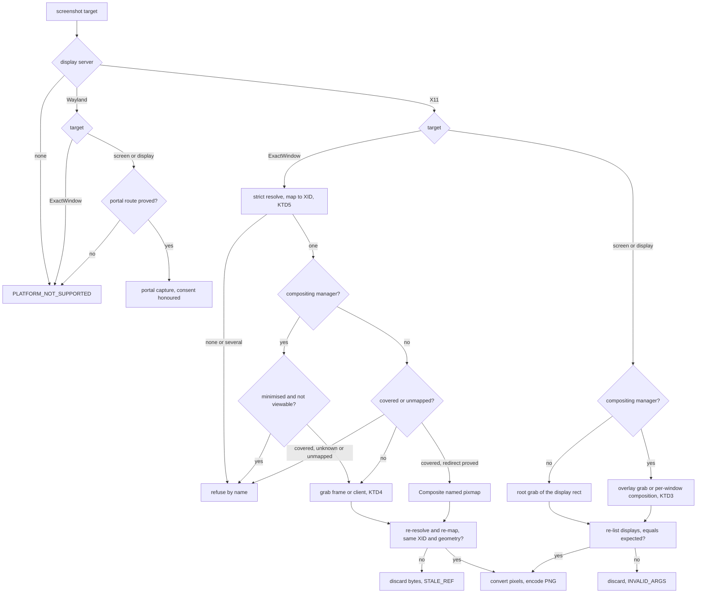
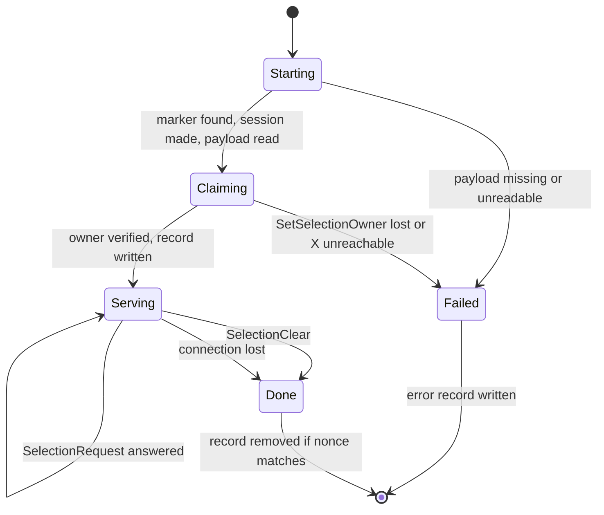

# Linux Capture and Clipboard (Sub-phase 3.10) - Plan

## Goal Capsule

- **Objective:** an agent on a Linux desktop can photograph a window or a display and read, write and clear the clipboard in the three typed shapes (text, image, file paths) through the same commands and envelopes as on macOS and Windows. Every answer is what the desktop actually showed or held, and every case the desktop cannot prove (a covered window under a manager that does not keep its pixels, an ambiguous window, any Wayland window, a missing tool, a consent dialog nobody is attending) is refused by name and never filled with a guess.
- **Means:** X11 capture is a per-window `GetImage` through the `x11rb` pin 3.4 added, encoded by one pinned pure-Rust PNG encoder (KTD2, KTD6); the X11 clipboard is native selection ownership, with the setter handing the selection to a detached helper executable, located beside the running image and shared by the CLI and the FFI library, that serves until another client takes the selection (KTD10); Wayland uses only the routes the box has measured (KTD12, KTD13).
- **Authority:** `docs/phases.md` §3.10 as corrected here (R17). Core's `PlatformAdapter` surface as it stands is fixed: no new target, field or hook is added to `crates/core` or `src/`. The owner is a second binary target of `crates/linux`, so it needs none.
- **Stop conditions:** stop and write the owner item instead of building if a requirement needs a change under `crates/core` or `src/`; if 3.4 lands without the AT-SPI frame to X11 client mapping, the deadline-bounded X11 runner or `list_displays`; if 3.6 lands without the stacking snapshot (KTD4, KTD5 read it); if 3.4 lands without the shared session detector or its `list_displays` and `MonitorReader` do not sit on it (KTD8); if 3.8 lands without the deadline-bounded session-bus connection facility (only U12's one real-bus binding file needs it; the rest of U12 is built over a trait and does not); if the box's two window managers cannot both run in a private session (they do, `L16-2`, `L16-6`); or if `png` fails the size or `cargo deny` gate (KTD6).
- **Execution profile:** U1 first and its ledger rows enter `probes/linux/FINDINGS.md` before U4-U6, U10 and U12 start. U2 after U1. U3 and U4 after U2, in either order. U5 and U6 after U3 and U4. U7 after U4. U8 after U2, independently of capture. U11 after U8 and U2. U9 after U4, U8 and U11. U10 after U8. U16 after U9, U10 and U11. U12 after U1 and U3, gated by U1's Wayland rows. U14 after U5-U7 and U12. U17 after U10, U11 and U16. U15 after U14 and U17. U13 last, because it records the dispositions U14, U15 and U17 produce.
- **Finishes and ships:** the implementer runs the box measurements and the live verification, commits, and opens one PR stacked on `feat/linux-3.9-lifecycle`. Nothing merges to `main`.

### Build status

- Built and merged on this branch: skeleton, lane A (pixels, PNG, X11 grab, Composite redirect, `grab_redirected`), lane C (clipboard formats, detached owner), lane D (X11 read, helper spawn and locate, set, clear, reap). `clipboard-get`, `clipboard-set` and `clipboard-clear` are wired through `adapter.rs` and pass a release-binary check in a private session: `clipboard-set` exits and the owner lives, a second GTK3 process reads the value, `clipboard-get` reads a value another client set, `clipboard-clear` ends the owner, and a foreign client taking the selection ends the owner.
- The helper check refuses a helper writable by others, and one writable by a group unless that group is the caller's own primary group and no other account belongs to it, so a build made under a `0002` umask (mode `0775`, private group) works with no `chmod`, and a helper in a shared group (for example `adm`) is refused. The same rule applies to the helper's directory, except that a sticky directory owned by the caller or root may be writable by others.
- In progress: lane B (window and display capture, `screenshot.rs`, permissions) and lane E (Wayland clipboard and capture, which needs 3.8's session bus). U1 legs 8 and 9 (`L29-18`, `L29-19`) are deferred until a healthy headless Wayland session exists. U13 to U15 and U17 wait for those lanes.
- Ledger: area L29 holds the measured rows (`L29-1` to `L29-19`); the area number was fixed at integration.


---

## Product Contract

### Summary

Ship `screenshot` and the three clipboard commands on Linux. On X11 a window is photographed from its own drawable, the full screen from the route its session type proves correct, and the clipboard is read and owned natively with no `xclip` and no `wl-clipboard`, set from the CLI and from an FFI host alike by a detached owner process that outlives its caller (`L22-9`). On Wayland the sub-phase ships the routes the box measured, and reports every other target as not supported. `PermissionReport.screen_recording` follows what capture can actually do. Core is unchanged.

### Problem Frame

Linux has no capture or clipboard code, and the three obvious shortcuts all fail on the measured box.

Capture: a root-window `XGetImage` returns a stale picture on a compositing session; with a 1000x700 window mapped and unmapped the grab differed by 0.0 and held no blue or red cell (`L9-10`). The per-window grab of a window's own drawable returned the window's pixels while another window sat above it and while it was minimised (`L9-8`, `L9-9`), but every one of those rows is a composited GNOME fact, and the manager planned for private sessions, openbox, does not composite (`L16-6`). The portals do not help headless: a host caller's non-interactive Screenshot ended `Response 2` (`L9-13`), the dialog is invisible to AT-SPI (`L9-14`), and mutter's own ScreenCast handed out a PipeWire node with no consent step but no frame could be read (`L13-21`).

Clipboard: `xclip`, `xsel` and `wl-clipboard` are not on a stock GNOME install (`L1-2`). `xclip` serves one target per process, so a file copy needs two targets and one call replaces the other (`L9-5`); its serving child keeps the caller's stdio and the caller never sees end-of-file (`L9-1`); and every non-text target vanishes when its owner stops (`L9-4`). Because the CLI exits, a setter needs a process that outlives it, and that process needs a stated owner and a stated end: it is ended by another client taking the selection, by the loss of its X connection, or by identity through `clipboard-clear` and a later set. The caller may be the CLI or an FFI host that is not the CLI: an owner inside the host dies with the host, but a detached child keeps serving after the host exits (`L22-9`), so a foreign host is served by the same detached owner and is not refused.

The roadmap's exit text promises a portal dialog that is approved once and then bypassed. A headless session grants with no dialog (`L13-20`), so that sentence cannot be proved without a person, and the plan says so rather than claim it.

### Requirements

**Screenshot**

- R1. On X11, `screenshot` of an exact window returns a PNG of that window's own pixels, taken from the XID that 3.4's AT-SPI to X11 mapping returns. A missing, ambiguous or non-X11 mapping is refused by name, never guessed (`L8-4`, `L8-5`, `L8-7`).
- R2. A covered or minimised window is returned as its own pixels only where the session is proved to keep them (a compositing manager, `L9-8`, `L9-9`) or where a measured route yields them (KTD3); otherwise it is refused with the cause. The covering window's pixels are never returned as the target's.
- R3. Identity is proved before and after every grab: the window is strictly re-resolved and re-mapped to the same XID with the same geometry, and a display still equals the `expected` core pinned. On any change the bytes are discarded and the call fails.
- R4. `FullScreen`, `Screen(n)` and `Display` return the targeted display's actual content. `FullScreen` is the primary display. An out-of-range index is `INVALID_ARGS` with the display count. The route per session type is the one U1 proved (KTD3). `scale_factor` is the owning display's scale as 3.4 reports it.
- R5. `screenshot_window_frame` returns an image whose width and height ratios against `WindowInfo.bounds` agree within core's 0.02 `--debug` check, or refuses. It never returns an image core will reject.
- R6. Pixel conversion follows the visual's masks and byte order, the encoder is the pinned pure-Rust one, and an image over core's byte or pixel cap is refused.
- R7. On Wayland, `ExactWindow` is `PLATFORM_NOT_SUPPORTED`. `FullScreen`, `Screen` and `Display` use a portal route only if U1 proved one (KTD13); a portal refusal is `PERM_DENIED`; otherwise they are `PLATFORM_NOT_SUPPORTED`. No path bypasses the portal's consent.

**Permissions**

- R8. `screen_recording` is `not_required` where X11 capture is reachable and `unknown` where it cannot be determined (Wayland until a request outcome exists, an unreachable display). It is never `denied` without a refusal, and `accessibility` is unchanged.

**Clipboard**

- R9. On X11, `clipboard-get` reads text, a PNG image and file paths natively from the `CLIPBOARD` selection. `Auto` prefers file paths, then image, then text. Absent is `Ok(None)`, an empty text is `Some("")`, reads past one request use INCR, and a payload over the cap is refused (`L9-6`, `L9-7`).
- R10. On X11, `clipboard-set` makes a detached owner serve every target of the payload from one process (`L9-5`), and returns only after a fresh connection sees that owner and its targets, from the CLI and from a foreign FFI host alike (a host process such as Python or Swift, `L22-9`). The command's stdout reaches end-of-file as soon as the CLI exits (`L9-1`).
- R10a. The same set works when the caller is a foreign FFI host (any process that loaded the library and is not `agent-desktop`): the owner is a detached child that survives the host's exit, is found beside the library image and not through `PATH`, and the value is read by an independent reader after the host has exited (`L22-9`). A missing helper beside the image is a named `PLATFORM_NOT_SUPPORTED` that says the helper is absent, never a silent in-process owner.
- R11. The owner has null stdio, its own session, no inherited lock and a pid-and-start-time record under the state root. It exits when another client takes the selection (`SelectionClear`) or its X connection is lost, with no timer, so the clipboard persists until replaced as on macOS and Windows; a second set replaces the first (`L9-2`, `L9-5`).
- R12. `clipboard-clear` leaves `CLIPBOARD` unowned, verified, and ends our owner by recorded identity, never by name.
- R13. On Wayland, clipboard uses `wl-clipboard` only where it is installed and measured: the empty clipboard, a stale or refused socket, a seat with no keyboard and a timeout are distinct actionable errors, clear uses `wl-copy --clear`, and a format with no measured route is `PLATFORM_NOT_SUPPORTED` (`L13-2`, `L13-10`, `L13-11`, `L13-12`). Nothing reads the clipboard through AT-SPI `CopyText` (`L4-24`).
- R14. Display server selection is the one shared session detector 3.4 owns, used by capture, display enumeration, clipboard routing and the permission probe alike: a Wayland socket that connects selects Wayland, a stale `WAYLAND_DISPLAY` with a working `DISPLAY` selects X11, never `XDG_SESSION_TYPE` (`L13-1`, `L13-2`). This sub-phase has no detection of its own (B1).

**Process and proof**

- R15. `crates/core` and `src/` are unchanged, and no shipped source names a plan, phase or decision id.
- R16. Every test fails for a real reason and is invert-verified. Captures are judged by independent PNG pixel statistics against known paint, the clipboard by foreign-producer and foreign-reader round trips, never by `ok:true`. Live tests run only in private sessions and never touch the live display's clipboard.
- R17. `docs/phases.md` states what was built and no longer states what the evidence disproved, the open rows are settled by owner (`L9-17` and `L13-21` measured here; `L13-25` measured by 3.8 and consumed here; `L1-17` stays with 3.15 once 3.8 lands and reassigns it, and this sub-phase does not edit that row), all 28 rows that `scripts/check-linux-findings.py --sub-phase 3.10` lists at the 3.6 head are disposed of (`L1-3` and `L22-9` are not among them), and every owner item is written down.
- R18. A stranger dogfood is run on a private X11 session under each window manager and on a headless Wayland session, and its report goes in the PR description with at least one finding, each disposed of; no report file is committed.
- R19. The release binary stays under 15 MiB and `cargo deny check` passes, both recorded as a ledger row. No performance baseline is run for this sub-phase.

### Acceptance Examples

- AE1. **Covers R2.** Given a non-compositing session where window B sits over window A, when `screenshot` targets A, then the PNG holds A's own paint, or the call is refused naming the cover. A PNG holding B's paint inside A's rectangle is a failure.
- AE2. **Covers R1.** Given two windows with the same pid and title that the mapping cannot separate, when `screenshot` targets one, then the result is `AMBIGUOUS_TARGET` with `not_delivered` and no bytes.
- AE3. **Covers R3.** Given a window that closes after the first resolution and before the second, when `screenshot` returns, then it is an error and no image.
- AE4. **Covers R10, R11.** Given `clipboard-set --file-paths` run with its stdout piped to a reader, then the reader sees end-of-file when the CLI exits, a foreign reader gets both `text/uri-list` and `x-special/gnome-copied-files`, and the recorded owner is alive.
- AE4a. **Covers R10a.** Given a host process that loads the library and calls the set entry point (text through the C ABI, typed payloads through a Rust host of the adapter) and then exits, when an independent reader asks for the clipboard after the host is gone, then it gets the value, the recorded owner is alive, and `clipboard-clear` from another process ends it.
- AE5. **Covers R12.** Given a live owner, when `clipboard-clear` runs, then `GetSelectionOwner` is none, a later `clipboard-get` is absent, and the recorded pid is gone.
- AE6. **Covers R7.** Given a Wayland session, when `screenshot --window-id` runs, then the result is `PLATFORM_NOT_SUPPORTED`, and its suggestion names the screen route only if one shipped.

### Key Decisions

- KD1. **Core stays platform-neutral and Phase 3 is trait implementation only.** (session-settled: user-directed — chosen over adding Linux paths, region or element targets, or a completeness field in core: core is the shared surface.) Governs R15. Anything this sub-phase needs from core is written into `docs/phases.md` for the owner and not built (KTD3's completeness question). The owner process needs nothing from core.
- KD2. **Tests fail for a real reason, and real runs outrank suites.** (session-settled: user-directed — chosen over broad fixture-driven suites: a test that cannot fail guards nothing.) Governs R16. Probe scripts and captures are never committed and never read by a test.
- KD3. **Nothing shipped guesses.** Where evidence is missing the answer is a named refusal or `unknown`. Governs R1, R2, R7, R8, R13.

### Scope Boundaries

Non-goals considered and not built:

- Region or element screenshots: core has no such target (`crates/core/src/screenshot_target.rs`) and Phase 3 does not add one.
- Wayland per-window capture: the portals pick sources by a user dialog and GTK4 reports no global position to crop with (`L13-6`, `L9-15`); no route is measured.
- `org.gnome.Shell.Screenshot`: `AccessDenied` for an unlisted client (`L9-12`).
- Mutter's private ScreenCast API as a product route: it handed out a stream with no consent step (`L13-21`). It is a diagnostic in U1 only, because a tool that records the screen around the portal's consent is the wrong behaviour on a user's desktop.
- The `PRIMARY` selection: core exposes only the clipboard.
- A PNG decoder for clipboard images other than `image/png`, and BMP or other image targets: such a clipboard reads as no image (KTD11).
- A clipboard history, a daemon, or a service for the owner: stateless commands until the daemon phase.
- A confirmation-by-pixel screenshot gate (retry until the window repaints): not asked for, and the identity sandwich covers the failure that can be proved.
- Reading the X11 selection through AT-SPI: `CopyText` writes the user's clipboard (`L4-24`).

### Deferred to Follow-Up Work

- The portal consent leg that needs a person (approve once, later calls bypass the dialog): owner item in `docs/phases.md`, needs a human-attended session (U13).
- - A completeness flag on `ImageBuffer`, needed only if U1 shows a compositing full-screen can be assembled only partially (KTD3): owner item (U13).
- Linux skill text for these commands: 3.13 owns the skill; findings about the shipped text are written into its scope (U13).

---

## Planning Contract

### Key Technical Decisions

- KTD1. **Layout.** New files follow the shared platform layout and each stays under the 400-line cap. Capture: `crates/linux/src/system/screenshot.rs` (target dispatch, dispositions) and `crates/linux/src/system/capture/` (`pixels.rs`, `png_encode.rs`, `window_xid.rs`, `window.rs`, `window_context.rs`, `window_unit.rs`, `window_obstruction.rs`, `display.rs`, `compose.rs`, `fullscreen_route.rs`, `wayland_portal.rs`, `wayland_frame.rs`). X11 primitives: `crates/linux/src/system/x11/` (`grab.rs`, `grab_error.rs`, `grab_rect.rs`, `visual.rs`, `channel_masks.rs`, `byte_order.rs`, `compositing.rs`, `drawable.rs`, `drawable_info.rs`, `map_state.rs`, `composite.rs`), one domain type per file. Clipboard: `crates/linux/src/input/clipboard/` (`formats.rs`, `uri_list.rs`, `targets.rs`, `payload.rs`, `incr.rs`, `x11_read.rs`, `x11_requestor.rs`, `owner_spawn.rs`, `owner_spawn_spec.rs`, `owner_locate.rs`, `owner_signal.rs`, `owner_entry.rs`, `owner_serve.rs`, `owner_request.rs`, `owner_record.rs`, `owner_files.rs`, `set_clear.rs`, `wayland.rs`, `wayland_errors.rs`, `command_runner.rs`); the owner executable is `crates/linux/src/bin/agent-desktop-linux-clipboard-owner.rs`, a thin `main` over `owner_entry.rs`. The root `adapter.rs` (which holds the empty `InputOps` impl today) and `system/adapter.rs` only wire; no `input/adapter.rs` is created. Governs R15.
- KTD2. **X11 capture is a per-window grab of the window's own drawable.** Fixed input: chosen over a root-window grab (stale on composited GNOME, `L9-10`), the `xcap` crate (a second capture stack, not pure Rust on Linux), and the portals (no headless consent, `L13-20`, `L9-13`). The grab is a core-protocol `GetImage` in `ZPixmap`, which needs no extra `x11rb` feature (`x11rb` 0.14.0 `GetImage`). A grab larger than one reply is split into row strips so the bounded thread returns partial progress inside the deadline. Governs R1, R2.
- KTD3. **Covered and full-screen behaviour is decided by session type and settled by U1 measurement; the alternatives are concrete, so there is no competition to run.** Session type is the compositing manager selection `_NET_WM_CM_S<n>` owner (a standard property; present under mutter, absent under openbox), read in one request (`x11/compositing.rs`). The decision table U1 fills and U5 and U6 implement:

  | Session | Own window, uncovered | Covered or minimised | Full screen or display |
  |---|---|---|---|
  | Compositing (`gnome-shell --x11`) | direct grab (`L9-8`, `L9-9`) | covered: direct grab, since the manager keeps the window's pixels; minimised: direct grab only if U1 shows the window stays viewable (`GetImage` on an unmapped window is `BadMatch`), else refuse | the first of: Composite overlay-window grab, per-window composition, whichever U1 shows equals known paint |
  | No compositing (openbox) | direct grab | covered: Composite `RedirectWindow` plus `NameWindowPixmap`, which returns the window's own pixels (`L29-10`), polled for non-blank because the first read can be blank (`L29-11`); minimised (unmapped): refuse | root grab, which U1 expects to be exact |

  A per-window composition lacks everything the manager draws on its own stage (wallpaper, shell chrome). If the overlay route fails and composition is the only option, it ships only if U1 shows the missing area is exactly the area no X window owns, the fill is a flat neutral colour, and the limitation is an owner item (core's `ImageBuffer` cannot say "partial", KD1); if that cannot be stated honestly, a compositing full-screen is refused with `PLATFORM_NOT_SUPPORTED` and `--window-id` stays the working route. `x11rb` features `composite` (pulls `xfixes`) is added only if a Composite route is chosen. No head-to-head build of the options is warranted: they are small and concrete, the answer is a measurement, and reversing it touches one module. Governs R2, R4.
- KTD4. **A window screenshot captures the rectangle `WindowInfo.bounds` describes.** AT-SPI bounds include the title bar on GTK3 (`L8-5`: y is the client's y minus the top frame extent, height plus it), and core's `--debug` capture rejects an image whose width and height ratios against the bounds differ by more than 0.02 (`src/visual_debug/capture.rs`). A client-only grab of a 700-pixel window with a 37-pixel title bar is off by 0.05 and is rejected, so the unit is chosen by rule: the window manager's frame window (the client's `QueryTree` parent, when it is not the root) if its size passes a stricter 0.01 ratio check against the bounds, else the client drawable if that passes, else `screenshot` still returns the frame image (core runs no alignment check on it) while `screenshot_window_frame` returns `ACTION_FAILED` rather than an image core would reject. `WindowInfo.bounds` is filled from the client origin by `place_windows` for a toolkit with no global position (GTK4) and is `None` when the window maps to no single client; with `None` bounds `screenshot` returns the frame image and `screenshot_window_frame` is `ACTION_FAILED`. U1 filled the pairs: on openbox GTK3 passes on the frame and GTK4 and Chromium on the client (`L29-15`); under `gnome-shell --x11` Chromium passes on the client and GTK3 and GTK4 pass on neither, so `screenshot_window_frame` is `ACTION_FAILED` for GTK there (`L29-16`); Qt is unmeasured (`L29-17`). Governs R5.
- KTD5. **The target is found by mapping and never guessed; identity brackets the grab.** The XID comes from 3.4's pid-and-title mapping with the extents tie-break (`ClientMatch::One` is the only success). No window-to-XID helper exists at the 3.6 head, and `stacking::frame_window_state` is not it: it folds `Several`, `NoClient` and a missing manager into `None` and runs a stacking read. `window_xid.rs` finds the listed window by id (`window_ops::windows_of` over `registry::read_registry`; `ListedWindow.frame` is the `FrameFacts`), reads the managed clients through `StackingSource::clients_within` on `DisplayReader` (`X11State::{Unavailable, NoWindowManager, Ready}`, which is what separates the codes below) and applies `match_client`. `Several` is `AMBIGUOUS_TARGET`; `NoClient` with a window manager is `ACTION_FAILED` naming the cause; no window manager, a Wayland session or an unreachable display is `PLATFORM_NOT_SUPPORTED`. Before the grab the window is strictly re-resolved (3.4's `resolve_window_strict`) and mapped; after the grab both are repeated and the XID and the frame geometry must be unchanged, and on a non-compositing session the stacking snapshot is read again and the obstruction check re-run (a popup can appear between the check and the grab; if anything now overlaps or the answer is unknown, the bytes are discarded and the call is `ACTION_FAILED` with reason `covered`) (XIDs recur across processes, `L8-7`; the strict resolver checks the window id, the pid and the process instance and does not compare the title, so the title enters through the pid-and-title mapping that runs again after the grab, and the two together make "same XID" mean "same window"). Obstruction on a non-compositing session reads 3.6's stacking snapshot, `StackingSource::read_within(target_client, deadline)` returning `StackingRead::{Ready, NotX11, NoManager, Unavailable}`: `StackingSnapshot { current_desktop, stack (bottom to top), override_redirect_above, override_redirect_receiving }` over `StackedWindow { id, flags: WindowFlags { hidden, above, mapped }, desktop: DesktopPlacement, kind, client, extents }`, all rectangles in root coordinates. It is read against the whole target rectangle; 3.6's occlusion work is point-based, so rectangle coverage is new logic in `window_obstruction.rs`. When the snapshot is unavailable or the answer is unknown (an override-redirect window of unknown extent, no stacking property), the capture is refused: returning stale or covering pixels is worse than a refusal. The toolkit fact the mapping's tie-break needs comes from the app behind the window id through 3.4's toolkit classifier, since `ScreenshotTarget::ExactWindow` carries only a `WindowInfo`; the frame window comes from a `QueryTree` read this plan adds (`x11/drawable.rs`), because 3.4's client record has none. Governs R1, R2, R3.
- KTD6. **PNG is `png =0.18.1`, default features off, `Compression::Balanced`.** Fixed input: one pinned pure-Rust encoder, rejected if it fails size or `cargo deny`. Evidence from a scratch crate on the Mac with this workspace's release profile (`opt-level z`, `lto`, `codegen-units 1`, `strip`, `panic abort`): `png` adds 49.9 KB and `x11rb` with `randr` adds 67.5 KB to a 286 KB hello-world, so the pair is about 117 KB against a 15 MiB cap. `cargo-deny` 0.19.6 run with this repo's `deny.toml` against that crate, with `--all-features` and with the default set, reports advisories, bans, licenses and sources ok; `zlib-rs` (licence `Zlib`) appears in the lock as an optional dependency of `flate2` but is not in the built tree and is not flagged; `miniz_oxide` is `MIT OR Zlib OR Apache-2.0` and passes through its allowed branches. The resolved tree adds about nine crates (`bitflags`, `crc32fast`, `cfg-if`, `fdeflate`, `simd-adler32`, `flate2`, two `miniz_oxide` versions, `adler2`). `Compression::Fast` is rejected: on a 1280x800 synthetic UI-like frame it produced 1,001,112 bytes against 19,869 for `Balanced`, at 33.2 ms against 37.7 ms (min of seven). The binary size is identical for both because both paths are linked. A hand-rolled stored-deflate encoder is rejected: a 1280x800 frame would be about 4 MB of base64. The release-build number on the box and the workspace `cargo deny check` are the gates (U2), not the Mac figures. A direct `rustix =1.1.5` dependency with features `process` and `fs` (already in the lock through `x11rb`; 3.9 pins the same crate with `default-features = false` and `std`, `process` on the same manifest line, so the merged line is `std`, `process`, `fs`) is added for `setsid`, `pidfd_open`, signalling through a pidfd and `memfd_create`, all safe functions there; the sub-phase's one `unsafe` block is the lease-descriptor helper in KTD10, which the workspace lints permit (the image lookup is safe, parsed from `/proc/self/maps`). Governs R6, R19.
- KTD7. **Pixels are converted from the visual, not assumed.** `visual.rs` reads the screen's root and the window's visual: depth, red, green and blue masks, `bits_per_pixel`, scanline padding and the connection's `image_byte_order`. Only 24 and 32 bits per pixel, 8 bits per channel `TrueColor` is converted (the alpha or pad byte is dropped, so a depth-32 window's rounded corners read as opaque); anything else is `ACTION_FAILED` naming the visual. Conversion is a pure function over bytes, masks and order. Governs R6.
- KTD8. **Display-server choice comes from the shared session detector 3.4 owns.** This sub-phase carries no detector of its own. The detector decides by a connectable socket and not by the variable alone: a Wayland socket that connects selects Wayland; a stale `WAYLAND_DISPLAY` whose socket is missing or refused, with a working `DISPLAY`, selects X11; `DISPLAY` alone selects X11; neither is none; it never reads `XDG_SESSION_TYPE` (`L13-1`); and its answer carries the missing-versus-refused reason that R13's error taxonomy needs (`L13-2`). It is `system/display_server.rs`: `session_server()` returns `DisplayServer::{Wayland, X11(display), Unavailable(Unavailable { cause, detail })}` with `Cause::{NotConfigured, Missing, Refused}`, and the X11 name is already through `canonical_display`. `NotConfigured` carries an empty detail, so the message that names both variables is this sub-phase's own, built through `display::unreachable` (made `pub(crate)`, a one-word edit). Its consumers already sit on it (`DisplayReader`, `MonitorReader`, `list_displays` and the stacking `route`), and this sub-phase's capture, display resolution, clipboard routing and permission probe call it, so a full-screen capture never enumerates displays by one route and grabs by another (B1). The reason is present at the 3.6 head, so the stop condition does not fire. Governs R14.
- KTD9. **X11 clipboard reads are a requestor on a bounded thread.** A reader connection makes a one-pixel `InputOnly` window with `PropertyChange` selected, asks `CLIPBOARD` for `TARGETS`, picks the wanted target by format, converts it, and follows INCR. It runs on 3.4's bounded runner exactly as it stands: `x11::start` takes any `Send` closure and `PendingRead::finish(deadline)` is `None` on a timeout. The closure returns `Result<T, MonitorFault>`; `MonitorFault` (`Denied`, `Unreachable`, `Unreadable`, built by `fault_of_connect`) already separates a refused connection from an address nobody answers, and a `None` from `finish` is the timeout, so KTD15's codes can be told apart with no edit to `bounded.rs` (which 3.9 also edits). It is bounded because a blocking X round trip ignores a `Deadline`. A selection owner that never answers is `TIMEOUT` naming the owner's `_NET_WM_PID` when it has one. Target choice by format: Text takes `UTF8_STRING`, then `text/plain;charset=utf-8`, then `text/plain`, then `STRING` decoded as Latin-1 (invalid UTF-8 is `ACTION_FAILED`, never lossy); Image takes `image/png`; FileUrls takes `text/uri-list`, then `x-special/gnome-copied-files`. `Auto` walks FileUrls, Image, Text against the `TARGETS` list. Governs R9.
- KTD10. **The X11 setter hands the selection to a detached helper executable that sits beside the running image.** Fixed input: native ownership through `x11rb`, no `xclip` subprocess (`L1-2`, `L9-5`), chosen over an in-process serving thread (it dies with its host, `L22-9`), a `fork` (needs `unsafe`), and a long-lived service (a later phase). The same owner serves the CLI and every FFI host, which is parity with macOS and Windows: macOS finds a helper beside the library image and Windows writes in-process, so neither refuses a foreign host; the earlier draft's refusal under a non-CLI host was a design choice that the measured platform does not force (`L22-9`: an owner inside the host dies with the host, a detached child keeps serving after the host exits). Shape:
  - **Model, with the rejected alternative.** Chosen: a dedicated helper binary, `agent-desktop-linux-clipboard-owner`, a second `[[bin]]` of `crates/linux` whose `main` calls `owner_entry.rs` and nothing else, discovered beside the image that holds the adapter code, the way macOS discovers `agent-desktop-macos-helper` (`crates/macos/src/input/clipboard_helper_dl.rs`, `crates/macos/src/bin/agent-desktop-macos-helper.rs`). Rejected: self-re-exec of the CLI binary through the `run_cursor_overlay_child` hook. Evidence: (1) a cdylib loaded by Python or Swift has no CLI to re-execute, `/proc/self/exe` is the interpreter, and the hook exists only in `src/main.rs`, so self-re-exec cannot serve an FFI host at all; (2) exec of an `agent-desktop` shipped beside the library would force the whole CLI into the FFI archive and still needs the hook; (3) a helper that owns its own `main` needs no core hook, which removes the cursor-overlay naming conflict and the owner item that asked core to rename it; (4) the CLI and the FFI library then share one locate-and-spawn path and one artifact, so 3.13 packages one extra file. Cost: one more small executable (it links `x11rb` and the framing code only, no `png`, no `zbus`) in the CLI archive, the FFI archive and the npm package; that cost is handed to 3.13 (below).
  - **Locate.** `owner_locate.rs` finds the image that contains the adapter code by reading `/proc/self/maps` for the mapping holding the address of one of its own functions (safe Rust, no `dladdr`). In the CLI that image is `agent-desktop`; in an FFI host it is `libagent_desktop_ffi.so`. The helper is the file named `agent-desktop-linux-clipboard-owner` in the same directory; the image path is canonicalised once and the helper must be a regular file, executable, owned by the current user or root and not group or world writable, else `PLATFORM_NOT_SUPPORTED` naming the missing or unsafe helper (never found through `PATH` or the current directory, `docs/solutions/logic-errors/a-path-resolved-tool-is-not-the-tool-you-measured.md`). The helper checks a build identity the parent passes in the environment and refuses to run on a mismatch, so a stale helper left beside a newer library fails closed; macOS does the same with `BUILD_IDENTITY`.
  - **Entry.** Every module is private to the crate, so `lib.rs` re-exports one function for the helper's `main` (`pub use input::clipboard::owner_entry::run_from_env as clipboard_owner_from_env`, the macOS pattern in `crates/macos/src/lib.rs`), and the `[[bin]]` stanza follows macOS's (`name`, `path = "src/bin/agent-desktop-linux-clipboard-owner.rs"`). The helper `main` runs the owner when the marker `AGENT_DESKTOP_SELECTION_OWNER=<protocol generation>` and the build identity match, and otherwise exits with a usage error and a non-zero status. `LinuxAdapter` does not override `run_cursor_overlay_child`; `crates/core` and `src/` are not involved.
  - **Spawn.** The parent runs the located helper with stdin, stdout and stderr on `/dev/null`, no `process_group` (so the child is not a group leader and can call `rustix::process::setsid` itself, the safe route that needs no `pre_exec`), and a scrubbed environment. The lease descriptors core opens are close-on-exec (`crates/core/src/private_file.rs`), but a descriptor inherited through `AGENT_DESKTOP_INTERACTION_LEASE_FD` is duplicated without that flag (`crates/core/src/file_lock.rs`, `duplicate_inheritable`) and stays open until adopted, which a clipboard set may never do. The spawn therefore sets close-on-exec on the descriptor the variable names and removes the variable; a raw descriptor number can only be borrowed with `unsafe`, so one small helper in `owner_spawn.rs` first checks the number with `F_GETFD` and then does the borrow, and is the only `unsafe` in the sub-phase, so the owner holds no lock and a second CLI can take the lease while it lives. A foreign host has no such variable and the step is a no-op there. The helper must not inherit the host's other descriptors: only the payload descriptor is passed, every other descriptor above 2 in the child is close-on-exec by construction.
  - **Payload hand-off.** The payload goes through an anonymous in-memory file (`memfd_create`, close-on-exec cleared on that one descriptor, which the setter owns, so no `unsafe` is needed), its number passed in `AGENT_DESKTOP_SELECTION_PAYLOAD_FD`; the owner reads it to the end and closes it before it claims the selection. Nothing secret is ever on disk, so a crashed setter leaves nothing to orphan or sweep. Chosen over a payload file in the state root (clipboard contents would sit on possibly persistent storage and need a crash sweep), a stdin pipe (stdio is null, `L9-1`) and an environment variable (size, process listings). The record (below) is the only file, and it holds no payload.
  - **Handshake.** The owner creates its window, takes a server timestamp, calls `SetSelectionOwner`, checks `GetSelectionOwner` names its window, and then writes its record (pid, start-time token from 3.4's `process_facts`, display, window id, nonce) atomically; on failure it writes the nonce with an error. The parent polls for the nonce with a deadline-bounded backoff, then verifies independently from a fresh connection that the owner is that window and `TARGETS` lists every served target. An early child exit is detected through the `Child` handle. On a handshake timeout the parent kills the child through that handle and re-reads the selection owner; the disposition is uncertain unless the kill was confirmed before any claim.
  - **Serving.** One process serves every target of the payload (`L9-5`): `TARGETS`, `TIMESTAMP`, then by payload: text serves `UTF8_STRING`, `text/plain;charset=utf-8`, `text/plain` and `STRING` when every character fits Latin-1; an image serves `image/png`; file paths serve `text/uri-list` (CRLF-terminated, percent-encoded `file://` URIs) and `x-special/gnome-copied-files` (`copy`, a newline, the URIs). Requests above one property use INCR. Unknown targets are refused with `property=None`. `SelectionClear` or a connection error ends the process.
  - **Lifetime.** The owner serves until another client takes the selection (`SelectionClear`, which a second set, `clipboard-clear` and any application's own copy all produce) or its X connection is lost because the display went away. There is no timer, so the clipboard persists until replaced, in parity with macOS and Windows. Orphan safety does not rest on a timer: the owner has its own session and null stdio, so it holds no terminal, pipe or lease; it is bound to its X connection, so it cannot outlive its X server; its record carries the start-time token, so `clipboard-clear` and a later set end exactly that process by identity; and a stale record is never signalled. Chosen over a fixed lifetime, which would silently empty the clipboard under an idle agent and diverge from the other platforms, and over "until the session ends" (core has no end hook). GNOME's shell takes text and image selections when the owner exits (`L9-3`), but non-text targets are gone once the owner stops (`L9-4`), so file paths need the live owner and this is not relied on for any format.
  - **Record and cleanup.** The state root is `agent_desktop_core::session::agent_desktop_dir()`, the public accessor (the Windows overlay spawn uses it); core's `private_file` helpers are `pub(crate)`, which is why `owner_files.rs` exists. `<state root>/clipboard/owner-<normalised DISPLAY>-<nonce>.json`, private (one record per owner, so a second setter never overwrites the record of the owner it is about to replace; the display is normalised so `:0` and `:0.0` agree). A record is live only if the start time parsed from `/proc/<pid>/stat` (3.4's `parse_start_time`, not the wider process-facts scan) still matches; a mismatch is stale and is never signalled, so a recycled pid is safe. `clipboard-clear` and a later set stop a live recorded owner after the selection is released, by opening a pidfd first, checking the start time of that pid, and signalling through the pidfd (`owner_signal.rs`, local to this sub-phase: it imports nothing from 3.9's `signal.rs`, and an owner item merges the two after the stack lands), so a pid reused between the check and the signal cannot be hit; where `pidfd_open` is unavailable (kernel older than 5.3) nothing is signalled and the owner ends by `SelectionClear` or the loss of its X connection. The record is keyed by display so a private test display and the live display never share a record. An owner removes its own record on exit only when the nonce still matches.
    The environment the owner receives is an allowlist: `DISPLAY`, `XAUTHORITY`, `XDG_RUNTIME_DIR`, `AGENT_DESKTOP_HOME`, `HOME`, the marker, the build identity and the payload descriptor variable; everything else is dropped. Under an FFI host the caller's `DISPLAY` is the host process's, which a host may have changed or unset; the owner takes the display the setter resolved through the shared detector, passed explicitly in the allowlist, and never its own environment lookups. Testability: the command builder returns a recording spec of program, stdio and environment (std's `Command` does not expose them), signals go through an injected signaller, and the sweep takes an injected clock. Governs R10, R11, R12.
- KTD11. **Typed formats and their limits.** Paths cross the trait as local filesystem paths, not URIs (`crates/core/src/commands/clipboard_set.rs` validates they exist). Reading `text/uri-list` accepts `file:` URIs with an empty or `localhost` host, percent-decodes UTF-8, skips comment lines and non-file or remote-host entries, and treats a list with no usable entry as no file paths; an invalid percent sequence is `ACTION_FAILED`. An image is read and written as `image/png` bytes passed through (core already validates the PNG on set); an owner offering only another image type reads as no image. The payload cap is core's `MAX_PNG_INPUT_BYTES` (64 MiB) for every format. Governs R9.
- KTD12. **Wayland clipboard is `wl-clipboard`, the only measured route, behind one module.** Fixed input: the roadmap scope names `wl-clipboard`, mutter offers no data-control protocol (`L13-13`) so a pure-Rust client cannot take the selection, and `L13-10` shows `wl-copy` and `wl-paste` working with a keyboard seat. The tools are resolved to an absolute path and their version recorded where measured (`docs/solutions/logic-errors/a-path-resolved-tool-is-not-the-tool-you-measured.md`). `wl-copy` forks a server by default and the server keeps the inherited pipes (the `L9-1` shape), so a set runs it with null stdio and waits for the parent process to exit, or runs `--foreground` and kills it after the clipboard is verified, whichever U1 shows keeps the selection; a runner that read to end-of-file would hang. A bounded runner (`command_runner.rs`) starts them with null stdin/stderr as needed, a captured-and-capped stdout, and kills the child at the deadline; a fake runner makes the taxonomy testable. Mapping: `rc 1` with "Nothing is copied" is `Ok(None)`; "This seat has no keyboard" is `ACTION_FAILED` with a distinct reason and suggestion (`L13-11`); "No such file or directory" is a missing socket and "Connection refused" a refused one, each distinct (`L13-2`); a timeout kills the child and is `TIMEOUT`; a missing binary is `PLATFORM_NOT_SUPPORTED` naming the `wl-clipboard` package. Clear is `wl-copy --clear`. `wl-copy` serves one MIME type per call, so on Wayland a file-path set offers `text/uri-list` only, and a format with no measured round trip stays `PLATFORM_NOT_SUPPORTED` until U1 measures it. When the Wayland route is selected, the `wl-clipboard` tools are missing and `DISPLAY` is set (Xwayland), the clipboard falls back to the native X11 route only if U1 leg 7 shows the bridge works in both directions (an Xwayland owner read by `wl-paste`, a `wl-copy` owner read by an X11 requestor); if it does not, the missing tool stays an install message and `docs/phases.md` records the bridge result as the reason. **Conflict call-out:** one reading of the roadmap's instruction "no `xclip`/`wl-clipboard` subprocess" would drop this module; it was kept because it is the only Wayland clipboard route the ledger has measured. If the owner rules it out, U11 is deleted and Wayland clipboard becomes `PLATFORM_NOT_SUPPORTED` with no other change. Governs R13.
- KTD13. **Wayland capture goes through the portal's consent, or is not supported.** Candidate routes, tried in this order by U1 in a private headless session, the first that returns a PNG judged by pixel statistics twice winning: (a) the portal `Screenshot` v2 (a file URI, no PipeWire; `L9-15`), cropped to a display's bounds by decoding and re-encoding with the pinned crate; (b) the portal `ScreenCast` plus a frame read by `gst-launch-1.0 pipewiresrc` with the portal's PipeWire file descriptor inherited (the descriptor's close-on-exec flag cleared with `rustix`, no `pre_exec`), `videoconvert` and `pngenc`, with a session manager present in the private session so the `L13-21` failure is isolated rather than repeated. A route that works headless is implemented in U12 with portal `Response` codes mapped (0 granted; 1 or 2 `PERM_DENIED`; absent portal `PLATFORM_NOT_SUPPORTED`) and the dialog-only legs left to the owner item. Every target U12 enables needs a recorded, authoritative mapping from the requested display to pixel bounds (the portal's ScreenCast position and size may be in compositor coordinates, and Screenshot returns the whole desktop); a target without that proof is `PLATFORM_NOT_SUPPORTED`. If neither route yields a frame, U12 ships only the refusal and the ledger rows say what was tried. Mutter's `org.gnome.Mutter.ScreenCast` is used in U1 only to tell a broken pipeline from a broken portal. A stored `restore_token` for "approve once" is plumbed only if the headless probe shows the portal returns one. Governs R7.
- KTD14. **`screen_recording` follows capture availability.** Fixed input: the Windows precedent (`crates/windows/src/system/permissions.rs` reports `not_required` where capture works). X11 with a connection that answers within the deadline is `NotRequired`; Wayland, an unreachable display or no display is `Unknown` (the permission is a portal request outcome, `L9-16`). Core's gate blocks only `Denied` (`src/command_policy/mod.rs`), so `Unknown` lets `screenshot` through to the adapter, and the adapter itself returns `PLATFORM_NOT_SUPPORTED` for every Wayland path with no proved route; `Denied` is never produced without a refusal. The probe is a bounded connection and shares the thread runner. Governs R8.
- KTD15. **Error and disposition mapping.** Every failure maps to an existing `ErrorCode` and a `DeliverySemantics`; no new code is introduced. `AdapterError::new` and `timeout` leave the disposition `Unknown`, so every row sets its disposition explicitly and a test asserts each; a custom `PLATFORM_NOT_SUPPORTED` uses its own message, never `AdapterError::not_supported(method)`, so core's `is_default_not_supported` does not read it as "fall through".

  | Method | Condition | Code | Delivery |
  |---|---|---|---|
  | `screenshot` | `ExactWindow` without `process_instance` | `INVALID_ARGS` | not delivered |
  | `screenshot` | window not resolvable before or after the grab | the strict resolver's own code | not delivered |
  | `screenshot` | mapping finds several X11 clients | `AMBIGUOUS_TARGET` | not delivered |
  | `screenshot` | mapping finds none, a manager exists | `ACTION_FAILED` | not delivered |
  | `screenshot` | no manager, Wayland, or no display | `PLATFORM_NOT_SUPPORTED` | not delivered |
  | `screenshot` | identity or geometry changed across the grab | `STALE_REF` | not delivered |
  | `screenshot` | covered under a non-compositing manager, no own-pixels route | `ACTION_FAILED` with reason `covered` | not delivered |
  | `screenshot` | minimised and the session cannot read it | `INVALID_ARGS` (Windows parity) | not delivered |
  | `screenshot` | window viewable but not wholly on screen and the session cannot read it (`GetImage` returns `BadMatch` for it too) | `ACTION_FAILED` with reason `off_screen` | not delivered |
  | `screenshot` | display index out of range, or display differs from `expected` | `INVALID_ARGS` | not delivered |
  | `screenshot` | visual not convertible, or image over the cap | `ACTION_FAILED` | not delivered |
  | `screenshot` | portal refused | `PERM_DENIED` | not delivered |
  | `screenshot` | deadline | `TIMEOUT` | not delivered |
  | `screenshot` | encoder failure | `INTERNAL` | not delivered |
  | `get_clipboard_content` | no owner, target absent, no usable entry | `Ok(None)` | none |
  | `get_clipboard_content` | owner never answers | `TIMEOUT` | not delivered |
  | `get_clipboard_content` | malformed payload, invalid UTF-8, over the cap | `ACTION_FAILED` | not delivered |
  | `get_clipboard_content` | no display variable | `PLATFORM_NOT_SUPPORTED` | not delivered |
  | `set_clipboard_content` | image metadata disagrees with its PNG | `INVALID_ARGS` | not delivered |
  | `set_clipboard_content` | owner could not start, or exited before claiming | `ACTION_FAILED` | not delivered |
  | `set_clipboard_content` | no handshake before the deadline | `TIMEOUT` | uncertain unless the kill preceded any claim |
  | `set_clipboard_content` | helper beside the image is missing, not a regular file, or unsafe (not owned by the user or root, or group or world writable) | `PLATFORM_NOT_SUPPORTED`, naming the helper | not delivered |
  | `set_clipboard_content` | helper build identity differs from the parent's (stale helper beside a newer image) | `ACTION_FAILED`, naming both identities | not delivered |
  | `set_clipboard_content` | payload over the cap | `INVALID_ARGS` | not delivered |
  | `set_clipboard_content`, `clear_clipboard` | no display variable, or the display unreachable | `PLATFORM_NOT_SUPPORTED`, `ACTION_FAILED` | not delivered |
  | `set_clipboard_content` | verification from a fresh connection failed, or ownership lost mid-set | `APP_UNRESPONSIVE` (Windows parity) | delivered unverified |
  | `clear_clipboard` | another client re-owned within the deadline | `APP_UNRESPONSIVE` | delivered unverified |
  | any Wayland clipboard call | tool missing, seat without keyboard, socket missing or refused, timeout | per KTD12 | not delivered |

  A failed write is not an undelivered write: once the owner has claimed the selection the previous clipboard is gone, so only failures before the claim are `not_delivered` (the Windows rule, `docs/plans/2026-08-09-001-feat-windows-capture-clipboard-plan.md`). Governs R1-R13.
- KTD16. **Seams make the logic testable without a display, and real runs prove the rest.** The X11 side is a trait returning plain records (3.4's shape), so mapping, obstruction, composition, unit choice and target selection take values. The owner's request handling and INCR chunking are pure state machines. The Wayland tools sit behind a command-runner trait. A test never uses its own process as the owner (`docs/solutions/best-practices/a-test-that-acts-on-its-own-runner-acts-on-every-other-test.md`); live tests start the owner as a child and stop it by recorded identity. Governs R16.

### High-Level Technical Design

Routing for `screenshot`:



Setting the clipboard on X11:

```mermaid
sequenceDiagram
  participant CLI as agent-desktop or FFI host (setter)
  participant FS as state root (0700)
  participant OWN as owner helper (beside the image)
  participant X as X server
  CLI->>CLI: payload into anonymous memfd, nonce
  CLI->>OWN: spawn helper beside the image, marker and build identity env, null stdio, no lease
  OWN->>OWN: setsid
  OWN->>OWN: read payload from inherited memfd
  OWN->>X: create window, timestamp, SetSelectionOwner
  OWN->>X: GetSelectionOwner is me?
  OWN->>FS: write record (pid, start token, window, nonce)
  CLI->>FS: poll for nonce (deadline)
  Note over CLI,OWN: on timeout: kill child, re-read owner
  CLI->>X: fresh connection: owner is that window? TARGETS complete?
  CLI-->>CLI: return; the CLI or the host may now exit, stdout closes
  X-->>OWN: SelectionRequest (any client, any target)
  OWN->>X: property + notify (INCR when large)
  X-->>OWN: SelectionClear, or connection lost
  OWN->>FS: remove record if nonce matches, exit
```

Owner lifecycle:



### Assumptions

- 3.9's process model matches the shape its design calls for: spawned children get null stdio and a new session through safe code. The owner is a separate executable, so it depends on no core hook and no override in 3.9.
- 3.13 packages the owner helper next to `agent-desktop` in the CLI archive, next to the library in the FFI archive, and in the npm package (U13 writes this into 3.13's scope); until it does, an FFI host without the helper gets the named `PLATFORM_NOT_SUPPORTED` of R10a.
- The window manager planned for private sessions is openbox from the extracted tree (`L16-6`) and `gnome-shell --x11` runs rootless in a private Xvfb (`L16-2`); both are available to U1, U14 and U15.
- 3.6's stacking snapshot is as KTD5 names it: managed windows bottom to top with `flags` (hidden, above, mapped), `desktop`, `kind`, the client rectangle and the frame extents, and the mapped override-redirect rectangles above the target client. The 3.6 head is the base this plan is checked against (`846f32c5`).
- `L22-9` names a probe row that 3.13 staged outside `probes/linux/FINDINGS.md`; it is not in the ledger at the 3.6 head. Every `L22-9` citation here means U1 leg 6's own row, which repeats the measurement (a detached child survives the host's exit), and U13 rewrites the citations to that row's id.
- `FullScreen` is the primary display (`DisplayInfo.is_primary`, else index 0), matching Windows's index 0.
- A minimised window the session cannot read is `INVALID_ARGS`, matching the Windows code for the same condition, so agents see one behaviour across platforms.
- `scale_factor` is the owning display's `scale` as 3.4 reports it (Mutter's value on GNOME); multi-monitor and mixed-scale are unmeasured and stated so.
- A parked owner costs one idle process per X display and is replaced by each set; no test or dogfood run leaves one running, because each stops its recorded owners by identity.
- Test apps for toolkits are the ones 3.6's live tests use (a GTK3 app, GTK4 Files or Calculator, a Qt app, Chromium) plus painter windows made with `x11rb` in the test.
- A `DISPLAY` set alongside a live `WAYLAND_DISPLAY` (Xwayland) selects Wayland (KTD8).
- The box's stock install lacks `xclip` and `wl-clipboard` (`L1-2`); live tests use the copies under the user-space tools tree as foreign producers and readers, never as the product's route.

---

## Implementation Units

### Shared files with the parallel sub-phases

3.10 needs no code from 3.7, 3.8 or 3.9 except U12's one binding file (3.8's `SessionBus`). It reads 3.6 (stacking snapshot, `DisplayReader`) and 3.4/3.5 code that is in the base. Paths are under `crates/linux` and are checked at the 3.6 head. Every shared file takes a minimal edit so a rebase conflict is a union of lines:

| File | Also edited by | 3.10 edit |
|---|---|---|
| `Cargo.toml` | 3.8 (`x11rb` feature `xtest`), 3.9 (`rustix` line) | add `png =0.18.1` (default features off); the `rustix` line becomes `std`, `process`, `fs`; add `composite` to the `x11rb` features only if U1 chooses a Composite route; add one `[[bin]]` for the owner |
| `../../Cargo.lock` | 3.8, 3.9 | regenerate after the rebase; never merge by hand |
| `src/lib.rs` | none known | one line, `pub use input::clipboard::owner_entry::run_from_env as clipboard_owner_from_env;` |
| `src/adapter.rs` | 3.7 (actions), 3.8 (`InputOps` body) | the empty `impl InputOps for LinuxAdapter {}` gains `get_clipboard_content`, `set_clipboard_content`, `clear_clipboard`, each one delegating line; 3.8 adds `mouse_event`, `key_event`, `drag` to the same block (a union of methods) |
| `src/system/adapter.rs` | 3.8, 3.9 (many methods) | `SystemOps` gains `screenshot` and `screenshot_window_frame`, each one delegating line |
| `src/system/mod.rs` | 3.8, 3.9 | `mod route;`, `pub(crate) mod capture;`, `mod screenshot;` |
| `src/system/x11/mod.rs` | 3.9 | the new X11 modules (`mod grab;` and the rest of KTD1's list) |
| `src/system/display.rs` | none known | `unreachable` becomes `pub(crate)` |
| `src/system/permissions.rs`, `permissions_tests.rs` | none known | U7 |
| `src/input/mod.rs` (empty now) | 3.8 | `pub(crate) mod clipboard;` |

Not shared: `crates/core`, `src/` of the repository root, `crates/ffi`, `deny.toml` (the KTD6 licences all pass the current allow list), `x11/bounded.rs` (3.9 edits it; 3.10 does not). `docs/phases.md` and `probes/linux/FINDINGS.md` are edited by every sub-phase and conflict by hunk: 3.10's text stays inside §3.10, §3.13 and the rows it adds.

### Implementation lanes

Five lanes with disjoint file ownership, plus integration (lane I). Lane I lands the skeleton first: every new file as a compiling stub (`PLATFORM_NOT_SUPPORTED`, `None` or `Unknown`, no `todo!`), all `mod` lines, all adapter wiring, the manifest edits and the real `route.rs` (U2), in one commit. After it the shared files above are frozen; a lane overwrites only the stubs it owns. Stub items carry `#[expect(dead_code, reason = "stub the owning lane replaces")]` until their first caller lands.

Frozen interfaces (signatures; a change is a message to lane I, who edits the stub):

```rust
// I: system/route.rs (real)
pub(crate) enum Route { X11(String), Wayland }
pub(crate) fn resolve(server: DisplayServer) -> Result<Route, AdapterError>;
pub(crate) fn current() -> Result<Route, AdapterError>;

// A: system/capture/pixels.rs, png_encode.rs
pub(crate) struct VisualFormat { red_mask: u32, green_mask: u32, blue_mask: u32, bits_per_pixel: u8, depth: u8, scanline_pad: u8, msb_first: bool }
pub(crate) fn to_rgb(format: &VisualFormat, data: &[u8], width: u32, height: u32, stride: usize) -> Result<Vec<u8>, AdapterError>;
pub(crate) const MAX_PIXELS: u64 = 64 * 1024 * 1024;
pub(crate) fn encode_png(rgb: &[u8], width: u32, height: u32, scale_factor: f64) -> Result<ImageBuffer, AdapterError>;

// A: system/x11/grab_rect.rs, grab_error.rs, map_state.rs, drawable_info.rs, grab.rs
pub(crate) struct GrabRect { x: i16, y: i16, width: u16, height: u16 }
pub(crate) enum GrabError { Gone, Unviewable, OffScreen, Resource, Fault(MonitorFault), Timeout }
pub(crate) enum MapState { Viewable, Unviewable, Unmapped }
pub(crate) struct DrawableInfo { rect: Extents, parent: Option<u32>, depth: u8, map_state: MapState, override_redirect: bool }
pub(crate) struct Raw { data: Vec<u8>, width: u32, height: u32, stride: usize, format: VisualFormat }
pub(crate) trait Grabber: Send + Sync {
    fn describe(&self, window: u32, deadline: Deadline) -> Result<DrawableInfo, GrabError>;
    fn grab(&self, drawable: u32, rect: GrabRect, deadline: Deadline) -> Result<Raw, GrabError>;
    fn compositing(&self, deadline: Deadline) -> Result<bool, GrabError>;
}
pub(crate) struct DisplayGrabber;   // real: one connection per call, on x11::start

// B: system/screenshot.rs, capture/window_xid.rs, window_unit.rs, window_obstruction.rs, compose.rs, permissions.rs
pub(crate) fn screenshot(bus: &SharedBus, target: ScreenshotTarget, deadline: Deadline) -> Result<ImageBuffer, AdapterError>;
pub(crate) fn screenshot_window_frame(bus: &SharedBus, window: &WindowInfo, deadline: Deadline) -> Result<ImageBuffer, AdapterError>;
pub(crate) enum XidOutcome { One(u32), Several(Vec<u32>), NoClient, NoManager, Unavailable }
pub(crate) fn window_xid(bus: &SharedBus, window: &WindowInfo, deadline: Deadline) -> XidOutcome;
pub(crate) enum Cover { Clear, Covered, Unknown }
pub(crate) fn cover(read: &StackingRead, target_client: u32, rect: Extents) -> Cover;
pub(crate) enum CaptureAvailability { Reachable, Unknown }
pub(crate) fn report_from_probe(accessibility: Result<(), AdapterError>, capture: CaptureAvailability) -> Result<PermissionReport, AdapterError>;

// C: system-neutral clipboard core, input/clipboard/{formats,uri_list,targets,payload,incr}.rs
pub(crate) struct Target { name: String, bytes: Vec<u8> }
pub(crate) struct Payload { targets: Vec<Target> }
pub(crate) fn payload_of(content: &ClipboardContent) -> Result<Payload, AdapterError>;
pub(crate) fn frame(payload: &Payload) -> Vec<u8>;
pub(crate) fn unframe(bytes: &[u8]) -> Result<Payload, AdapterError>;
pub(crate) fn decode_text(target: &str, bytes: &[u8]) -> Result<String, AdapterError>;
pub(crate) fn parse_uri_list(bytes: &[u8]) -> Result<Vec<String>, AdapterError>;
pub(crate) enum Wanted { FileUrls(&'static str), Image, Text(&'static str) }
pub(crate) fn choose_target(offered: &[String], format: ClipboardFormat) -> Option<Wanted>;
pub(crate) fn content_of(wanted: &Wanted, bytes: Vec<u8>) -> Result<ClipboardContent, AdapterError>;

// C: owner side, input/clipboard/owner_*.rs, src/bin/agent-desktop-linux-clipboard-owner.rs
pub(crate) const MARKER_ENV: &str = "AGENT_DESKTOP_SELECTION_OWNER";
pub(crate) const BUILD_IDENTITY_ENV: &str = "AGENT_DESKTOP_SELECTION_BUILD";
pub(crate) const PAYLOAD_FD_ENV: &str = "AGENT_DESKTOP_SELECTION_PAYLOAD_FD";
pub(crate) const DISPLAY_ENV: &str = "AGENT_DESKTOP_SELECTION_DISPLAY";
pub(crate) fn build_identity() -> String;
pub fn run_from_env() -> i32;
pub(crate) struct OwnerRecord { pid: u32, start_ticks: u64, display: String, window: u32, nonce: String }
pub(crate) fn records_for(display: &str) -> Vec<OwnerRecord>;
pub(crate) fn is_live(record: &OwnerRecord) -> bool;

// D: input/clipboard/x11_read.rs, set_clear.rs, owner_spawn.rs, owner_locate.rs, owner_signal.rs
pub(crate) fn read_x11(display: &str, format: ClipboardFormat, deadline: Deadline) -> Result<Option<ClipboardContent>, AdapterError>;
pub(crate) fn set_x11(display: &str, content: &ClipboardContent, lease: &InteractionLease) -> Result<(), AdapterError>;
pub(crate) fn clear_x11(display: &str, lease: &InteractionLease) -> Result<(), AdapterError>;
pub(crate) fn locate_helper() -> Result<PathBuf, AdapterError>;

// E: input/clipboard/wayland.rs, command_runner.rs; system/capture/wayland_*.rs
pub(crate) fn read_wayland(format: ClipboardFormat, deadline: Deadline) -> Result<Option<ClipboardContent>, AdapterError>;
pub(crate) fn set_wayland(content: &ClipboardContent, lease: &InteractionLease) -> Result<(), AdapterError>;
pub(crate) fn clear_wayland(lease: &InteractionLease) -> Result<(), AdapterError>;
pub(crate) fn capture_wayland(target: &ScreenshotTarget, deadline: Deadline) -> Result<ImageBuffer, AdapterError>;
```

Each public fn of the adapter reaches these through `route::current()`; the routing match lives in `set_clear.rs` (clipboard) and `screenshot.rs` (capture), never in the shared files.

| Lane | Units | Owns | Consumes by stub or fake until it lands |
|---|---|---|---|
| A, capture primitives | U3, U4 | `system/capture/{mod,pixels,png_encode}.rs`, `system/x11/{grab,grab_error,grab_rect,visual,channel_masks,byte_order,compositing,drawable,drawable_info,map_state,composite}.rs` and their tests | `route::current` |
| B, capture commands | U5, U6, U7 | `system/screenshot.rs`, `system/capture/{window_xid,window,window_context,window_unit,window_obstruction,display,compose,fullscreen_route}.rs`, `system/permissions.rs`, their tests | A's `Grabber`, `to_rgb`, `encode_png`; E's `capture_wayland` |
| C, clipboard formats and owner | U8, U10 | `input/clipboard/{mod,formats,uri_list,targets,payload,incr,owner_entry,owner_serve,owner_request,owner_record,owner_files}.rs`, `src/bin/agent-desktop-linux-clipboard-owner.rs`, their tests | none |
| D, clipboard read, set and clear | U9, U16 | `input/clipboard/{x11_read,x11_requestor,owner_spawn,owner_spawn_spec,owner_locate,owner_signal,set_clear}.rs`, their tests | C's pure fns, `OwnerRecord`, env constants; E's Wayland fns |
| E, Wayland | U11, U12 | `input/clipboard/{wayland,wayland_errors,command_runner}.rs`, `system/capture/{wayland_portal,wayland_portal_call,wayland_portal_bus,wayland_frame}.rs`, their tests | C's `Target`, `choose_target`; `route` |
| I, integration | U1, U2, U13-U15, U17 | skeleton and every shared file above, `route.rs`, `probes/linux/FINDINGS.md`, `docs/phases.md`, `capture_live_tests.rs`, `set_clear_live_tests.rs`, `owner_live_tests.rs` | all |

Order: I lands the skeleton and starts U1 (measurement needs only the box) at once. A to E then start together, each on a branch off the skeleton commit, with no lane waiting on another. Lane B's first work is the pure rules (`window_unit`, `window_obstruction`, `compose`), lane D's is `owner_locate` and the spec builder, lane E's is the error classifier and the `PortalCaller` fakes. Merge order A, C, B, D, E, then `wayland_portal_bus.rs` once 3.8 is under the branch; no two lanes touch one file, so the merges conflict only in compile errors at the frozen seams, which lane I resolves. U1 results that fix constants (strip size, INCR chunk, unit rule table, composition fill) arrive as ledger rows plus a message; lanes use named placeholder constants in their own file until then.

Risks of the split: the owner (C) and the setter (D) share the env constants and the record shape, so those are frozen above and C owns them; `x11/mod.rs` and the `Cargo.toml` `[[bin]]` land only in the skeleton, so the bin compiles from the first commit; a Composite route (U1) adds `composite.rs` content and one manifest feature after the skeleton, which is a lane A request to lane I.

### Unit Index

| U-ID | Title | Files touched | Depends on |
|---|---|---|---|
| U1 | Measure the open facts | `probes/linux/FINDINGS.md` | none |
| U2 | Dependencies and detector wiring | `crates/linux/Cargo.toml`, `Cargo.lock` | U1 |
| U3 | Pixels and PNG | `system/capture/pixels.rs`, `png_encode.rs` | U2 |
| U4 | X11 grab primitives | `system/x11/grab.rs`, `visual.rs`, `compositing.rs`, `drawable.rs`, `composite.rs` | U2 |
| U5 | Window capture | `system/capture/window*.rs`, `system/screenshot.rs` | U3, U4 |
| U6 | Display capture and composition | `system/capture/display.rs`, `compose.rs`, `fullscreen_route.rs` | U3, U4 |
| U7 | Permission report | `system/permissions.rs` | U4 |
| U8 | Clipboard formats, payload and INCR (pure) | `input/clipboard/formats.rs`, `uri_list.rs`, `targets.rs`, `payload.rs`, `incr.rs` | U2 |
| U9 | X11 clipboard read | `input/clipboard/x11_read.rs`, `x11_requestor.rs` | U4, U8, U11 |
| U10 | Selection owner process | `input/clipboard/owner_entry.rs`, `owner_serve.rs`, `owner_request.rs`, `owner_record.rs`, `owner_files.rs`, `system/adapter.rs` | U8 |
| U16 | Setter and clear | `input/clipboard/owner_spawn.rs`, `set_clear.rs`, `adapter.rs` | U9, U10, U11 |
| U11 | Wayland clipboard | `input/clipboard/wayland*.rs`, `command_runner.rs` | U2, U8 |
| U12 | Wayland capture (gated) | `system/capture/wayland_portal.rs`, `wayland_portal_call.rs`, `wayland_portal_bus.rs`, `wayland_frame.rs` | U1, U3; the binding file needs 3.8's session-bus facility |
| U13 | Roadmap, ledger and owner items | `docs/phases.md`, `probes/linux/FINDINGS.md` | U14, U15, U17 |
| U14 | Capture live verification and cost | `capture_live_tests.rs` | U5-U7, U12 |
| U17 | Clipboard live verification | `set_clear_live_tests.rs`, `owner_live_tests.rs` | U10, U11, U16 |
| U15 | Stranger dogfood | the PR description | U14, U17 |

### U1. Measure the open facts

- **Goal:** replace every assumption the later units rest on with a ledger row, and settle the four open rows or re-assign them.
- **Requirements:** R2, R4, R5, R7, R10, R11, R13, R17, R19.
- **Dependencies:** none.
- **Files:** `probes/linux/FINDINGS.md` (new rows; the highest area at the 3.6 head is L27 and 3.7 to 3.9 also add areas, so the rows are staged under a scratch area label and take their area number at rebase, before `check-linux-findings.py` runs; the raw captures and scripts stay in the dev-only probe tree and are never committed or read by a test).
- **Approach:** every leg runs in a private session (`XDG_RUNTIME_DIR` set, `dbus-run-session`, `xvfb-run -a`), under openbox and again under `gnome-shell --x11` where X11 is measured, and in a headless Wayland session where Wayland is measured; nothing runs on the live display. Each behavioural claim is measured in the failing and the passing direction (`docs/solutions/best-practices/one-measurement-is-not-a-measurement.md`), and the resolved path and version of every external tool is recorded. Legs:
  1. **Session type.** Whether `_NET_WM_CM_S0` has an owner under each manager; the Composite extension version; the root and a window visual (depth, masks, byte order, bits per pixel, padding); the server's maximum request length. Fills D1.
  2. **Root, overlay and per-window grabs against known paint.** Painter windows (made with `x11rb`) in known colours, one over another, one minimised, one partly off-screen, one override-redirect popup. Per manager: the root grab, the overlay-window grab (compositing only), the per-window grab of each. The covered window on openbox: the grab, and `RedirectWindow` automatic plus `NameWindowPixmap` (whether the pixmap holds the window's own paint and whether it is blank until a repaint). Fills D2 and D3.
  3. **The unit of a window.** For a GTK3 app, GTK4 Files, a Qt app and Chromium on each manager: client size, frame-window size and the bounds AT-SPI gives, and which pass the 0.01 and 0.02 ratio checks (KTD4). Fills D4.
  4. **Composition fidelity.** Under `gnome-shell --x11`, a per-window composition in stacking order against the painter ground truth, and exactly which screen area no X window owns. Fills D5.
  5. **Cost.** Grab, convert and encode of 1280x800 and a 1000x700 window, min of seven with the warm-up discarded. Fills D6.
  6. **Owner spawn shape.** A scratch stand-in helper executable launched beside a loaded library, from a Python host through `ctypes` as well as from a CLI-shaped parent: the caller's pipe reaches end-of-file when the CLI exits (`L9-1` reproduced and then fixed), the lease file descriptor is not inherited and a second lease can be taken while the child lives, the child survives a kill of the parent's process group after `setsid`, and `setsid` fails as expected when `process_group` was used; the host's exit does not signal the owner (new session, not in the host's process group), the helper is found beside the image by the `/proc/self/maps` lookup for a library loaded by path and by name; whether `pidfd_open` and a memfd with cleared close-on-exec work on the box and the CI image. Fills D7.
  7. **Serving.** A foreign `xclip -o` and a GTK reader against a stand-in owner for every served target; INCR at 1 MB and at a size above the server's maximum request; `SetSelectionOwner` to none by a non-owner against a foreign owner and against the shell's clipboard manager under `gnome-shell --x11` (`L9-3`); whether an owner on Xwayland is visible to `wl-paste`. Fills D8.
  8. **Wayland capture.** In a private headless session: the portal `Screenshot` v2 outcome; the ScreenCast portal `Start` outcome and whether it returns a `restore_token`; the target-to-pixel-bounds mapping for each display target (single and two virtual monitors); the `L13-21` isolation (mutter's node read through `gst-launch-1.0 pipewiresrc` with a PipeWire daemon and a session manager present, then absent, with and without `videoconvert`). Fills the gate for U12 (D9).
  9. **Wayland clipboard.** `L13-12` persistence re-measured at least three times in both directions (writer stopped, writer killed, `--clear`); image and `text/uri-list` round trips. The `L13-25` modifier-versus-selection isolation is not measured here: 3.8's keyboard unit owns it with a foreign clipboard producer, and this unit reads that row. If it names the selection offer as the cause, the `wl-copy` offer behaviour it describes is carried into U11's error taxonomy and the shipped skill facts; if it names the modifier path, 3.8 has repaired it and nothing changes here (E1). Fills D10.
  10. **Size and supply chain baseline on the box.** Release build size of the stack as it stands and the workspace `cargo deny check`; the after-additions figure is recorded by U2 once the pins land. Fills D11.
  11. **Dispositions.** `L1-17` stays owned by 3.15 as 3.8 decided; capture and clipboard add no `uinput` need, and this sub-phase moves no ownership of it (B2). `L9-17` is answered by legs 7-9.
- **Execution note:** this unit is measurement, not code; its rows must exist before the units that read D1-D11 start. A leg that cannot be run is a row saying so with the reason, never a silent skip.
- **Test expectation:** none -- measurement; `python3 scripts/check-linux-findings.py` validates the rows.
- **Verification:** `python3 scripts/check-linux-findings.py` exits 0 and `--sub-phase 3.10` lists no row as `DEFERRED` that this unit was able to measure.

### U2. Dependencies and detector wiring

- **Goal:** the dependency pins land with their gates, and every route choice in this sub-phase goes through the shared session detector.
- **Requirements:** R6, R14, R19.
- **Dependencies:** U1.
- **Files:** `crates/linux/Cargo.toml`, `Cargo.lock`, `crates/linux/src/system/route.rs`, `crates/linux/src/system/route_tests.rs`, `crates/linux/src/system/mod.rs`, `crates/linux/src/system/display.rs` (`unreachable` to `pub(crate)`).
- **Approach:** KTD6, KTD8. Pin `png =0.18.1` (default features off), `rustix =1.1.5` (features `process`, `fs`) and, only if D2 or D3 chose a Composite route, add `composite` to the existing `x11rb` feature list. Review the lock diff for exactly the crates KTD6 names, and record the release size after the additions here. `route.rs` maps the shared detector's answer (X11, Wayland, none with the missing-versus-refused reason) to the capture and clipboard routes and is the only place this sub-phase asks; it reads no environment variable itself (B1).
- **Patterns to follow:** `x11/reader.rs` (`display_to_read`) and `x11/stacking.rs` (`route`), which already consume the detector and are left as they are; this unit replaces nothing.
- **Test scenarios:**
  - Over a fake detector: an X11 answer selects the X11 capture and clipboard routes, a Wayland answer selects the Wayland routes, and none reports the none reason with both variable names.
  - The stale-socket case: the detector answering X11 although `WAYLAND_DISPLAY` is set to a dead socket selects X11 for capture, display enumeration, clipboard and the permission probe, and no Wayland call is made (B1).
  - A none answer carrying "socket missing" and one carrying "refused" produce two different reasons in the error (`L13-2`).
  - `XDG_SESSION_TYPE=tty` and `wayland` change nothing (`L13-1`).
  - A source scan finds no read of `WAYLAND_DISPLAY`, `DISPLAY` or `XDG_SESSION_TYPE` in the capture, clipboard and permission modules.
- **Verification:** the scenarios pass; ignoring the detector's X11 answer for a stale socket fails the stale-socket scenario, and reading an environment variable in a route module fails the source scan. `cargo deny check` and the box release-size number are recorded against 15 MiB before U3 starts.

### U3. Pixels and PNG

- **Goal:** bytes from the server become a PNG with the right colours, or a named refusal.
- **Requirements:** R6.
- **Dependencies:** U2.
- **Files:** `crates/linux/src/system/capture/mod.rs`, `pixels.rs`, `png_encode.rs`, `pixels_tests.rs`, `png_encode_tests.rs`.
- **Approach:** KTD6, KTD7. `pixels.rs` takes a visual description (masks, bits per pixel, byte order, padding), the raw reply bytes, width, height and stride, and returns tightly packed RGB or `Unsupported`. `png_encode.rs` wraps the encoder with `Balanced`, 8-bit RGB, and builds core's `ImageBuffer` (format Png, width, height, scale factor supplied by the caller), refusing zero dimensions, more than 64 Mi pixels (67,108,864: core's `MAX_PNG_PIXELS` is private to core, so the number is repeated here as a constant and a test pins it) or more than `MAX_PNG_INPUT_BYTES`.
- **Patterns to follow:** `crates/windows/src/system/png_codec.rs` for the buffer contract; `crates/core/src/image_buffer.rs` for the caps.
- **Test scenarios:**
  - A 2x2 little-endian 32-bit buffer with masks `0xff0000/0x00ff00/0x0000ff` and bytes `B,G,R,X` converts to the expected RGB for four distinct colours.
  - The same pixels with the masks reversed (`0x0000ff` red) convert to the same RGB, proving masks and not a fixed order are read.
  - Big-endian image byte order converts correctly.
  - A scanline padded beyond the pixel width is skipped, so a 3-pixel-wide image with a 16-byte stride yields 3 pixels per row.
  - 16 bits per pixel, a non-`TrueColor` visual and 10-bit channels return `Unsupported` naming the visual.
  - The encoder's output starts with the PNG signature, `parse_png_dimensions` returns the given width and height, and decoding with the `png` decoder returns the input pixels.
  - Zero width, 67,108,865 pixels (one over 64 Mi; 65,000,000 is under the cap) and an output over the byte cap are refused before encoding.
- **Verification:** the scenarios pass; swapping red and blue in the converter fails the first scenario; ignoring the stride fails the padding scenario.

### U4. X11 grab primitives

- **Goal:** bounded, typed X11 operations capture needs: grab a rectangle, describe a drawable, tell the session type.
- **Requirements:** R2, R4, R6.
- **Dependencies:** U2.
- **Files:** `crates/linux/src/system/x11/grab.rs`, `grab_error.rs`, `grab_rect.rs`, `visual.rs`, `channel_masks.rs`, `byte_order.rs`, `compositing.rs`, `drawable.rs`, `drawable_info.rs`, `map_state.rs`, `composite.rs` (the overlay-window grab and the redirect with named pixmap; only if D2 or D3 chose a Composite route), and their `_tests.rs`. `bounded.rs` is not edited: it is already generic (KTD9). The new modules register in `system/x11/mod.rs` (see Shared files).
- **Approach:** KTD2, KTD3, KTD7. `grab.rs` issues `GetImage` for a drawable and rectangle, in row strips sized from the server's maximum request length, and maps protocol errors (`BadMatch`, `BadWindow`, `BadDrawable`, `BadAlloc`) to a typed `GrabError`. `drawable.rs` returns geometry, the frame window (the `QueryTree` parent when it is not the root, a read 3.4's client record lacks), map state (viewable, unviewable, unmapped) and `override_redirect`. `compositing.rs` reads the `_NET_WM_CM_S<n>` owner. `visual.rs` reads the visual description for U3. All run through the bounded runner, which returns any `Send` result.
- **Patterns to follow:** 3.4's `x11/reader.rs` and `bounded.rs`; `docs/solutions/logic-errors/a-deadline-cannot-interrupt-a-blocking-os-call.md`.
- **Test scenarios:**
  - The strip planner splits a 3840x2160 image into strips whose byte size stays under the request limit and whose rows sum to 2160; an image smaller than one strip is one request.
  - A grab rectangle not wholly on screen for a viewable window is `OffScreen`, distinct from the unmapped-window `BadMatch` (`Unviewable`), decided from map state and screen bounds.
  - A protocol `BadMatch` on an unmapped window maps to `Unviewable`, `BadWindow` to `Gone`, `BadAlloc` to a resource error, each distinct.
  - A selection owner of `0` reads as non-compositing and a non-zero owner as compositing.
  - Map-state values decode to the three states; `override_redirect` set is reported.
  - A grab closure's `MonitorFault::Unreachable`, `MonitorFault::Denied` and a `finish` of `None` map to three distinct errors (`PLATFORM_NOT_SUPPORTED` naming the address, `PLATFORM_NOT_SUPPORTED` naming the refusal, `TIMEOUT`).
  - A strip planner given a request limit one row too small for a row of the image rejects it rather than looping; the first and last strips cover rows 0 and height-1 exactly.
- **Verification:** the scenarios pass; mapping `BadMatch` to `Gone` fails the first error scenario; an off-by-one in the strip row count fails the strip scenario; decoding `unviewable` as `viewable` fails the map-state scenario. Live behaviour is U14's.

### U5. Window capture

- **Goal:** `screenshot` of an exact window, and the `--debug` frame capture, behave as KTD3-KTD5 and KTD15 say.
- **Requirements:** R1, R2, R3, R5, R6.
- **Dependencies:** U3, U4.
- **Files:** `crates/linux/src/system/capture/window_xid.rs`, `window.rs`, `window_context.rs`, `window_unit.rs`, `window_obstruction.rs`, `crates/linux/src/system/screenshot.rs`, their `_tests.rs`, `crates/linux/src/system/adapter.rs`.
- **Approach:** KTD3, KTD4, KTD5, KTD15.
  1. `window_xid.rs` is the KTD5 path: the listed window's `FrameFacts`, `clients_within` over the bounded read, `match_client`; `One` is the XID, every other outcome is the named error. It uses no 3.9 code (3.9's `x11/window_facts.rs` is a separate decoder; the two stay apart until the stack lands).
  2. `window_obstruction.rs` decides, from 3.6's stacking snapshot and the target rectangle, whether anything is above and overlapping, with override-redirect windows above counted and windows on another desktop or minimised ignored.
  3. `window_unit.rs` is the pure rule of KTD4 over client size, frame size and bounds.
  4. `window.rs` runs the sequence: strict resolve, map, session type, obstruction (non-compositing only), unit, grab, then strict resolve, map and geometry again, and only then convert and encode. The scale factor is the display with the largest overlap with the window, 1.0 when displays are unavailable. A context struct carries the resolved window, XID, session type and deadline so no function takes more than five parameters.
  5. `screenshot.rs` dispatches the target arms, applies the dispositions of KTD15 (an `Unknown` disposition becomes `not_delivered`, as on Windows) implements `screenshot_window_frame` by the same path with the stricter refusal, and owns the unconditional Wayland arm: `ExactWindow` is `PLATFORM_NOT_SUPPORTED` whatever U12 builds.
- **Patterns to follow:** `crates/windows/src/system/screenshot.rs` (identity sandwich, disposition upgrade).
- **Test scenarios:**
  - A window without `process_instance` is `INVALID_ARGS`, `not_delivered`, before any X11 call.
  - A mapping that returns two clients is `AMBIGUOUS_TARGET` with the candidate count in details; none with a manager is `ACTION_FAILED`; no manager is `PLATFORM_NOT_SUPPORTED`.
  - A fake whose second mapping returns a different XID gives `STALE_REF` and returns no `ImageBuffer` (covers AE3).
  - A fake whose second read shows the same XID with a moved frame gives `STALE_REF`.
  - On a non-compositing fake whose second stacking read shows a new cover above the target, the bytes are discarded and the result is `ACTION_FAILED` reason `covered` with no `ImageBuffer`.
  - A viewable window partly off screen on a non-compositing fake is `ACTION_FAILED` reason `off_screen`, never `INVALID_ARGS` minimised.
  - Obstruction: a managed window above that overlaps the target by one pixel counts; one that only touches an edge does not; one below does not; an override-redirect window above counts; a minimised window above does not; a window on another desktop does not.
  - On a non-compositing fake with a cover above, the result is `ACTION_FAILED` reason `covered` and no grab is issued; on a compositing fake with the same cover, the grab is issued (covers AE1 by routing; the pixels are U14's).
  - Unit rule: client 1000x700, frame 1002x739, bounds 1000x737 picks the frame; a bounds that neither passes makes `screenshot_window_frame` return `ACTION_FAILED` while `screenshot` returns the frame.
  - A minimised unmapped window on a non-compositing fake is `INVALID_ARGS`.
  - The scale factor comes from the display with the largest overlap with the window when two displays have different scales.
  - `ExactWindow` on a Wayland session is `PLATFORM_NOT_SUPPORTED` and no X11 call is made; its suggestion says to capture the screen only when U12 shipped a screen route, and says that no capture route exists on Wayland otherwise (covers AE6).
  - `screenshot_window_frame` on a window whose frame passes the ratio check returns the frame image; an unsupported visual is `ACTION_FAILED`; an image over the cap is refused.
  - A fake whose grab returns `BadWindow` midway is `STALE_REF`; a minimised window on a compositing fake is refused unless the fake reports it viewable.
  - An `Unknown` disposition on an inner error leaves the call `not_delivered`; every row of the error table sets its disposition.
  - Rectangle coverage: a cover that overlaps only the lower-right corner of the target still counts; unknown stacking on a non-compositing fake refuses.
- **Verification:** the scenarios pass; removing the post-grab re-map makes the XID-change scenario fail; removing the obstruction check makes the covered scenario fail; removing the post-grab obstruction re-read fails the new-cover scenario; making the unit rule always pick the client makes the frame scenario fail.

### U6. Display capture and composition

- **Goal:** `FullScreen`, `Screen` and `Display` return the display's real content by the route KTD3 and D2-D5 chose.
- **Requirements:** R3, R4, R6.
- **Dependencies:** U3, U4.
- **Files:** `crates/linux/src/system/capture/display.rs`, `compose.rs`, `fullscreen_route.rs`, their `_tests.rs`, `crates/linux/src/system/screenshot.rs`.
- **Approach:** KTD3, KTD5. `display.rs` resolves the target through 3.4's `list_displays`, which sits on the shared detector with `MonitorReader`, so enumeration and the grab take the same route under a stale `WAYLAND_DISPLAY` (the FFI `Screen(n)` index is the list position, `FullScreen` the primary), verifies the display equals `expected` before and after, and crops or grabs the display rectangle. `fullscreen_route.rs` picks root grab, overlay grab or composition from the session type and D2/D3/D5. `compose.rs` is the pure composition: windows bottom to top from the stacking snapshot (managed and override-redirect, minimised and other-desktop skipped), each clipped to the display, over the neutral fill D5 names. If D5 says composition cannot be stated honestly, the compositing arm returns `PLATFORM_NOT_SUPPORTED`.
- **Patterns to follow:** `crates/windows/src/system/screenshot.rs` (`capture_display`).
- **Test scenarios:**
  - `FullScreen` picks the primary display when it is not first in the list; with no primary it picks index 0.
  - `Screen(5)` with two displays is `INVALID_ARGS` with `display_count: 2`.
  - A `Display` whose `expected` differs from the live display before the grab is `INVALID_ARGS`, and one that changes after the grab discards the bytes.
  - Composition: of two overlapping windows the later in stacking order wins in the overlap; a window partly outside the display is clipped; a window wholly on another display is skipped; an override-redirect window above everything is drawn last; uncovered area is the fill; a 1x1 display composes without panic.
  - The route chooser returns root grab for a non-compositing fake and the D2-selected route for a compositing one.
  - A display crop of a larger grab returns exactly the display rectangle's pixels.
  - With the fake detector answering X11 under a stale Wayland variable, `FullScreen` enumerates displays and grabs through the X11 reader and never reports the display list unavailable (B1).
- **Verification:** the scenarios pass; reversing the z-order fails the overlap scenario; skipping the post-grab display check fails the discard scenario.

### U7. Permission report

- **Goal:** `screen_recording` tells the truth about capture.
- **Requirements:** R8.
- **Dependencies:** U4.
- **Files:** `crates/linux/src/system/permissions.rs`, `crates/linux/src/system/permissions_tests.rs`.
- **Approach:** KTD14. `report` keeps the accessibility probe as it is and adds a capture-availability value from the display-server decision and one bounded X connection; `report_from_probe` stays pure and takes both.
- **Test scenarios:**
  - X11 answering gives `screen_recording: NotRequired`.
  - Wayland gives `Unknown` and no portal call is made.
  - A display that does not answer within the deadline gives `Unknown`, and the accessibility result is still reported as the bus probe found it.
  - No display variable gives `Unknown`.
  - A failed capture probe never produces `Denied`.
- **Verification:** the scenarios pass; mapping an unreachable display to `NotRequired` fails its scenario.

### U8. Clipboard formats, payload and INCR (pure)

- **Goal:** every conversion the clipboard does is a pure function with exact tests.
- **Requirements:** R9, R10, R11.
- **Dependencies:** U2.
- **Files:** `crates/linux/src/input/clipboard/mod.rs`, `formats.rs`, `uri_list.rs`, `targets.rs`, `payload.rs`, `incr.rs`, and `_tests.rs` for each.
- **Approach:** KTD9, KTD10, KTD11. `uri_list.rs` parses and encodes. `formats.rs` decodes `UTF8_STRING` (strict) and `STRING` (Latin-1) and encodes the four text targets. `targets.rs` chooses a target from a `TARGETS` list per format and walks `Auto`. `payload.rs` frames a payload for the owner file (targets with lengths and bytes, a generation byte) and rejects truncation. `incr.rs` is the chunking state machine for both directions.
- **Test scenarios:**
  - `file:///a%20b/c.txt` decodes to `/a b/c.txt`; `file:///caf%C3%A9` to `/café`; `file://localhost/x` accepted; `file://otherhost/x`, `http://x` and `#` comment lines are skipped; CRLF and LF both split; a list of only skipped entries yields no file paths; `%zz` is an error.
  - Encoding `/tmp/a b/é #1.txt` gives CRLF-terminated `file:///tmp/a%20b/%C3%A9%20%231.txt` and decodes back to the same path; a path containing a newline round-trips through `%0A`.
  - `x-special/gnome-copied-files` parses `copy`, `cut` and a missing header, and the encoder writes `copy` first with no trailing newline.
  - `UTF8_STRING` with invalid UTF-8 is an error, never replaced; `STRING` bytes `0xE9` decode to `é`; text with a character above U+00FF omits the `STRING` target; an empty string encodes and decodes as present-empty.
  - Target choice: a list with `text/uri-list` and `UTF8_STRING` makes `Auto` pick file paths; image and text picks image; text only picks text; `TARGETS` and `TIMESTAMP` only picks nothing; `Text` requested with only an image offered is absent.
  - Payload framing round-trips three targets, rejects a length that overruns the buffer, a zero-target payload and an unknown generation.
  - INCR chunking: a payload that is an exact multiple of the chunk size ends with a zero-length chunk; a remainder emits one short chunk; an empty payload emits only the zero chunk; the receiving machine reassembles the same bytes and aborts when a chunk exceeds the cap.
- **Verification:** the scenarios pass; dropping percent-decoding fails the first; making the encoder skip `%23` fails the second; omitting the terminating zero chunk fails the INCR scenario.

### U9. X11 clipboard read

- **Goal:** `get_clipboard_content` reads what a foreign owner holds.
- **Requirements:** R9, R13 (no AT-SPI read).
- **Dependencies:** U4, U8, U11.
- **Files:** `crates/linux/src/input/clipboard/x11_read.rs`, `x11_requestor.rs`, their `_tests.rs`, `crates/linux/src/adapter.rs` (the empty `InputOps` impl is replaced by a wiring impl).
- **Approach:** KTD9, KTD11, KTD15. `x11_requestor.rs` is the thin `x11rb` layer (window, `ConvertSelection`, `SelectionNotify`, property read with delete, INCR loop) behind a trait of "request this target, get bytes or a reason"; `x11_read.rs` is the logic over that trait: ask `TARGETS`, pick, convert, decode, cap. Runs on the bounded runner. `get_clipboard_content` picks X11 or Wayland through U2.
- **Test scenarios:**
  - No owner gives `Ok(None)`; an owner whose `TARGETS` lacks the wanted target gives `Ok(None)`; an owner that refuses the conversion (`property None`) gives `Ok(None)`.
  - An empty text value gives `Some(Text(""))`, distinct from none (`L9-7`).
  - A large value delivered by INCR in 1 KiB chunks reassembles byte for byte.
  - A value over `MAX_PNG_INPUT_BYTES` is `ACTION_FAILED` and reading stops early.
  - An owner that never answers is `TIMEOUT` and the details name its pid when the owner window has one.
  - `Image` returns the `image/png` bytes with the width and height from `parse_png_dimensions` and `scale_factor` 1.0; an owner offering only `image/bmp` gives none.
  - Malformed uri-list and invalid UTF-8 are `ACTION_FAILED`; an `image/png` target whose bytes fail `parse_png_dimensions` is `ACTION_FAILED`.
  - An INCR transfer whose next chunk never arrives is `TIMEOUT`, not a short value.
  - Neither display variable set is `PLATFORM_NOT_SUPPORTED`.
- **Verification:** the scenarios pass; treating "no owner" as an error fails the first; replacing strict UTF-8 with lossy decoding fails the invalid-UTF-8 scenario; accepting a partial INCR value fails the stall scenario.

### U10. Selection owner process

- **Goal:** the detached helper executable that owns and serves the X11 selection, its entry and record.
- **Requirements:** R10, R10a, R11, R15.
- **Dependencies:** U8.
- **Files:** `crates/linux/src/input/clipboard/owner_entry.rs`, `owner_serve.rs`, `owner_request.rs`, `owner_record.rs`, `owner_files.rs`, their `_tests.rs`, `crates/linux/src/bin/agent-desktop-linux-clipboard-owner.rs`, and the `[[bin]]` entry in `crates/linux/Cargo.toml`.
- **Approach:** KTD10, KTD11, KTD16.
  1. `owner_entry.rs` is what the helper `main` calls: an absent marker or build identity mismatch is a usage error with a non-zero status and no X connection; a marker of another generation is an error; otherwise it runs the owner and returns its status.
  2. `owner_serve.rs` is the owner: `setsid`, payload read from the inherited descriptor and closed, claim, record, then the request loop; `owner_request.rs` is the pure per-request answer; the loop ends on `SelectionClear` or a lost connection and removes the owner's record.
  3. `owner_record.rs` applies the start-time staleness rule and the nonce rule; `owner_files.rs` holds the Linux-local private-file helpers for the record (create-new 0600 files in a 0700 directory, atomic rename, unlink), since core's equivalents are not public.
- **Patterns to follow:** `crates/macos/src/bin/agent-desktop-macos-helper.rs` and `clipboard_helper_entry.rs` (helper `main`, environment protocol, build identity); `crates/windows/src/system/cursor_overlay/child.rs` (marker and generation check); `crates/macos/src/input/clipboard_transaction.rs` (verify after write).
- **Test scenarios:**
  - The entry with no marker, or with a build identity that differs, exits non-zero before any X connection; with both it runs the owner; a different generation returns an error.
  - The request handler: `TARGETS` returns the served list plus `TARGETS` and `TIMESTAMP`; `UTF8_STRING` returns the text; an unserved target returns refusal (`property None`); a payload above one property starts INCR; two requestors in a row, and two concurrent INCR transfers, are answered independently; a requestor window destroyed mid-INCR ends that transfer and not the owner; the `TIMESTAMP` answer is the claim time.
  - The serving loop ends on `SelectionClear` and on a lost connection, removes its own record in both cases, and has no timer: a loop with no request for a long injected idle period is still serving.
  - A record whose start time matches the live process is live; one whose start time differs, or whose pid is gone, is stale and is never signalled (through an injected signaller); a record with another nonce is not removed by an exiting owner.
  - The files helper creates a record with mode 0600 in a 0700 directory and refuses an existing file.
  - A payload descriptor that is absent, not open or truncated makes the owner write an error record carrying the nonce and exit without claiming.
- **Verification:** the scenarios pass; running the owner without checking the marker and build identity fails the first scenario (a stale helper beside a newer library would serve); signalling a stale record fails the staleness scenario; creating the record with mode 0644 fails the files scenario.

### U16. Setter and clear

- **Goal:** `clipboard-set` and `clipboard-clear` on X11, and the routing between X11 and Wayland.
- **Requirements:** R10, R10a, R11, R12.
- **Dependencies:** U9, U10, U11.
- **Files:** `crates/linux/src/input/clipboard/owner_spawn.rs`, `owner_locate.rs`, `owner_spawn_spec.rs`, `set_clear.rs`, their `_tests.rs`, `crates/linux/src/adapter.rs`.
- **Approach:** KTD10, KTD15. `owner_locate.rs` finds the helper beside the image holding the adapter code (KTD10). `owner_spawn.rs` builds a recording spec (the located helper, three null stdio, marker, build identity, scrubbed environment), sets close-on-exec on the inherited lease descriptor (the one `unsafe` helper), writes the payload to a memfd, spawns with an allowlisted environment, waits for the handshake, verifies from a fresh connection and handles timeout by kill, unlink and owner re-read. `set_clear.rs` implements `set_clipboard_content` and `clear_clipboard` with the dispositions of KTD15 and routes Wayland to U11.
- **Test scenarios:**
  - The spec has the located helper as program (never `/proc/self/exe`, never a `PATH` lookup), null stdin, stdout and stderr, no process group, the marker, the build identity, and no `AGENT_DESKTOP_INTERACTION_LEASE_FD` even when the parent has it set to an open descriptor, whose close-on-exec flag is then set.
  - Locate: over a fake `/proc/self/maps` listing a library at `/opt/x/lib/libagent_desktop_ffi.so`, the helper is `/opt/x/lib/agent-desktop-linux-clipboard-owner`; with the same listing for the CLI binary, the helper is beside the binary; a helper that is missing, a directory, a symlink out of the directory, not executable, or group or world writable gives `PLATFORM_NOT_SUPPORTED` naming it, `not_delivered`, with nothing written or spawned; the same code path is used whether the image is the CLI or a host-loaded library, so a host that is not `agent-desktop` is not refused.
  - Failure before the claim is `not_delivered`; a failed verification after the claim is `APP_UNRESPONSIVE`, `delivered_unverified`; no handshake before the deadline kills the child, re-reads the owner and is `TIMEOUT` with an uncertain disposition.
  - The payload descriptor is closed on spawn failure, handshake failure and timeout, and no file holding the payload exists at any point.
  - The spec's environment is exactly the allowlist, with the payload descriptor variable set and close-on-exec cleared on that descriptor only.
  - Clear: after the selection is released, a recorded live owner is stopped through the injected signaller; another client re-owning inside the deadline is `APP_UNRESPONSIVE`; a stale record is deleted without a signal; a signal goes only through a pidfd opened before the start-time check, and with no pidfd support nothing is signalled.
  - A second set while a live record exists stops that owner after the new claim and leaves exactly one record.
  - An over-cap payload is `INVALID_ARGS` before any file is written.
- **Verification:** the scenarios pass; locating the helper through `PATH` or `/proc/self/exe` fails the locate scenario; passing the lease variable through fails the spec scenario; skipping the post-claim verification fails the disposition scenario. Live behaviour is U17's.

### U11. Wayland clipboard

- **Goal:** the measured Wayland clipboard route, with the L13 error taxonomy.
- **Requirements:** R13.
- **Dependencies:** U2, U8.
- **Files:** `crates/linux/src/input/clipboard/wayland.rs`, `wayland_errors.rs`, `command_runner.rs`, their `_tests.rs`.
- **Approach:** KTD12. `command_runner.rs` is a trait plus a real implementation that starts a program with a deadline, captured capped output and kill on expiry. `wayland.rs` builds the `wl-copy` and `wl-paste` calls (types per format, `--clear`, `--list-types`) and `wayland_errors.rs` is the pure classifier from exit code and stderr text. Formats D10 did not measure return `PLATFORM_NOT_SUPPORTED`.
- **Test scenarios:**
  - `rc 1` with "Nothing is copied" is `Ok(None)` and not an error.
  - "This seat has no keyboard" is `ACTION_FAILED` with reason `no_keyboard_seat` and a suggestion naming a headless session.
  - "No such file or directory" and "Connection refused" give two distinct reasons; with `DISPLAY` set the call falls back to X11 instead.
  - A runner that never finishes is killed and gives `TIMEOUT`.
  - A missing `wl-paste` is `PLATFORM_NOT_SUPPORTED` naming the `wl-clipboard` package.
  - `clear` runs `wl-copy --clear`; a text set runs `wl-copy --type text/plain;charset=utf-8` with the payload on stdin; a file-path set runs `--type text/uri-list` and offers no second type.
  - With the Wayland route selected, `wl-paste` missing and `DISPLAY` set, the call uses the X11 route when the bridge result allows it and returns the install message otherwise.
  - A fake `wl-copy` that exits 0 while a forked server keeps its pipe open is a success without a `TIMEOUT` (the `L9-1` shape).
  - Output over the cap is cut off and reported as `ACTION_FAILED`.
- **Verification:** the scenarios pass; mapping "Nothing is copied" to an error fails the first; dropping the kill makes the timeout scenario hang and fail.

### U12. Wayland capture (gated)

- **Goal:** the portal route U1 proved, or the honest refusal.
- **Requirements:** R7.
- **Dependencies:** U1, U3.
- **Files:** `crates/linux/src/system/capture/wayland_portal.rs` (the dispatch: the whole screen through the portal, a display or window refused), `wayland_portal_call.rs` (the `PortalWire` and `Pending` traits: subscribe to a `Request` response, call, wait for the `Response`, over plain values), `wayland_portal_bus.rs` (the one real binding, over 3.8's `SessionBus::get`), `wayland_file.rs` (the result file: allowed directories, no links, owner, freshness, size, removal), their `_tests.rs`, and `wayland_portal_live_tests.rs` with `wayland_portal_live_support.rs` (`#[ignore]`). The Screenshot route (a) was proved, so the ScreenCast frame reader is not built.
- **Approach:** KTD13. If D9 names a route: `wayland_portal.rs` makes the raw portal calls over the deadline-bounded session-bus connection that 3.8's `session_bus.rs` provides (the desktop portals live on the session bus, not on the accessibility bus the crate's shared connection serves), never over the accessibility connection and never over a second session open of its own (A4), subscribes to the `Request` response before calling so the signal cannot be missed, and maps `Response` codes; `wayland_frame.rs` (ScreenCast route only) runs `gst-launch-1.0` with the inherited descriptor and a deadline kill, and crops with the pinned crate when a display is not the whole desktop. If D9 names none, only the dispatch arm that returns `PLATFORM_NOT_SUPPORTED` for every Wayland target is built, naming `--window-id` is unavailable and that the screen route needs a person to approve a dialog.
- **Test scenarios:**
  - `Response 0` yields the result URI; `1` and `2` are `PERM_DENIED` with a suggestion; a missing portal service is `PLATFORM_NOT_SUPPORTED`.
  - A `Response` that arrives before the call returns is still seen (the subscription precedes the call).
  - Each call reaches the correct bus (A4): the portal binding names one connection getter, a unit test pins it to the session-bus getter and fails when it names another, and a live check in a private session shows that the portal connection answers with the session bus id, that the accessibility bus has another id, and that the portal service is owned on the session bus only (the connection type is not fakeable, so there are no recording fake buses); with no session bus the result is `PLATFORM_NOT_SUPPORTED` naming the missing portal service, not a hang.
  - A file URI outside the user's temp, runtime or home directory is refused, not opened (the portal writes under the home directory, `L29-25`); the file is opened relative to its directory descriptor without following symlinks and without blocking, so a FIFO is refused at once and left in place; it must be a regular file owned by the current user and modified no more than 120 s before the request started; its bytes are read into memory and the file is unlinked through that directory descriptor, only when the name still holds the opened device and inode, after a successful capture and after a decode failure alike; a file over the byte cap is refused and removed.
  - `Response 1` is `PERM_DENIED` with the privacy-settings hint; `Response 2` before 20 s of waiting is `PERM_DENIED` with its own message and a hint that names a dialog left open by an earlier call first, then a Deny and a failing backend, and a `Response 2` after 20 s is `TIMEOUT` because it is the portal giving up on an unanswered dialog at 25 s (`L29-25` to `L29-26`, `L29-33`); a failed `Screenshot` call or a handle mismatch closes the request.
  - The wait for a person is 30 s: the portal ends an unanswered dialog by itself at 25.0 s and honours `Request.Close` only then, so any shorter wait leaves a live dialog whose late Allow writes `~/Screenshot.png` and stores a grant after the process has gone (`L29-33`). A unit test pins the budget above 25 s and a live test in a private Wayland shell shows `TIMEOUT` at 25 s, a late Allow that writes no file and stores no grant, and a second request made while a dialog shows that answers `PERM_DENIED` at once with the open-dialog hint.
  - A no-selector `FullScreen` on Wayland is the primary display (R4): with more than one monitor it is the crop of the primary, with one monitor or an unreadable layout it is the whole image.
  - The whole-screen image reports `scale_factor` 1.0 because it spans monitors of any scale; a display crop reports that display's scale (`L29-27`, `L29-30`). The monitor layout is listed again after the answer and a layout that differs refuses the crop with `ACTION_FAILED`.
  - A display target whose pixel-bounds mapping U1 did not record is `PLATFORM_NOT_SUPPORTED`; one with a recorded mapping crops to exactly its bounds.
  - A crop to a display rectangle returns exactly those pixels of a known image.
  - The frame tool exiting non-zero, or printing no PNG, is `ACTION_FAILED`; a deadline kills it.
  - Refusal-only variant (no route proved): `FullScreen`, `Screen` and `Display` each return `PLATFORM_NOT_SUPPORTED` with a message that names the missing consent flow, and no portal call is made.
- **Verification:** the scenarios pass; accepting any file URI fails the URI scenario; subscribing after the call fails the race scenario.

### U13. Roadmap, ledger and owner items

- **Goal:** `docs/phases.md` and the ledger say what was built, and every disposition and owner item is written where the next reader looks.
- **Requirements:** R17.
- **Dependencies:** U14, U15, U17.
- **Files:** `docs/phases.md`, `probes/linux/FINDINGS.md`.
- **Approach:** correct in place, no annotations, each citing the row that disproved it:
  - §3.10 Scope: the X11 grab statement loses "a non-compositing X11 session is unmeasured" and states the per-session result (D1-D5); the typed-clipboard bullet states native selection ownership on X11 and `wl-clipboard` on Wayland only, with the payload hand-off file and the record; the `xclip` setter bullet becomes the owner process shape (the `L9-1`, `L9-2`, `L9-5` lessons apply to our own process); the consent bullet states that consent is detected from the portal `Response` code and that the `Start` of a headless session grants with no dialog (`L13-20`); `RemoteDesktop` is removed from the capture route if U1 shows ScreenCast carries its own consent; `screen_recording` is `not_required` where X11 capture works and `unknown` elsewhere.
  - §3.10 Exit criteria: enumerate every capability (window, covered, minimised, `--screen`, full screen, `--debug` frame capture, X11 and Wayland legs, text, image and file-path round trips, absent versus empty, clear, replace, lease and end-of-file behaviour, tool-missing and dead-display errors, `screen_recording`), and replace the "approve once, later calls bypass" sentence with what is measurable (portal `Response` codes, `Request.Close`, the permission store) plus the owner item below.
  - Platform API rows (the Clipboard and Screenshot rows in the Phase 3 table and in the cross-platform table), P3-O4, P3-O5, P3-O11, the Display Server Detection tool bullets (X11 needs no tool; only Wayland needs `wl-clipboard`), and the extension test line for the portal flow.
  - §3.13: the skill text facts for these commands (the owner persists until replaced, tool requirement on Wayland, what a refused covered window means), any finding about the shipped text from U15, and the packaging scope this plan creates: the owner helper `agent-desktop-linux-clipboard-owner` ships beside `agent-desktop` in the CLI archive, beside the library in the FFI archive, and in the npm package, with an archive-contents check over all three, discovered beside the image and not through `PATH`; the FFI clipboard is no longer a documented refusal for set on X11, and the C text-only limit of the existing ABI stays (the ABI carries text only).
  - §3.8 and §3.15: no reassignment; `L1-17` stays with 3.15 (B2) and `L13-25` stays with 3.8, whose result is cited by the §3.10 text that depends on it (E1).
  - Owner items, each stating what was learned and the evidence: (1) the approve-once portal leg needs a human-attended session; (2) none: the owner is a separate executable and needs no core hook; (3) an `ImageBuffer` completeness flag if D5 requires it; (4) core has no region or element screenshot target, by design here; (5) Wayland per-window capture has no route; (6) whether the Wayland `wl-clipboard` route (U11) stays given the roadmap's instruction to avoid clipboard subprocesses, citing `L13-10` and `L1-2`, with deletion making Wayland clipboard `PLATFORM_NOT_SUPPORTED` and nothing else; (7) a note that the owner persists until replaced, as on macOS and Windows, with no timer.
  - Ledger: new rows for every U1 and U14 measurement; the 28 rows disposed of; `python3 scripts/check-linux-findings.py --sub-phase 3.10` lists none as `DEFERRED`.
- **Test expectation:** none -- documentation; `python3 scripts/check-linux-findings.py` and the citation check are the gates.
- **Verification:** the checker exits 0; a search of `docs/phases.md` for the superseded statements (`xclip` as the X11 route, "unmeasured" non-compositing, "approves via the XDG portal dialog once") finds none outside history-free text.

### U14. Capture live verification and cost

- **Goal:** prove capture and permissions on real software in private sessions and measure what they cost.
- **Requirements:** R1-R8, R16, R19.
- **Dependencies:** U5-U7, U12.
- **Files:** `crates/linux/src/system/capture/capture_live_tests.rs` (`#[ignore]`, started by the launch helpers 3.2's live walk uses).
- **Approach:** every test refuses to run unless `DISPLAY` is the private server its wrapper started, and judges output by decoding the PNG and classifying cells against the paint. Two kinds of target, never mixed: raw painter windows built with `x11rb` exist on X11 only and are not on the accessibility tree, so `--window-id` (an accessibility bus name and object path, `window_id.rs`) cannot select them; they exercise the XID-level primitives (grab, visual conversion, strip stride, obstruction, map state, close during grab) by calling those functions with the painter's XID. Complete-command tests (`screenshot --window-id`, `--app`) use registered application windows: a throwaway GTK3 and GTK4 window from a short Python `gi` script written into the test's temporary directory, each with a solid CSS background of a known colour and a stable title, so the accessibility registry lists it and the paint is known independently of the capture. Each test runs under openbox and again under `gnome-shell --x11`; the Wayland leg uses the headless session recipe.
- **Test scenarios:**
  - Complete command: a registered GTK window of known colour is captured by `--window-id` (taken from `list-windows`); every sampled cell classifies as the paint, on both managers (covers R1).
  - Complete command: a second registered window above the first: under `gnome-shell --x11` the first's capture is its own colours; under openbox it is its own colours via the proved route or a refusal with reason `covered`, and in no run does it contain the cover's colour (covers AE1, R2).
  - Complete command: a minimised registered window: its own colours where the manager keeps them, a named refusal where not.
  - Complete command: two registered windows of one process with the same title give `AMBIGUOUS_TARGET` where the mapping cannot separate them, and the exact XID where the extents tie-break does (covers AE2).
  - Primitive, painter XID: the grab, conversion and obstruction functions return the painted cells, a covered painter is refused or exact per the route, and a painter destroyed between map and grab gives an error and no image (covers AE3 at the primitive; the complete-command close-during-grab case closes a registered window mid-capture and asserts the same).
  - `--screen 0`, `--screen 9` and no selector against RandR bounds, and with two monitors from `xrandr --setmonitor`: dimensions equal the monitor and the painted cells land where expected (covers R4).
  - `--debug` visual capture on a GTK3, GTK4, Qt and Chromium window passes core's alignment check or returns the named refusal, never a rejected image (covers R5).
  - `permissions` shows `screen_recording` as designed on X11 and Wayland (covers R8).
  - Stale-socket scenario through complete commands (B1): a private X11 session under each manager with `WAYLAND_DISPLAY` set to a socket nothing listens on and a working `DISPLAY`: `screenshot` with no selector, `--screen 0`, an out-of-range `--screen` (its `display_count` comes from the X11 enumeration) and `--window-id` all capture on X11 and decode to the painted cells, and `permissions` reports `screen_recording: not_required`; the same environment with `DISPLAY` unset is the documented none-or-Wayland error.
  - Wayland leg: `ExactWindow` is not supported (covers AE6); the U12 route if built, with its pixel judgement.
  - Size: the release binary against 15 MiB, recorded as a ledger row; no performance baseline is run.
- **Verification:** the suite passes under both managers and the Wayland leg; each named rule is broken once and its test seen to fail (post-grab re-map removed, obstruction removed, strip stride, channel order) and then restored; the release size goes in the ledger.

### U17. Clipboard live verification

- **Goal:** prove the clipboard and the owner process on real software in private sessions.
- **Requirements:** R9-R13, R10a, R16, R19.
- **Dependencies:** U10, U11, U16.
- **Files:** `crates/linux/src/input/clipboard/set_clear_live_tests.rs` (spawn, serve, replace, clear, take-over exit and the round trips) and `owner_live_tests.rs` (a stale record from a killed owner, the lease descriptor not inherited, a state directory the owner cannot use), both `#[ignore]`.
- **Approach:** as U14, driving a separately built debug `agent-desktop` binary and the owner helper beside it (`cargo build --locked -p agent-desktop -p agent-desktop-linux --bins` runs first and the directory is passed to the tests, because cargo does not build another package's binary for `-p agent-desktop` alone; the test process is never the owner's host, and the owner is stopped by recorded identity); foreign tools (`xclip`, `wl-copy`, `wl-paste`) are producers and readers, never the product's route, started and stopped by pid, and the owner is always a child process of the test, never the test runner (`docs/solutions/best-practices/a-test-that-acts-on-its-own-runner-acts-on-every-other-test.md`).
- **Test scenarios:**
  - Product set then foreign read for text, image and file paths; foreign write (`xclip -i` for `text/plain`, `image/png`, `text/uri-list`, `x-special/gnome-copied-files`) then product get in each format and `auto`; empty owner versus no owner; multi-line, non-BMP and 1 MB text; a large image above one request; file paths with spaces and non-ASCII names (covers R9).
  - A second set replaces the first and the first owner is gone; `clipboard-clear` leaves no owner and ends the recorded pid (covers AE5, R12).
  - The setter's stdout reaches end-of-file at exit, a foreign reader gets both file targets, and the recorded owner is alive (covers AE4, R10).
  - A second CLI takes the interaction lease while the owner lives; the owner survives a kill of the setter's process group; the owner exits when a foreign client takes the selection (`SelectionClear`, seen by the recorded pid disappearing) and when the test's own X server is stopped (lost connection), and is still serving after several minutes of idleness with nothing else having touched the selection (covers R11).
  - **FFI-host leg (covers R10a, AE4a).** The C ABI carries text only (`ad_set_clipboard` takes a C string and builds `ClipboardContent::Text`; the committed header has no typed clipboard entry point, and 3.13 R5 keeps it that way), so the C leg covers text. A separate host process (a small C program or a Python `ctypes` script run as a child of the test, with the built library and the helper in one directory, outside the repository tree) loads the library by path, calls `ad_set_clipboard` with text, and exits. The typed leg runs through the CLI (`clipboard-set` with file paths, then a foreign reader, on both managers) and through a separate Rust host: a test-built executable, copied with the helper into one directory outside the repository tree, that calls `LinuxAdapter::set_clipboard_content` with `ClipboardContent::FileUrls` and exits, so the located image is a host that is not `agent-desktop` and the owner must survive it. Both legs then apply the checks below. After the host has exited: an independent reader (`xclip -o` as a foreign tool, then `clipboard-get` from the CLI) returns the value, `GetSelectionOwner` names the recorded owner window, the recorded pid is alive and is not a child or member of the host's process group or session, and `clipboard-clear` from another process ends it. The owner is not found through `PATH`: the run repeats with `PATH` stripped. With the helper removed from the directory the call returns the named `PLATFORM_NOT_SUPPORTED`, the selection is unchanged, and no process is left. With a stale helper (different build identity) the call fails closed. Run under both managers.
  - A process-level run with the real binary: `clipboard-set` followed by `clipboard-get` in separate invocations returns the value, and every test first requires `DISPLAY` to be the private server its wrapper started, so no run reaches the live display's clipboard.
  - Stale-socket scenario through complete commands (B1): `clipboard-set`, `clipboard-get` and `clipboard-clear` in a private X11 session with `WAYLAND_DISPLAY` set to a dead socket and a working `DISPLAY` run the native X11 route, round-tripped against a foreign reader and producer; with `DISPLAY` unset the same commands are the Wayland-tool or install error naming the missing socket.
  - Wayland leg: a round trip with a keyboard seat, `wl-copy --clear`, the stale and empty `WAYLAND_DISPLAY` cases, and the `L13-12` re-measure as a row (covers R13); `L13-25` is cited from 3.8's row and not re-measured.
- **Verification:** the suite passes under both managers and the Wayland leg; each named rule is broken once and its test seen to fail (percent-decoding, helper located by `PATH`, build identity unchecked, lease variable passed through, stale record signalled, `Nothing is copied` mapped to an error, the helper left in the host's process group so it dies with the host) and then restored; no owner started by a test is left running.

### U15. Stranger dogfood

- **Goal:** find what the unit tests and the author cannot: the shipped skill and the built binary, driven by someone who has nothing else.
- **Requirements:** R18.
- **Dependencies:** U14, U17.
- **Files:** none. The report is written into the PR description.
- **Approach:** the operator is a subagent given the copy of `skills/agent-desktop/` and the release binary and denied the repository and this plan. Every example the skill contains is run verbatim in bash; reaching for a flag, variable or ordering the skill does not document ends the run as a finding; no fixed sleeps, only the tool's own waits; each failure is reproduced a second time before it is a finding; each behavioural claim is checked in both directions. Three legs: a private Xvfb with openbox, one with `gnome-shell --x11`, and a headless Wayland session. Targets are painter windows plus real GNOME apps (Calculator, Text Editor, Files). The judgements are J1 window by `--window-id` per toolkit, J2 covered and minimised on both managers, J3 `--screen` and full screen including two monitors and an out-of-range index, J4 stale, unknown, ambiguous and token-less window ids, J5 a window closed mid-capture, J6 the Wayland refusals and any proved route, J7 `permissions`, J8 `--debug` alignment, J9 clipboard foreign-producer and foreign-reader round trips in every format and `auto`, J10 the setter's stdout closing, the recorded owner alive, replaced and cleared, J11 tool-missing and dead-display errors, J12 a stale `WAYLAND_DISPLAY` with a working `DISPLAY` through `screenshot`, `permissions` and the three clipboard commands. Judgement uses independent decoding (stdlib `zlib` and `struct`) and pixel statistics, not `ok:true`. Every run ends by stopping the recorded owner pids and removing its private directory.
- **Test expectation:** none -- the dogfood is the verification; each finding is one of fixed with a named, invert-verified test, owned elsewhere with the receiving scope written into `docs/phases.md` in this PR, or accepted with a reason.
- **Verification:** the report goes in the PR description with an environment table, the per-target matrix, the judgements and at least one finding, every finding disposed of; a report without findings is re-scoped against harder targets and rerun.

---

## Verification Contract

| Check | Command or method | Proves |
|---|---|---|
| Lint | `cargo clippy --locked -p agent-desktop-core -p agent-desktop-linux -p agent-desktop -p agent-desktop-ffi --all-targets -- -D warnings` on the box | quality gate |
| Unit | `scripts/cargo-test-isolated-home.sh test --locked -p agent-desktop-linux` | U2-U12, U16 pure behaviour on every host |
| Live, X11 | `cargo build --locked -p agent-desktop` first, then through `scripts/remote-linux.sh`, `XDG_RUNTIME_DIR=$R dbus-run-session -- xvfb-run -a` with openbox and again with `gnome-shell --x11`: `cargo test --locked -p agent-desktop-linux -- --ignored capture_live clipboard_live owner_live` (U14, U17) | R1-R6, R8-R12 on real software, privately |
| Live, Wayland | a headless `gnome-shell --headless --wayland --virtual-monitor 1280x800` private session | R7, R13, AE6 |
| Invert | break each rule named in U2-U12 and U14, watch its test fail, restore | the tests guard what they name |
| MSRV | `cargo +1.89.0 check --locked -p agent-desktop-linux --all-targets` | toolchain floor |
| Supply chain | `cargo deny check` over the workspace; the lock diff lists only the crates KTD6 names | R19 |
| Size | release build before and after the additions, against 15 MiB | R19 |
| Isolation | `cargo tree -p agent-desktop-core` shows no platform crate; `git diff -- crates/core src` is empty | R15 |
| Source rules | `scripts/check-rust-file-size.sh`, `scripts/check-no-phase-references.sh`, `scripts/check-stale-ref-constructor-misuse.sh`, `cargo fmt --all -- --check` | 400-line cap, no plan ids in source |
| Ledger | `python3 scripts/check-linux-findings.py` exits 0, then `--sub-phase 3.10` lists none as `DEFERRED` | R17 |
| Dogfood | the report in the PR description with every finding disposed of | R18 |

Requirement-to-check map: R1 → U5 mapping and sandwich scenarios, U14 window paint; R2 → U5 obstruction and routing scenarios, U14 covered and minimised; R3 → U5 and U6 sandwich scenarios, U14 closed-mid-grab; R4 → U6 scenarios, U14 `--screen` and monitors; R5 → U5 unit rule, U14 `--debug`; R6 → U3 scenarios; R7 → U5 Wayland arm, U12 scenarios, U14 Wayland leg; R8 → U7 scenarios, U14 `permissions`; R9 → U8, U9 scenarios, U17 round trips; R10 → U10, U16 scenarios, U17 foreign read and end-of-file; R11 → U10, U16 scenarios, U17 lease, replacement, group kill, `SelectionClear` and lost-connection exit; R12 → U16 clear scenarios, U17 clear; R13 → U11 scenarios, U17 Wayland leg; R14 → U2 scenarios, U14 and U17 stale-socket scenarios; R15 → isolation row; R16 → invert row and the pixel and foreign-tool judgements; R17 → U13 and the ledger row; R18 → U15; R19 → supply chain and size rows.

## Definition of Done

- Every Verification Contract row passes in private sessions under both window managers and the Wayland leg, the invert check has been run for each rule it names, and the live-session re-run is either done or listed in the PR description as outstanding with what it covers.
- All 28 ledger rows the checker lists for 3.10 are disposed of in the PR description: implemented, owned elsewhere with the receiving scope in `docs/phases.md`, or accepted with the reason:
  - `L9-8`, `L9-9`, `L9-10`, `L9-11`: implemented by the per-window grab and the per-session routes (U4-U6), with the non-compositing leg now measured (U1).
  - `L9-12`: accepted, `org.gnome.Shell.Screenshot` is not used.
  - `L9-13`, `L9-14`, `L9-15`, `L9-16`: consent detection from the portal `Response` code (U12) and `screen_recording` from capture availability (U7); the dialog legs owned by the owner item.
  - `L9-17`, `L13-21`: measured in U1 legs 8 and 9, implemented or refused in U11 and U12.
  - `L13-19`, `L13-20`: the headless grant is recorded and the consent code path is left to the owner item.
  - `L9-1`, `L9-2`, `L9-3`, `L9-4`, `L9-5`, `L9-6`, `L9-7`: the owner process shape and the read path (U8-U10, U16), with `L9-3` not relied on; `L22-9`: implemented by the detached helper that serves the FFI host as well (R10a, U17 FFI-host leg).
  - `L1-2`: missing tools are the common path; X11 needs none, Wayland returns the install message (U11).
  - `L1-17`: stays owned by 3.15 as 3.8 decided; no `uinput` need here (B2).
  - `L13-1`, `L13-2`: display-server choice (U2); `L13-10`, `L13-11`, `L13-12`: the Wayland clipboard route and its re-measure (U1, U11); `L13-25`: measured by 3.8's keyboard unit with a foreign producer and consumed here (E1).
  - U1's new rows: each with its verdict and a disposition.
- The dogfood report is in the PR description with every finding disposed of and every fixed finding's test invert-verified; no report file is committed.
- `crates/core` and `src` diffs are empty, no shipped source names a plan, phase or decision id, and no probe script, capture or box identity is committed.
- `docs/phases.md` states what was built and no longer states what the evidence disproved, and the owner items are written.
- The release binary is under 15 MiB and `cargo deny check` passes, both recorded as a ledger row. No performance baseline is run.
- No abandoned experiment code remains, and no owner process started by a test or a dogfood run is left running.

## Risks & Dependencies

| Risk | Mitigation |
|---|---|
| 3.4, 3.6 or 3.9 land differently from their plans (mapping, stacking snapshot, bounded runner, detector) | the Goal Capsule stops on a missing piece; U4, U5 and U8 use whatever shipped and add only what is absent; the assumptions list names each |
| A covered window cannot be captured on a non-compositing manager | stated as a refusal with a reason, not worked around; U1 tries the Composite redirect route once, and the matrix in KTD3 records the answer |
| Composition of a compositing screen is partial and core cannot say so | U1 decides; if it cannot be stated honestly the arm is refused and the owner item is written |
| A parked owner outlives its usefulness | it serves until replaced, as the clipboard does on macOS and Windows; it ends on `SelectionClear` or a lost connection and cannot outlive its X server |
| A stale or missing helper beside the library | the helper checks a build identity and refuses on mismatch; a missing or unsafe helper is a named `PLATFORM_NOT_SUPPORTED`; 3.13 packages it in all three channels with an archive-contents check |
| The owner leaks, outlives its purpose or is signalled wrongly | bound to its X connection, one record per owner with a start-time check, ended by identity on clear and replace, stale records never signalled, a test and a dogfood leg for each |
| The FFI library's host is not the `agent-desktop` binary | the owner is a helper executable located beside the library image, so the host never needs to be the CLI (KTD10, U17 FFI-host leg); a host without the helper gets the named refusal |
| The payload is a secret | an anonymous in-memory file handed over by descriptor; no payload file ever exists; the record holds no payload |
| A recycled XID names a different window | the strict resolver's pid, process instance and title checks run before and after (KTD5, `L8-7`) |
| `wl-clipboard` is absent on stock installs (`L1-2`) | Wayland clipboard returns an install message; X11 needs no tool; the owner may delete U11 |
| Wayland capture has no headless route | U12 ships the refusal and the ledger rows say what was tried |
| `gst-launch-1.0` or its plugins are absent | the frame route is only built if U1 proves it; absence is `PLATFORM_NOT_SUPPORTED` naming the package |
| Size and supply chain: `png` and `rustix` features | pinned exactly, measured on the box, `cargo deny` gate in U2, stop condition in the Goal Capsule |
| PR size exceeds the roadmap's ~1.8k estimate and the ~2k guideline | about 4,000 lines of product code and 2,000 of tests (about 3,000 without U11 and U12). The estimate predates native selection ownership, the per-session capture routes, the Wayland probes, a pure-Rust PNG path and the stranger dogfood; each is required by an exit criterion. The natural seam is capture (U3-U7, U12) against clipboard (U8-U11), noted for information only; one PR is the decision |
| Live Wayland sessions are unstable (`L13-3`) | the Wayland leg uses the health gate and retry the earlier sub-phases use; a hung session is a row, not a pass |

## Open Questions

### Deferred to implementation

- The numbers U1 produces: D1-D11 (session detection, route per session, window unit per toolkit, composition fill, cost, spawn shape, serving behaviour, the Wayland gate, `wl-clipboard` persistence and paste results, size).
- Whether the `composite` feature is added (only if a Composite route is chosen).
- The exact INCR chunk size and strip size (below the server's maximum request length).
- Whether a stored `restore_token` is plumbed (only if the headless portal returns one).

### For the owner

- The approve-once portal flow needs a human-attended session; no headless run can prove it.
- An `ImageBuffer` completeness flag, if U1 shows a compositing full screen can only be assembled partially.
- Whether the Wayland clipboard module (U11) should exist, given the roadmap instruction to avoid clipboard subprocesses (KTD12).

## Sources & Research

- `probes/linux/FINDINGS.md` rows `L1-2`, `L1-3`, `L1-17`, `L4-24`, `L8-4`, `L8-5`, `L8-7`, `L9-1` to `L9-17`, `L13-1`, `L13-2`, `L13-3`, `L13-6`, `L13-9`, `L13-10` to `L13-13`, `L13-19` to `L13-21`, `L13-24`, `L13-25`, `L16-2`, `L16-6`.
- `crates/core/src/adapter/system.rs` (`screenshot`, `screenshot_window_frame`, `list_displays`, `permission_report`), `adapter/input.rs` (clipboard methods), `screenshot_target.rs`, `image_buffer.rs`, `commands/screenshot.rs`, `commands/clipboard_get.rs`, `clipboard_set.rs`, `interaction_lease.rs`, `private_file.rs`, `src/visual_debug/capture.rs`, `src/main.rs`.
- Windows precedent: `crates/windows/src/system/screenshot.rs`, `capture_backend.rs`, `permissions.rs`, `input/clipboard*.rs`, `system/cursor_overlay/child.rs`; `docs/plans/2026-08-09-001-feat-windows-capture-clipboard-plan.md`; `docs/dogfood-reports/2026-08-09-001-feat-windows-2-10-capture-clipboard-dogfood.md`. macOS: `crates/macos/src/input/clipboard_transaction.rs`, and the helper it uses beside the library image: `clipboard_helper_dl.rs`, `clipboard_helper_entry.rs`, `clipboard_helper_client.rs`, `crates/macos/src/bin/agent-desktop-macos-helper.rs`; `probes/linux` row `L22-9`.
- Earlier Linux plans this builds on: `docs/plans/2026-10-18-0946-feat-linux-observation-plan.md` (KTD10-KTD14, U9-U11: window identity, X11 reader, mapping, displays) and `docs/plans/2026-10-18-1148-feat-linux-actionability-plan.md` (U3 stacking snapshot).
- `x11rb` 0.14.0 feature list (`composite` pulls `xfixes`; `GetImage` is core protocol); `png` 0.18.1 `Compression` levels; scratch-crate measurements and `cargo-deny` 0.19.6 results quoted in KTD6.
- `docs/solutions/best-practices/one-measurement-is-not-a-measurement.md`, `a-test-that-cannot-fail-is-not-coverage.md`, `a-fixed-sleep-is-not-a-synchronization-primitive.md`, `a-test-that-acts-on-its-own-runner-acts-on-every-other-test.md`, `a-shared-live-desktop-is-shared-state.md`, `never-ship-platform-code-that-ci-cannot-execute.md`; `docs/solutions/logic-errors/a-deadline-cannot-interrupt-a-blocking-os-call.md`, `a-path-resolved-tool-is-not-the-tool-you-measured.md`, `tri-state-evidence-collapses-under-negation.md`.
